# Via

[](https://github.com/ThyFriendlyFox/via/actions/workflows/ci.yml)
[](LICENSE)

[Website](https://via-kappa-five.vercel.app) · [Contract](WORKCENTER.md) · [Status](ee-agent-kit/STATUS.md) · [Roadmap](ee-agent-kit/ROADMAP.md)

Via is the EE Workcenter. A workcenter is a set of tools, skills and gates
that an agent steps into to do one kind of work well. This one does
electronics: it turns a KiCad 10 project into fabrication outputs that
passed every gate.

<a href="https://via-kappa-five.vercel.app">
  <picture>
    <source media="(prefers-color-scheme: dark)" srcset="site/media/hero-dark.png">
    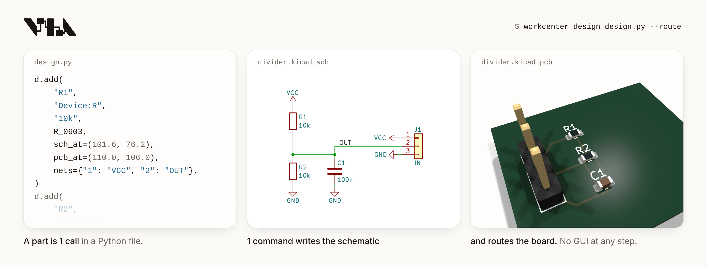
  </picture>
</a>

The fixture board `tests/boards/pass-first-design`: lines of its design
file, then the schematic and the routed board that `workcenter design`
writes from the file. The middle card shows the circuit's part of the
sheet.

2 runs of the gates, as the terminal printed them: that board, and a
fixture board with a clearance error on purpose.

```text
$ workcenter gates tests/boards/pass-first-design
PASS   erc        0 errors, 0 warnings  [0.41s]
PASS   drc        0 errors, 0 warnings (0 unconnected, 0 parity)  [0.75s]
PASS   sim        1 decks, 46 corner runs, 0 failures  [0.23s]
PASS   export     4/4 outputs, 22 gerber files  [1.6s]
GREEN: divider  report /home/user/via/tests/boards/pass-first-design/build/gates.json

$ workcenter gates tests/boards/fail-drc-clearance
PASS   erc        0 errors, 0 warnings  [0.27s]
FAIL   drc        1 errors, 1 warnings (0 unconnected, 0 parity)  [0.63s]
       - error: clearance: Clearance violation ( clearance 0.2000 mm; actual 0.0500 mm)
       - warning: track_dangling: Track has unconnected end
RED: rc_divider  report /home/user/via/tests/boards/fail-drc-clearance/build/gates.json
```

<table>
  <tr>
    <td width="50%">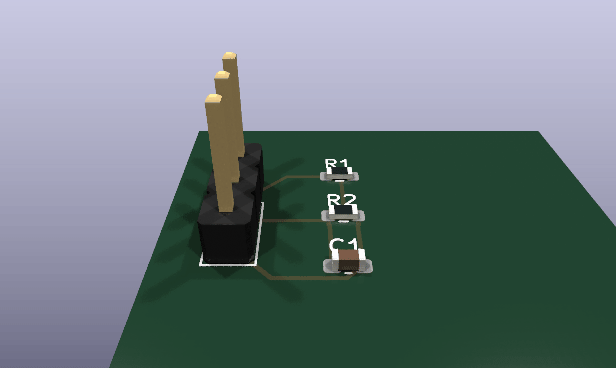</td>
    <td width="50%">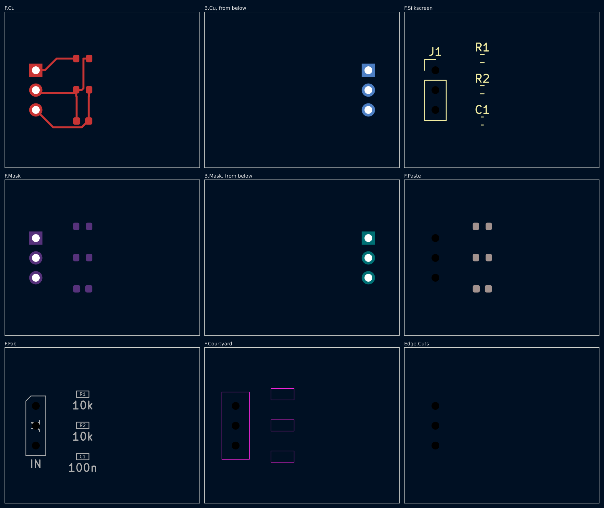</td>
  </tr>
  <tr>
    <td>The same board, turned. <code>workcenter render</code> draws it with <code>--views spin</code>.</td>
    <td>Each layer that holds something. <code>workcenter render</code> draws 1 picture for each and this sheet.</td>
  </tr>
</table>

The 3D views show the part bodies of KiCad's own library. `install.sh`
installs none of them, and without them the same command draws the bare
board. [site/media/README.md](site/media/README.md) has each picture, how
to fetch the 3 bodies, and the whole command that draws it.

## An example: Herald, a fire alarm communicator

<a href="examples/fire-alarm-communicator/v0.1/README.md">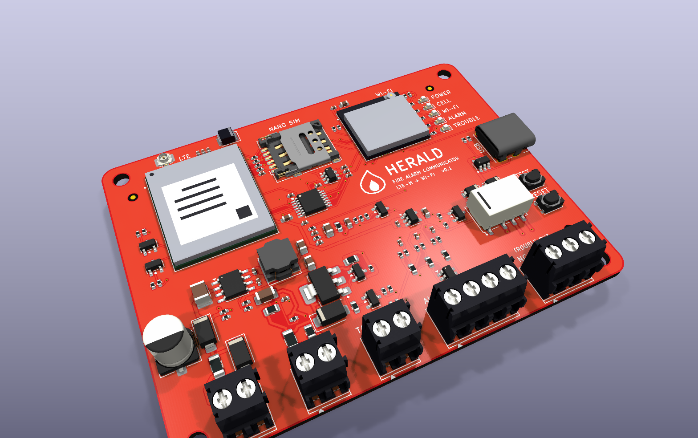</a>

[`examples/fire-alarm-communicator/v0.1`](examples/fire-alarm-communicator/v0.1/README.md) sits
beside a fire alarm panel and reports to a monitoring station over LTE-M, with Wi-Fi as the second
path. 84.4 x 64 mm, 4 layers, every part on the front, red with a white legend and black terminals.
It answers the panel's own phone dialer as if it were the line: a current-limited loop feed, dial
tone and the handshake from a PWM pin, and the panel's DTMF digits decoded in firmware with a
Goertzel filter. 3 supervised inputs read a closed contact, a whole loop and a cut wire apart at
every corner, and a fail-safe relay tells the panel when Herald itself fails.

## An example: Rosetta, a universal controller

<a href="examples/universal-controller/v0.2/README.md">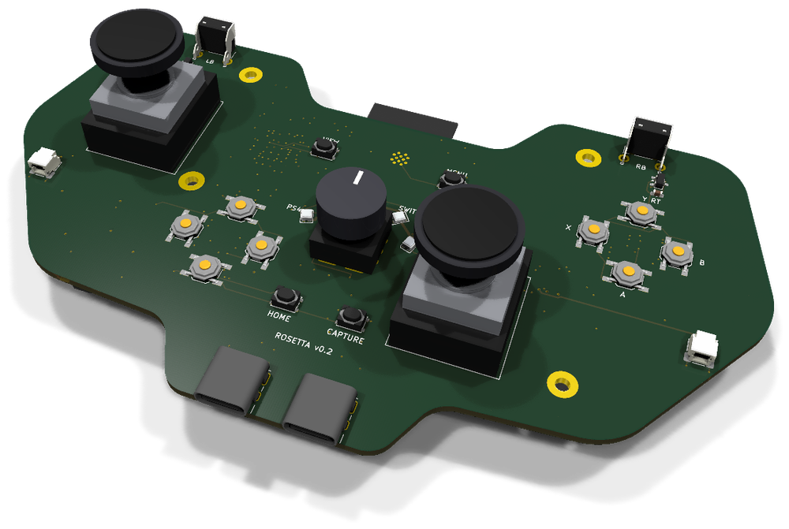</a>

[`examples/universal-controller/v0.2`](examples/universal-controller/v0.2/README.md) is a game
controller made with the workcenter: a 5-position knob picks a PS4, a PS5, an Xbox, a Switch or
Bluetooth. Its board is laid out like an Xbox 360 controller's, 148 x 82 mm, 6 layers, routed
and GREEN: thumbsticks soldered on (the footprint written from ALPS's drawing), Hall-effect
triggers on the shoulder horns, an RP2040 that runs a second USB port in software to relay a
console's signature to a licensed donor, an ESP32 whose antenna hangs past the dip between the
horns, and a knob read as 1 number whose 5 positions 6 decks prove never meet.

## An example: Signet, a mouse worn as a ring

<a href="examples/ring-mouse/README.md">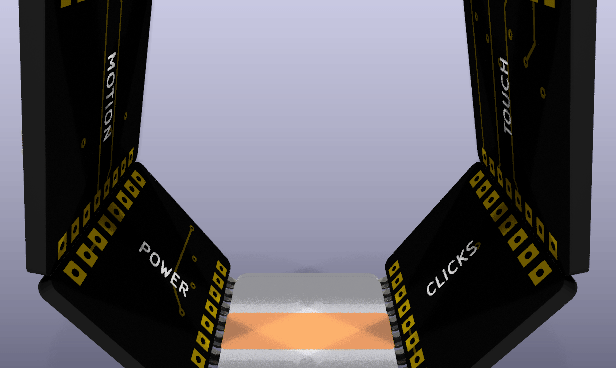</a>

[`examples/ring-mouse`](examples/ring-mouse/README.md) is a mouse you wear on the index finger, made
with the workcenter as a series of prototypes, a version per pass of a loop. Six 4-layer boards, 12
mm along the finger, sit on the faces of a hexagonal prism round it, each soldered to the next by 8
plated edge pads. The ring turns with the hand and the cursor follows its gyroscope; the thumb slides
along a 3-channel strip to scroll and presses the side to click. A Bluetooth LE module, a charger,
a 3.3 V rail and a 20 mAh cell ride on the other tiles, and every tile is GREEN.

## An example: Hush, a speaker that cancels noise

<table>
  <tr>
    <td width="50%"><a href="examples/anc-speaker/v0.1/README.md">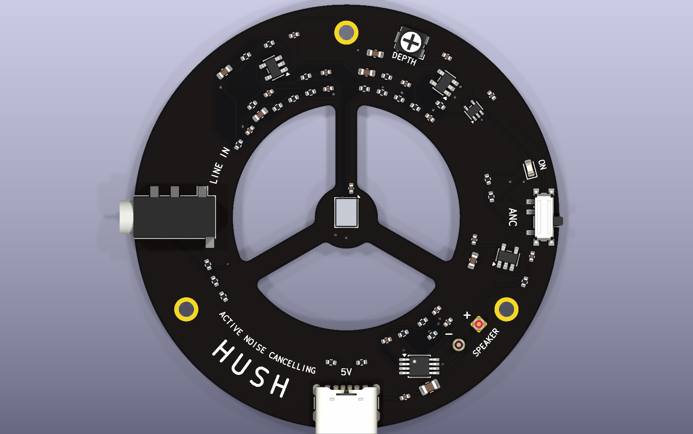</a></td>
    <td width="50%"><a href="examples/anc-speaker/v0.1/README.md">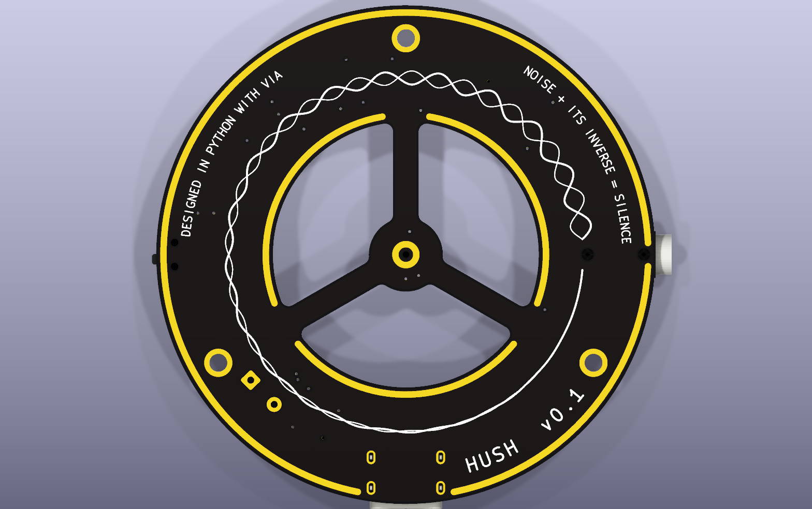</a></td>
  </tr>
</table>

[`examples/anc-speaker/v0.1`](examples/anc-speaker/v0.1/README.md) is a ring 62 mm across that
sits on the face of a 40 mm speaker. A microphone on its hub listens 4 mm in front of the cone, and
an analog feedback loop plays the inverse of what it hears: 7 decks hold 3 dB less noise at 50 Hz
and 12 dB from 200 to 300 Hz at every one of 986 corner runs, and take a 150 Hz hum 18.8 dB down
(13.4 dB at the worst corner). Music from a phone plays through the loop as its target. The back
draws the idea: the noise and its inverse, meeting as one line.

## An example: Wyvern, a Snapdragon development board

<a href="examples/snapdragon-dev-board/README.md">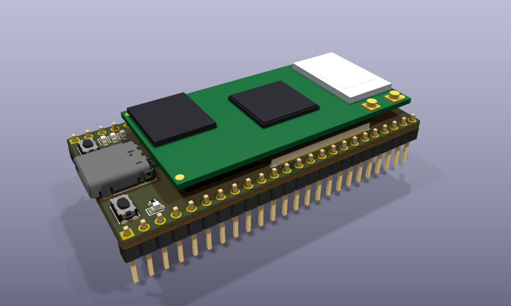</a>

[`examples/snapdragon-dev-board`](examples/snapdragon-dev-board/README.md) is a development board
with a Snapdragon on it, laid out like a Teensy and kept as version folders. v0.2 is one flat board,
76.2 x 53.34 mm, 6 layers, 2 rows of 30 pins: a Qualcomm QCS6490 on Vantron's VOSM6490 is soldered
straight on by its 662 pads, a land pattern generated from SGET's OSM standard. An RP2350 beside it
drives the pins at 3.3 V, and Linux flashes it over USB. A buck-boost holds the module's 5.0 V from
any USB-C cable, and an HD3SS3220 switches its USB 3 lane to the side the plug is on; the lane and
the converter's 0.25 mm power pads are drawn by hand in the design file.

## An example: Basalt, a microATX Threadripper board

<a href="examples/threadripper-matx/README.md">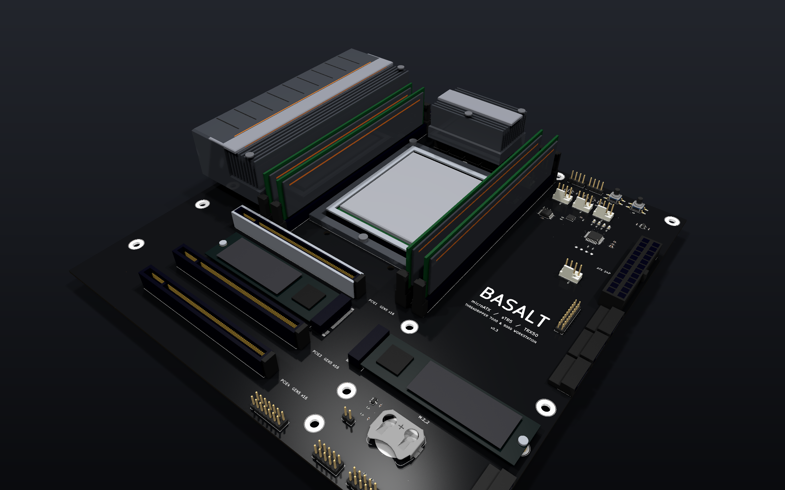</a>

[`examples/threadripper-matx`](examples/threadripper-matx/README.md) is a workstation motherboard
for an AMD Threadripper on sTR5, on a microATX board (244 x 244 mm), which no maker has built. It is
a prototype series built in a loop logged in its [`LOOP.md`](examples/threadripper-matx/LOOP.md),
one version a feature, each GREEN: v0.1 the floor plan, a 4844-land socket and 14 phases with every
supply in a pour; v0.2 the 4 DDR5 channels, 576 traces drawn by rule with 0 DRC errors on the first
run; v0.3 the ports and headers a desktop board carries, routed by the project's own grid router.
10 layers, black and silver.

## A chip: acc8, an 8-bit processor

Via also takes a chip from RTL to a GDSII mask layout: the drawing a
foundry etches from. The project is Verilog, benches, timing constraints
and `chip.json`. 10 gates run in order on open engines and the open
SkyWater 130 nm process, and stop at the first that does not pass.

<table>
  <tr>
    <td width="50%">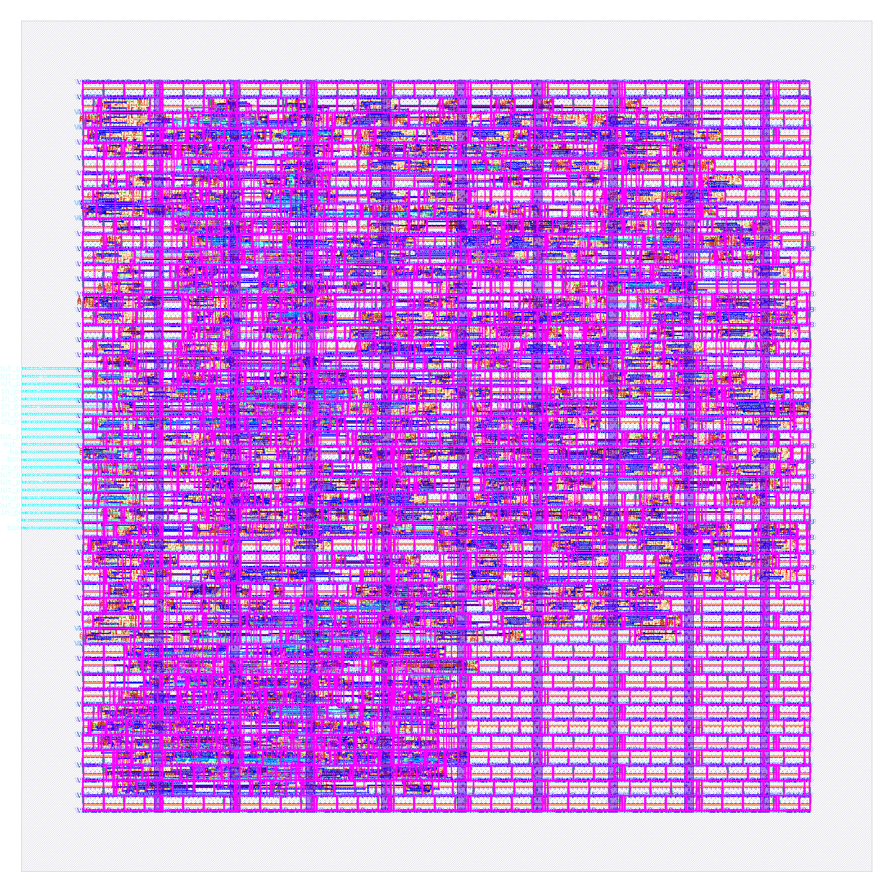</td>
    <td width="50%">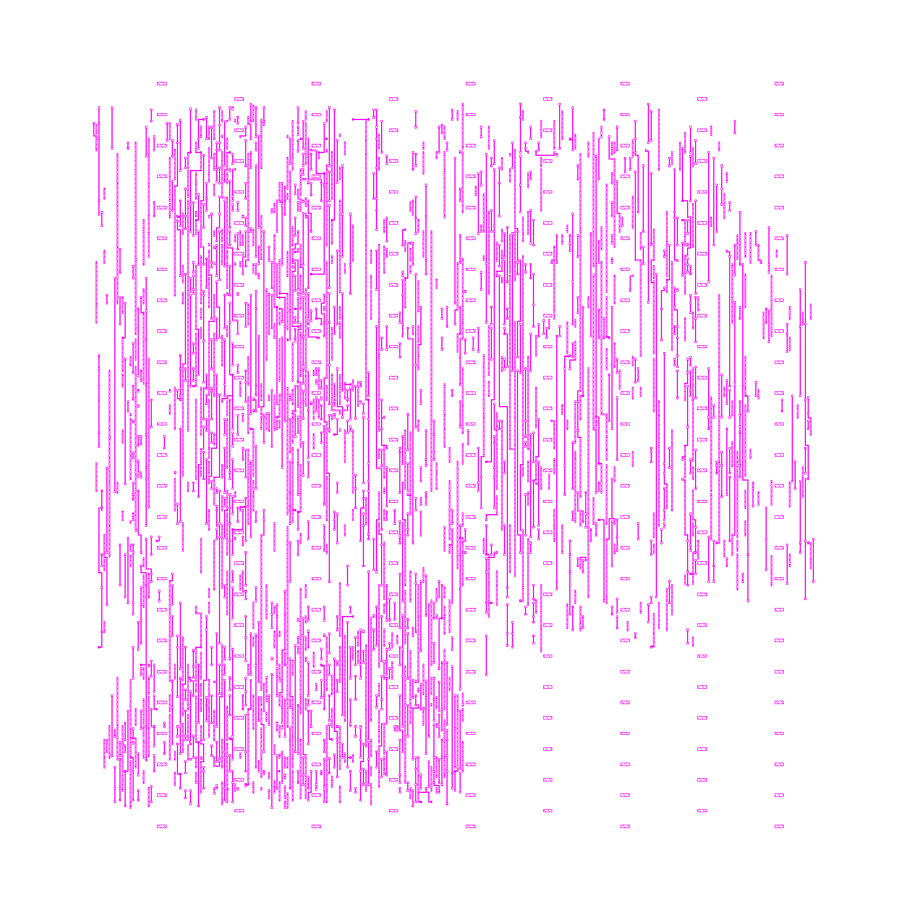</td>
  </tr>
  <tr>
    <td>The layout of <code>tests/chips/pass-acc8</code>, every layer: 760 cells on a die of 152.38 um by 152.38 um. <code>workcenter chip render</code> draws it.</td>
    <td>The second metal layer alone. The command draws 1 picture for each routing layer.</td>
  </tr>
</table>

acc8 is an accumulator processor with 16 opcodes and 4 programs in its
ROM. 5 benches make 1098 checks on the RTL, 4 of them again on the
routed netlist. The run, as the terminal printed it:

```text
$ workcenter chip gates tests/chips/pass-acc8 --strict
PASS   lint       4 RTL files, top acc8, 0 failures  [0.19s]
PASS   sim        5 benches, 1098 checks, 18 of 18 changes of the RTL caught, 0 failures  [0.74s]
PASS   synth      760 cells, 132 flops, 8530.7 um2, the mapping removed 24 flops that nothing reads (--json names each), 0 failures  [1.84s]
PASS   layout     8379.29 um2 of cells, utilisation 0.493, 0 failures  [194.64s]
PASS   sta        15 corners, least setup slack 25.1717 ns at max_ss_n40C_1v60, least hold slack 0.2974 ns at min_ff_n40C_1v95, 0 failures  [4.56s]
PASS   glsim      4 benches on the final netlist, 1 on the RTL only, 0 failures  [0.51s]
PASS   drc        2 decks: magic 0, klayout-mr 0, 0 failures  [15.16s]
PASS   antenna    the routed database, 0 failures  [0.31s]
PASS   lvs        the layout against the netlist with its supply pins: 792 devices against 792, 0 failures  [2.82s]
PASS   export     22 files, 20 reports and manifest.json in chip/tapeout, 0 failures  [0.37s]
scope: open engines, sky130A 1.0.470-0-g6d4d117, decks: magic (community), klayout-mr (community), corners: max_ss_n40C_1v60, max_ss_100C_1v60, max_ff_n40C_1v95, max_ff_100C_1v95, max_tt_025C_1v80, min_ss_n40C_1v60, min_ss_100C_1v60, min_ff_n40C_1v95, min_ff_100C_1v95, min_tt_025C_1v80, nom_ss_n40C_1v60, nom_ss_100C_1v60, nom_ff_n40C_1v95, nom_ff_100C_1v95, nom_tt_025C_1v80; no foundry deck ran; no shuttle's limits were checked
GREEN: pass-acc8  report /home/user/via/tests/chips/pass-acc8/build/gates.json
```

| Gate | What it holds |
|---|---|
| LINT, SIM | The RTL reads the same to a simulator and to a synthesizer. Every bench passes, and every listed change of the RTL fails a bench: a bench that passes on a wrong design proves nothing. |
| SYNTH, LAYOUT | The RTL maps onto the library's cells, with a reset on every flop. The cells are placed and routed with no violation. |
| STA, GLSIM | Timing holds at every corner of temperature and supply the project names, with the routed wires. The benches pass again on the routed netlist. |
| DRC, ANTENNA, LVS | The layout breaks no rule of 2 decks, no wire collects too much charge, and the layout is the netlist, device by device. |
| EXPORT | The layout is handed out only when each of the 9 gates passed on the files as they are now. |

The line before the verdict is the scope of the run. GREEN says that the
open engines found no fault in these files. It does not say that a foundry
accepts the layout or that the silicon works: no foundry deck runs here.

The engines install on request: `sudo ./install.sh --chip`.
`workcenter chip init <dir> --top <module>` starts a project, and
`workcenter next <dir>` names each step from there.
[`.claude/skills/chip-design/SKILL.md`](.claude/skills/chip-design/SKILL.md)
has the procedure, and [`tests/chips/README.md`](tests/chips/README.md)
the 9 fixture chips.

## What it does

| Part | In short |
|---|---|
| **Engines** | KiCad 10 (`kicad-cli`), ngspice, FreeRouting. |
| **Gates** | ERC, DRC, SIM, EXPORT, in that order. A board is done when `workcenter gates <project>` prints GREEN. |
| **Design as code** | `workcenter design design.py --route` builds a schematic and a routed board from a Python file that names parts from the KiCad libraries. No GUI at any step. |
| **A schematic that simulates** | The design file says how each part simulates (`d.sim`, `d.no_sim`), and the schematic KiCad opens exports a netlist ngspice runs. A pin map KiCad would complete by position is refused first. |
| **Decks** | The SIM gate runs the decks under `sim/` and holds each measured value to its bound. A deck is a file of its own. Nothing holds a deck typed by hand to the schematic's parts yet: the roadmap names that gap. |
| **Corners** | The SIM gate runs every deck at each temperature the project names and with each part at each end of its tolerance. It runs every combination of those ends up to 64 runs, and a worst case for each bound above that. It also runs the Monte Carlo draws the project names. A bound holds at every corner or it does not hold. |
| **Frequency plan** | The SIM gate holds every switching frequency and its harmonics against every resonance a deck measured. |
| **The next step** | `workcenter next <project>` names the one step that is left, its command, and the fix for the first failure. A person or an agent of any size follows the same path. |
| **Skills** | Procedures for each kind of step, as Markdown files. |
| **Fixture boards** | The tests. Each passes everything or fails 1 named gate. |

## How it works

<picture>
  <source media="(prefers-color-scheme: dark)" srcset="site/media/diagram-dark.png">
  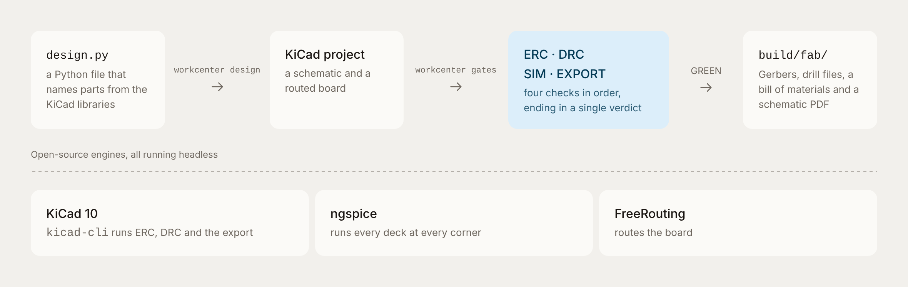
</picture>

A design file becomes a KiCad project. The 4 gates judge the project in
order and stop at the first red. The last line of a run is the verdict:
GREEN, RED or SKIPPED. The fabrication outputs of a GREEN board are in
`build/fab/`.

## Quick start

```sh
sudo ./install.sh     # Ubuntu 24.04: KiCad 10, ngspice, Java 21, FreeRouting
workcenter doctor     # each engine's status; ok when nothing is absent
workcenter gates tests/boards/pass-first-design     # GREEN
workcenter gates tests/boards/fail-drc-clearance    # red at DRC, on purpose
workcenter next tests/boards/fail-drc-clearance     # the one next step: the fix
workcenter sim tests/boards/fail-sim-corner         # red at its corners, on purpose
workcenter sim tests/boards/fail-freq-overlap       # red on the frequency plan
```

Output goes to `<project>/build/`: `erc.json`, `drc.json`, `sim/`,
`fab/` (gerbers, drill, BOM, schematic PDF), `gates.json`.

A first board starts from a copy of the template's design file, in a
folder of its own outside this checkout:

```sh
mkdir ~/divider
cp templates/project/design.py ~/divider/
workcenter design ~/divider/design.py --route    # the KiCad project, routed
workcenter gates ~/divider --strict              # GREEN, and SIM has no deck to run yet
```

[`.claude/skills/board-design/SKILL.md`](.claude/skills/board-design/SKILL.md)
has the procedure from a spec to a GREEN board.

## Commands

`workcenter --help` describes each command, and
`workcenter <command> --help` lists its flags.
[`ee-agent-kit/docs/CONFIGURATION.md`](ee-agent-kit/docs/CONFIGURATION.md)
has every flag.

<details>
<summary>The 25 commands</summary>

| Command | What |
|---|---|
| `doctor` | Report each engine's status. |
| `next` | Name the one next step for a project. |
| `chip` | A chip project, from RTL to a GDSII layout: `chip init`, `chip gates`, 1 command for each of its 10 gates, and `chip render` for a picture of the layout. Tests hold all 10 gates. The acceptance design, an 8-bit processor of 760 cells on the sky130A process, is GREEN with `--strict` in under 4 minutes. |
| `design` | Build a design file into a KiCad project; `--route` routes it; `--check` compares. |
| `erc`, `drc`, `sim`, `export` | One gate, alone. |
| `gates` | The 4 gates in order; the last line is the verdict. |
| `verify` | Check a verification package against a fresh run; say whether the requirements are met. |
| `autoroute` | Write FreeRouting's session file for a hand-drawn board's DSN. The import into KiCad is by hand. |
| `inspect` | Read a routed board: `map`, `list`, `probe`, `net`, `islands`, `resistance`, `crossed`. |
| `placement` | Run a kistack placement check on a board. |
| `render`, `pictures` | Images of the schematic, the board, every layer; turning GIFs; assembly scenes. |
| `procure`, `costs` | Price a board's parts; price every board of every version. |
| `sources`, `fetch`, `curve` | Check each part's datasheet and model; fetch one; read a curve from a PDF. |
| `mutate` | Prove a firmware's host tests can fail. |
| `ci` | Replay a repository's GitHub workflow here. |
| `docs`, `version`, `diagram` | A version's contents page and datasheets; a new version folder; a block diagram. |

</details>

## Where it runs

**A Claude Code cloud environment.** The environment carries the
software; the project's repository carries the board. Create an environment
whose setup script is the 3 lines in
[`environment/setup.sh`](environment/setup.sh), with the network hosts from
[`environment/README.md`](environment/README.md). Open any project's
repository in it. Attach this repository as a second repository when its
skills should load.

**Another agent host.** `AGENTS.md` at the root is the entry for a host
that does not read `CLAUDE.md`; the 2 files are the same text. Every
procedure is a Markdown file under `.claude/skills/`, and every check is a
command. `workcenter next <project>` gives the step, and `make verify`
the repository's health.

**A Docker image.** `docker build -t ee-workcenter .` builds on the
official `kicad/kicad:10.0` base. `release.yml` publishes the image to
GHCR on a version tag (`v*.*.*`). No tag exists yet, and the build has
not run.

## The website

`site/` is the project's website: 1 static page with real runs of the
commands and the board above. It is live at <https://via-kappa-five.vercel.app>.
`python3 -m http.server 8000 --directory site` serves it at
http://localhost:8000. Vercel deploys a push that changes `site/`: `main`
to production, any other branch to a preview.
[`site/README.md`](site/README.md) has the commands, the files and how the
images are drawn.

## Repository map

<details>
<summary>Each path and what it holds</summary>

| Path | What |
|---|---|
| `install.sh` | The only source of the toolchain. |
| `Makefile`, `verify/verify.sh` | `make verify`: the repository's health gate, one command. |
| `tools/workcenter` | The CLI and the gates. Standard library only. |
| `tools/kicadgen.py` | Design a board in Python from the KiCad libraries; writes the KiCad project and routes it headless. |
| `tools/simcorners.py`, `tools/freqplan.py` | The corners a deck runs at; the frequency plan. Read by the SIM gate. |
| `tools/guide.py` | `workcenter next`: the one next step and the fix for each kind of failure. |
| `tools/chipflow.py` | `workcenter chip`: what the chip gates share. It reads `chip.json`, the constraints and a process table, selects the timing corners, starts the engines and drives the gates to a verdict. |
| `tools/chipfront.py`, `tools/chipback.py`, `tools/chipscripts/` | The chip gates LINT, SIM, SYNTH and GLSIM; the chip gates LAYOUT, STA, DRC, ANTENNA, LVS and EXPORT; the engine scripts the chip gates run. |
| `tools/chipguide.py` | `workcenter next` for a chip project: the one next step, from `chip.json` to a GREEN layout. |
| `tools/inspect_board.py`, `tools/stretch.py` | Read a routed board with KiCad's geometry; grow a design at a cut. |
| `tools/doctools.py`, `tools/scene.py`, `tools/wrlgen.py` | Document commands; assembly scenes; 3D bodies. |
| `tools/pdfcurve.py`, `tools/kistack_board.py` | A PDF page's vector paths; the board reader kistack's checks run on. |
| `tools/hooks/` | Claude Code hooks: no `cd` in a command, no test written by a script. |
| `WORKCENTER.md` | The contract a project gets from this workcenter. |
| `AGENTS.md`, `CLAUDE.md` | Where an agent starts. The same text. |
| `.claude/skills/` | `attached-repos`, `autoroute`, `blog-post`, `board-design`, `board-gates`, `chip-design`, `chip-gates`, `kistack`, `procurement`, `simulate`, `verification`. |
| `templates/` | A first design file, a version's README and gates report, `corners.json`, `frequency-plan.json`, the verification package. |
| `rules/` | A fabrication house's limits as KiCad design rules. One house so far. |
| `tests/` | The tests of the tools. `tests/boards/` holds the fixture boards and what each proves. |
| `examples/` | Example projects made with the workcenter, each in version folders with its own README. |
| `third_party/kistack/` | The vendored kistack skills. |
| `environment/` | Cloud environment setup script and hosts. |
| `Dockerfile`, `.github/workflows/` | The image. CI on each pull request and push to `main`, a nightly run, the release, stale issues. |
| `requirements.txt`, `pyproject.toml` | The venv's packages for tests and lint; the settings of ruff and pytest. |
| `site/` | The website: 1 static page, its stylesheet, the Open Graph image. `site/media/` holds this file's pictures. |
| `ee-agent-kit/` | How work on this repository is run. Start at `ee-agent-kit/ROUTING.md`. |

</details>

## Working on this repository

`make verify` must be green before any push.
[`ee-agent-kit/AGENTS.md`](ee-agent-kit/AGENTS.md) is binding;
[`ee-agent-kit/ROADMAP.md`](ee-agent-kit/ROADMAP.md) decides what gets built.
[`ee-agent-kit/CONTRIBUTING.md`](ee-agent-kit/CONTRIBUTING.md) has the rules
for a pull request. [`ee-agent-kit/SECURITY.md`](ee-agent-kit/SECURITY.md)
says how to report a vulnerability.

## Where things stand

[`ee-agent-kit/STATUS.md`](ee-agent-kit/STATUS.md) has each area's state
with its evidence. In short: the gates, the corners, the frequency plan and `workcenter next`
run on the fixture boards in `make verify`. Via has no release yet. The
cloud setup script and the Docker build have not run yet.

## License

MIT; see [LICENSE](LICENSE). KiCad, ngspice, and FreeRouting keep their
own licenses. Inter, the website's font, is under the SIL Open Font
License: [site/fonts/LICENSE](site/fonts/LICENSE).
