# Via

[](https://github.com/ThyFriendlyFox/via/actions/workflows/ci.yml)
[](LICENSE)

[Website](https://via.computer) · [Contract](WORKCENTER.md) · [Status](ee-agent-kit/STATUS.md) · [Roadmap](ee-agent-kit/ROADMAP.md)

Via is the EE Workcenter. A workcenter is a set of tools, skills and gates
that an agent steps into to do one kind of work well. This one does
electronics: it turns a KiCad 10 project into fabrication outputs that
passed every gate.

A new board starts with 2 commands. `workcenter new <dir>` writes the
project: a design file to edit, from the template. `workcenter next <dir>`
then names each step, 1 at a time, until the board is GREEN.

<a href="https://via.computer">
  <picture>
    <source media="(prefers-color-scheme: dark)" srcset="site/media/hero-dark.png">
    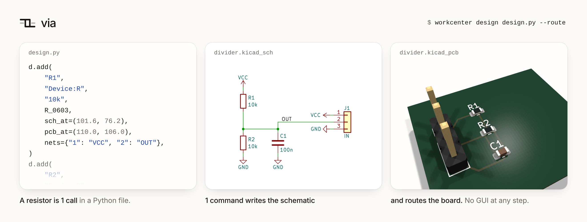
  </picture>
</a>

The fixture board `tests/boards/pass-first-design`: lines of its design
file, then the schematic and the routed board that `workcenter design`
writes from the file. The middle card shows the circuit's part of the
sheet.

2 runs of the gates, as the terminal printed them: that board, and a
fixture board with a clearance error on purpose.

```text
$ workcenter gates tests/boards/pass-first-design
PASS   erc        0 errors, 0 warnings  [0.25s]
PASS   drc        0 errors, 0 warnings (0 unconnected, 0 parity), legend (no fab named: held to the least of the 4 fabs the workcenter knows (height pcbway-standard, stroke oshpark-2layer)): 0 fail, 0 not judged  [0.8s]
PASS   sim        1 decks, 46 corner runs, 0 failures  [0.16s]
PASS   export     7/7 outputs, 22 gerber files, 3 files read back  [2.09s]
thermal: no part's junction is judged: sim/thermal.json is not there, and the gate judges only the parts it names (the simulate skill, A part's temperature)
RATINGS not asked for: no ratings.json beside the schematic
GREEN: divider  report /home/user/via/tests/boards/pass-first-design/build/gates.json

$ workcenter gates tests/boards/fail-drc-clearance
PASS   erc        0 errors, 0 warnings  [0.3s]
FAIL   drc        1 errors, 1 warnings (0 unconnected, 0 parity), legend (no fab named: held to the least of the 4 fabs the workcenter knows (height pcbway-standard, stroke oshpark-2layer)): 0 fail, 0 not judged  [0.83s]
       - error: clearance: Clearance violation ( clearance 0.2000 mm; actual 0.0500 mm)
       - warning: track_dangling: Track has unconnected end
RATINGS not asked for: no ratings.json beside the schematic
RED: rc_divider  report /home/user/via/tests/boards/fail-drc-clearance/build/gates.json
```

<table>
  <tr>
    <td width="50%">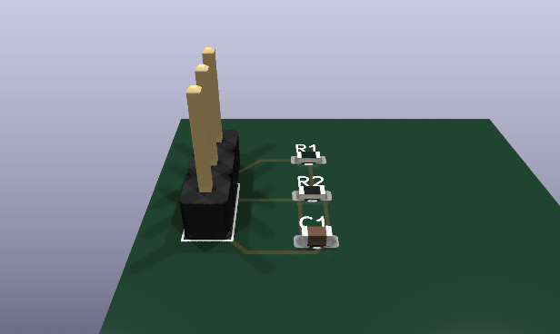</td>
    <td width="50%">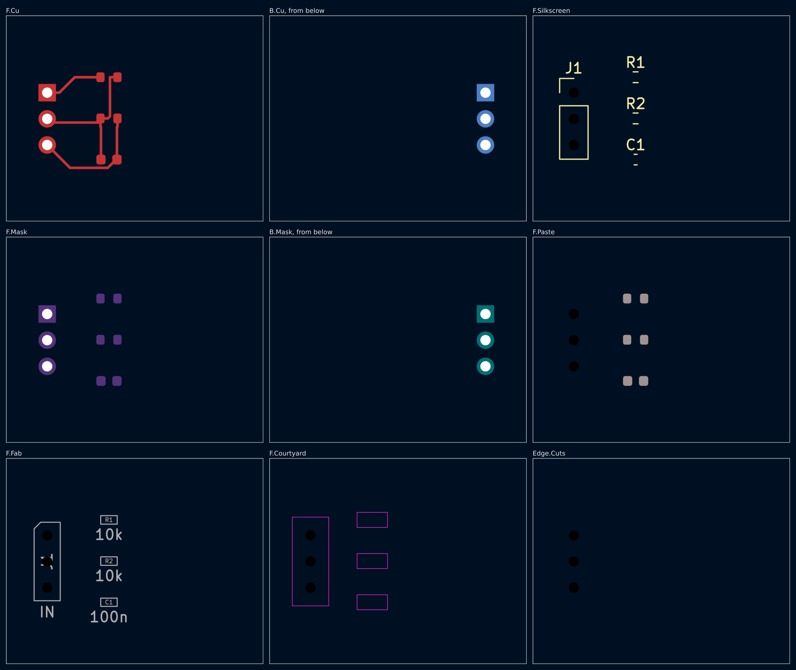</td>
  </tr>
  <tr>
    <td>The same board, turned. <code>workcenter render</code> draws it with <code>--views spin</code>.</td>
    <td>Each layer that holds something. <code>workcenter render</code> draws 1 picture for each and this sheet.</td>
  </tr>
</table>

The 3D views show the part bodies of KiCad's own library. `install.sh`
installs none of them, and without them the same command draws the bare
board. [site/media/README.md](site/media/README.md) has each picture, how
to fetch the 3 bodies, and the whole command that draws it.

## An example: Herald, a fire alarm communicator

<a href="examples/fire-alarm-communicator/v0.1/README.md">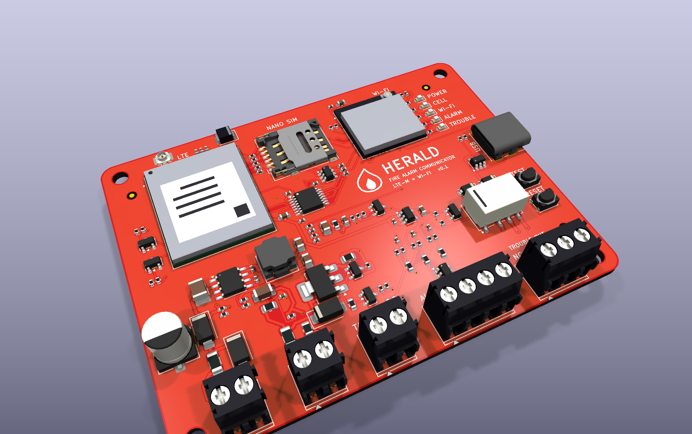</a>

[`examples/fire-alarm-communicator/v0.1`](examples/fire-alarm-communicator/v0.1/README.md) sits
beside a fire alarm panel and reports to a monitoring station over LTE-M, with Wi-Fi as the second
path. 84.4 x 64 mm, 4 layers, every part on the front, red with a white legend and black terminals.
It answers the panel's own phone dialer as if it were the line: a current-limited loop feed, dial
tone and the handshake from a PWM pin, and the panel's DTMF digits decoded in firmware with a
Goertzel filter. 3 supervised inputs read a closed contact, a whole loop and a cut wire apart at
every corner, and a fail-safe relay tells the panel when Herald itself fails.

## An example: Rosetta, a universal controller

<a href="examples/universal-controller/v0.3/README.md">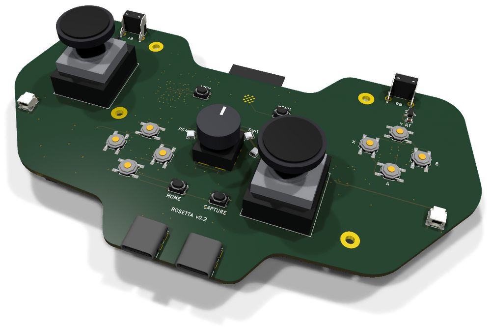</a>

[`examples/universal-controller/v0.3`](examples/universal-controller/v0.3/README.md) is a wireless game
controller made with the workcenter: a 5-position knob picks a PS4, a PS5, an Xbox, a Switch or
Bluetooth. Its board is laid out like an Xbox 360 controller's, 148 x 82 mm, 6 layers, routed
and GREEN: thumbsticks soldered on (the footprint written from ALPS's drawing), each in a ring of 8
RGB LEDs; Hall-effect triggers on the shoulder horns; an OLED screen under the dip; 2 back buttons
that set any button to rapid, staggered, burst or pulsed turbo; a cell charged at up to 2.5 A from
USB-C, with a fuel gauge, a buck-boost to 3.3 V, and a power path that runs it as a wired controller
when the cell is flat. An RP2040 runs a second USB port in software to relay a console's signature
to a licensed donor, an ESP32's antenna hangs past the dip between the horns, and 6 decks prove the
knob's 5 positions never meet.

## An example: Signet, a mouse worn as a ring

<a href="examples/ring-mouse/README.md">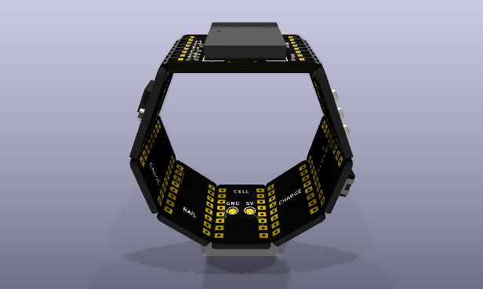</a>

[`examples/ring-mouse`](examples/ring-mouse/README.md) is a mouse you wear on the index finger, made
with the workcenter as a series of prototypes, a version per pass of a loop. Eight 4-layer boards,
12 mm along the finger, sit on the faces of an octagonal prism round it, each soldered to the next by
8 plated edge pads. The ring turns with the hand and the cursor follows its gyroscope; the thumb slides
along a 3-channel strip to scroll and presses the side to click. A Bluetooth LE module, a charger,
a 3.3 V rail and a 20 mAh cell ride on the other tiles, and every tile is GREEN.

## An example: Hush, a speaker that cancels noise

<table>
  <tr>
    <td width="50%"><a href="examples/anc-speaker/v0.1/README.md">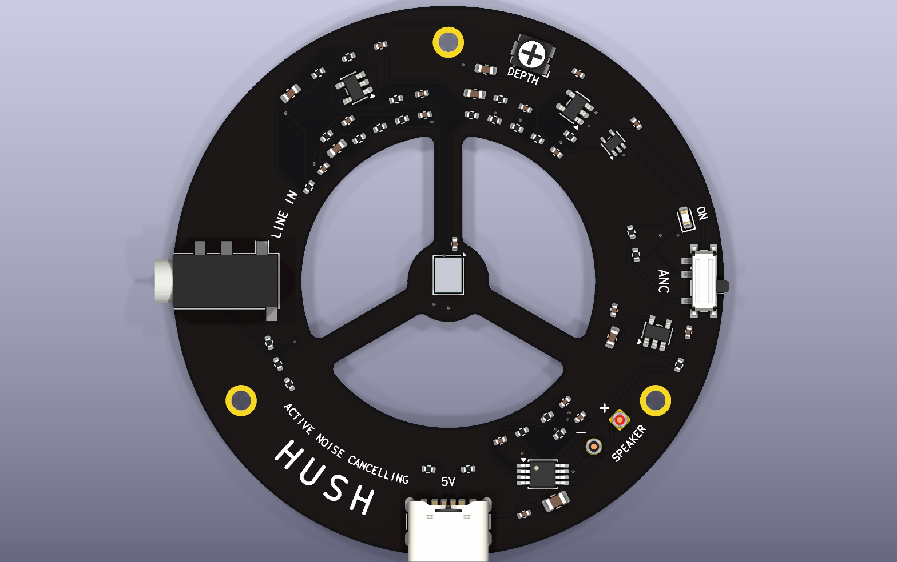</a></td>
    <td width="50%"><a href="examples/anc-speaker/v0.1/README.md">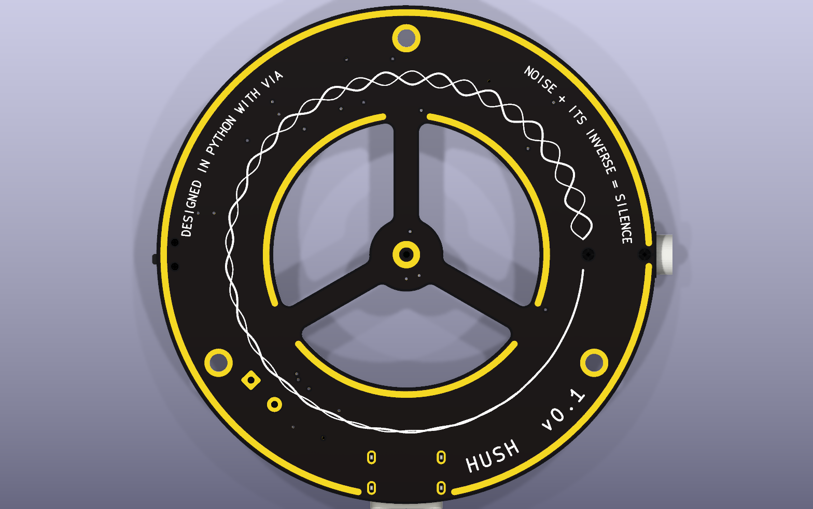</a></td>
  </tr>
</table>

[`examples/anc-speaker/v0.1`](examples/anc-speaker/v0.1/README.md) is a ring 62 mm across that
sits on the face of a 40 mm speaker. A microphone on its hub listens 4 mm in front of the cone, and
an analog feedback loop plays the inverse of what it hears: 7 decks hold 3 dB less noise at 50 Hz
and 12 dB from 200 to 300 Hz at every one of 986 corner runs, and take a 150 Hz hum 18.8 dB down
(13.4 dB at the worst corner). Music from a phone plays through the loop as its target. The back
draws the idea: the noise and its inverse, meeting as one line.

## An example: Wyvern, a Snapdragon development board

<a href="examples/snapdragon-dev-board/README.md">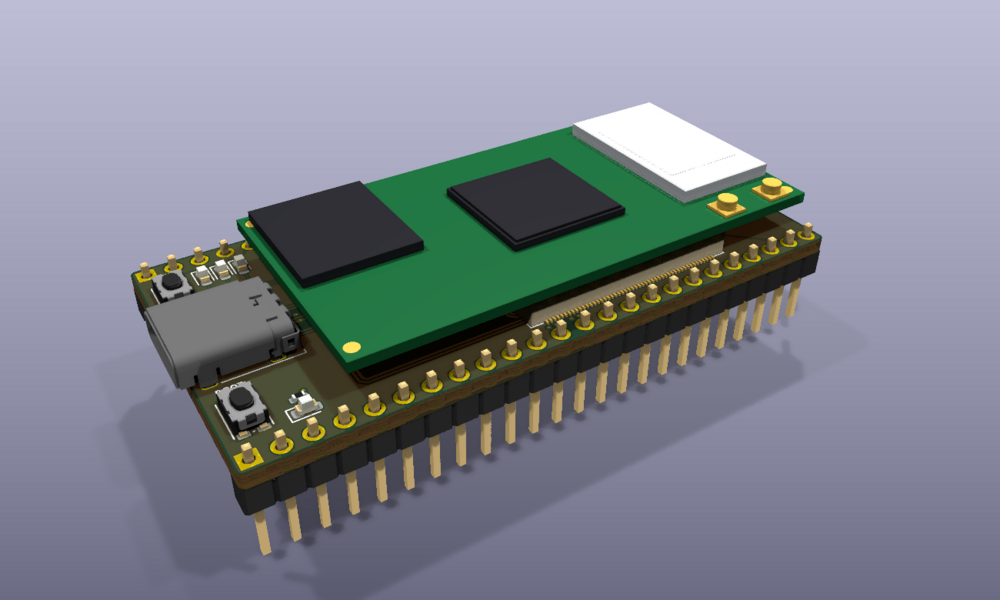</a>

[`examples/snapdragon-dev-board`](examples/snapdragon-dev-board/README.md) is a development board
with a Snapdragon on it, laid out like a Teensy and kept as version folders. v0.2 is one flat board,
76.2 x 53.34 mm, 6 layers, 2 rows of 30 pins: a Qualcomm QCS6490 on Vantron's VOSM6490 is soldered
straight on by its 662 pads, a land pattern generated from SGET's OSM standard. An RP2350 beside it
drives the pins at 3.3 V, and Linux flashes it over USB. A buck-boost holds the module's 5.0 V from
any USB-C cable, and an HD3SS3220 switches its USB 3 lane to the side the plug is on; the lane and
the converter's 0.25 mm power pads are drawn by hand in the design file.

## An example: Basalt, a microATX Threadripper board

<a href="examples/threadripper-matx/README.md">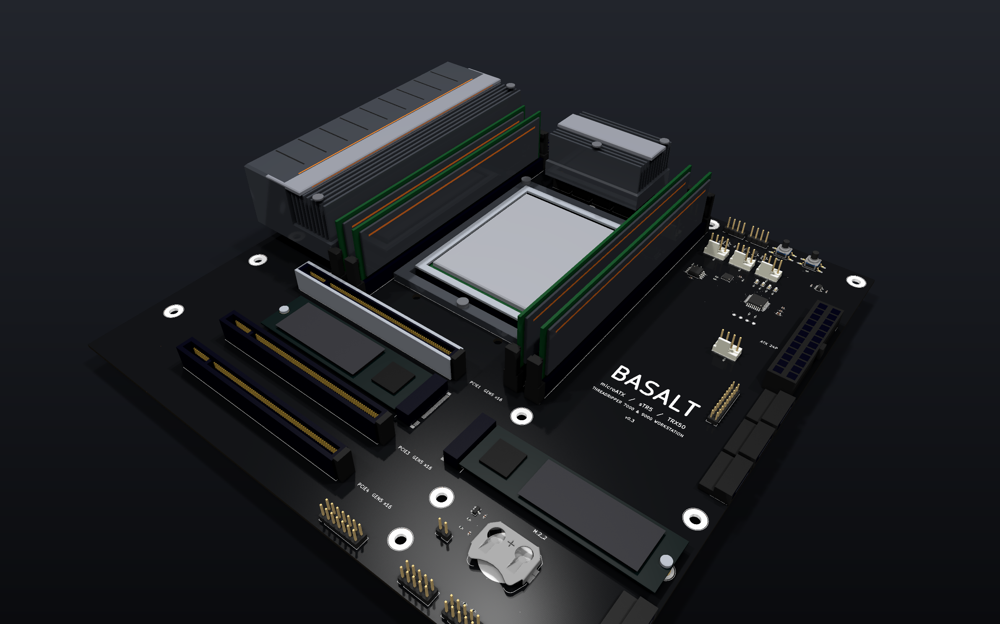</a>

[`examples/threadripper-matx`](examples/threadripper-matx/README.md) is a workstation motherboard
for an AMD Threadripper on sTR5, on a microATX board (244 x 244 mm), which no maker has built. It is
a prototype series built in a loop logged in its [`LOOP.md`](examples/threadripper-matx/LOOP.md),
one version a feature, each GREEN: v0.1 the floor plan, a 4844-land socket and 14 phases with every
supply in a pour; v0.2 the 4 DDR5 channels, 576 traces drawn by rule with 0 DRC errors on the first
run; v0.3 the ports and headers a desktop board carries, routed by the project's own grid router.
10 layers, black and silver.

## A chip: acc8, an 8-bit processor

Via also takes a chip from RTL to a GDSII mask layout: the drawing a
foundry etches from. The project is Verilog, benches, timing constraints
and `chip.json`. 10 gates run in order on open engines and the open
SkyWater 130 nm process, and stop at the first that does not pass.

<table>
  <tr>
    <td width="50%">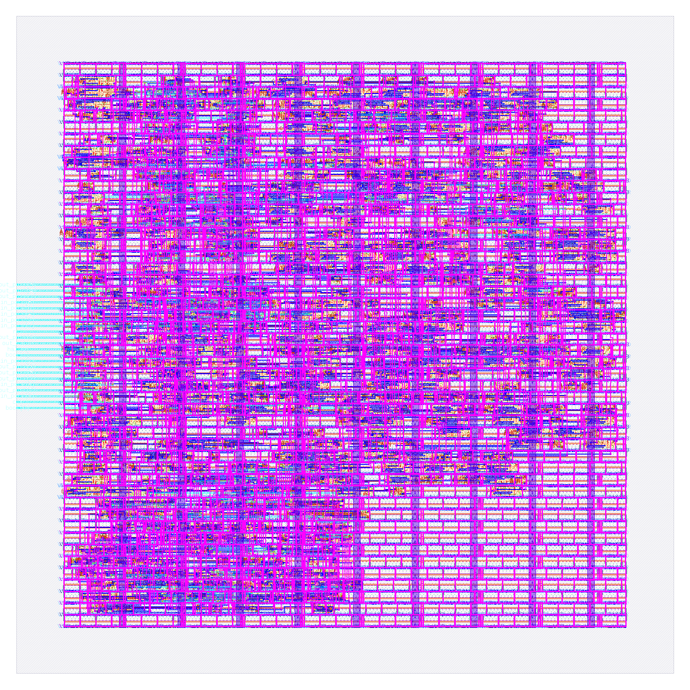</td>
    <td width="50%">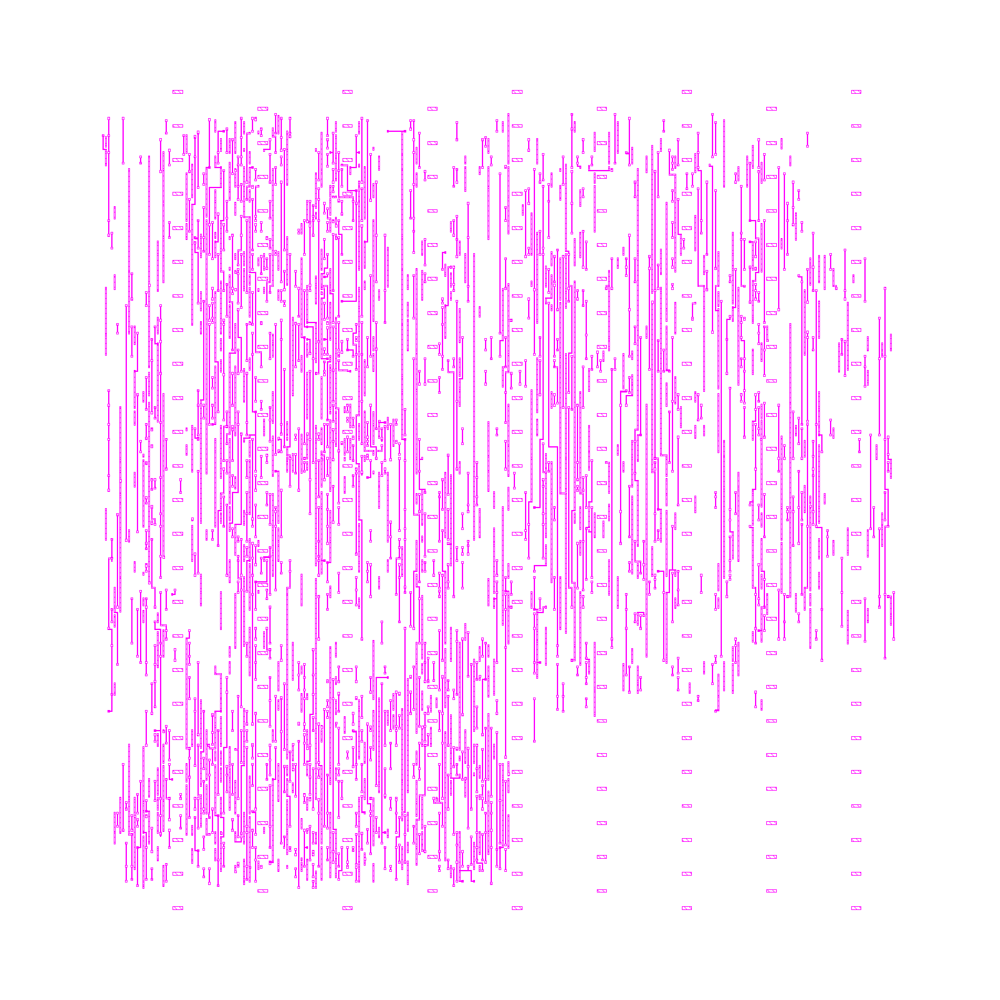</td>
  </tr>
  <tr>
    <td>The layout of <code>tests/chips/pass-acc8</code>, every layer: 760 cells on a die of 152.38 um by 152.38 um. <code>workcenter chip render</code> draws it.</td>
    <td>The second metal layer alone. The command draws 1 picture for each routing layer.</td>
  </tr>
</table>

acc8 is an accumulator processor with 16 opcodes and 4 programs in its
ROM. 5 benches make 1098 checks on the RTL, 4 of them again on the
routed netlist. The run, as the terminal printed it:

```text
$ workcenter chip gates tests/chips/pass-acc8 --strict
PASS   lint       4 RTL files, top acc8, 0 failures  [0.19s]
PASS   sim        5 benches, 1098 checks, 18 of 18 changes of the RTL caught, 0 failures  [0.74s]
PASS   synth      760 cells, 132 flops, 8530.7 um2, the mapping removed 24 flops that nothing reads (--json names each), 0 failures  [1.84s]
PASS   layout     8379.29 um2 of cells, utilisation 0.493, 0 failures  [194.64s]
PASS   sta        15 corners, least setup slack 25.1717 ns at max_ss_n40C_1v60, least hold slack 0.2974 ns at min_ff_n40C_1v95, 0 failures  [4.56s]
PASS   glsim      4 benches on the final netlist, 1 on the RTL only, 0 failures  [0.51s]
PASS   drc        2 decks: magic 0, klayout-mr 0, 0 failures  [15.16s]
PASS   antenna    the routed database, 0 failures  [0.31s]
PASS   lvs        the layout against the netlist with its supply pins: 792 devices against 792, 0 failures  [2.82s]
PASS   export     22 files, 20 reports and manifest.json in chip/tapeout, 0 failures  [0.37s]
scope: open engines, sky130A 1.0.470-0-g6d4d117, decks: magic (community), klayout-mr (community), corners: max_ss_n40C_1v60, max_ss_100C_1v60, max_ff_n40C_1v95, max_ff_100C_1v95, max_tt_025C_1v80, min_ss_n40C_1v60, min_ss_100C_1v60, min_ff_n40C_1v95, min_ff_100C_1v95, min_tt_025C_1v80, nom_ss_n40C_1v60, nom_ss_100C_1v60, nom_ff_n40C_1v95, nom_ff_100C_1v95, nom_tt_025C_1v80; no foundry deck ran; no shuttle's limits were checked
GREEN: pass-acc8  report /home/user/via/tests/chips/pass-acc8/build/gates.json
```

| Gate | What it holds |
|---|---|
| LINT, SIM | The RTL reads the same to a simulator and to a synthesizer. Every bench passes, and every listed change of the RTL fails a bench: a bench that passes on a wrong design proves nothing. |
| SYNTH, LAYOUT | The RTL maps onto the library's cells, with a reset on every flop. The cells are placed and routed with no violation. |
| STA, GLSIM | Timing holds at every corner of temperature and supply the project names, with the routed wires. The benches pass again on the routed netlist. |
| DRC, ANTENNA, LVS | The layout breaks no rule of 2 decks, no wire collects too much charge, and the layout is the netlist, device by device. |
| EXPORT | The layout is handed out only when each of the 9 gates passed on the files as they are now. |

The line before the verdict is the scope of the run. GREEN says that the
open engines found no fault in these files. It does not say that a foundry
accepts the layout or that the silicon works: no foundry deck runs here.

The engines install on request: `sudo ./install.sh --chip`.
`workcenter chip init <dir> --top <module>` starts a project, and
`workcenter next <dir>` names each step from there.
[`.claude/skills/chip-design/SKILL.md`](.claude/skills/chip-design/SKILL.md)
has the procedure, and [`tests/chips/README.md`](tests/chips/README.md)
the 9 fixture chips.

## What it does

| Part | In short |
|---|---|
| **Engines** | KiCad 10 (`kicad-cli`), ngspice, FreeRouting. |
| **Gates** | ERC, DRC, SIM, EXPORT, in that order. A board is done when `workcenter gates <project> --strict` prints GREEN; with a `ratings.json`, that needs its ratings held, and the line above the verdict says whether they are. |
| **Design as code** | `workcenter design design.py --route` builds a schematic and a routed board from a Python file that names parts from the KiCad libraries. No GUI at any step. |
| **A schematic that simulates** | The design file says how each part simulates (`d.sim`, `d.no_sim`), and the schematic KiCad opens exports a netlist ngspice runs. A pin map KiCad would complete by position is refused first. |
| **Decks** | The SIM gate runs the decks under `sim/` and holds each measured value to its bound. A deck is a file of its own. Nothing holds a deck typed by hand to the schematic's parts yet: the roadmap names that gap. |
| **Corners** | The SIM gate runs every deck at each temperature the project names and with each part at each end of its tolerance. It runs every combination of those ends up to 64 runs, and a worst case for each bound above that. It also runs the Monte Carlo draws the project names. A bound holds at every corner or it does not hold. |
| **Frequency plan** | The SIM gate holds every switching frequency and its harmonics against every resonance a deck measured. |
| **The next step** | `workcenter next <project>` names the one step that is left, its command, and the fix for the first failure. A person or an agent of any size follows the same path. |
| **Skills** | Procedures for each kind of step, as Markdown files. |
| **Fixture boards** | The tests. Each passes everything or fails 1 named gate. |

## How it works

<picture>
  <source media="(prefers-color-scheme: dark)" srcset="site/media/diagram-dark.png">
  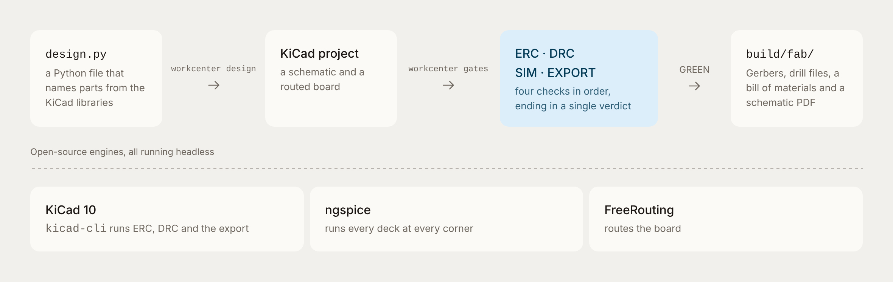
</picture>

A design file becomes a KiCad project. The 4 gates judge the project in
order and stop at the first red. The last line of a run is the verdict:
GREEN, RED or SKIPPED. The fabrication outputs of a GREEN board are in
`build/fab/`.

## Quick start

```sh
sudo ./install.sh     # Ubuntu 24.04: KiCad 10, ngspice, Java 21, FreeRouting
workcenter doctor     # each engine's status; ok when nothing is absent
workcenter gates tests/boards/pass-first-design     # GREEN
workcenter gates tests/boards/fail-drc-clearance    # red at DRC, on purpose
workcenter next tests/boards/fail-drc-clearance     # the one next step: the fix
workcenter sim tests/boards/fail-sim-corner         # red at its corners, on purpose
workcenter sim tests/boards/fail-freq-overlap       # red on the frequency plan
```

On your own computer the install has no time limit: a slow line finishes, and apt gives up a stalled file by itself; to set one, pass it through sudo with env (`sudo env APT_DOWNLOAD_TIMEOUT=900 ./install.sh`). CI sets `APT_UPDATE_TIMEOUT=120 APT_DOWNLOAD_TIMEOUT=570`, so a stall ends with apt's own line before the job's limit. Run the script as a file, not through a pipe or `bash <(...)`.

Output goes to `<project>/build/`: `erc.json`, `drc.json`, `sim/`,
`fab/` (gerbers, drill, BOM, schematic PDF), `gates.json`.

A first board starts in a folder of its own outside this checkout:

```sh
workcenter new ~/divider                         # design.py from the template, .gitignore, parts.csv, library/sources.csv
workcenter next ~/divider                        # the one next step: here, the design
workcenter design ~/divider/design.py --route    # the KiCad project, routed
workcenter gates ~/divider --strict              # GREEN, and SIM has no deck to run yet
```

[`.claude/skills/board-design/SKILL.md`](.claude/skills/board-design/SKILL.md)
has the procedure from a spec to a GREEN board.

## Commands

`workcenter --help` describes each command, and
`workcenter <command> --help` lists its flags.
[`ee-agent-kit/docs/CONFIGURATION.md`](ee-agent-kit/docs/CONFIGURATION.md)
has every flag.

<details>
<summary>The 37 commands</summary>

| Command | What |
|---|---|
| `doctor` | Report each engine's status. |
| `next` | Name the one next step for a project. |
| `new` | Start a board project in a folder: the template's design file under the folder's name, `.gitignore`, `parts.csv` and `library/sources.csv` with their headers. Refuses a folder that holds a design. |
| `chip` | A chip project, from RTL to a GDSII layout: `chip init`, `chip gates`, 1 command for each of its 10 gates, and `chip render` for a picture of the layout. Tests hold all 10 gates. The acceptance design, an 8-bit processor of 760 cells on the sky130A process, is GREEN with `--strict` in under 4 minutes. |
| `design` | Build a design file into a KiCad project; `--route` routes it; `--check` compares. |
| `erc`, `drc`, `sim`, `export` | One gate, alone. |
| `gates` | The 4 gates in order; the last line is the verdict. |
| `verify` | Check a verification package against a fresh run; say whether the requirements are met. |
| `ratings` | Hold a schematic to its parts' ratings: each pin's voltage limits, each part's derating by a named standard, each regulator's output, load and support parts. Every limit names its document, and a pack's rule and a pin's limit their page. |
| `references` | The index of the standards, notes, datasheets, reports, web pages, papers and books the rules and the code cite, each held by the SHA256 of its copy, a web page by the values read from it: `fetch` gets each once under the workcenter's own name into a folder outside the repository, `check` judges a file a person downloaded, `rules` fails a rule or a tool's `CITES` whose document the index lacks. |
| `measure` | Write the plan of measurements for a built board: for each sim bound the pad to probe, the reference pad, the instrument, the span the reading must fall in and the predicted value, as written and over the corners. |
| `now` | The work card of 1 piece of work in progress: its `**Status:**` line for the project board (Todo, In progress or Done), its branch and last commit, what is done now, the last health gate, what it waits for and what is left. 1 issue's body per piece of work, titled `Work card: ...` and rewritten in place; `--write` puts it on the `status` branch for a host without GitHub. |
| `standards` | List each requirement of the product kind `product.json` names, from free documents, as held by a gate, held by a named test of the verification package, or not held, with the document and clause. A list, not a certificate. |
| `image` | The content tag of the toolchain's files (`Dockerfile`, `install.sh`, `requirements.txt`) at a commit, the name of the image of that tag, and in the image the record of its build: tag, commit, machine, the tools' versions. Runs no engine. |
| `legend` | Hold every text printed on a board to its fab's least height and stroke and to no overlap, no hidden or stray designator and 2 directions a side, from the board file; `--place OUT` writes a copy with each designator placed. |
| `highspeed` | Hold the fast pairs that `interfaces.json` names to their interface's document: the width a cross-section solver gives for its impedance on the board's stackup at the gap the tracks have, the gap, the length, the skew within a pair, the vias, and an unbroken ground plane above and below; write the same limits as KiCad rules. |
| `copper` | Hold a routed board's power nets to a greatest voltage drop and current density on their own copper and in each via's barrel, and the board to a greatest temperature from its parts' heat; draw each as a picture. Every constant names its document; every limit is the project's. |
| `fields` | Simulate the critical nets `fields.json` names with openEMS, from the board file, and hold impedance, loss and coupling to their limits. |
| `bench` | Route design files with each router and compare: time, share joined, DRC errors, commands, bytes read. |
| `autoroute` | Write FreeRouting's session file for a hand-drawn board's DSN. The import into KiCad is by hand. |
| `inspect` | Read a routed board: `map`, `list`, `probe`, `net`, `islands`, `resistance`, `crossed`. |
| `placement` | Run a kistack placement check on a board. |
| `render`, `pictures` | Images of the schematic, the board, every layer; turning GIFs; assembly scenes. |
| `procure`, `costs` | Price a board's parts; price every board of every version. |
| `sources`, `fetch`, `curve` | Check each part's datasheet and model; fetch one, or keep one a person downloaded, and refuse a web page saved as a PDF; read a curve from a PDF. |
| `mutate` | Prove a firmware's host tests can fail. |
| `ci` | Replay a repository's GitHub workflow here. |
| `docs`, `version`, `diagram` | A version's contents page and datasheets; a new version folder; a block diagram. |

</details>

## Where it runs

**A Claude Code cloud environment.** The environment carries the
software; the project's repository carries the board. Create an environment
whose setup script is the 3 lines in
[`environment/setup.sh`](environment/setup.sh), with the network hosts from
[`environment/README.md`](environment/README.md). Open any project's
repository in it. Attach this repository as a second repository when its
skills should load.

**Another agent host.** `AGENTS.md` at the root is the entry for a host
that does not read `CLAUDE.md`; the 2 files are the same text. Every
procedure is a Markdown file under `.claude/skills/`, and every check is a
command. `workcenter next <project>` gives the step, and `make verify`
the repository's health.

**A Docker image.** With Docker instead of installing (amd64 or arm64; no openEMS on arm64):
`docker run --rm --user "$(id -u):$(id -g)" -v "$PWD":/work ghcr.io/thyfriendlyfox/via:main workcenter gates .`.
The files the gates write belong to you. The image holds the toolchain install.sh installs and the workcenter, without the example boards and the site; `.github/workflows/image.yml` builds it on Ubuntu 24.04 and publishes it from `main`, a release's tag, each Monday and by hand. Pin a toolchain by its digest from the `Image` workflow's summary. The package is named `via`. Its first image is pushed by the release's tag or the next push to `main`; the images built before the first release went to an older package, `ee-workcenter`, which is no longer updated.

### Run the workcenter from its container

The image of the release v0.1.0 has the tag `v0.1.0`.
It mounts your project on `/work`, its working folder.

Pull the image:

```sh
docker pull ghcr.io/thyfriendlyfox/via:v0.1.0
```

Run the gates on the project in the current folder, on Linux or macOS in a POSIX shell:

```sh
docker run --rm --user "$(id -u):$(id -g)" -v "$PWD":/work ghcr.io/thyfriendlyfox/via:v0.1.0 workcenter gates .
```

On Windows, in PowerShell:

```powershell
docker run --rm -v "${PWD}:/work" ghcr.io/thyfriendlyfox/via:v0.1.0 workcenter gates .
```

On Windows, in cmd.exe:

```bat
docker run --rm -v "%cd%:/work" ghcr.io/thyfriendlyfox/via:v0.1.0 workcenter gates .
```

- On Linux, `--user` makes the files the gates write yours; the image's build checks this with the same command.
- With no command, the image runs `workcenter doctor`.
- The package is private until the owner makes it public; until then, a pull needs `docker login ghcr.io` with a token that can read it.
- On arm64 (an Apple Silicon Mac, a Windows on Arm PC) the image has no openEMS; `--platform linux/amd64` runs the amd64 image, with openEMS, under emulation.
- Docker Desktop on Windows and macOS runs Linux containers, and this image is a Linux image (Ubuntu 24.04).
- The chip engines are not in the image; `sudo ./install.sh --chip` installs them on Ubuntu 24.04.
- The image build runs the Linux command on Linux; nobody has run these commands on Windows or macOS yet.

## The website

`site/` is the project's website: a home page with real runs of the
commands, drawings of what each gate catches and the board above, and a
page for each example, written by `site/examples.py` from the example's
README, its `TIMELINE.md` and its board. It is live at <https://via.computer>.
`python3 -m http.server 8000 --directory site` serves it at
http://localhost:8000. Vercel deploys a push that changes `site/`: `main`
to production, any other branch to a preview.
[`site/README.md`](site/README.md) has the commands, the files and how the
images are drawn.

## Repository map

<details>
<summary>Each path and what it holds</summary>

| Path | What |
|---|---|
| `install.sh` | The only source of the toolchain. |
| `Makefile`, `verify/` | `make verify`: the repository's health gate, one command; `verify/testshards.py` runs its tests in shards side by side by `verify/shards.csv` (`verify/README.md`). |
| `tools/workcenter` | The CLI and the gates. Standard library only. |
| `tools/kicadgen.py` | Design a board in Python from the KiCad libraries; writes the KiCad project and routes it headless. |
| `tools/simcorners.py`, `tools/freqplan.py`, `tools/thermal.py`, `tools/simneeds.py` | The corners a deck runs at; the frequency plan; each part's junction temperature at every run; the decks the schematic asks for. Read by the SIM gate. |
| `tools/partdata.py` | The makers' data of a deck's capacitors and inductors: picks each curve from the part's facts when its maker's file has its row in `library/sources.csv`, and rewrites the deck's part as ngspice's behavioural element on it. Standard library only; the SIM gate runs it. |
| `tools/guide.py` | `workcenter next`: the one next step and the fix for each kind of failure. |
| `tools/newboard.py` | `workcenter new`: a board project from `templates/project/`, with the headers of the parts file and of `library/sources.csv`. Standard library only. |
| `tools/enginelock.py` | The engine lock: long `workcenter` commands take turns on 1 machine in the order they came, and `make verify` holds it for the whole gate; `hold`, `held` and `state` on its own command line. Standard library only. |
| `tools/clock.py` | The day and the time a command runs at: 1 reading at its start, pinned by `SOURCE_DATE_EPOCH`; the machine's day for a price's age and the machine's clock for the engine lock; and the reader of a file's calls of the clock that 2 tests hold the tools and the test files to. Standard library only. |
| `tools/ratings.py` | `workcenter ratings`: the voltage span of each net, the facts of each part, and each stress against its limit. Standard library only. |
| `tools/blocks.py` | Circuit blocks a design file adds in 1 call, each written from its maker's note: `blocks.buck`, a buck regulator by TI SLVA477C, and the entry points of the other blocks; their numbers in `rules/blocks/`. |
| `tools/blocks_usbc.py` | `blocks.usbc`: a USB Type-C receptacle as a sink, by USB Type-C R2.5 and USB 2.0. |
| `tools/blocks_i2c.py` | `blocks.i2c`: the 2 pull-ups of an I2C bus by TI SLVA689A, each device on the bus held to its facts. |
| `tools/blocks_charger.py` | `blocks.charger`: a BQ21040 charger for 1 lithium cell with a BQ29700 protector, by their datasheets. |
| `tools/blocks_mcu.py` | `blocks.mcu`: an MSP430FR5720 with its crystal and decoupling, by TI SLAA322D. |
| `tools/blocks_ldo.py` | `blocks.ldo`: a fixed-output linear regulator and its 2 capacitors, by TI SLVA079 and the TLV755P datasheet. |
| `tools/fabfiles.py`, `tools/panel.py` | EXPORT's files read back against the board: the placement file, the assembly pages, IPC-2581 and the panel. `panel.py` runs KiKit's panelization under `KIKIT_PYTHON`. |
| `tools/measureplan.py` | `workcenter measure`: the plan of measurements from the decks' bounds and the board's nets. Standard library only. |
| `tools/now.py` | `workcenter now`: the work card of 1 piece of work, and `record`, which `verify/verify.sh` runs on exit to leave the gate's verdict in `build/verify.json`. Standard library only. |
| `tools/board.py`, `.github/workflows/board.yml` | The workflow Board: each issue titled `Work card: ...` stands on the owner's project board in the column its `**Status:**` line names, and a closed card is Done. Once a day and by hand (`--all`) it walks every card and puts right the ones that stand wrong. Standard library only; it needs the repository secret `BOARD_TOKEN`. |
| `tools/highspeed.py` | `workcenter highspeed`: the board's stackup, its fast pairs' widths, gaps, lengths, skew, vias and planes against `rules/interfaces/`, and the KiCad rules file. Standard library only. |
| `tools/legend.py` | The legend check and the designator placer: `workcenter legend`, the DRC gate's legend lines, `Design.place_designators`. Standard library only. |
| `tools/image.py` | `workcenter image` and the image's own command line: the content tag of the toolchain's files, where CI's `full` job runs (`decide`), the record the Dockerfile writes (`record`), the check inside CI (`check`). Standard library only. |
| `tools/xsection.py` | The cross-section solver: a track's or a pair's impedance and eps_eff on a layer stack, and the width for a target. Needs numpy; `workcenter highspeed` runs it under the venv. |
| `tools/copper.py` | `workcenter copper`: the board's copper on a grid, each cell weighted by its copper, the drop and the heat by conjugate gradients, the pictures and the report. Runs under the venv's Python (numpy, pcbnew, Pillow). |
| `tools/fields.py` | `workcenter fields`: the model of a board's critical nets from its board file, the mesh, the ports, openEMS run as its own program, and the limits held. Standard library only. |
| `tools/routebench.py` | `workcenter bench`: the routing benchmark and the router each board takes. Standard library only. |
| `tools/routers.py` | The routers behind `workcenter design --route` and `bench`: FreeRouting 1.9.0 (the default) and 2.5.0, each with its presence, version and command line. Standard library only. |
| `tools/boardrules.py` | `workcenter drc` with a `board-rules.json`: a board held to a standard's rule pack, each gap to its nets' voltage and each track's width to its net's current; each net's vias to its current, against the wall `board-rules.json` states (`via_wall` or `hdi`). Standard library only. |
| `tools/layoutrules.py` | `workcenter drc` with layout packs under `layout` in `board-rules.json`: ESD at each connector that leaves the device (TI SLVA680A) and power and ground traces at most 3:1 on a 2-layer board (TI SZZA009), measured along the copper. Standard library only. |
| `tools/creepage.py` | `workcenter drc` with `creepage` in `board-rules.json`: clearance and creepage between each pair of nets on F.Cu and B.Cu, held to the voltage between them by a creepage pack (MIL-HDBK-454C table 69-I, TI SLUP419). Standard library only. |
| `tools/standards.py` | `workcenter standards`: each requirement of the product kind `product.json` names, from `rules/products/`, as held by a gate, held by a named test, or not held. Standard library only. |
| `tools/references.py` | `workcenter references`: the index of the documents the rules cite, the fetch that asks each URL once, and the check of a downloaded file and of the rules. Standard library only. |
| `tools/chipflow.py` | `workcenter chip`: what the chip gates share. It reads `chip.json`, the constraints and a process table, selects the timing corners, starts the engines and drives the gates to a verdict. |
| `tools/chipfront.py`, `tools/chipback.py`, `tools/chipscripts/` | The chip gates LINT, SIM, SYNTH and GLSIM; the chip gates LAYOUT, STA, DRC, ANTENNA, LVS and EXPORT; the engine scripts the chip gates run. |
| `tools/chipguide.py` | `workcenter next` for a chip project: the one next step, from `chip.json` to a GREEN layout. |
| `tools/inspect_board.py`, `tools/stretch.py` | Read a routed board with KiCad's geometry; grow a design at a cut. |
| `tools/doctools.py`, `tools/scene.py`, `tools/wrlgen.py` | Document commands; assembly scenes; 3D bodies. |
| `tools/pdfcurve.py`, `tools/kistack_board.py` | A PDF page's vector paths; the board reader kistack's checks run on. |
| `tools/harvest.py` | What the projects taught the workcenter, read from the repository: each branch's work that main lacks, the scripts projects wrote for themselves, the mistakes made again; and the roadmap's rated candidates held to their scores. |
| `tools/hooks/` | Claude Code hooks: no `cd` in a command, no test written by a script. |
| `tools/ci/` | `scope.py`: what a change needs, `fast` or `full`; the `engine` marker's plugin and its guard. `make scope`, `make verify-site`. |
| `WORKCENTER.md` | The contract a project gets from this workcenter. |
| `AGENTS.md`, `CLAUDE.md` | Where an agent starts. The same text. |
| `.claude/skills/` | `attached-repos`, `autoroute`, `blocks`, `blog-post`, `board-design`, `board-gates`, `board-loop`, `board-rules`, `charger-block`, `chip-design`, `chip-gates`, `copper`, `fabrication`, `fields`, `highspeed`, `kistack`, `land`, `lead`, `legend`, `now`, `procurement`, `ratings`, `references`, `simulate`, `standards`, `user-round`, `verification`. |
| `templates/` | A first design file, a version's README and gates report, `corners.json`, `frequency-plan.json`, the verification package. |
| `rules/` | Fabrication houses' limits as KiCad design rules: Sierra Circuits, JLCPCB, PCBWay, OSH Park. `rules/ratings/`: 2 derating standards as packs for `workcenter ratings`, each limit with its table and page. `rules/board/`: ECSS-Q-ST-70-12C Rev.1 as a board rule pack for `workcenter drc`, each limit with its clause, table and page. `rules/copper/`: the 5 constants of `workcenter copper`, each with its document and page. `rules/interfaces/`: the fast interfaces `workcenter highspeed` holds a pair to, each limit with its document, clause and page. `rules/references/`: the index of the 18 documents the rules cite (7 standards, 2 application notes, 9 datasheets), each with its URL and SHA256; no document itself. |
| `tests/` | The tests of the tools. `tests/boards/` holds the fixture boards and what each proves. |
| `examples/` | Example projects made with the workcenter, each in version folders with its own README. |
| `third_party/kistack/` | The vendored kistack skills. |
| `environment/` | Cloud environment setup script and hosts. |
| `Dockerfile`, `.github/workflows/` | The image. `image.yml` builds it for amd64 and arm64. CI on each pull request and push to `main`, a nightly run, the release, stale issues, and Board: each `Work card: ...` issue in the column of the project board its `**Status:**` line names. |
| `requirements.txt`, `pyproject.toml` | The venv's packages for tests and lint; the settings of ruff and pytest. |
| `site/` | The website: 1 static page, its stylesheet, the Open Graph image. `site/media/` holds this file's pictures. |
| `ee-agent-kit/` | How work on this repository is run. Start at `ee-agent-kit/ROUTING.md`. `ee-agent-kit/lead/` holds the lead's tools: `landed.py`, `gate-and-push.sh`, `quiet.py` and 3 example workflow scripts (`ee-agent-kit/lead/README.md`). |

</details>

## Working on this repository

`make verify` must be green before any push; a change `make scope` calls `fast` may be pushed on `make verify-site`.
[`ee-agent-kit/AGENTS.md`](ee-agent-kit/AGENTS.md) is binding;
[`ee-agent-kit/ROADMAP.md`](ee-agent-kit/ROADMAP.md) decides what gets built.
[`ee-agent-kit/CONTRIBUTING.md`](ee-agent-kit/CONTRIBUTING.md) has the rules
for a pull request. [`ee-agent-kit/SECURITY.md`](ee-agent-kit/SECURITY.md)
says how to report a vulnerability.

## Where things stand

[`ee-agent-kit/STATUS.md`](ee-agent-kit/STATUS.md) has each area's state
with its evidence. In short: the gates, the corners, the frequency plan and `workcenter next`
run on the fixture boards in `make verify`. Via has no release yet. The
cloud setup script has not run yet. The Docker image is built on GitHub,
and the package is still private.

## License

MIT; see [LICENSE](LICENSE). KiCad, ngspice, and FreeRouting keep their
own licenses. Inter, the website's font, is under the SIL Open Font
License: [site/fonts/LICENSE](site/fonts/LICENSE).
