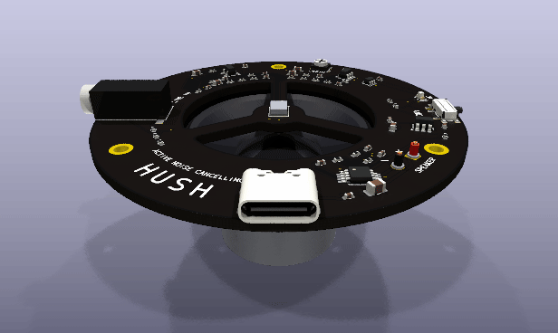
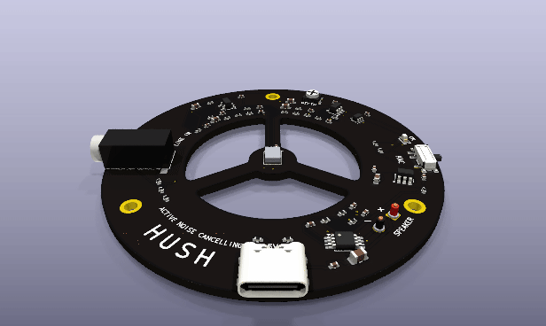
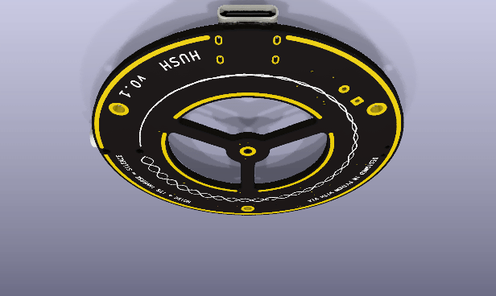

# Hush: a speaker that cancels noise

A round board that sits on the face of a 40 mm speaker. A microphone at its
centre listens a few millimetres in front of the cone; two op-amps turn what
it hears into the inverse wave, a class-D amplifier plays it, and the hum in
front of the speaker cancels in the air. Music from a phone plays at the same
time: the loop takes it as its target instead of cancelling it.

Each version is its own folder, and each folder is a whole KiCad 10 project:
`design.py`, the `.kicad_*` files `workcenter design` writes from it, its 3D
bodies, its ngspice decks, its README with what it must do, the circuit and
the decisions, and its pictures under `docs/`. [`library/`](library/) holds
the datasheets and models every version reads, with `library/sources.csv`
naming each file's revision and hash. The EE Workcenter, this repository,
supplies the tools and the gates.

| From above | From below |
|---|---|
|  |  |

## Versions

| Version | Board | What it does | State |
|---|---|---|---|
| [v0.1](v0.1/README.md) | 62 mm ring, 4 layers, 62 parts | Feedback cancelling from 50 to 500 Hz on the cone's axis, music through the loop, a depth trimmer and an on/off switch | Routed, gates GREEN; not built |
