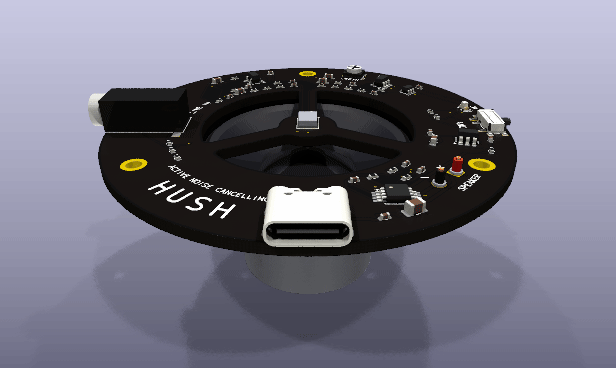
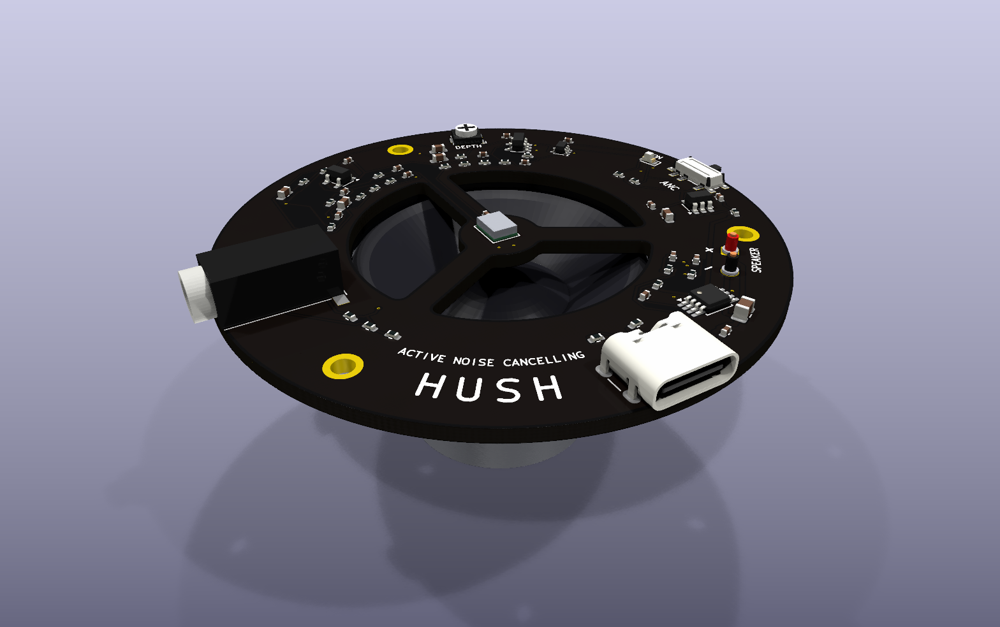
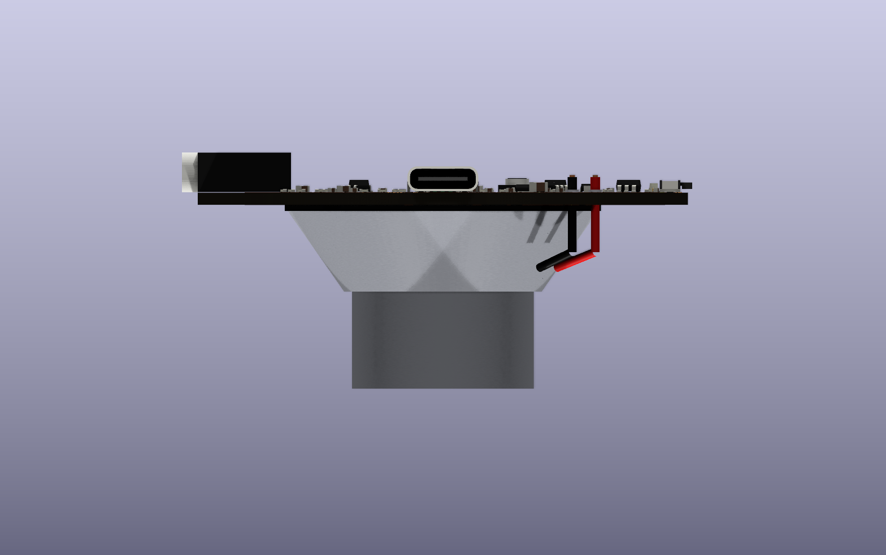
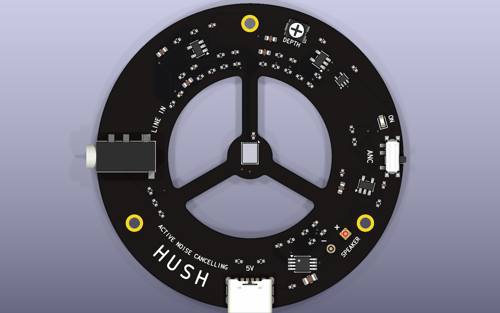
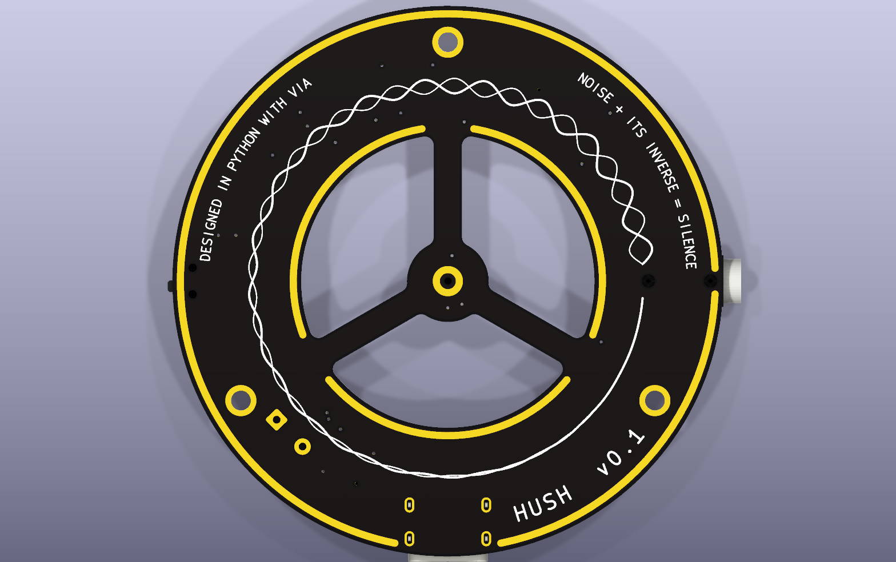
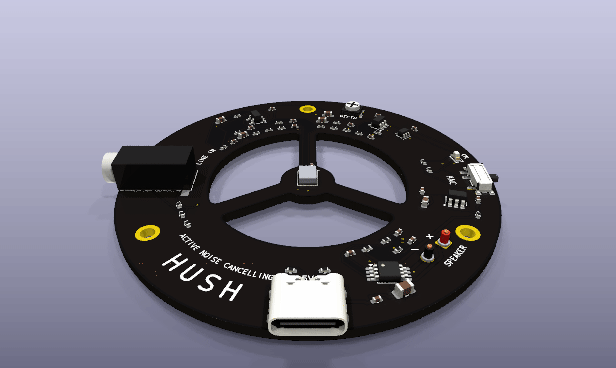
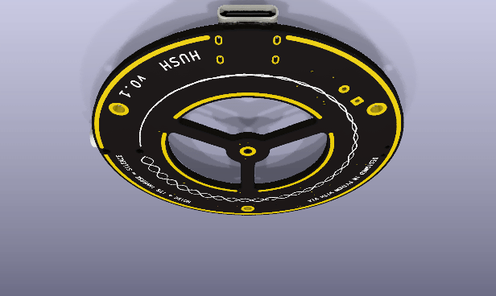
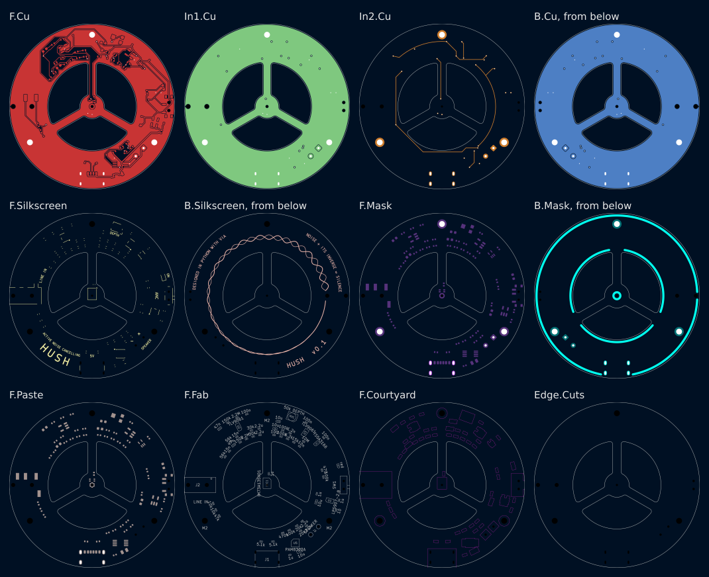
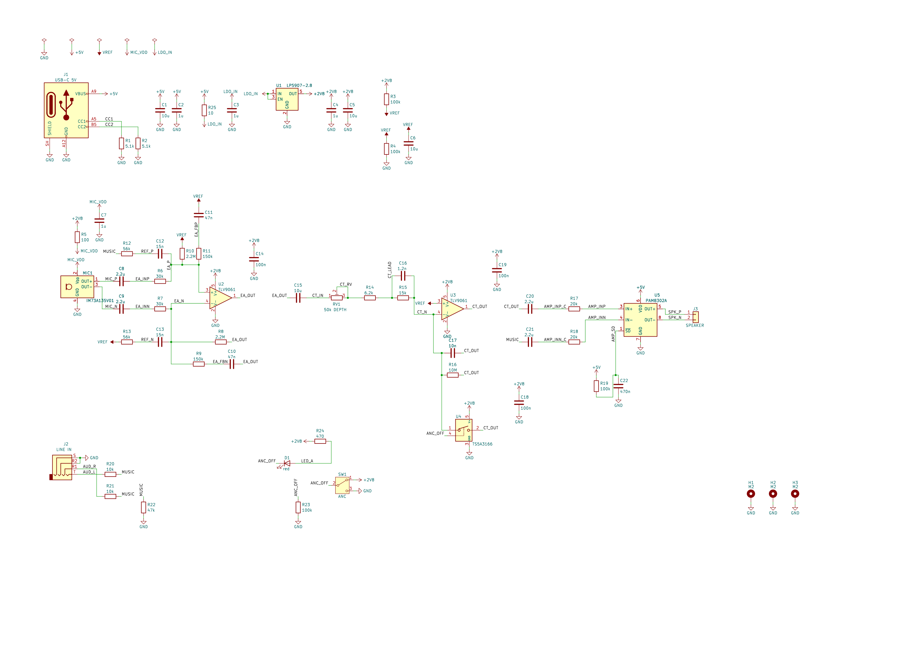

# Hush — board prototype v0.1

> The first version of the [Hush prototype series](../README.md).

Hush is a speaker that listens to the room and plays the inverse wave. A ring of circuit board sits
on the face of a 40 mm speaker driver. Through the ring's three windows you see the cone; at the
centre, on three spokes, a MEMS microphone listens 4 mm in front of it. Two op-amps turn what the
mic hears into its inverse, a class-D amplifier plays it, and a hum in front of the speaker cancels
in the air: 150 Hz comes out 18.8 dB quieter where the mic listens. Music from a phone plays at the
same time; the loop takes it as its target instead of cancelling it. There is no microcontroller and
no firmware: the inverse is made by analog parts within a few microseconds, which a feedback loop
through 4 mm of air needs.

This folder is a whole KiCad 10 project made with the EE Workcenter: `design.py` is the board, and
the `.kicad_*` files beside it are what `workcenter design` writes from it. The datasheets and
models it reads are in [`../library/`](../library/), the decks that prove the loop in [`sim/`](sim/),
the 3D bodies KiCad has none for in [`models/`](models/), the pictures in [`docs/`](docs/).

| Item | State |
|---|---|
| Schematic | 1 sheet, wired, in blocks the way the signal flows; ERC 0 errors, 0 warnings; no parity warning in the DRC (P24) |
| Board | A ring 62 mm across round a 33 mm opening, a 9.2 mm hub on 3 spokes; 4 layers, 1.6 mm; 62 parts, all on the front; black mask, white silkscreen, ENIG. 0.2 mm tracks, 0.15 mm clearance, 0.5/0.3 mm vias |
| Gates | GREEN with 6 warnings (ERC 0/0; DRC 0 errors, 0 unconnected, 0 parity, 4 silkscreen warnings where the jack and the switch hang over the edge; SIM 7 decks, 986 corner runs, 0 failures, 2 warnings from TI's model in its check deck; EXPORT 24 gerber files), see [`docs/gates.md`](docs/gates.md) |
| Datasheets and models | 7 files in [`../library/`](../library/) with their revisions and hashes in `sources.csv`: the datasheets of the 5 chips and the speaker driver, and TI's TLV9062 model. 2 models written here, each held to its source in a deck of its own: the PAM8302A's and a TLV9061 fitted to TI's. 7 decks, 986 corner runs |
| Cancelling | At the mic, nominal and at the worst corner: 7.5 and 3.0 dB at 50 Hz, 14.2 and 8.6 dB at 100 Hz, 20.4 and 16.9 dB at 200 Hz, 17.0 and 12.2 dB at 300 Hz, 11.3 and 6.9 dB at 500 Hz. No frequency louder by more than 2.6 dB, 5.9 dB at the worst corner |
| Verification | Not written yet (P28): see Open items |
| Firmware | None: the loop is analog |
| Built | Not ordered, not built |

## Images



| Assembly | From the side |
|---|---|
|  |  |

| Front | Back |
|---|---|
|  |  |

| Turning, from above | Turning, from below |
|---|---|
|  |  |

| Every layer | The schematic |
|---|---|
|  |  |

`workcenter pictures .` draws them all from [`pictures.json`](pictures.json): the board's stills,
layers and both turning GIFs in the board's own colours, and [`assembly.py`](assembly.py), the
ring on its driver, on the workcenter's
`tools/scene.py`. The 3D bodies of the mic, the jack, the trimmer and the speaker's wires come from
[`models/make_models.py`](models/make_models.py); every other body is KiCad's own
(`KICAD10_3DMODEL_DIR`).

## What changed in v0.1: the first board

| Finding | The owner's answer | What v0.1 does |
|---|---|---|
| The owner's request of 2026-11-11: a noise cancelling speaker that uses a microphone to play the inverse wave, as an example of what people make with Via; a compact board that looks great | The example in its own folder, iterated until it is gorgeous, merged to `main`; laid out like the owner's Last Hit series | This folder: a feedback loop on a ring that sits on the face of a 40 mm driver, the mic on the cone's axis, music through the loop, the back drawn as the idea itself |

### Board

- **The ring.** The driver, a Dayton Audio CE40-4, has a 40 mm frame round a 33 mm cone and
  surround. The board is a ring 62 mm across whose opening matches the surround, with three windows
  between three spokes, so the cone moves air freely and shows through. The spokes carry a 9.2 mm
  hub, and the hub carries the mic with its port on the cone's axis (`MIC1` at `(CX, CY - 0.68)`,
  turned 270 degrees: the footprint's port is 0.68 mm from its origin). The driver's frame rests on
  the back from the opening to 20 mm out; a parts keep-out holds that annulus clear.
- **Placement.** Every part sits on one of 4 tracks round the ring (18.9, 21.3, 24.2 and 27.6 mm),
  turned with it, in blocks the way the signal flows: the error amplifier west of the mic's spoke,
  the controller east of it, power and the ANC switch on the east edge, the amplifier with the
  speaker's pads south-east, the line input west. Within a block the passives stand in radial
  columns 8 degrees apart, so parts on neighbouring tracks line up. U5, the amplifier, stands square
  to the board: FreeRouting 1.9.0 reached none of its 0.65 mm pins with it turned 26 degrees along
  the ring (M142, P4 step 10). The two lower spokes are track keep-outs on F.Cu and In2.Cu: the hub
  and its spoke north carry the mic's lines and nothing else.
- **Layers.** F.Cu carries the parts and most signals; In1.Cu is a whole ground plane; In2.Cu
  carries signals; B.Cu is a whole ground pour that no track crosses, so the back's art and its gold
  rims sit on unbroken copper.
- **Hand copper.** 2 nets cross a quarter of the ring each, and the router made long detours of
  them: CT_OUT, the anti-noise, from the controller to the amplifier, and VREF across the top. Each
  runs as a concentric arc on In2.Cu between 2 vias, every via and chord probed clear with
  `workcenter inspect probe`. The mic's ground pad is a sealing ring that its footprint keeps out of every pour; a 0.3 mm
  track joins it to 2 vias on the hub.
- **The back.** The noise (0.25 mm) and its inverse (0.15 mm) start beside the line-in jack's inner
  peg hole at full height, braid round the ring and shrink together until they meet as one line:
  noise plus its inverse is silence. Their band, and the band under each line of lettering, is a
  via keep-out, so no via stands under the art.
  Gold rims open the mask over the pour round the edge, along each window over the cone and round
  the mic's port; the edge's rim breaks where the USB-C shell's slots and the jack's outer peg
  cross it. The masks are a near-black at 95 % opacity (`#0B0B0CF2`): under KiCad's named "Black"
  the renders show the ground pour brown. The fab's job file reads it as `R11G11B12`: order black.
- **Review.** Each round, a reviewer who had not seen the board read its renders against a fixed
  checklist and named the 3 worst problems. Round 1: the waves ended in the jack's peg hole and ran
  over vias, the rim ran into the jack and USB-C, the speaker had no polarity mark, the schematic's
  text overlapped. Round 2: the polarity marks read as "x" and "/" turned with the ring, the parts
  of the top band almost lined up, labels still touched parts, the music track crossed the spokes,
  the holes' pads crowded the rim. Each is fixed above; the mic's value on the schematic still
  crosses its OUT- wire, where KiCad's symbol puts it.
- **Route.** FreeRouting 1.9.0, 20 passes, 1 round: 426 segments and 12 vias round the hand
  copper, and 6 vias that tie F.Cu ground islands to the plane; the DRC finds 0 unconnected. With
  the waves' band a via keep-out, one route left U2's output pad walled in and needed a hand via;
  after the parts moved into columns the router reached it on F.Cu, and the hand via went.

### Simulation

7 decks in [`sim/`](sim/), each with its bounds in `<deck>.expect.json`, run at every corner of
[`sim/corners.json`](sim/corners.json): 0 and 40 °C, every resistor at 1 %, every capacitor at 10 %
and the C0G ones (C10 to C13, C16, C17) at 5 %, the speaker's Thiele-Small parameters at the
spreads driver makers state, the mic's sensitivity, its distance from the cone, the amplifier's
bandwidth and delay, USB's 4.75 to 5.25 V, and 48 Monte Carlo draws.

| Deck | What it proves | Nominal | Worst corner | Bound |
|---|---|---|---|---|
| `anc_loop` | the noise left at the mic, closed loop, at full depth | 50 Hz -7.5 dB, 100 Hz -14.2, 200 Hz -20.4, 300 Hz -17.0, 500 Hz -11.3; peak 2.6 dB | -3.0, -8.6, -16.9, -12.2, -6.9; peak 5.9 dB | -3, -8, -12, -12, -6; peak 6 dB |
| `anc_margin` | the loop opened by a voltage injected in series (Middlebrook) | phase margin 76.9° at 1.5 kHz, 79.6° at 25 Hz; loop gain 19.6 dB at 200 Hz | 50.7°, 55.9°; 15.6 dB | 45°, 45°; 14 dB |
| `anc_music` | music through the loop, against its 1 kHz level | 200 Hz to 10 kHz within +1.6 and -2.9 dB; 100 Hz -6.7 dB | 100 Hz -8.0 dB | +4/-6 dB at nominal; 100 Hz -10 dB |
| `anc_hum` | a 150 Hz hum of 0.2 Pa in time, 250 ms | -18.8 dB; the anti-noise 0.90 of the hum | -13.4 dB; 0.85 to 0.94 | -12 dB; 0.8 to 1.2 |
| `rail_5v` | +5V's impedance at U5 for the frequency plan | 0.059 ohm at 250 kHz; its resonance 0.45 ohm at 44.7 kHz | 0.069 ohm; 0.86 ohm, between 20 and 71 kHz | 0.1 ohm at 250 kHz |
| `pam_model` | the PAM8302A model against its datasheet | gain 22.83 dB, 10k in, outputs at 2.5 V | (not cornered) | 23.5 dB ± 1 dB, `warn` |
| `tlv9061_model` | the fitted op-amp against TI's model and the datasheet | 0.52 dB and 0.03° from TI's to 10 kHz; 125.7 dB, 9.16 MHz | (not cornered) | ±1 dB, ±5°, `warn` |

Every loop deck also holds VREF and U3's output at their DC values (1.36 to 1.44 V at every
corner): a false operating point fails there (M143). The music's flatness is judged at nominal: the
driver's own spread moves it further than the board can correct (Open items). The frequency plan
([`sim/frequency-plan.json`](sim/frequency-plan.json)) holds the amplifier's 200 to 300 kHz and
the test hum's harmonics against the rail's resonance: no overlap.

### Firmware

None.

### Parts and cost

Not priced: P25 asks for a distributor's live prices and stock, and no parts file is kept yet (Open
items). The library holds the datasheet of every chip and of the driver.

### Verification summary

No package yet (Open items).

## What it must do

Each line is a bound in `sim/`, and its source points here.

- At least 3 dB less noise at 50 Hz, 8 dB at 100 Hz, 12 dB from 200 to 300 Hz and 6 dB at 500 Hz,
  at the mic, with the depth trimmer at full depth (`anc_loop`).
- At least 12 dB less noise from 150 to 300 Hz, here a 150 Hz hum in time (`anc_hum`).
- No frequency louder by more than 6 dB. A sensitivity peak Ms of 2 guarantees a gain margin of
  Ms/(Ms-1) = 2 and a phase margin of 2 asin(1/(2 Ms)) = 29 degrees (`anc_loop`).
- 45 degrees of phase margin at each crossing (`anc_margin`).
- 12 dB less noise at 200 Hz needs a loop gain of 14 dB or more there (`anc_margin`).
- Music from 200 Hz to 10 kHz within -6 and +4 dB of its 1 kHz level, for the CE40-4 its sheet
  describes; music at 100 Hz no more than 10 dB under its 1 kHz level; the CE40-4 alone is 11 dB
  under there (`anc_music`).
- The rail at the amplifier's switching frequency: 0.1 ohm or less (`rail_5v`).
- USB-C power alone: 5 V from any USB port or charger, no data.

## Architecture

```
J1 USB-C ── +5V ─────────────────────────────────────────────┬── U5 PAM8302A ── J3 ── speaker
   (R1, R2: 5.1k CC)  └─ R25/C3 ─ U1 LP5907 ─ +2V8 ─ R3/R4 ─ VREF         ▲ IN+          ▲ IN-
                                                                            │              │
MIC1 ─ MIC_P/MIC_N ─ C8/C9 ─ U2 error amp ─ EA_OUT ─ C15 ─ RV1 ─ R14 ─┐     │              │
                              ▲ music ref (R12/C12, R13/C13)          U3 integrator ─ CT_OUT ─ C20
J2 line in ─ R20/R21 ─ MUSIC ─┴────────────────────────────────────────────────────────── C21
SW1 ─ ANC_OFF ─ U4 across C17 (off: the integrator held at zero), D1 lit while it cancels
```

### Stackup

| Layer | Copper | Use |
|---|---|---|
| F.Cu | 35 µm | the parts, most signals, a ground pour between them |
| In1.Cu | 35 µm | a whole ground plane |
| In2.Cu | 35 µm | signals, the hand arcs of CT_OUT and VREF |
| B.Cu | 35 µm | a whole ground pour, no track; the art's gold rims open on it |

### The loop

The mic hears the noise and what the speaker plays. U2 is a balanced difference amplifier, gain 5:
the mic's two outputs minus the music reference (R12/C12 into its + leg, R13/C13 the matching leg),
with a lag shelf in each leg (R9/C10, R11/C11 under R8 and R10) that buys phase margin below 50 Hz.
U3 integrates (C17, with R16 to hold its DC) behind the depth trimmer RV1 and a lead network (R14,
R15, C16) that gives back the phase the speaker and the air take near 1.5 kHz, where the loop gain
falls through 0 dB. U5 plays the result on IN+.

The plant is the CE40-4 from its Thiele-Small parameters (Re 3.6 ohm, Bl 1.50 Tm, Mms 0.73 g, Cms
0.92 mm/N, Qms 5.00, resonance 194 Hz), and the air between the cone and the mic: a piston 15 mm in
radius, its pressure on the axis at rmic = 4 mm, delayed by 28 µs (rmic/c plus half the path
difference to the piston's edge) plus the class-D amplifier's 2 µs. The loop cancels where its gain is high, 50 to 500 Hz, and the quiet is largest where the mic
listens.

The music enters twice: at U5's IN-, where it plays, and as U2's reference, so the loop sees the
music it plays as no error and leaves it alone. With the shelf, the music's bass below the driver's
194 Hz resonance comes up: 100 Hz is 6.7 dB under 1 kHz, against 11 dB for the driver alone.

The depth trimmer RV1 (50k) sits in series with R14: at its end stop the loop has its full gain, the
way every deck runs it; turned the other way it takes 10.5 dB off the loop's gain at low
frequency and 19 dB near its crossing. SW1 drives U4, an analog switch
across C17: closed, the integrator holds at zero and the speaker plays the music alone. D1 lights
while the loop cancels.

### Power

USB-C brings 5 V (R1 and R2 ask any source for its default current). +5V feeds U5 directly, held by
C1 (10 µF) and C2 (1 µF) at its pins. U1, an LP5907, makes +2V8 for the analog side behind an RC
filter (R25, C3) that keeps the amplifier's 200 to 300 kHz out: 3.8 mOhm of ripple impedance at
its input at 250 kHz. The mic's maximum supply is 3.0 V; it runs from +2V8 behind R5 and C7. R3 and
R4 make VREF, half of +2V8, the op-amps' and the mic's signal ground.

## Datasheets, models and simulation

[`../library/sources.csv`](../library/sources.csv) names every file the library keeps, its
revision as the file prints it, its date and its SHA256:

| Part | File | Revision |
|---|---|---|
| TLV9061 (U2, U3) | `ti/tlv9061.pdf` | SBOS839N, 2026-07 |
| TLV9061 model | `ti/tlv9062.lib` | Rev. D, 2021-06; TI publishes the family's model as the TLV9062, one channel of which is the TLV9061 |
| LP5907-2.8 (U1) | `ti/lp5907.pdf` | SNVS798Q, 2025-07 |
| TS5A3166 (U4) | `ti/ts5a3166.pdf` | SCDS186E, 2018-02 |
| PAM8302A (U5) | `diodes/PAM8302A.pdf` | DS41333 Rev. 6 - 2, 2021-05 |
| IM73A135V01 (MIC1) | `infineon/IM73A135.pdf` | V 1.20, 2021-07 |
| CE40-4 (the driver) | `dayton/CE40-4.pdf` | no revision printed; the PDF is dated 2023-09 |

TI's TLV9062 model is right against its datasheet, but in a closed loop ngspice settled on false
operating points with it (`source stepping failed`, an output at a rail), so the loop decks run
[`sim/models/tlv9061_fit.lib`](sim/models/tlv9061_fit.lib): its open-loop gain, its
gain-bandwidth and a second pole, fitted to TI's, within 0.52 dB and 0.03 degrees of it up to
10 kHz in `tlv9061_model` (M143). The PAM8302A has no maker's model;
[`sim/models/pam8302a.lib`](sim/models/pam8302a.lib) is its gain, its 10k inputs, its bandwidth
and its delay from the datasheet, held to the Gain row in `pam_model` (M139).

The `tlv9061_model` deck runs TI's own model, and ngspice warns there: `singular matrix` at a node
inside TI's model and `source stepping failed` on the way to an operating point it then finds. The
deck's measures land on the datasheet's rows, so the point it found is the circuit's; the 2 warnings
are the gate's 2.

## Verification

Not written yet: P28's package (requirements with their sources, a writeup per deck, the
traceability table) is the first candidate for v0.2.

## Pin plan

No microcontroller: nothing to plan.

## Bill of materials

All parts on the front face.

| Ref | Value | Package | Part |
|---|---|---|---|
| U1 | LP5907-2.8 | SOT-23-5 | TI LP5907MFX-2.8 |
| U2, U3 | TLV9061 | SOT-23-5 | TI TLV9061IDBVR |
| U4 | TS5A3166 | SC-70-5 | TI TS5A3166DCKR |
| U5 | PAM8302A | MSOP-8 | Diodes PAM8302AAS |
| MIC1 | IM73A135V01 | PG-LLGA-5-2 | Infineon IM73A135V01 |
| J1 | USB-C 5V | USB4125 | GCT USB4125, power only |
| J2 | LINE IN | PJ-320D | 3.5 mm jack |
| J3 | SPEAKER | 2 wire pads, 4.2 mm | the CE40-4's wires |
| SW1 | ANC | PCM12 | C&K PCM12, SPDT slide |
| RV1 | 50k DEPTH | TC33X | Bourns TC33X trimmer |
| D1 | red | 0603 | LED |
| C1 | 10u | 0805 | X5R |
| C2, C3, C4, C7 | 1u | 0402 | X5R |
| C5, C6, C15 | 10u | 0603 | X5R |
| C8, C9, C20, C21 | 2.2u | 0402 | X5R |
| C10, C11 | 47n | 0603 | C0G, 5 % |
| C12, C13 | 15n | 0402 | C0G, 5 % |
| C14, C18, C19 | 100n | 0402 | X7R |
| C16 | 1.2n | 0402 | C0G, 5 % |
| C17 | 10n | 0402 | C0G, 5 % |
| C22 | 470n | 0402 | X5R |
| R1, R2 | 5.1k | 0402 | 1 % |
| R3, R4, R19, R23 | 100k | 0402 | 1 % |
| R5 | 100 | 0402 | 1 % |
| R6, R7 | 30k | 0402 | 1 % |
| R8, R10 | 2.2M | 0402 | 1 % |
| R9, R11 | 150k | 0402 | 1 % |
| R12, R13 | 56k | 0402 | 1 % |
| R14 | 6.2k | 0402 | 1 % |
| R15 | 15k | 0402 | 1 % |
| R16 | 10M | 0402 | 1 % |
| R17, R18 | 20k | 0402 | 1 % |
| R20, R21 | 10k | 0402 | 1 % |
| R22 | 47k | 0402 | 1 % |
| R24 | 470 | 0402 | 1 % |
| R25 | 10 | 0402 | 1 % |
| H1, H2, H3 | M2 | 2.2 mm, plated, 3.5 mm pad | mounting holes on the spokes' axes, for button-head screws (ISO 7380) |

Off the board: the Dayton Audio CE40-4 driver, and 3 M2 button-head screws that fix the ring, with
the driver behind it, to a baffle or a bracket; the holes stand outside the driver's 40 mm frame.

## Working on this board

Run the commands from this folder. From the repository root, name the folder instead.

```sh
workcenter design design.py --route   # regenerate the KiCad project from the design file and route it
workcenter gates .                    # ERC, DRC, simulation, export; GREEN means done
workcenter sim .                      # the sim/ decks alone; one deck: --deck NAME --keep
workcenter pictures .                 # the renders, turning GIFs and the assembly into docs/ (P23)
python3 models/make_models.py         # the 4 bodies in models/
```

`assembly.py` is run by `workcenter pictures`; by hand, `PYTHONPATH=<workcenter>/tools python3
assembly.py`.

## Decisions

- **Music flatness judged at nominal** (v0.1). The music's response from 200 Hz to 10 kHz holds
  -6/+4 dB for the driver its sheet describes (+1.6 and -2.9 dB). With the driver's Cms and Qms
  20 % low and its Le 30 % high together it reaches +8.0 and -7.8 dB, and 48 Monte Carlo draws
  reach +4.8 and -5.6 dB. That spread is the driver's, which the loop cannot correct outside its
  band; the bound says so in its source. Chosen over loosening the bound or narrowing the driver's
  spreads below what makers state.
- **A fitted op-amp model in the loop decks** (v0.1). TI's model settles on false operating points
  in the closed loop; the fitted one is held to it within 0.52 dB in its own deck (M143).
- **Black mask as a custom colour** (v0.1). KiCad's named "Black" renders the ground pour brown
  through the mask; `#0B0B0CF2` renders black. The fab's job file then names an RGB value, not
  "Black".
- **The back as the idea** (v0.1). The back faces the driver, and from behind it shows what the
  board does: the noise and its inverse meeting as one line. Gold rims frame the windows over the
  cone. The ground pour stays whole under it, so the routing uses 3 copper layers.
- **Analog feedback, no microcontroller** (v0.1). The air between the cone and the mic delays the
  sound 28 µs; a feedback loop that cancels to 500 Hz and crosses at 1.5 kHz has little delay left
  for itself, and an ADC, a DSP and a DAC take tens of microseconds more. Chosen over a DSP's adaptive feedforward, which needs a second mic and firmware.
- **A ring on the driver's face** (v0.1). The cone moves air through the windows, the mic sits on
  its axis 4 mm away, and the board is the speaker's front; chosen over a board in an enclosure
  with a mic on a cable, whose distance to the cone would vary from one build to the next.
- **The CE40-4** (v0.1). A 40 mm frame, 4 ohm, 10 W RMS (AES), its Thiele-Small parameters
  published; the PAM8302A drives 4 ohm from 5 V.
- **A differential analog mic** (v0.1). The IM73A135's two outputs reject what the amplifier's
  switching couples into both; its low-frequency cut-off at 20 Hz (Table 3) sits well under the
  loop's band.

## Open items

Candidates for v0.2, from v0.1's work:

- The verification package (P28): requirements with their sources, a writeup per deck, the
  traceability table.
- A parts file with distributor prices and stock (P25), and library rows for the passives, the
  connectors, the switch and the trimmer (P27). Then `workcenter costs` and `workcenter docs`
  write the version's priced list, `CONTENTS.md` and `datasheets/`.
- rmic, the distance from the cone's centre to the mic's port: 4 mm is an estimate from the CE40-4's
  drawing. The corners take it from 3 to 5 mm; measure it on the first board.
- The driver's spread: the music's flatness moves with the CE40-4's own Cms, Qms and Le (Decisions).
  A driver measured for its parameters, or a shelf the trimmer also moves, would hold it.
- The switch's ON and OFF: SW1 is labelled ANC and D1 lights while the loop cancels. The PCM12's
  switching diagram, from its datasheet, says which end is which; mark them in v0.2.
- The driver in free air: the decks model the cone's front in free air. A box behind it adds its
  air spring to Cms and moves the resonance up: run the decks again with the box's volume.

On the bench and elsewhere:

- The quiet is largest at the mic. 18.8 dB at 150 Hz is the pressure where the mic listens; the
  quiet zone round it is a fraction of a wavelength (2.3 m at 150 Hz), so an ear close to the cone
  hears most of it. Measure it with a second mic beside the first.
- First power-on with DEPTH turned down; then up while listening for a whistle near 1.5 kHz, the
  loop's crossing. The speaker's polarity matters: + to + (J3's silkscreen); the other way round the
  loop's feedback turns positive and it whistles at once.
- The amplifier's switching near the mic's lines: the differential mic and U2's balanced input
  reject it on paper; listen for it with no music and the loop on.
