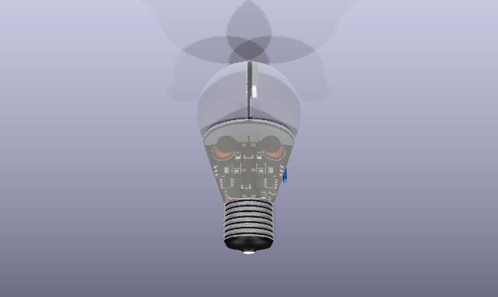

# Lark — prototype series

A light bulb for a ceiling fan's light kit that you talk to. It screws into the fan's E26 socket
and takes the mains like any bulb. Its boards are built to listen: a wake word and a set of
commands ("light on", "warmer", "dim to 30 percent") recognised inside the bulb by Espressif's
ESP-SR, with no hub, no app and no network. A slider on its neck joins it to one home system at a
time: Alexa over Zigbee 3.0, Apple Home over Thread, or neither. The light is 2 strings of LEDs,
warm and cool, driven with steady current: no flicker under the fan's blades. v0.1 is the hardware
and the light's own rules; the voice and radio firmware is not written yet.

This folder is a project made with Via. Each version is its own folder; each board in
it is a whole KiCad project built from its `design.py`, with the housing, the joints and the fit
check that every board shares in `bulb.py`. The versions came from a loop that judged each layout
against the housing and the gates and made the next ([`LOOP.md`](LOOP.md)).

The latest version, [v0.1](v0.1/), hanging base-up as it does in a fan:



## Versions

| Version | Bulb | What changed | Firmware | Commit |
|---|---|---|---|---|
| [v0.1](v0.1/) (current) | A19, 60 x 108 mm, E26. 4 boards in 2 directions: the driver standing in the neck (4 layers), the light disc lying across it (aluminum), the brain standing in the dome at 90 degrees to the driver (4 layers), the ear lying at the dome's tip (2 layers), joined by soldered tongues through slots | the first bulb: 120 V mains to 2 LED strings and a 3.3 V rail; an ESP32-C6 for Zigbee or Thread and the light, an ESP32-S3 for offline voice, 2 PDM microphones; a 3-place mode slider | the light's rules: the mode from the slider, the warm and cool mix inside a 90 % power budget, low-line and thermal foldback, with host tests | in work |

An A15 housing (47.6 x 87 mm) was tried first. The driver's parts each fit inside it, but not
beside each other: v0.1 is an A19 ([`v0.1/README.md`](v0.1/README.md), Decisions).

## Working on the bulb

Run from a version's folder; each board is a nested project.

```sh
python3 footprints/make_footprints.py           # the tongues, the slot pads and 2 parts, into footprints/Lark.pretty
python3 footprints/make_models.py               # the 3D bodies KiCad's library lacks, into each board's models/
workcenter design driver/design.py --route      # one board's KiCad project, routed; likewise light, brain, ear
workcenter gates driver                         # ERC, DRC, simulation, export; GREEN means done
make -C firmware test                           # the firmware's host tests
workcenter pictures .                           # every board's renders and GIF, and the assembly (assembly.py)
```

`make_footprints.py` and `make_models.py` import Via's `kicadgen` and `wrlgen`: run them
with Via's `tools/` on `PYTHONPATH`.
