# Lark — board prototype v0.1: a ceiling-fan bulb you talk to

> The first version of the [Lark prototype series](../README.md).

Lark is an A19 light bulb for a ceiling fan's light kit. It screws into the fan's E26 socket, hangs
base-up, and takes 120 V mains like any bulb. Its light is 16 LEDs in 2 strings, warm (2700 K) and
cool (5000 K), each driven with a steady current, so the light shows no 120 Hz ripple and no PWM:
under a fan's turning blades a ripple shows as a strobe. It is built to be talked to: 2 microphones
at the dome's tip face the room, and an ESP32-S3 with 8 MB of PSRAM runs Espressif's ESP-SR wake
word and command models inside the bulb, with no hub, no app and no network. A 3-place slider on the
neck sets what else it joins: Alexa (Zigbee 3.0, to an Echo with a Zigbee hub in it), nothing
(voice only), or Apple Home (HomeKit over Thread, to a HomePod or an Apple TV). An ESP32-C6 module
runs that radio and the light.

This folder is a whole project made with the EE Workcenter: `bulb.py` is the housing, each board's
place in it, the solder joints between the boards and the fit check; each board's `design.py` is its
schematic and layout; the `.kicad_*` files beside each are what `workcenter design` writes from it.
The workcenter supplies the tools and the gates.

| Item | State |
|---|---|
| Bulb | A19, 60 mm across and 108 mm from the base's contact to the dome's tip; E26 base. The boards stand and lie inside the housing's cavities, which `bulb.py` holds as numbers; `fit()` stops a design whose part leaves them or meets another board |
| Driver (`driver/`) | 45.9 mm wide under the disc, 20.0 mm in the base, 57.8 mm tall with its 2 tongues; 4 layers, 1.6 mm FR-4, In1 a ground plane. The mains, 2 LED drivers and the 3.3 V supply; parts on both faces |
| Light (`light/`) | a 45.2 mm disc, 1 copper layer on 1.0 mm aluminum. 16 LEDs on a ring and the disc's NTC; 3 slots for the tongues |
| Brain (`brain/`) | 16.0 x 45.5 mm with its 2 tongues; 4 layers, 1.0 mm FR-4, In1 a ground plane. The ESP32-C6 module, the ESP32-S3 and its flash; parts on both faces |
| Ear (`ear/`) | a 15.0 mm disc; 2 layers, 0.8 mm FR-4. 2 PDM microphones on its underside, their ports through the board |
| Joints | each standing board's tongue passes a slot in a lying board; a row of pads on the tongue's 2 faces meets a pad beside the slot, and a solder fillet joins each pair across the corner, as LED bulbs join a driver to its LED board. 26 joints; the light disc's copper carries the driver's 8 signals to the brain |
| Schematics | each board drawn with wires; ERC 0 errors and 0 warnings on all 4 |
| Gates | all 4 boards GREEN: the driver with 5 warnings, the brain with 5, the ear with 2, the light with none; each a silkscreen outline at an edge or a deck with no temperature term ([`docs/gates.md`](docs/gates.md)) |
| Simulation | 13 decks: the driver's 7 (the bus at full power, an LED channel switching, the dimming filter, the bus sense, the bus's impedance, and the 2 fitted models against their datasheets), the light's 2, the brain's 3, the ear's 1; each at its corners of temperature and tolerance |
| Datasheets and models | 22 parts with their datasheets in [`../library/`](../library/) (`library/sources.csv`); Infineon's MOSFET model and Diodes' US1J model used as published; 3 models fitted here: the HV9961 (Microchip publishes none for SPICE), the MB10S bridge and the Bridgelux LED |
| Firmware | the light's rules: the mode from the slider, the warm and cool mix inside the power budget, low-line and thermal foldback (`firmware/src/light.c`), 6 host tests (`make -C firmware test`). The radio and voice firmware is not written; nothing has run on a board |
| Verification | no verification package yet (P28): an open item |

## Images

The bulb as it hangs, base-up, its neck and dome drawn clear (`assembly.py` on the workcenter's
`tools/scene.py`, drawn by `workcenter pictures .` from [`pictures.json`](pictures.json)):

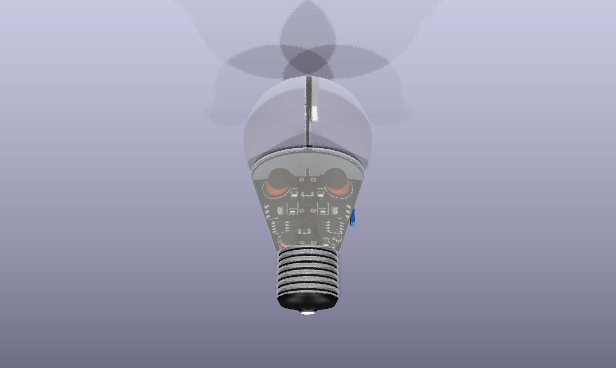

| From the room | From the side: the driver's back, the slider at the right |
|---|---|
| 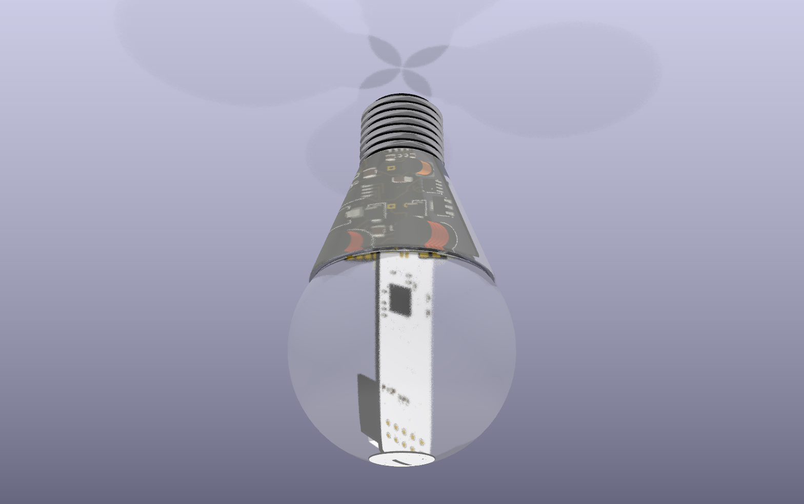 | 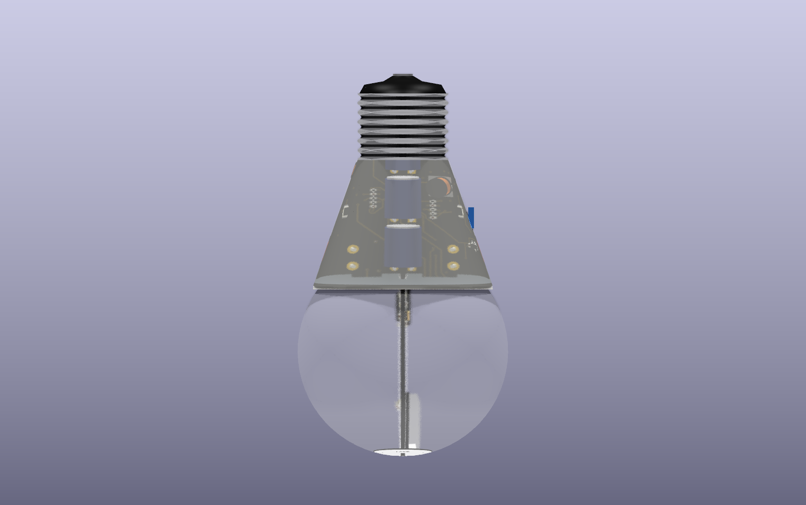 |

| The dome's tip, as the room sees it | Down the axis from the base: the light disc |
|---|---|
| 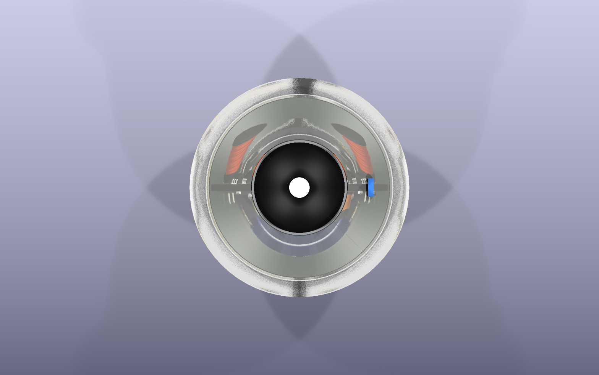 | 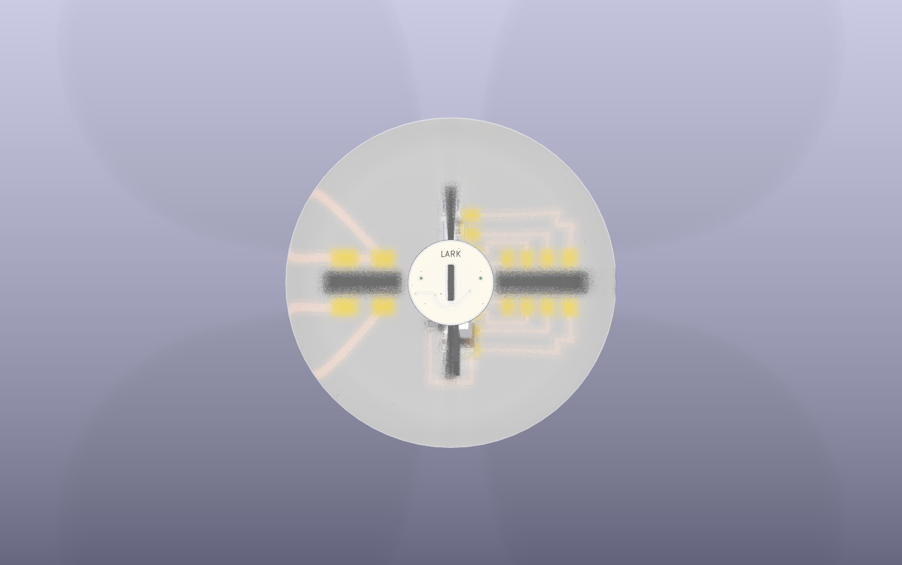 |

Each board, turning (`workcenter render --views spin`), and its 2 faces:

| Driver | Light | Brain | Ear |
|---|---|---|---|
| 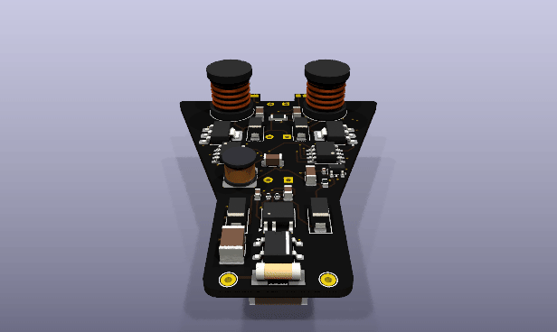 | 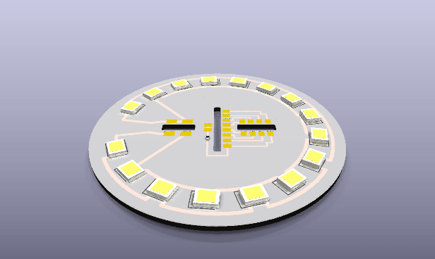 | 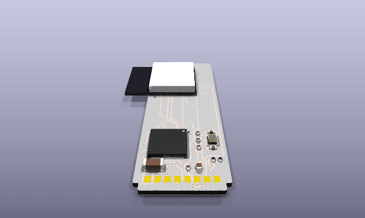 | 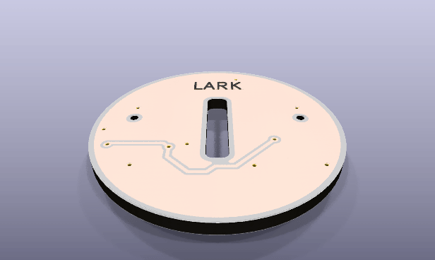 |
| 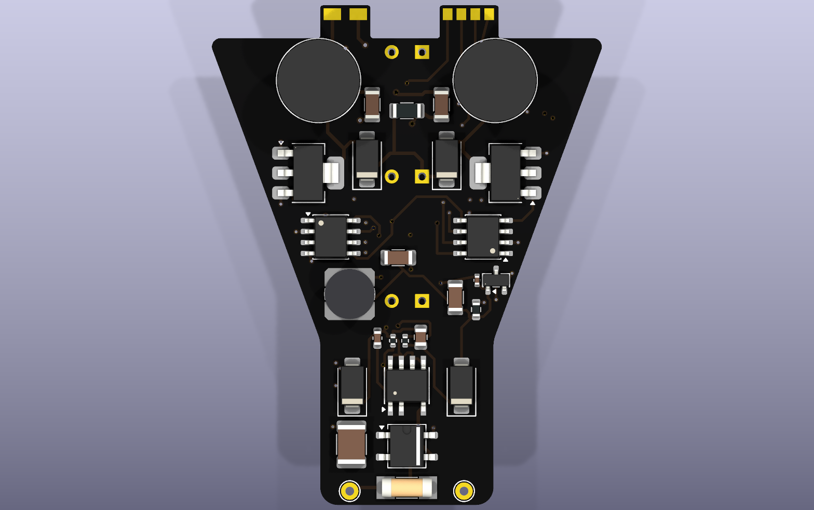 | 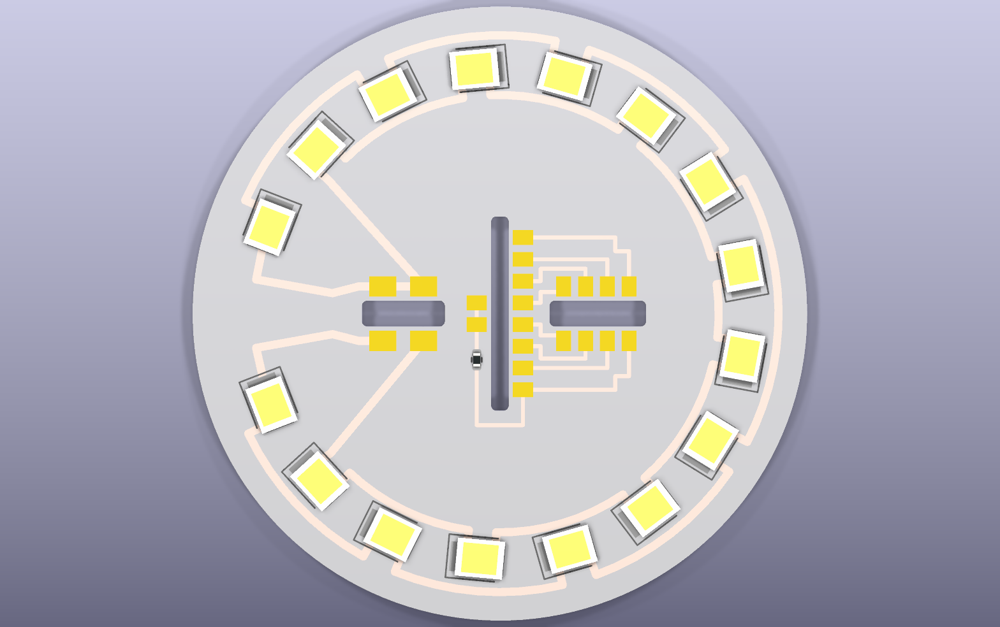 | 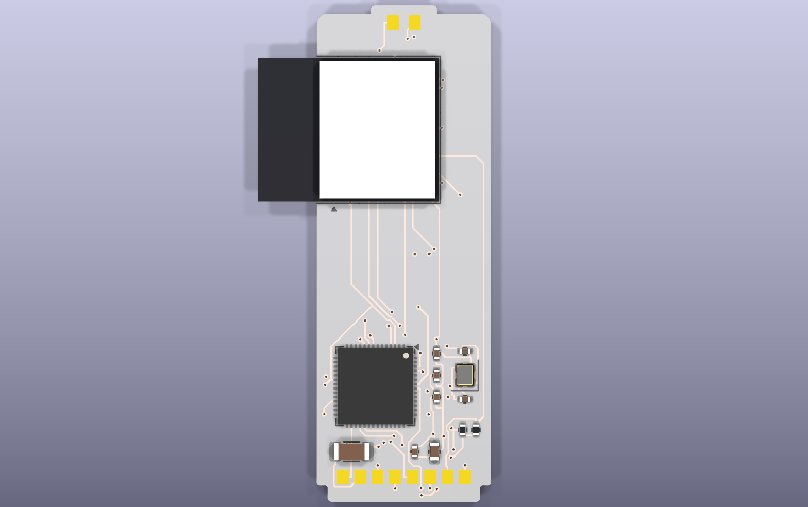 | 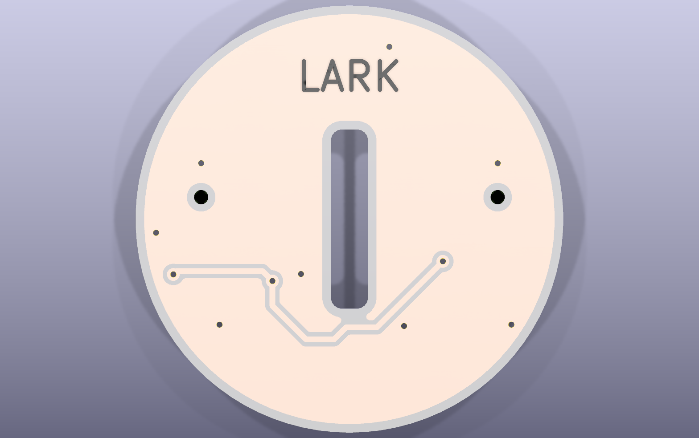 |
| 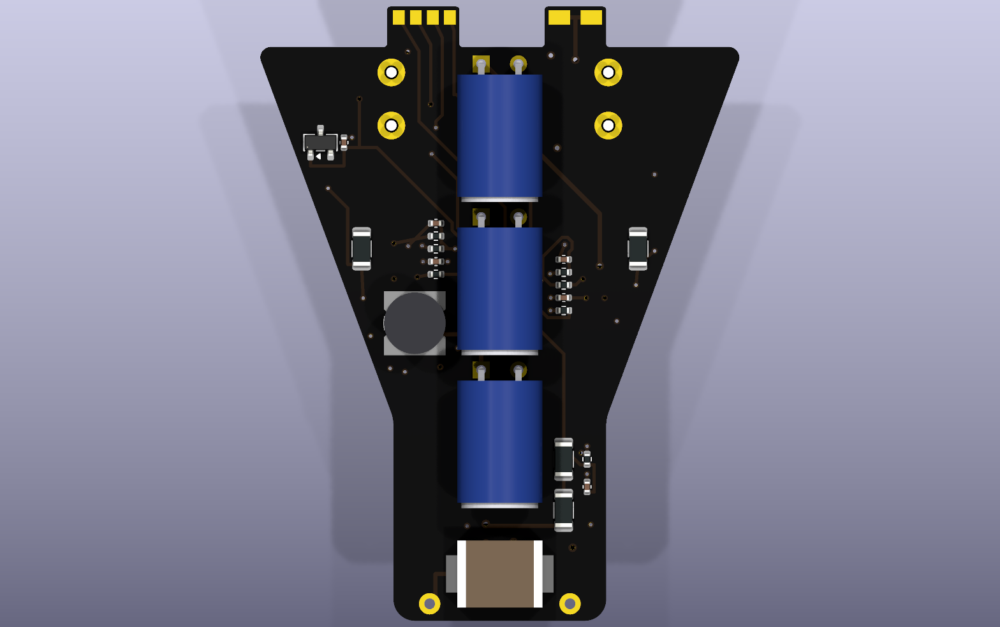 | 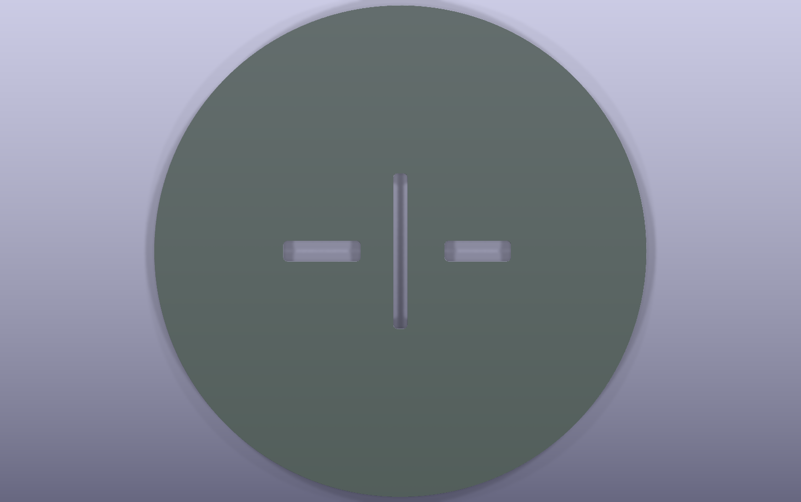 | 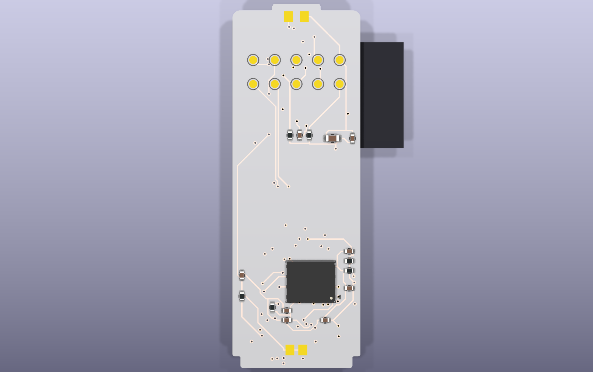 | 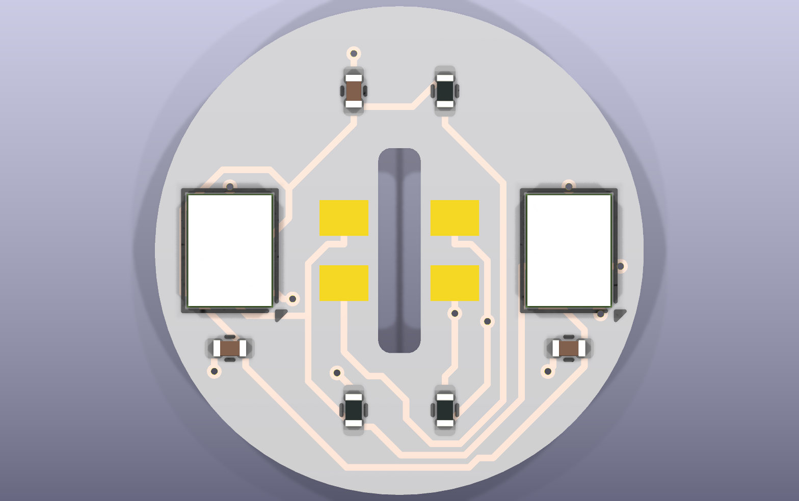 |

Every layer of each board is in [`docs/layers/`](docs/layers/), and each schematic in `docs/`.

## What is hard about it

| Problem | What v0.1 does |
|---|---|
| A bulb's inside is a cone, a sphere and a 20 mm tube, and a mains supply, 2 LED drivers, 2 processors and 2 microphones must fit in it | 4 boards in 2 directions: 2 stand at 90 degrees to each other, 2 lie across them, joined by soldered tongues through slots. `bulb.py` holds the housing as numbers and every part's height, and stops a design whose part leaves the housing or meets another board |
| Every node of a non-isolated bulb sits at mains potential | IPC-2221B spacings in [`rules/lark.kicad_dru`](rules/lark.kicad_dru): 0.8 mm between the mains nets and the logic on the outer layers, 0.2 mm inside the board; the housing is the insulation |
| A fan's blades turn any light ripple into a strobe | average-current bucks with analog dimming (no PWM at the LEDs), and 9.9 uF of bulk that holds the bus over the strings' highest voltage through every 120 Hz valley: 117.0 V at the worst corner against the 103.3 V the controllers need |
| A switch on the side of a mains-powered bulb | the slider is a magnet outside the sealed housing over 2 Hall switches inside it: no contact, no hole, no insulation to bridge |
| Voice in the bulb, with no cloud | an ESP32-S3 with 8 MB of PSRAM for ESP-SR's front end, wake word and command models; its own radio is not wired, and it reaches the network only through the C6's UART, which carries commands, never sound |
| The microphones in a hot, closed dome | the ear at the dome's tip, the coolest place in a bulb that hangs base-up; SPH0641LU4H-1, rated to 100 C at 3.6 V |

## What changed in v0.1: the first bulb

The owner asked for a bulb for a ceiling fan that takes mains power, joins Alexa or Apple's home
with a switch on its side, and takes voice in the bulb itself as the main way to work it, because
their Matter devices did not work well. Then: make it as compact as it can be to fit the bulb, and
grow it, or stack boards in more than 1 direction, where it cannot fit. [`../LOOP.md`](../LOOP.md)
has each pass.

| Finding | The owner's answer | What v0.1 does |
|---|---|---|
| A DIP switch through the housing of a non-isolated bulb puts mains-connected contacts under a finger | not asked in this round | a magnetic slider over 2 Hall switches, 3 places: Alexa, voice only, Apple (Decisions) |
| Matter is the one standard both Alexa and Apple read, and it is the one the owner's devices failed at | not asked in this round | each system's own local protocol: Zigbee 3.0 to an Echo's hub, HomeKit over Thread to an Apple home hub; voice works with neither (Decisions) |
| The driver did not fit in an A15 | "expand the design as well if it cannot fit, or use multiple dimensions of stacked boards" | A19, and 4 boards in 2 directions |

### Board

The driver stands on the bulb's axis in the XZ plane, from 5 mm over the base's eyelet to 1 mm under
the disc. The tall parts stand on the axis, where the cavity is deepest: the 3 bulk capacitors lie
in a column on the back, and the 2 LED chokes stand on the front in the neck's widest part. The
mains parts are surface-mount in the base, where a lead through the board would stand under a part
on the other face. In1 is a ground plane; each surface GND pad has its own via to it.

The driver took the most work to route ([`../LOOP.md`](../LOOP.md), passes 6, 7 and 9). The router's
file gets In1 back as a power layer holding the GND plane, so the router has no GND to join, and a
class-pair rule that keeps the LinkSwitch's nets 0.8 mm from the logic while they stay 0.2 mm from
each other (`DriverDesign.dsn`). Inside the board the mains nets keep IPC-2221B's 0.2 mm for
internal conductors, outside 0.8 mm. The router cannot start a track from the HV tongue's pads,
which stand 0.35 mm from the tongue's top edge, under the HV class's 0.8 mm; it also left each
controller's links at the cone's narrow edge open. `hand_routes()` in `driver/design.py` draws
those: the 3 string nets from the tongue, the LV tongue's 4 back pads in a bundle past C4's and L3's
leads, each controller's VIN, CS and GATE, U2's VDD, LD and RT, HALL_A, HALL_B and the +3V3 for U6
through the 2.4 mm between L3's leads, LED_A under R9, and DIM_C: 94 track segments and 23 vias
on 20 nets, each coordinate read from the board's pads. With the 25 ground vias and their tracks,
FreeRouting routed the rest in 1 round: 252 segments and 17 vias, 0 links open.

The light disc lies on the neck's ledge. Its 16 LEDs stand on 17 places round a ring, the 17th the
gap where the warm string's ends cross; each color's 8 LEDs alternate round the whole ring. Every
track on the disc is drawn in `light/design.py`: the router is not used.

The brain stands on the disc in the YZ plane, 90 degrees round from the driver, and reaches the ear.
The C6 module's antenna stands past the mast's edge into the dome, clear of every copper layer. The
brain routed with 602 segments and 68 vias.

The ear lies under the dome's tip, its top face 2.4 mm under it; a gasket ring joins each
microphone's port to its own hole in the dome. It routed with 88 segments and 11 vias.

### Simulation

Every deck is in its board's `sim/`; `workcenter sim <board>` runs each at its corners
(`sim/corners.json`: the temperatures and each part's tolerance, with their sources).

| Board | Deck | What it holds |
|---|---|---|
| driver | `bus_valley` | the bus through each 120 Hz valley at 8.3 W and 120 V rms: its lowest point over the strings' 103.3 V, its peak under 320 V, the inrush under the bridge's rating, each bulk capacitor's ripple under its 47 mA |
| driver | `led_channel` | 1 string at full current through the HV9961 model, Infineon's MOSFET model and Diodes' US1J: 100 mA, the switching frequency, the ripple at the LEDs, the drain's peak and the duty under 0.75 |
| driver | `dim_filter` | DIM_W's 20 kHz PWM through R5, R6 and C7 to a steady LD voltage |
| driver | `vbus_sense` | the bus's divider into the C6's ADC |
| driver | `rail_vbus` | the bus's impedance from 1 to 50 kHz, where the pi filter would ring: the frequency plan's resonance |
| driver | `hv9961_model`, `mb10s_model` | the 2 fitted models against their datasheets' rows |
| light | `led_model`, `led_string` | the LED model against Bridgelux DS207; each string's voltage over its bins and temperatures |
| brain | `rail_3v3` | the 3.3 V rail's impedance at the brain, through L4, the driver's and the brain's capacitors and the disc's traces: its peak under 3.0 ohm, and the frequency plan's resonance |
| brain | `ntc_divider` | the disc's NTC at the C6's ADC: 1.58 V at 85 C, 1.085 V at 105 C |
| brain | `en_delay` | each chip's enable after the rail: 13 ms |
| ear | `mic_supply` | the LinkSwitch's ripple through R2 and C1 to the microphones: under 3 mV |

### Firmware

`firmware/src/light.c` holds the rules the boards depend on, free of ESP-IDF so that the host tests
run them (`make -C firmware test`, 6 tests):

- `lark_mode_from_hall()`: the slider's place from HALL_A and HALL_B. Both low is no place the
  slider has, and the bulb stays in voice mode.
- `lark_mix()`: a level and a color temperature into the 2 strings' shares, on the mired scale,
  with warm and cool together at most `LARK_BUDGET`, 90 % of one string's full current. A share
  under 13.5 % rounds to 0 or 13.5 %: under it the HV9961's LD voltage stops the controller.
- `lark_foldback_line()`: the budget falls in a line from 110 V to half at 103 V of the bus's
  valley, the strings' 77.5 V over the controller's duty limit of 0.75.
- `lark_foldback_temp()`: from the disc's NTC, the whole budget to 85 C, a fifth at 105 C, off
  over 110 C.

Not written: the voice front end on the S3 (ESP-SR's AFE, WakeNet and MultiNet), the UART
protocol between the 2 chips, Zigbee and HomeKit on the C6, and the firmware updates the C6 gives
the S3 through its CHIP_PU and GPIO0.

### Parts and cost

Every part is in the bill of materials below. `workcenter costs` has not run for this version: an
open item.

## The bulb

The bulb's frame: z along the axis from the base's contact (z = 0) to the dome's tip, x and y
across. The driver stands in the XZ plane with its front toward -y; the brain in the YZ plane with
its front toward +x; the light disc and the ear lie in the XY plane, their fronts toward the tip.

| Board | Where | z | Joints |
|---|---|---|---|
| driver | the neck and the base | 5.0 to 59.0, the tongues to 62.8 | 2 tongues through the light disc: LV (8 signals) at +x, HV (the 2 strings) at -x |
| light | across the neck's top | 60.0 to 61.0 | 3 slots: the driver's 2 tongues and the brain's |
| brain | up the dome | 59.5 to 105.0 | its bottom tongue through the light disc (10 pads), its top tongue through the ear (4 pads) |
| ear | under the dome's tip | 104.2 to 105.0 | 1 slot: the brain's top tongue |

### Driver (`driver/`)

Mains: J1 (the base's eyelet, L) and J2 (its shell, N). F1, a 10 ohm fusible resistor, limits the
inrush and opens on a fault; RV1 (150 V rms) clamps a surge; BR1 rectifies. C2, L1 and C3 with C4
are a pi filter: 9.9 uF of 400 V electrolytic.

LEDs: 2 average-current bucks, U1 (warm) and U2 (cool), each an HV9961 with an IPN60R1K5PFD7S
MOSFET, a US1J diode and a 2.2 mH choke. The strings' anodes sit on the bus (LED_A); each string's
cathode returns through its choke to its MOSFET. The current is 0.185 x V(LD) / R_CS (Microchip
DS20005588B): the brain's 20 kHz PWM on DIM_W and DIM_C, filtered to a steady LD voltage by R5 to R8
and C7, C8, sets each string's current from 13.5 % to 100 % of 100 mA. LED_EN holds both off until
the brain runs.

3.3 V: U3, a LinkSwitch-TN2 LNK3205 as a high-side buck from the bus straight to 3.3 V for the
brain and the ear, always on: the bulb listens with the light off.

The mode slider: U5 and U6, DRV5033 Hall switches at the neck's +x edge, 19 mm apart along it,
under the slider's magnet track.

VBUS_SENSE: 2 M over 24.9k into the C6's ADC, for the firmware's low-line foldback.

### Light (`light/`)

16 Bridgelux 2835 LEDs, 9 V each (BXEN-27G-13H-9C, 2700 K, and BXEN-50G-13H-9C, 5000 K), 8 in each
string. RT1, a 100k NTC, reads the disc's temperature for the brain. The disc's 6 pad rows (J1 to
J6) take the driver's 2 tongues and the brain's tongue; its tracks carry the 2 strings and the 8
signals between the driver and the brain.

### Brain (`brain/`)

U1, an ESP32-C6-MINI-1-H4 (rated to 105 C), is the bulb's network and its light: Zigbee 3.0 or
HomeKit over Thread by the slider, and the 2 LED currents. U2, an ESP32-S3R8 (85 C with its PSRAM's
ECC on), hears: its 8 MB of octal PSRAM holds ESP-SR's front end, wake word and command models. Its
own radio is not wired; the only path out of it is U1's UART, which carries commands, never sound.
U1 holds U2's CHIP_PU and GPIO0, so U1 can update U2's firmware. U3, a W25Q128JVPJQ (105 C), is U2's
16 MB flash. Test pads on the back (TP1 to TP10) give a pogo jig both chips' USB, U1's console and
its boot strap.

### Ear (`ear/`)

MK1 and MK2, Knowles SPH0641LU4H-1 PDM microphones, 10.4 mm apart, share 1 clock and 1 data line:
MK1 answers on 1 clock edge, MK2 on the other, and U2 reads both in its PDM receiver at 2.048 MHz,
128 times ESP-SR's 16 kHz. Both are -26 dBFS and 64.3 dB(A) SNR, which ESP-SR's microphone guide
asks for. R2 (47 ohm) and C1 (2.2 uF) take the LinkSwitch's 66 kHz ripple off their supply. R3
holds the clock low while U2 resets, and with no clock the microphones sleep.

### Stackup

| Board | Layers | Copper | Use |
|---|---|---|---|
| driver | 4, 1.6 mm FR-4 | 35 um outer, 35 um inner | F.Cu and B.Cu parts and tracks; In1 the ground plane; In2 tracks |
| light | 1 on 1.0 mm aluminum | 35 um | the LEDs and every track; the aluminum carries the heat to the housing. B.Cu stands for the aluminum in the generated files and is empty |
| brain | 4, 1.0 mm FR-4 | 35 um | F.Cu and B.Cu parts and tracks; In1 the ground plane; In2 tracks |
| ear | 2, 0.8 mm FR-4 | 35 um | parts on B.Cu, facing the dome's tip; a ground pour on F.Cu |

## Datasheets, models and simulation

The library is [`../library/`](../library/), listed in `library/sources.csv` with each file's
revision and SHA256 (`workcenter sources`). The makers' models used as published: Infineon's
CoolMOS PFD7 models (its L0 level: the L1 level's package inductances stall ngspice at each
turn-off) and Diodes' US1J. Fitted here, each with its own deck against its datasheet:

- `driver/sim/models/hv9961.lib`: the HV9961's average-current loop, off-time timer, blanking and
  VDD regulator, against DS20005588B's rows (VDD 7.5 V, the off-times, the 250 ns blanking, VCST,
  the LD gain). Microchip publishes a SIMetrix/SIMPLIS model only.
- `driver/sim/models/mb10s.lib`: the bridge's forward drop, against onsemi's MB10S rev. 3.
- `light/sim/models/led_2835_9v.lib`: 3 dies in series, against Bridgelux DS207's forward voltages
  at 25 C and 85 C. Bridgelux publishes no SPICE model.

Power Integrations publishes no SPICE model for the LNK3205 (PI Expert only), and none of the
decks puts it in a loop: the 3.3 V rail's decks take its output as a source with its ripple.

## Pin plan

U1, the ESP32-C6-MINI-1-H4 (Espressif datasheet v1.5, Table 3-1; straps Tables 4-1 and 4-3):

| Pin | Port | Signal | Function |
|---|---|---|---|
| 3 | 3V3 | +3V3 | supply |
| 8 | EN | C6_EN | enable, 10k and 1 uF from the rail |
| 12 | IO0 | NTC | ADC1 channel 0: the disc's temperature |
| 13 | IO1 | VBUS_SENSE | ADC1 channel 1: the bus |
| 5 | IO2 | DIM_W | LEDC, 20 kHz: the warm string's level |
| 6 | IO3 | DIM_C | LEDC, 20 kHz: the cool string's level |
| 9 | IO4 | LED_EN | both HV9961s' PWMD |
| 10 | IO5 | HALL_A | the slider over U5: Alexa |
| 15 | IO6 | HALL_B | the slider over U6: Apple |
| 16 | IO7 | S3_EN | U2's CHIP_PU |
| 24 | IO18 | S3_BOOT | U2's GPIO0 |
| 28 | IO22 | S3_RXD | UART1 TX to U2 |
| 29 | IO23 | S3_TXD | UART1 RX from U2 |
| 22 | IO8 | C6_IO8 | strap, 10k up |
| 23 | IO9 | C6_BOOT | strap, test pad |
| 17, 18 | IO12, IO13 | C6_DN, C6_DP | USB Serial/JTAG, test pads |
| 30, 31 | RXD0, TXD0 | C6_RX0, C6_TX0 | the console, test pads |

U2, the ESP32-S3R8 (Espressif datasheet v2.2, Tables 2-1 and 2-11):

| Pin | Port | Signal | Function |
|---|---|---|---|
| 4 | CHIP_PU | S3_EN | enable, from U1 |
| 5 | GPIO0 | S3_BOOT | boot strap, from U1 |
| 8 | GPIO3 | S3_IO3 | JTAG strap, 10k down |
| 9 | GPIO4 | PDM_CLK | I2S0 PDM clock to the ear, 2.048 MHz |
| 10 | GPIO5 | PDM_DATA | I2S0 PDM data from the ear |
| 25, 26 | GPIO19, GPIO20 | S3_DN, S3_DP | USB, test pads |
| 49 | U0TXD | S3_TXD | to U1 |
| 50 | U0RXD | S3_RXD | from U1 |
| 53, 54 | XTAL_N, XTAL_P | XTAL_N, XTAL_P | 40 MHz crystal |
| 29 | VDD_SPI | VDD_SPI | the flash's supply |
| 30 to 35 | SPI pins | FL_IO0 to FL_IO3, FL_CLK, FL_CS | U3, quad SPI |

## Bill of materials

| Ref | Value | Package | Face | Part |
|---|---|---|---|---|
| **driver** | | | | |
| J1, J2 | L (eyelet), N (shell) | 2.0 mm pad, 1.0 mm hole | front | the base's leads |
| F1 | 10 ohm, fusible | MELF 0207 | front | fusible resistor |
| RV1 | 150 V rms | 8.0 x 6.3 mm | back | TDK B72650M0151K072 (CU3225K150G2) |
| BR1 | 1000 V, 0.8 A | TO-269AA | front | onsemi MB10S |
| C1 | 100 nF, 630 V | 1812 | front | X7R |
| C2, C3, C4 | 3.3 uF, 400 V | 8 x 11.5 mm, lying | back | Nichicon ULD2G3R3MPD |
| L1 | 470 uH | 5.8 mm | back | Bourns SDR0604-471KL |
| U1, U2 | HV9961LG-G | SOIC-8 | front | Microchip |
| Q1, Q2 | 600 V, 1.5 ohm | SOT-223 | front | Infineon IPN60R1K5PFD7S |
| D1, D2, D4 | US1J | SMA | front | Diodes US1J-13-F |
| D3 | ES1J | SMA | front | Diodes ES1J-13-F |
| L2, L3 | 2.2 mH | 9.5 mm radial | front | Fastron 07HVP-222K-51 |
| C14, C15 | 2.2 uF, 100 V | 1206 | front | X7R |
| R1, R3 | 2.74 ohm, 1 % | 1206 | back | current sense |
| R2, R4 | 54.9k, 1 % | 0402 | back | off-time |
| R5, R7 | 12.1k, 1 % | 0402 | back | LD divider |
| R6, R8 | 10k, 1 % | 0402 | back | LD divider |
| C5, C6, C7, C8 | 1 uF | 0402 | back | VDD, LD |
| R9 | 0 ohm | 1206 | front | LED_A to the bus |
| U3 | LNK3205D | SO-8C | front | Power Integrations |
| L4 | 150 uH | 5.8 mm | front | Bourns SDR0604-151KL |
| C10 | 100 nF | 0603 | front | BP |
| C11 | 10 uF | 0805 | front | feedback |
| R10, R11 | 1.54k, 2.49k, 1 % | 0402 | front | feedback divider |
| C12, C13 | 47 uF | 1206 | front | the 3.3 V rail |
| R12 | 1k | 0603 | front | minimum load |
| R13, R14 | 1 M, 1 % | 1206 | back | bus sense |
| R15 | 24.9k, 1 % | 0402 | back | bus sense |
| C16 | 10 nF | 0402 | back | bus sense |
| U5, U6 | DRV5033AJQDBZ | SOT-23 | U5 front, U6 back | TI Hall switch |
| C17, C18 | 100 nF | 0402 | as U5, U6 | |
| J3 to J6 | tongues | | front and back | solder joints to the light disc |
| **light** | | | | |
| D1 to D8 | 2700 K, 9 V | 2835 | front | Bridgelux BXEN-27G-13H-9C |
| D9 to D16 | 5000 K, 9 V | 2835 | front | Bridgelux BXEN-50G-13H-9C |
| RT1 | 100k, B 4250 K | 0402 | front | Murata NCP15WF104F03RC |
| J1 to J6 | slot pads | | front | solder joints to the tongues |
| **brain** | | | | |
| U1 | ESP32-C6-MINI-1-H4 | module | front | Espressif |
| U2 | ESP32-S3R8 | QFN-56 7 x 7 mm | front | Espressif |
| U3 | W25Q128JVPJQ | WSON-8 6 x 5 mm | back | Winbond |
| Y1 | 40 MHz, 10 pF | 2016 | front | crystal |
| C14, C15 | 12 pF | 0402 | front | crystal load |
| C1, C4 | 10 uF | 0603 | back, front | |
| C3, C5, C9, C11, C13 | 1 uF | 0402 | both | |
| C2, C6, C7, C8, C12, C16 | 100 nF | 0402 | both | |
| C10 | 10 nF | 0402 | front | |
| C17 | 47 uF | 1206 | front | the rail's bulk at the brain |
| R1 to R8 | 10k | 0402 | both | enables, straps, pull-ups, the NTC's divider (R8, 0.1 %) |
| TP1 to TP10 | test pads | 1.0 mm | back | |
| J1 to J4 | tongues | | front and back | solder joints to the light disc and the ear |
| **ear** | | | | |
| MK1, MK2 | SPH0641LU4H-1 | LGA 3.50 x 2.65 mm | back | Knowles |
| R2 | 47 ohm | 0402 | back | supply filter |
| C1 | 2.2 uF | 0402 | back | supply filter |
| C3, C4 | 100 nF | 0402 | back | at each microphone |
| R1, R3 | 100k | 0402 | back | PDM_DATA and PDM_CLK held low |
| J1, J2 | slot pads | | back | solder joints to the brain's top tongue |

## Regulation and safety

- **Mains.** The bulb is not isolated: every node is at mains potential to earth, and the housing is
  the insulation. The boards' spacings follow IPC-2221B Table 6-1 for 151 to 250 V: 0.8 mm between
  the mains nets and the logic on the outer layers (A6, a coated lead or termination), 0.2 mm inside
  the board (B1). A lamp sold in the US is listed to UL 1993 with its driver to UL 8750; neither
  listing is started.
- **The switch.** The slider's magnet sits outside the sealed housing and the Hall switches inside:
  no conductive part of the switch reaches the outside.
- **Standby power.** The bulb listens with the light off. Its logic takes about 0.6 W, about 0.9 W
  from the mains through the LinkSwitch (the bus deck's share). California's Title 20 holds a
  state-regulated LED lamp's standby to 0.2 W: v0.1 does not meet it (Open items).
- **Radio.** The C6 module carries its own FCC and IC grants (Espressif); the bulb needs its own
  unintentional-radiator testing (FCC Part 15 Subpart B) with its LED drivers running.
- **HomeKit.** A HomeKit accessory sold to the public needs Apple's MFi program; Apple's open HomeKit
  ADK is for development only.

## Working on this board

Run the commands from this folder (`examples/fan-bulb/v0.1`). Each board is a nested project.

```sh
PYTHONPATH=<workcenter>/tools python3 footprints/make_footprints.py   # footprints/Lark.pretty
PYTHONPATH=<workcenter>/tools python3 footprints/make_models.py       # each board's models/
workcenter design driver/design.py --route   # regenerate one board's KiCad project; likewise light, brain, ear
workcenter gates driver                      # ERC, DRC, simulation, export; GREEN means done
workcenter sim driver                        # the sim/ decks alone; one deck: --deck NAME --keep
workcenter sources driver                    # the board's parts against ../library/sources.csv
make -C firmware test                        # the light's rules, on the host
workcenter pictures .                        # the renders, turning GIFs and the assembly into docs/ (P23)
```

The light disc's tracks are all drawn in `light/design.py`: `workcenter design light/design.py`,
without `--route`, writes the whole board. The other 3 route with FreeRouting.

## Decisions

- **A magnetic slider, not a DIP switch** (v0.1). The owner asked for a DIP switch on the side. In a
  non-isolated bulb a switch's contacts are at mains potential, and a switch through the housing
  needs reinforced insulation between its lever and its contacts. A magnet in a slider outside the
  sealed housing over 2 Hall switches inside gives the same 3 places with no opening. My call; the
  owner can still ask for a switch.
- **Zigbee 3.0 for Alexa, HomeKit over Thread for Apple, not Matter** (v0.1). The owner's Matter
  devices did not work well. Each system's own local protocol is the one it has supported longest:
  an Echo with a Zigbee hub in it pairs a Zigbee 3.0 light directly, and an Apple home hub (a HomePod
  mini, a HomePod or an Apple TV 4K) is a Thread border router for HomeKit. The ESP32-C6 runs either;
  the slider chooses, so 1 bulb never joins 2 systems at once. Matter stays possible on the same
  radio. My call.
- **2 chips, not 1** (v0.1). The C6 has the 802.15.4 radio Zigbee and Thread need, and no room for
  ESP-SR's models; the S3 runs ESP-SR with its 8 MB of PSRAM and has no 802.15.4 radio. The S3's
  own radio is left unwired, so sound never leaves the bulb. My call.
- **A19, not A15** (v0.1). The A15 was tried first; its driver's parts each fit but not together.
  The owner's answer covered it: "expand the design as well if it cannot fit".
- **Analog dimming, a 90 % power budget** (v0.1). PWM at the LEDs strobes under a fan's blades. At
  the bulk capacitors' corners, warm and cool both at full current would carry 48.4 mA against their
  47 mA rating: the firmware holds the 2 together to 90 % of one string. My call.
- **The ear at the dome's tip** (v0.1). The microphones face the room through the dome, each through
  a sealed gasket, at the coolest place of a bulb that hangs base-up. Their 10.4 mm spacing is far
  under the 4 to 6.5 cm ESP-SR's 2-microphone front end is tuned for (Open items). My call.

## Open items

Candidates for v0.2, from v0.1's work:

- Standby power: about 0.9 W from the mains with the voice front end running, over Title 20's 0.2 W.
  A wake-word chip that listens at a few mW, waking the S3, is the candidate.
- The microphones' spacing: 10.4 mm, against the 4 to 6.5 cm ESP-SR's 2-microphone front end is
  tuned for. Its beamforming gains little at 10.4 mm; a single-microphone front end, or the 2
  microphones across the dome's width, is the choice to make.
- A wake word of the bulb's own: ESP-SR ships "Hi ESP", "Computer" and others; "Alexa" is one, and
  would wake the owner's Echo too. Espressif trains a custom word as a service.
- A parts catalog with each line's distributor number (`parts.csv`), then `workcenter sources` per
  board and `workcenter costs` for 1 bulb and 10; and the verification package (P28).
- The fan's own control: many fan light kits dim with a triac or switch the light from a remote's
  receiver. v0.1 expects a steady 120 V at the socket; a phase-cut input is not handled.
- 230 V mains: the bus, the LinkSwitch's ratings and the spacings are for 120 V rms.

On the bench and elsewhere:

- The firmware: ESP-SR on the S3, the UART protocol, Zigbee and HomeKit on the C6.
- The housing: the neck's ribs that hold the driver, the disc's ledge, the gasket rings at the
  microphones' holes, and the slider's track, drawn from `bulb.py`'s numbers.
- Every gate's numbers on a built bulb: the bus's valley, the LED current, the disc's temperature in
  a closed fan globe, and what the microphones hear through the dome.
