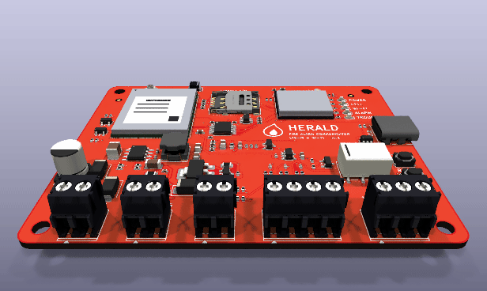
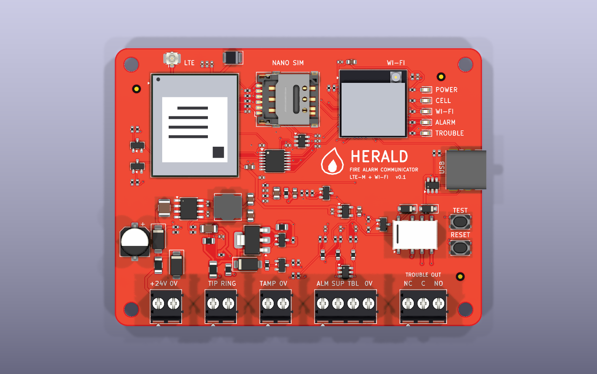
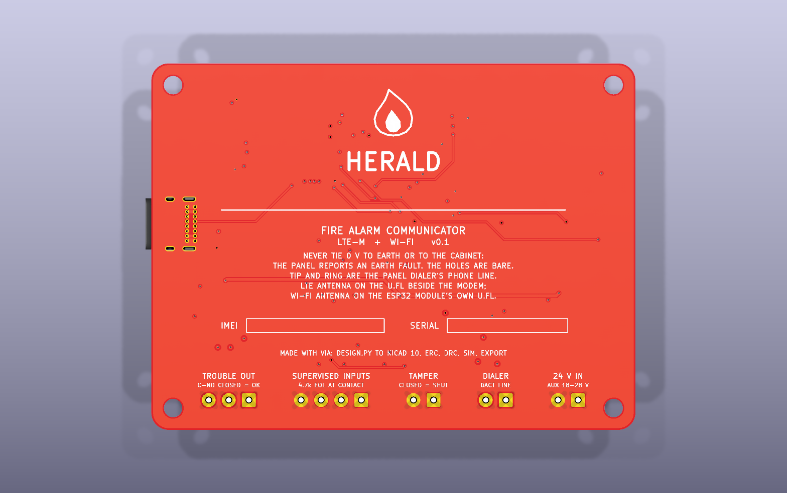
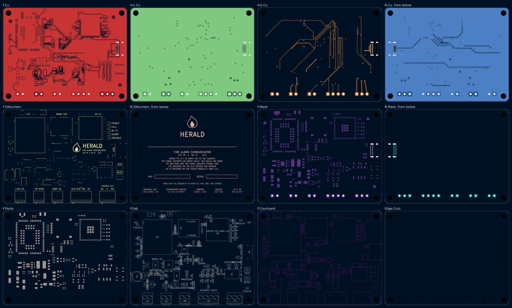
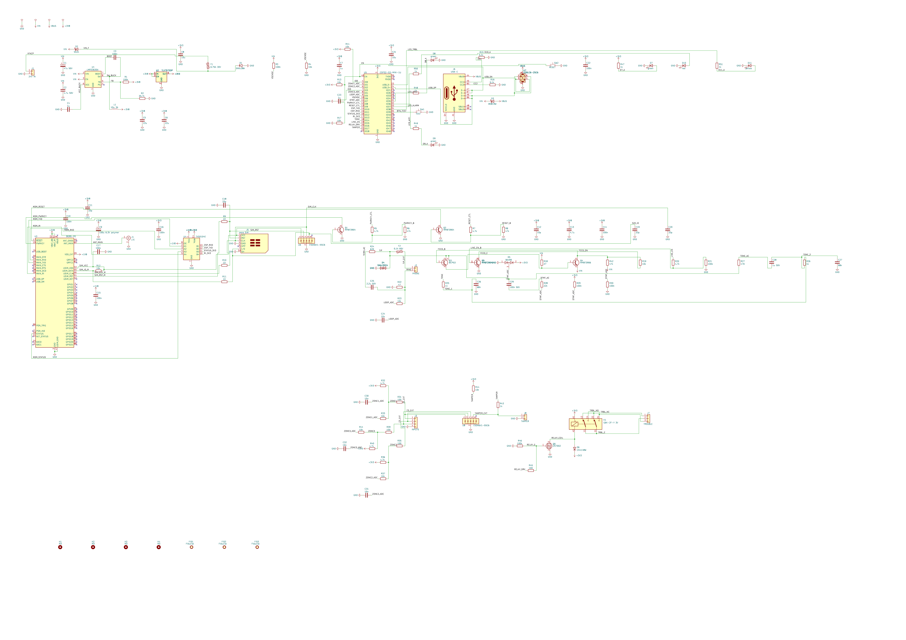

# Herald v0.1: a fire alarm communicator

Herald sits in a cabinet beside a fire alarm control panel and reports what the panel reports to a
monitoring station: over LTE-M first, over Wi-Fi when the cell path is down. It takes the panel's
signals 2 ways. It answers the panel's own phone dialer as if it were the phone line, and it reads
3 supervised relay contacts. A relay tells the panel when Herald itself is in trouble.

This folder is a whole KiCad 10 project made with the EE Workcenter: `design.py` is the board,
and the `.kicad_*` files beside it are what `workcenter design` writes from it. It is one of the
workcenter's example projects, laid out the way a board repository lays out a version.

<!-- pictures:begin -->


| Front | Back |
|---|---|
|  |  |

| Every layer | The schematic, wired, in blocks |
|---|---|
|  |  |

From `workcenter render . --strict --views schematic,3d,layers,spin --width 1600 --spin-zoom 1.1`,
with KiCad's 3D bodies in `KICAD10_3DMODEL_DIR` (the workcenter's `site/media/README.md` says how to
fetch them) and the 3 bodies in `models/`.
<!-- pictures:end -->

## What is hard about it, and where each part lives

| The problem | The answer on this board |
|---|---|
| A fire panel reports by phone, and there is no phone line | J2 is the panel dialer's line. Q3 (BCP53) and Q4 (MMBT3906) feed it a current-limited loop from the 24 V input: Q4 holds 0.55-0.75 V across R18 (27 ohm), 20 to 28 mA. R22 (47 ohm) in the return reads the loop current, so the ESP32 sees the dialer go off hook. The ESP32 then plays dial tone, the handshake and the kissoff from a PWM pin through 2 RC poles (R25-R27, C26-C28), and hears the dialer's DTMF digits on an ADC pin through C29 and R28 onto a mid-rail bias. `sim/tone_out.cir` and `sim/dtmf_in.cir` hold each level at every corner. |
| DTMF without a DTMF chip | `firmware/src/dtmf.c` runs a Goertzel filter per DTMF frequency over 25.6 ms windows, 12.8 ms apart, at 8 kHz. It takes and refuses what ITU-T Q.24 (Table A-1) says a receiver must: 0 to -25 dBm, the high tone 4 dB over to 8 dB under the low one, 1.5 % off frequency but not 3.5 %, 40 ms digits but not 23 ms ones. The host tests play all 16 keys and a whole Contact ID call through it. |
| A panel that reports by relay | 3 supervised inputs on J3. Each loop ends in a 4.7k resistor across the panel's contact, so the ADC tells a closed contact, a whole loop and a cut wire apart. R32 (4.7k) pulls each loop up, R31 (100) meets the field wiring, U8 clamps it. `sim/zone_*.cir` hold every reading 200 mV or more from the firmware's thresholds at every corner. |
| The panel must know when Herald fails | K1 (Omron G6K-2F-Y) is held on while Herald is healthy. A lost supply opens it, and so does a reset: R46 holds Q6 off until the firmware drives it. The panel sees its supervisory or trouble input change. Both poles run in parallel. |
| 2 paths to the station | U3, a Quectel BG95-M1 (LTE-M), with its nano SIM (J5) and antenna connector (J4). The ESP32-S3's own Wi-Fi is the second path; its antenna is on the module's u.FL. The BG95's I/O is 1.8 V: U4 (TXS0104E) carries its UART, STATUS and RI to the ESP32's 3.3 V. |
| When neither path works | Q5 (LINE_EN) lets the firmware drop the line feed. The panel then sees no phone line and reports its own communication trouble, the way it would for a cut line. R21 holds the feed off while the ESP32 is in reset. |
| The panel's 0 V must not touch the cabinet | A fire panel watches for an earth fault: any path from its wiring to earth. The 4 mounting holes are bare, and nothing ties GND to them. The back of the board says so. |

## The board

- 84.4 x 64 mm, 4 layers, 1.6 mm: F.Cu signal and a GND pour, In1.Cu a whole GND plane, In2.Cu
  signal, B.Cu signal and a GND pour. Every part is on the front. Order it as 4 layers.
- Red solder mask, white legend, ENIG: `design.py`'s `HeraldDesign` writes the colours into the
  stackup, and `workcenter render` draws the board in them.
- The field wiring enters along the bottom edge: 24 V in, the phone line, the 3 inputs and their
  common, the trouble relay's contacts, and the cabinet's tamper switch. Each terminal block's
  wire entry faces the edge.
- The status lights (power, cell, Wi-Fi, alarm, trouble), the USB-C port for set-up and the TEST
  and RESET buttons sit on the right edge; the LTE antenna connector in the top-left corner.
- The antenna feed from the BG95's pad 60 to J4 is drawn by hand, 0.35 mm: 50 ohm over In1.Cu.

### Power

J1 takes the panel's 24 V auxiliary output, 18 to 28 V. F1 (a PTC) and D1 (SMAJ28A) come first: a
surge is clamped, and a supply wired backwards drives D1 forward until F1 trips. D2 (SS34) keeps the
reversed voltage off everything else. U1 (LMR33630, 3 A, 400 kHz) makes +3V8 for the modem; U2
(TLV75733P, 1 A) makes +3V3 from it. The BG95 makes its own +1V8 (VDD_EXT) for its I/O. USB's
5 V reaches the buck through D3, so the board runs on a laptop for set-up. R3 and R4 let the ESP32
read the input.

### The ESP32-S3's pins

| GPIO | Net | To |
|---|---|---|
| 0 | IO0 | the boot strap, held high by R14 |
| 1, 2, 4 | ZONE1_ADC, ZONE2_ADC, ZONE3_ADC | the 3 inputs (ADC1 channels 0, 1, 3) |
| 3 | IO3 | a strapping pin with no pull of its own, held low by R17 |
| 5 | LOOP_ADC | the off-hook sense, R23 from RING (ADC1 channel 4) |
| 6 | VSENSE | the 24 V input through R3/R4 (ADC1 channel 5) |
| 7 | DTMF_ADC | the DTMF input (ADC1 channel 6) |
| 8, 9 | PWRKEY_CTL, RESET_CTL | Q1 and Q2, the BG95's PWRKEY and RESET_N |
| 10, 11 | ESP_TXD, ESP_RXD | the BG95's UART through U4 |
| 12, 13 | STATUS_3V3, RI_3V3 | the BG95's STATUS and RI through U4 |
| 14 | TONE | the tone path (LEDC PWM) |
| 15 | LINE_EN | Q5: the line feed on |
| 16 | RELAY_DRV | Q6: the trouble relay |
| 17 | TAMPER | J8, the cabinet's tamper switch |
| 19, 20 | USB_DN, USB_DP | J6 through U7 |
| 35-38 | LED_CELL, LED_WIFI, LED_ALARM, LED_TRBL | D8-D11 |
| 39 | BTN_TEST | SW1 |

The checks beside the table (`PROCESSES.md` P16): every analog input is on ADC1, because ADC2 is
shared with Wi-Fi (ESP-IDF, "ADC Oneshot", Hardware Limitations). GPIO26 is the PSRAM's on the
N4R2 variant and is left free (datasheet v1.7, Table 3-1, note b). GPIO45 and GPIO46 are straps and
are left to their internal pull-downs (Table 4-1). GPIO3 must not float (section 4.4): R17.

### Connectors

| Ref | Part | Pins |
|---|---|---|
| J1 | Phoenix PT 1,5/ 2-3,5-H BK, 3.5 mm, 2-way, black | 1 +24V (VFACP), 2 0V |
| J2 | Phoenix PT 1,5/ 2-3,5-H BK, 3.5 mm, 2-way, black | 1 TIP (through F2), 2 RING |
| J3 | Phoenix PT 1,5/ 4-3,5-H BK, 3.5 mm, 4-way, black | 1 ALM, 2 SUP, 3 TBL, 4 0V: the 3 loops' common |
| J7 | Phoenix PT 1,5/ 3-3,5-H BK, 3.5 mm, 3-way, black | 1 NC, 2 C, 3 NO of K1 (C to NO closed while healthy) |
| J8 | Phoenix PT 1,5/ 2-3,5-H BK, 3.5 mm, 2-way, black | 1 TAMP, 2 0V: the cabinet door's switch, closed while shut |
| J6 | GCT USB4085, through-hole | VBUS through D3 to the buck, D+/D- to the ESP32, CC1/CC2 5.1k to GND (a device) |
| J4 | Hirose U.FL | the BG95's main antenna |
| J5 | Same Sky NSIM-2-C, hinged | the BG95's USIM: VCC, RST, CLK, I/O through 22 ohm (R9-R11) |

## The call

What the dialer and Herald say to each other, with the firmware's constant for each
(`firmware/src/contactid.h`). The SIA DC-05 text was not read: the values come from 2 open
receivers (spandsp's `ademco_contactid.c`, Asterisk's `app_alarmreceiver.c`), the Zeta ZNDC fire
dialer's manual (5.2-5.3) and DMP's LT-1462, which cites DC-05-1999.09.

| Step | Who | What |
|---|---|---|
| Seize | the dialer | goes off hook: the loop current reads 0.78 V or more on GPIO5 for 20 ms (`LINE_STABLE`) |
| Dial tone | Herald | North America's 350 + 440 Hz, until the first digit |
| Dial | the dialer | the station's number in DTMF; 1.5 s of quiet ends it (`DIAL_GAP_MS`) |
| Handshake | Herald | 1400 Hz 100 ms, silence 100 ms, 2300 Hz 100 ms |
| Message | the dialer | 16 DTMF digits, 50-60 ms on and off: ACCT MT Q XYZ GG CCC S. The values' sum, 0 counted as 10, is a multiple of 15; 11-15 go as `*`, `#`, `A`, `B`, `C` |
| Kissoff | Herald | 1400 Hz for 800 ms after a good message (`KISSOFF_MS`); none after a bad one, so the dialer sends it again |

Fire panels' common event codes: 110 fire alarm, 200 fire supervisory, 300 system trouble, 301 AC
loss, 373 fire trouble, 602 periodic test (Q 1 a new event, 3 a restore).

## What proves it

```sh
workcenter design design.py --route    # the KiCad project, routed: from this folder
workcenter gates .                     # ERC, DRC, SIM, EXPORT
make -C firmware test                  # the inputs, the hook, DTMF and Contact ID on the host
```

- **The gates.** `GREEN with 7 warnings`: ERC 0 errors and 0 warnings; DRC 0 errors and 0
  unconnected, the 7 warnings the silkscreen of the 5 terminal blocks and the USB receptacle
  (2 lines) reaching the edge they face; SIM 8 decks, 573 corner runs; EXPORT 4 of 4 outputs,
  24 gerber files in `build/fab/`.
- **The route.** FreeRouting joins every net but 3, drawn by hand. It found no way for K1's NO
  contact past the strip that keeps tracks off the terminals' names, and took the C contact round
  the relay's label: both run on the front straight down to a via clear of the legend, then on
  In2.Cu under the strip to J7. Left to the router, D+ walled J6's A5 pin in, so CC1 runs from R15
  straight down and across into A5, between D+ and VBUS. A ground via beside 4 pads (U5.63,
  C24.2, J5.SH, C13.2) is placed before the route, so no route walls them off the front pour.
  `workcenter inspect probe` on the routed board finds each track clear and each via meeting only
  itself, and the DRC agrees. Keep-outs hold copper off every word: the front's
  under the mark, the terminals', the lights' and the buttons' names; the back's under the mark,
  the name, the subtitles, the write-on boxes and each terminal group's 2 lines.
- **The supervised inputs, simulated.** `sim/zone_short.cir`, `sim/zone_normal.cir`,
  `sim/zone_normal_wire.cir` and `sim/zone_open.cir` put a closed contact, a whole loop with and
  without 100 ohm of wire, and a cut wire on zone 1, each with 1 uA of leakage pushing toward the
  nearest threshold. The corners (`sim/corners.json`) run 0 and 50 C, every resistor at both ends
  of 1 %, the end-of-line resistor at 5 %, +3V3 at 3 %, and 32 Monte Carlo draws. The worst
  readings: a closed contact 0.151 V, a whole loop 1.555 to 1.798 V, a cut wire 3.186 V; each
  stays 0.2 V or more from the firmware's thresholds (0.6, 1.1 to 2.3, 2.7 V).
- **The hook, simulated.** `sim/loop_offhook.cir` reads 0.776 V at least with the feed's current
  25 % under its 22 mA; `sim/loop_onhook.cir` 0.040 V at most with 0.5 mA of line monitor. The
  firmware's threshold is 0.4 V.
- **The tones, simulated.** `sim/tone_out.cir` puts the PWM through its 2 poles onto the line's
  600 ohm load: 191 to 204 mV peak at 350 Hz (about -15 dBm), 132 to 153 mV at 2300 Hz, and the
  78 kHz carrier 47 dB under the 1400 Hz tone at its worst corner. The first values, 10k and 10n,
  read 28 mV: the line's load took the tone. The deck found it; the poles are 1k and 68n now.
- **The DTMF input, simulated.** `sim/dtmf_in.cir`: a gain of 0.690 to 0.699 at 697 and 1633 Hz,
  under 0.01 dB of twist, the bias at 1.584 to 1.717 V.
- **The firmware.** The host tests hold each zone and hook reading the decks measured to its
  state, play all 16 DTMF keys through the decoder, and check what ITU-T Q.24 (Table A-1) says a
  receiver takes and refuses: 0 to -25 dBm, the high tone 4 dB over and 7.5 dB under the low,
  1.5 % off frequency, 40 ms digits, noise; the high tone 6 dB over or 10 dB under, 3.5 % off,
  -40 dBm, and 23 ms bursts at every phase against the windows, refused. They parse Contact ID
  with hex checksums, and play a whole call: off hook, dial tone, the number, the handshake, a
  supervisory message through the decoder, the kissoff, a bad message that gets none.

## Parts and why

| Ref | Part | Why |
|---|---|---|
| U3 | Quectel BG95-M1 | LTE Cat M1 in an LGA module, in KiCad's library. |
| U5 | Espressif ESP32-S3-MINI-1U | The CPU, the Wi-Fi path and USB in 1 certified module, with a u.FL for an antenna outside a metal cabinet. |
| U1 | TI LMR33630A | 3.8 to 36 V in, 3 A, synchronous, internal compensation: 7 parts round it. |
| U2 | TI TLV75733P | 1 A, 3.3 V, SOT-23-5. |
| U4 | TI TXS0104E | 4 channels, either direction, for a UART between 1.8 V and 3.3 V. |
| Q3 | BCP53 (PNP, SOT-223) | The line feed's pass transistor: up to 0.6 W with the dialer off hook. |
| K1 | Omron G6K-2F-Y, 3 V coil | A small sealed DPDT relay; 33 mA at 3 V, 1 A at 30 V DC on its contacts. |
| U6, U8 | ESDA6V1-5SC6 | 5 clamps in SOT-23-6: the SIM's lines, the 3 inputs and the tamper loop. |
| U7 | USBLC6-2SC6 | The USB data lines' clamp. |
| J1-J3, J7, J8 | Phoenix PT 1,5 3.5 mm | Screw terminals for field wire; each wire entry faces the board's edge. |
| C9 | KEMET T520B, 100 uF 6.3 V polymer | The modem's bulk at VBAT_RF, on the tantalum B-case land: a low ESR for the radio's bursts. |

## What is open

- **Firmware.** The zone classifier, the hook, the DTMF decoder and the Contact ID call are
  written and tested on the host. The tone sequencer, the ESP32's ADC sampling, the BG95's AT
  commands, the station's protocol over LTE-M and Wi-Fi, the trouble relay's watchdog and the
  status lights are not written. Nothing has run on a board.
- **No station protocol is chosen.** Monitoring stations take events over IP in SIA DC-09 or a
  receiver's own format; which one, and its encryption, is the next decision.
- **Listings.** A communicator that a fire alarm system relies on is listed to UL 864 (or the
  local equivalent) as part of that system. This board has been through none of it: no surge
  test, no supervision timing check, no listing.
- **The line feed's on-hook voltage** is the 24 V input, about 23 V. Some dialers want more
  before they call a line good; read the panel's manual. A converter to 48 V would cover every
  dialer, and is the change for v0.2 if a panel asks for it.
- **The BG95's peak current.** The supply is sized for 2 A bursts (U1 is a 3 A buck, C9 100 uF);
  the BG95-M1's own peak was not read from a datasheet: the copy read gives a figure only for
  the M3 and M5.
- **The relay's coil polarity** follows KiCad's G6K symbol (A1 positive). The G6K is a
  polarised relay; check A1 against Omron's drawing (pin 1, coil +) before ordering.
- **The schematic** is wired, ERC 0 errors and 0 warnings, and laid out by `design.py`'s
  `lay_out_schematic()`: each support part beside the pin it serves. It is not arranged by hand:
  a few wires in the modem and phone-line blocks run long.
- **Not ordered.** No board has been made and no part has been priced.
- **The black terminals' order numbers.** The PT 1,5 family comes in black (BK): Phoenix's
  datasheet for the 5.0 mm 3-way (1989450) and a distributor's listing of the 3.5 mm 2-way
  (1775275) show it. The 3.5 mm 3-way and 4-way BK numbers were not confirmed from Phoenix's own
  catalogue, which refused this machine. The 3D bodies are KiCad's, recoloured
  (`models/make_models.py`).
- **3 mm of height.** The last review found the board could be 61 mm tall, not 64: the LDO
  beside the buck, the inputs, the power entry, the phone line's parts and the relay each up
  into the gaps of the lower band. It moves about 25 parts and was left for v0.2.
- **The back's notes.** Keep-outs hold copper off the mark, the name, the subtitles, the boxes
  and the terminal groups' lines. The 5 lines of notes have none: the band under them holds the
  front's ground pads, each with a via beside it (M138), and a few vias and 2 tracks cross them.
