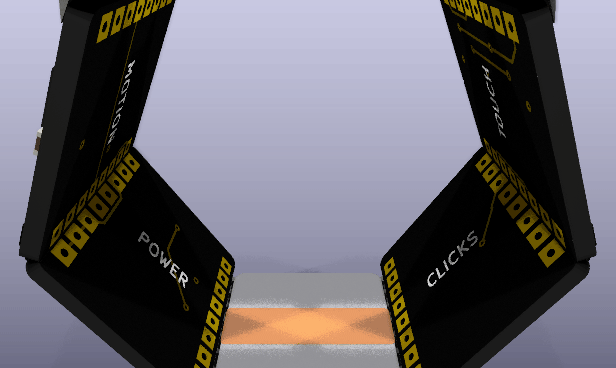
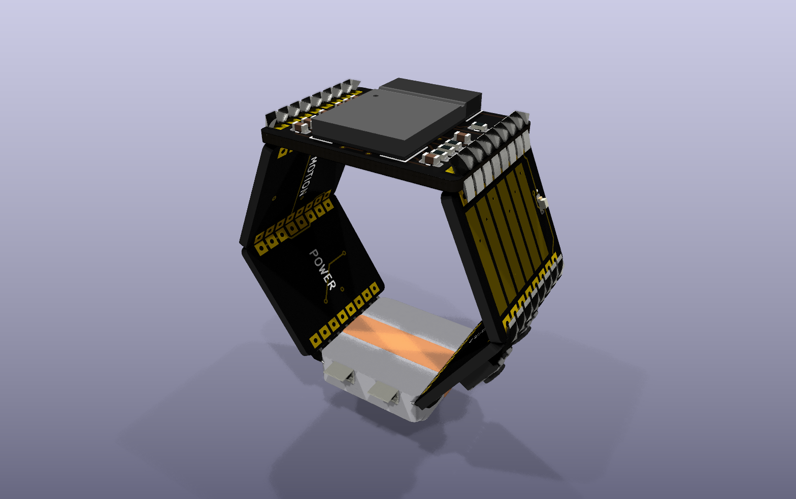
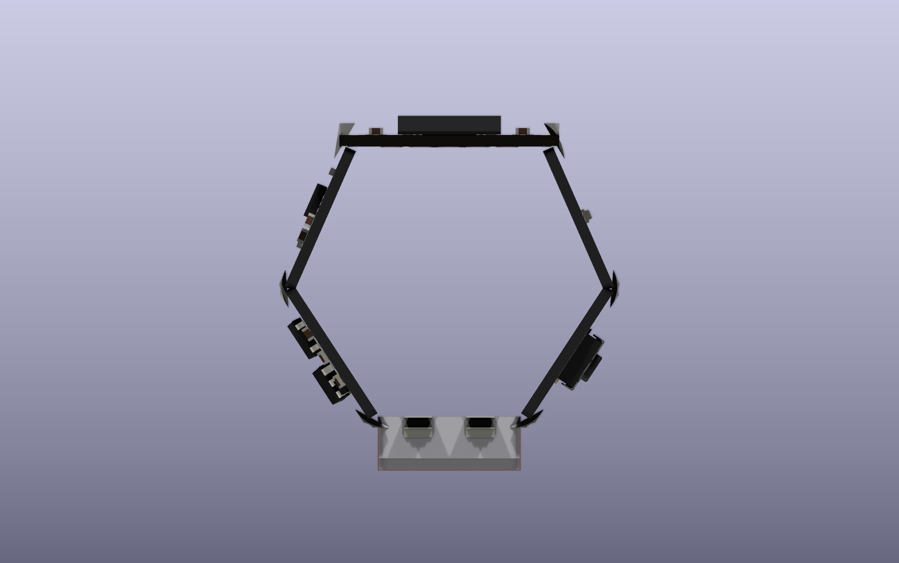

# Signet — prototype series

A mouse you wear as a ring. Six small boards sit on the faces of a hexagonal ring round the index
finger, soldered edge to edge. The ring turns with the hand and moves the cursor; the thumb slides
along a strip to scroll and presses the ring's side to click. It talks Bluetooth LE to the computer
as an ordinary mouse.

This folder is a project made with the EE Workcenter, kept the way
[Last Hit](https://github.com/ThyFriendlyFox/vape-prototype) keeps its prototypes: each version is
its own folder, each tile in it a whole KiCad project built from its `design.py`, with its README,
its pictures under `docs/` and its firmware. The versions came from a loop: each pass judged the
last version against a checklist and made the next ([`LOOP.md`](LOOP.md)).

The latest version, [v0.2](v0.2/), turning:



| The thumb's side | Along the finger |
|---|---|
|  |  |

## Versions

| Version | Ring | What changed | Firmware | Commit |
|---|---|---|---|---|
| [v0.1](v0.1/) | 6 tiles round a 20 mm cylinder, 12 mm along the finger; the radio tile 15.6 mm wide, 4 layers; touch 4 layers; the others 10.8 mm, 2 layers | the first ring: a BLE module, an IMU, a 3-channel scroll strip, 2 clicks, a charger, a 3.3 V rail and a 20 mAh cell on 6 tiles joined by 8-pad solder joints | the scroll strip's decoder, 8 host tests | `e4181fa` |
| [v0.2](v0.2/) (current) | as v0.1; every tile 4 layers | the first pass of the loop: ground only inside, so every face is black; solder in every joint and a foil cell in the pictures; L and R on the clicks, the name on the motion tile | the air mouse: the gyro turned back from the motion tile's angle into cursor counts, with the strip as a clutch, 7 host tests | in work |

Before v0.1, a single flat board was tried: a ring-shaped PCB with a finger hole and a crown. It
did not wrap the finger, and the owner asked for the circuit on the surface of the cylinder. It has
no folder.

## Working on the ring

Run from a version's folder; each tile is a nested project.

```sh
python3 footprints/make_footprints.py           # the joint and the scroll strip, into footprints/Ring.pretty
workcenter design radio/design.py --route       # one tile's KiCad project, routed; likewise each tile
workcenter gates radio --strict                 # ERC, DRC, simulation, export; GREEN means done
make -C firmware test                           # the firmware's host tests
workcenter pictures .                           # every tile's renders and GIF, and the assembly (assembly.py)
```
