# Signet — prototype v0.1

> Archived: v0.1 of the [Signet prototype series](../README.md), as of commit `e4181fa`. The design and KiCad files are the ones that commit holds. The next version, [`../v0.2/`](../v0.2/), makes every face black, draws the solder in the joints and the cell, and turns the gyro into cursor motion.

A mouse you wear as a ring. Six small boards sit on the faces of a hexagonal ring round the index
finger, each soldered to the next along its edge. Turn the ring's crown toward the thumb: the ring
turns with the hand and the cursor follows its gyroscope; the thumb slides along the scroll strip to
scroll, and presses the clicks tile for the left and the right button. The ring talks Bluetooth LE
to the computer as an ordinary HID mouse and charges on a post through 2 pads inside it.

This folder is a whole project made with the EE Workcenter: `ring.py` is what the tiles share,
each tile's `design.py` is its board, and the `.kicad_*` files beside each are what
`workcenter design` writes from it.

| Item | State |
|---|---|
| Ring | 6 tiles on a hexagonal prism whose faces touch a 20.0 mm cylinder (a 19.4 mm finger, US size 9 1/2, in a 0.3 mm liner); 12 mm along the finger; 0.8 mm boards, black mask, white legend, ENIG |
| Tiles | radio 15.6 x 12 mm, 4 layers; touch 10.82 x 12 mm, 4 layers; clicks, cell, power and motion 10.82 x 12 mm, 2 layers. Every part on a tile's outer face; only flat pads on the inner faces |
| Joints | each tile soldered to its 2 neighbours by a row of 8 plated pads, 1.0 mm square, 1.3 mm apart, 0.3 mm from the edge on both boards: the fillet fills the V the 2 boards open outside. A pad no signal needs is ground |
| Schematics | each tile drawn with wires; ERC 0 errors and 0 warnings on all 6; no parity warning |
| Gates | all 6 tiles GREEN; the radio with 2 warnings and the motion tile with 1, all legend ones ([`docs/gates.md`](docs/gates.md)) |
| Simulation | 1 deck on the power tile, the cell's gauge: its ratio, its drain on the cell and its top voltage at 52 corner runs (`power/sim/`) |
| Firmware | the scroll strip's decoder (`firmware/src/strip.c`), 8 host tests (`make -C firmware test`); not yet run on a ring |

## Images

The ring, from the thumb's side and along the finger (`assembly.py` on the workcenter's
`tools/scene.py`, drawn by `workcenter pictures .` from [`pictures.json`](pictures.json)):

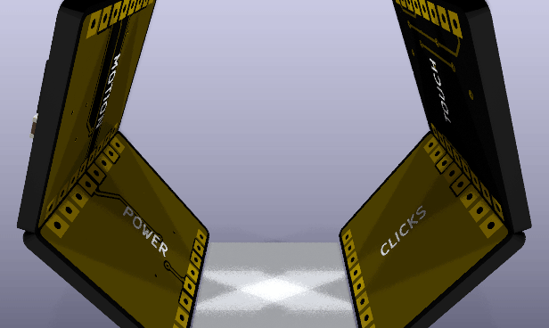

| The thumb's side | The other side |
|---|---|
| 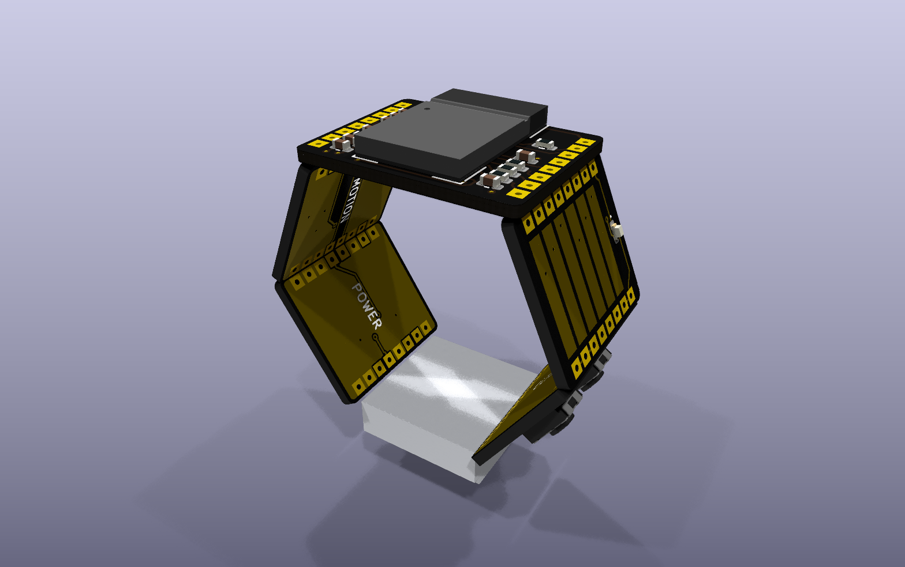 | 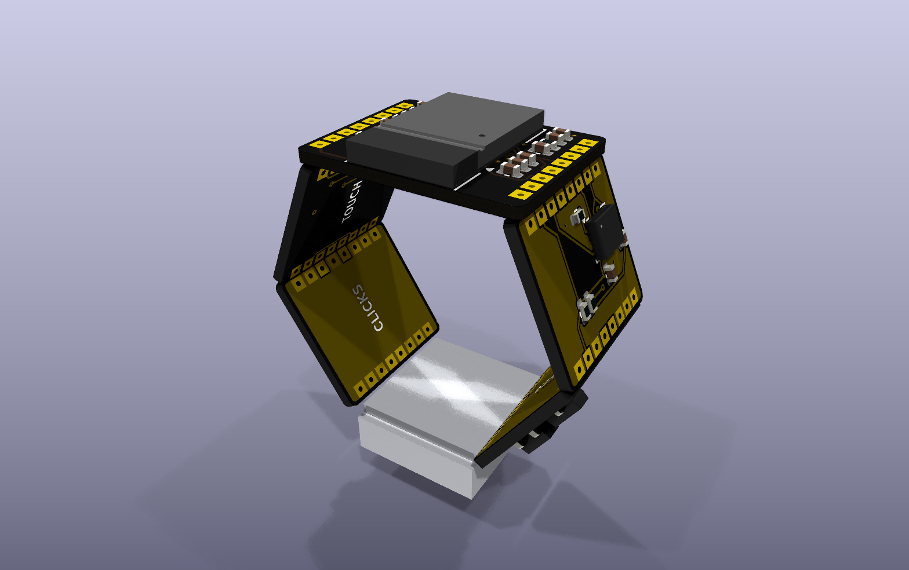 |

| Along the finger, from the hand | The radio's face | The cell's face, from the palm |
|---|---|---|
| 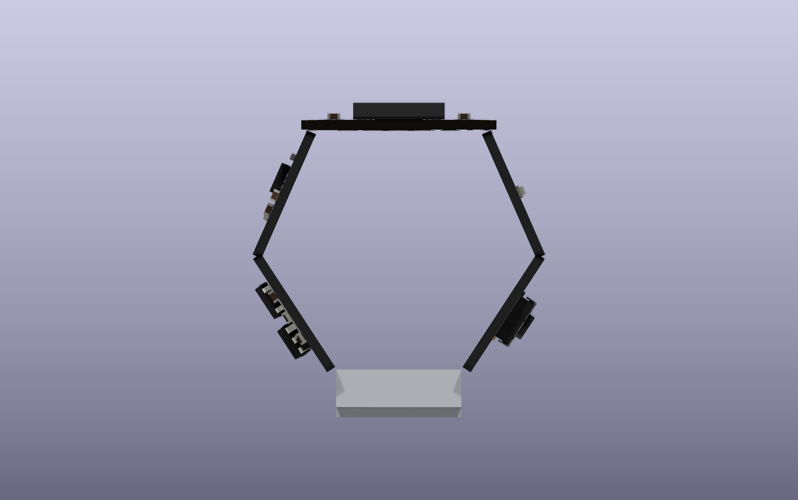 | 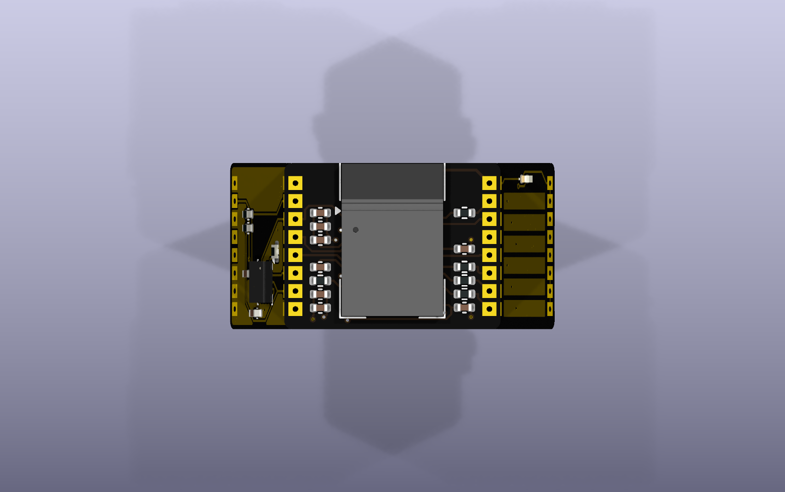 | 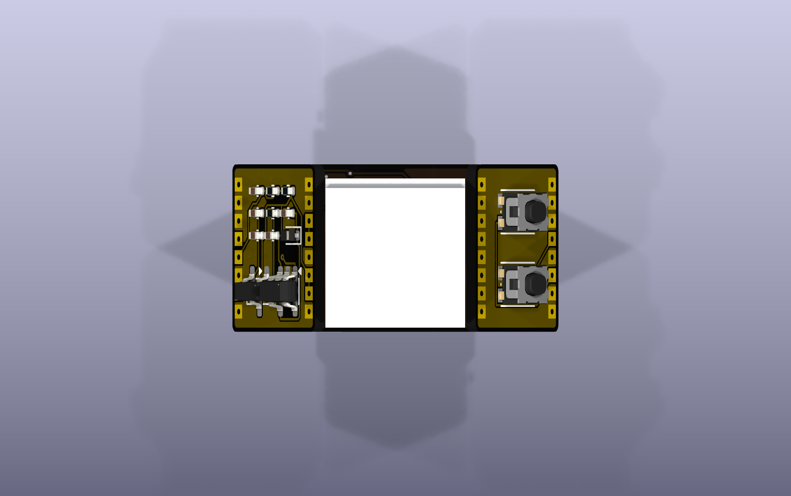 |

Each tile, turning (`workcenter render --views spin`), and from its outer face:

| Radio | Touch | Clicks |
|---|---|---|
| 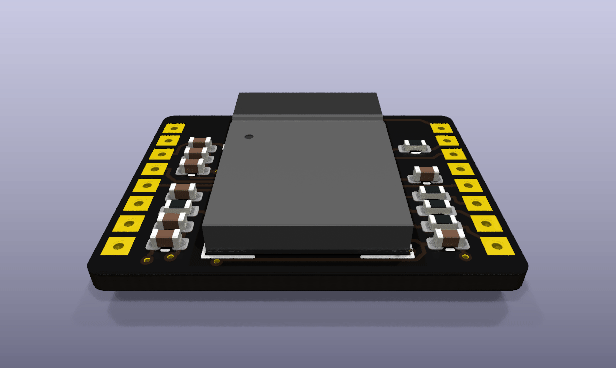 | 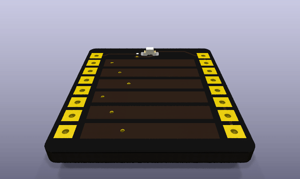 | 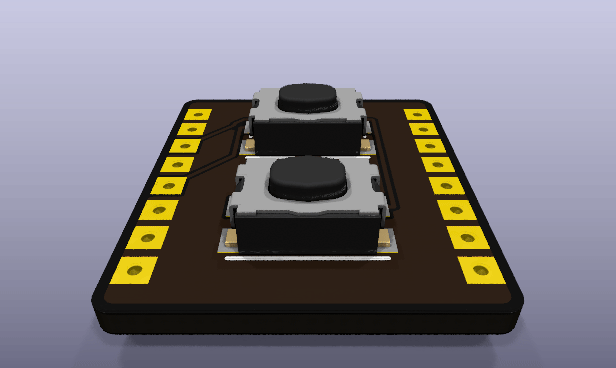 |
| 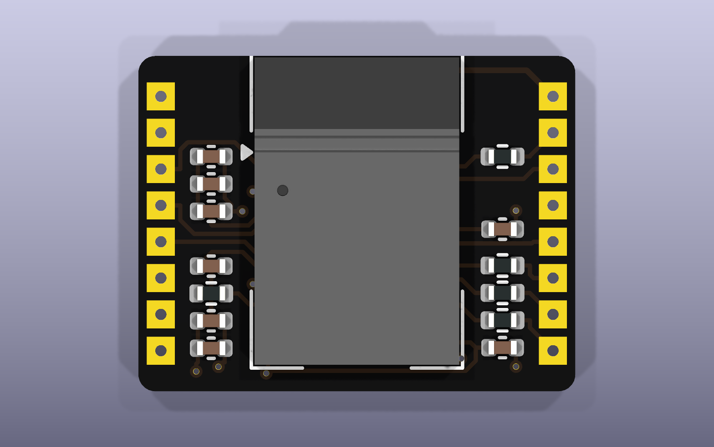 | 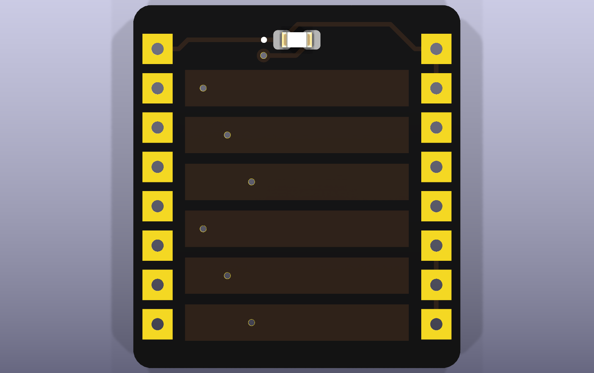 | 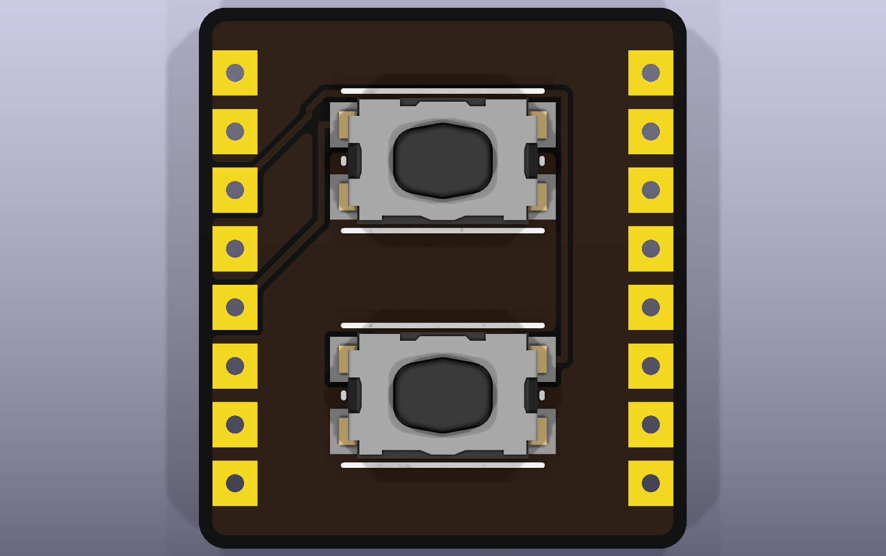 |

| Cell | Power | Motion |
|---|---|---|
| 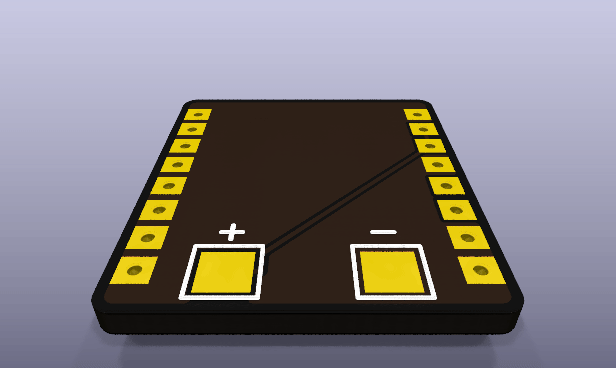 | 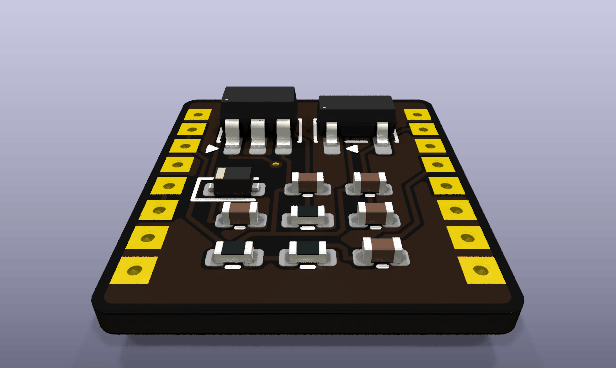 | 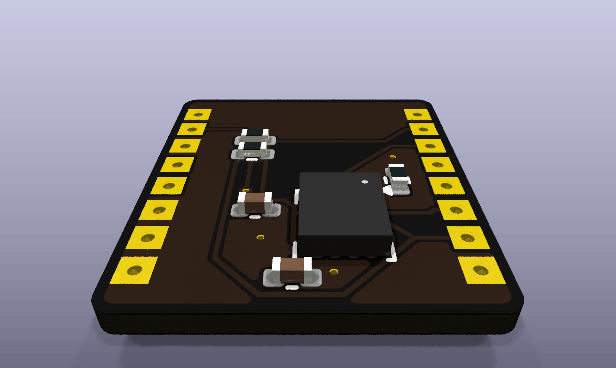 |
| 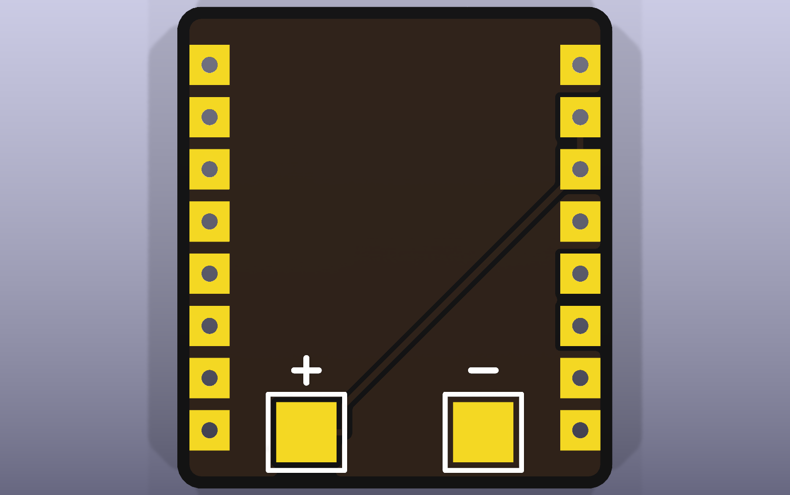 | 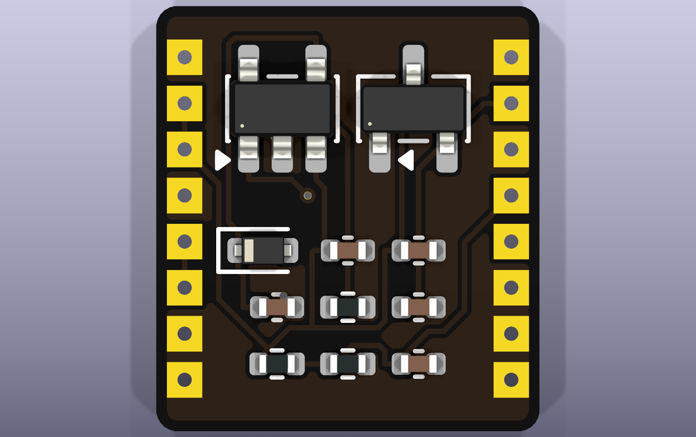 | 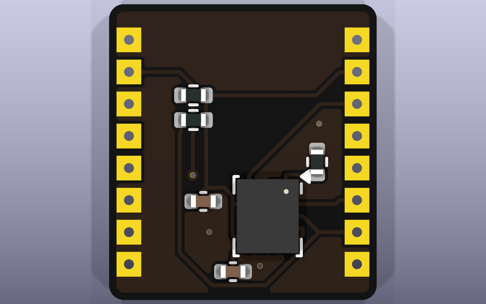 |

Every layer of each tile: [radio](docs/layers-radio.png), [touch](docs/layers-touch.png),
[clicks](docs/layers-clicks.png), [cell](docs/layers-cell.png), [power](docs/layers-power.png),
[motion](docs/layers-motion.png). The schematics: [radio](docs/radio-schematic.png),
[touch](docs/touch-schematic.png), [clicks](docs/clicks-schematic.png),
[cell](docs/cell-schematic.png), [power](docs/power-schematic.png),
[motion](docs/motion-schematic.png).

## What changed in v0.1: the first ring

| Finding | The owner's answer | What v0.1 does |
|---|---|---|
| A signet's face on a band is no ring the board makes | "the mouse is a ring that someone literally wears" | the boards are the ring |
| A flat ring-shaped board with a finger hole does not wrap the finger | "the ring is three dimensional, so the circuit should exist as small boards on the surface of the cylinder" | 6 tiles on a hexagonal prism round the finger, soldered edge to edge ("The ring") |

## The ring

The tiles' inner faces are tangent to a cylinder of radius 10.0 mm, each at its middle, so their
inner corners meet. Round the ring, each tile joins the next along its right edge (seen from
outside, the fingertip's edge up): radio, touch, clicks, cell, power, motion, and back to the radio.
The radio tile is the widest, 15.6 mm: the module is 7.3 x 11 mm and its supply capacitors stand
beside it. The other 5 share the rest of the circle: 56.8 degrees each, 10.82 mm wide. The radio
joins its neighbours at 66.4 degrees, the others at 56.8.

`ring.py` holds the geometry (`R_IN`, `T`, `H`, `WIDTH`, `centre_angle`) and every joint's 8 nets
(`JOINT_NETS`); both tiles of a joint read the same list, so their pads cannot disagree. Each signal
sits level with the module pin it serves, and passes straight across the tiles between:

| Joint | Pads 1 to 8, from the fingertip's edge |
|---|---|
| radio–touch | GND, LED_A, BTN_R, GND, BTN_L, TOUCH_C, TOUCH_B, TOUCH_A |
| touch–clicks | GND, GND, BTN_R, GND, BTN_L, GND, GND, GND |
| clicks–cell | GND x 8 |
| cell–power | GND, VBAT, VBAT, GND, VCHG, VCHG, GND, GND |
| power–motion | GND, +3V3, GND, VBAT_SENSE, CHG_STAT, GND, GND, GND |
| motion–radio | GND, +3V3, IMU_INT, VBAT_SENSE, CHG_STAT, I2C_SDA, I2C_SCL, GND |

### Radio (`radio/`)

U1, an STM32WB5MMG: Bluetooth LE with its antenna, crystals and SMPS in a 7.3 x 11 mm module. Its
antenna end sits 0.05 mm in from the tile's fingertip edge, and the footprint's keep-out, 0.25 mm
larger, holds no copper on any layer (`ANTENNA`); the ground plane on In1 and the pour on B.Cu stop
0.3 mm short of it. RF_OUT (59) is joined straight to ANT_IN (58) for the module's own antenna. The
inner ground pad (84) has a via in it, filled and capped at the fab. Ground pad 86, by the antenna,
reaches J2's ground by a track along the top edge. The supply capacitors stand in a column between
J1 and pins 1-17, the touch resistors, the touch sampling capacitor and the light's resistor between
J2 and pins 31-47. 5 SWD pads lie flat on the inner face for a pogo jig.

### Touch (`touch/`)

6 stripes, 7.4 x 1.2 mm, 0.35 mm apart, under the mask: A B C A B C from the fingertip's end. A
thumb sliding along the finger crosses them in turn; the radio's touch controller reads the 3
channels through its group 1 (`radio/design.py`) and the firmware turns them into scroll detents.
In1 is a ground plane under the strip, a shield from the inside of the ring. Each stripe has its own
via near its left end, A, B and C at 3 x positions, so the router joins each channel's 2 stripes on
the inner layers without crossing. The amber light (D1) sits above the strip.

### Clicks (`clicks/`)

2 C&K KMR2 switches, left nearer the fingertip. Each pulls its line to ground; the radio holds both
up and wakes on either (PC13 and PC5 are wake-up pins).

### Cell (`cell/`)

A 3.0 x 10 x 10 mm LiPo pouch (301010 size, about 20 mAh) with its own protection board lies on the
outer face; its tabs fold onto TP1 (BAT+) and TP2 (BAT-) at the hand's edge. On the inner face, TP3
(VCHG) and TP4 (GND), 2.0 mm round: the ring slides onto a charging post whose 2 spring pins meet
them.

### Power (`power/`)

VCHG passes D2 (BAT54XV2), so a post wired the wrong way round, or a wet ring, cannot drive the
charger's input backward. U1 (MCP73831-2) charges the cell at 1000 V / R1 = 1000 V / 33k = 30 mA
(MCP73831 datasheet DS20001984H, section 5.1), inside its 15 to 500 mA range. U2 (TPS7A0533, 1 uA
typical quiescent, 3 uA at most, datasheet SBVS254D) makes +3V3 from the cell; it drops 235 mV at
200 mA, and the ring draws a few mA. R2 and R3 (1M each) halve the cell for the radio's ADC.

### Motion (`motion/`)

U1, an LSM6DSL 6-axis IMU on I2C1 at 0x6A (SA0 low through R3), turned so SDA and SCL leave for J2
straight. R1 and R2 (4.7k) are the bus's pull-ups. INT1 wakes the radio when the hand moves.

## Simulation

`power/sim/vbat_sense.cir`: the gauge with the cell at 4.2 V, every resistor at both ends of 1 %,
the capacitor at both ends of 10 %, and 32 Monte Carlo draws (`power/sim/corners.json`): the ratio
stays inside 0.495 to 0.505, the drain under 2.2 uA, and the ADC's input under 2.2 V.

## Firmware

`firmware/src/strip.c` turns the TSC's 3 counts into scroll detents. Each channel's fall from its
untouched count is its signal; a thumb covers several stripes, so the 3 signals rise and fall in
turn as it slides, 120 degrees apart. Their Clarke angle is the thumb's place within 1 cycle of 3
stripes (4.65 mm); unwrapped from reading to reading it is a position, and every quarter cycle is 1
detent, up when the thumb moves toward the fingertip. A touch starts when the 3 signals sum to 120
counts and ends below 80; while untouched, each baseline follows its count slowly.
`firmware/tests/test_strip.c` slides a modelled thumb along the 6 stripes: a cycle each way is 4
detents, a resting thumb and slow drift scroll nothing, a light brush is no touch, a fast flick
counts every detent, and a new touch starts afresh. At each end of the strip the thumb's bump hangs
off the last stripe and the angle moves less: the whole strip is 6 or 7 detents, not 6.67.

## Pin plan (radio, U1)

Pin numbers from KiCad's symbol; each pin's functions from ST's open pin data
(`STM32_open_pin_data`, `mcu/STM32WB5MMGHx.xml`).

| Pin | Port | Signal | Function |
|---|---|---|---|
| 3 | PA0 | IMU_INT | SYS_WKUP1: the IMU wakes the ring |
| 4, 6, 15, 17, 32 | VREF+, VDDA, VBAT, VDDSMPS, VDDUSB | +3V3 | every supply pin on the 3.3 V rail |
| 5, 16, 31, 57, 60, 84, 86 | VSS, VSSSMPS | GND | |
| 7 | PC3 | VBAT_SENSE | ADC1_IN4 |
| 9 | PC1 | CHG_STAT | GPIO, internal pull-up |
| 10 | NRST | NRST | 100n to ground (C4); SWD pad |
| 11, 14 | PB9, PB8 | I2C_SDA, I2C_SCL | I2C1 |
| 13 | PH3-BOOT0 | BOOT0 | 10k to ground: boot from flash |
| 25, 26 | PA13, PA14 | SWDIO, SWCLK | SWD |
| 35, 37, 38 | PB13, PB14, PB15 | TSC_A, TSC_B, TSC_C | TSC_G1_IO2, IO3, IO4: the strip's 3 channels, through 10k |
| 40 | PC13 | BTN_L | SYS_WKUP2, internal pull-up |
| 41 | PB12 | TSC_CS | TSC_G1_IO1: the group's sampling capacitor, 10n C0G |
| 45 | PC5 | BTN_R | SYS_WKUP5, internal pull-up |
| 46 | PB11 | LED | TIM2_CH4, through 1k to the light |
| 58, 59 | ANT_IN, RF_OUT | RF | joined: the module's own antenna |

Shared resources: the 3 touch channels are in 1 group and are read one after another; the 2 clicks
and the IMU's interrupt are on 3 different wake-up pins.

## Bill of materials

| Tile | Ref | Value | Package | Part |
|---|---|---|---|---|
| radio | U1 | STM32WB5MMG | LGA-86 11 x 7.3 mm | ST STM32WB5MMGH6 |
| radio | C1 | 4.7u | 0402 | X5R 6.3 V |
| radio | C2, C3, C5, C6, C8 | 100n | 0402 | X7R |
| radio | C4 | 100n | 0402 | NRST |
| radio | C7 | 10n | 0402 | C0G: the touch sampling capacitor |
| radio | R1 | 10k | 0402 | BOOT0 |
| radio | R2 | 1k | 0402 | the light |
| radio | R3, R4, R5 | 10k | 0402 | the touch channels |
| radio | TP1-TP5 | | 1.0 mm pad, inner face | SWDIO, SWCLK, NRST, 3V3, GND |
| touch | E1 | | 6 stripes | copper |
| touch | D1 | amber | 0402 | |
| clicks | SW1, SW2 | KMR2 | 4.2 x 2.8 mm | C&K KMR211G LFS |
| cell | TP1, TP2 | | 1.5 mm square pads | the cell's tabs |
| cell | TP3, TP4 | | 2.0 mm round pads, inner face | the charging post |
| power | U1 | MCP73831-2 | SOT-23-5 | Microchip MCP73831T-2ACI/OT |
| power | U2 | TPS7A0533 | SOT-23 | TI TPS7A0533PDBZR |
| power | D2 | BAT54XV2 | SOD-523 | onsemi BAT54XV2T1G |
| power | C1, C2 | 4.7u | 0402 | X5R 10 V |
| power | C3, C4 | 1u | 0402 | X5R |
| power | C5 | 100n | 0402 | the gauge |
| power | R1 | 33k | 0402 | the charge current |
| power | R2, R3 | 1M | 0402 | 1 %: the gauge |
| motion | U1 | LSM6DSL | LGA-14 3 x 2.5 mm | ST LSM6DSLTR |
| motion | C1, C2 | 100n | 0402 | |
| motion | R1, R2 | 4.7k | 0402 | I2C pull-ups |
| motion | R3 | 10k | 0402 | SA0 |
| off the ring | | 301010 LiPo pouch, about 20 mAh, with its protection board | | not chosen |

## Working on this board

Run from this folder.

```sh
python3 footprints/make_footprints.py        # Ring.pretty: the joint and the scroll strip
workcenter design radio/design.py --route    # likewise touch, clicks, cell, power, motion
workcenter gates radio --strict              # each tile; GREEN means done
workcenter sim power                         # the gauge's deck at its corners
make -C firmware test                        # the decoder's host tests
workcenter pictures .                        # the renders, GIFs and the assembly into docs/
```

KiCad's 3D views need the bodies the tiles name (the workcenter's `site/media/README.md` says how
to fetch them into `KICAD10_3DMODEL_DIR`).

## Decisions

- **6 tiles, the radio's wider** (v0.1). A regular hexagon gives every tile 11.55 mm, too narrow
  for the module and its capacitors side by side. 8 tiles round the finger would be 8.3 mm each.
  The radio's tile takes 15.6 mm; the other 5 share the rest.
- **Solder joints, not a flex** (v0.1). The workcenter makes rigid boards; 8 plated pads a side and
  a fillet each hold the tiles and carry the signals, as Last Hit's display board stands on its
  base. A rigid-flex ring is the production answer, and out of reach of these tools.
- **The STM32WB5MMG** (v0.1). The only BLE module in KiCad's library with its antenna inside and a
  hardware touch controller, and ST publishes its pin functions as data. Nordic's documents and
  ST's datasheet site refused this session, so the module's supply and RF hookup follow its symbol
  and pin data: every supply pin on +3V3 and RF_OUT joined to ANT_IN ("Open items").
- **The scroll strip as a 3-phase encoder** (v0.1). Scrolling needs relative motion only: 3
  channels repeated twice give a cycle every 4.65 mm and 4 detents a cycle from 3 pins and 1
  sampling capacitor.
- **Charging on a post through the inner face** (v0.1). A USB connector is wider than a tile. 2 flat
  pads inside the ring meet a post's spring pins, and D2 stops a reversed or wet post.

## Open items

Candidates for v0.2, from v0.1's work:

- The assembly draws no solder at the joints, and the cell as a plain block.
- The copper pours on the outer faces show olive through the black mask.
- The legend on the inner faces names each tile; the outer faces say nothing.
- The IMU's axes are turned from the radio's by 66 degrees about the finger; the firmware that
  turns them back and maps the gyro to the cursor is not written.

On the bench and elsewhere:

- ST's datasheet (DS13252) was not read: check the supply pins' hookup and decoupling, and the
  RF_OUT to ANT_IN link, against it before an order.
- The antenna lies 1.1 mm from the skin; ST tuned it for free space. Measure the range on a hand.
- The touch strip's counts with a real thumb through the mask; the decoder's thresholds are
  modelled, not measured.
- The joints' strength: a solder fillet across a 57 to 66 degree V on 0.8 mm boards.
- Not ordered.
