# Signet — prototype v0.5

> The current version of the [Signet prototype series](../README.md), started as a copy of [`../v0.4/`](../v0.4/). The earlier versions are the sibling folders, [`../v0.1/`](../v0.1/) to [`../v0.4/`](../v0.4/).

A mouse you wear as a ring. Eight small boards sit on the faces of an octagonal ring round the index
finger, each soldered to the next along its edge. Turn the ring's crown toward the thumb: the ring
turns with the hand and the cursor follows its gyroscope; the thumb slides along the scroll strip to
scroll, and presses the clicks tile for the left and the right button. The ring talks Bluetooth LE
to the computer as an ordinary HID mouse and charges on a post through 2 pads inside it.

This folder is a whole project made with the EE Workcenter: `ring.py` is what the tiles share,
each tile's `design.py` is its board, and the `.kicad_*` files beside each are what
`workcenter design` writes from it.

| Item | State |
|---|---|
| Ring | 8 tiles on an octagonal prism (since v0.5; 6 before) whose faces all touch a 20.0 mm cylinder (a 19.4 mm finger, US size 9 1/2, in a 0.3 mm liner) and whose neighbours share each inner corner; it turns 66.9 degrees at the radio's 2 corners and 37.7 at the 6 others; 12 mm along the finger; 0.8 mm boards, black mask, white legend, ENIG |
| Tiles | radio 13.2 x 12 mm; touch and motion 10.016 x 12 mm; clicks, charge, cell, rail and gauge 6.831 x 12 mm (since v0.5). Every tile 4 layers, ground only on In1: both faces black (since v0.2). Every part on a tile's outer face; only flat pads on the inner faces |
| Joints | each tile soldered to its 2 neighbours by a row of 8 plated pads, 1.0 mm across the edge and 0.8 mm along it (0.5 mm of mask between 2, since v0.3), 1.3 mm apart, 0.3 mm from the edge on both boards: the fillet fills the V the 2 boards open outside. A pad no signal needs is ground |
| Schematics | each tile drawn with wires; ERC 0 errors and 0 warnings on all 8; no parity warning |
| Gates | all 8 tiles GREEN; the radio with 2 legend warnings, the module's outline over its antenna edge ([`docs/gates.md`](docs/gates.md)) |
| Simulation | 1 deck on the gauge tile, the cell's gauge: its ratio, its drain on the cell and its top voltage at 52 corner runs (`gauge/sim/`) |
| Firmware | the scroll strip's decoder (`firmware/src/strip.c`, 8 host tests) and the air mouse (`firmware/src/air.c`, 7 host tests, since v0.2): `make -C firmware test`; not yet run on a ring |

## Images

The ring with the solder in its joints and the cell on its tile, from the thumb's side and along the
finger (`assembly.py` on the workcenter's `tools/scene.py`, drawn by `workcenter pictures .` from
[`pictures.json`](pictures.json)):

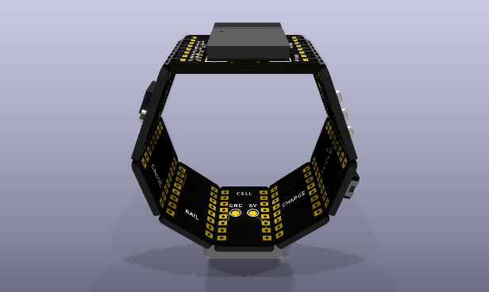

| The thumb's side | The other side |
|---|---|
| 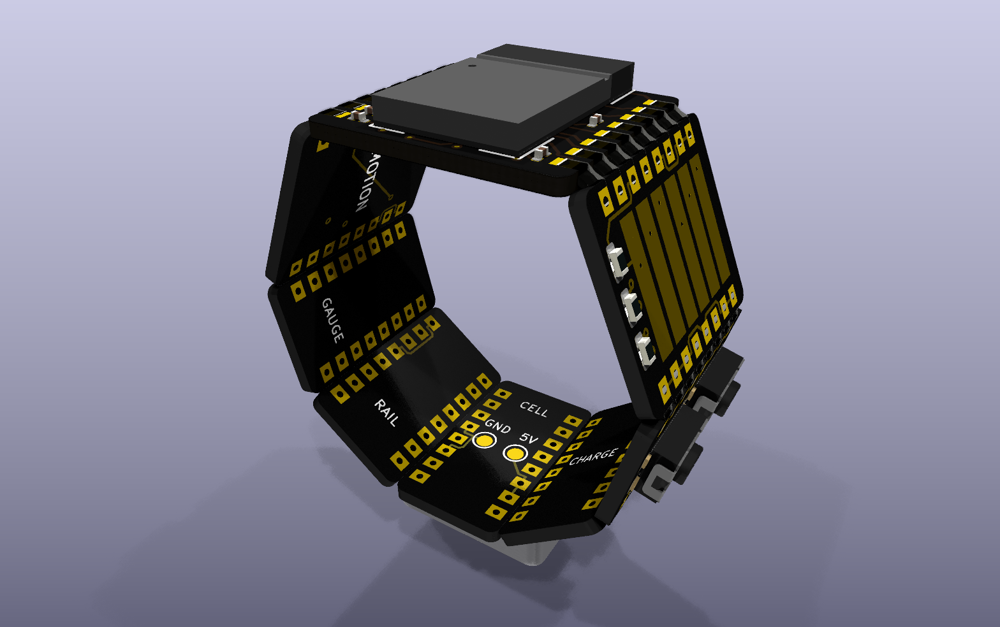 | 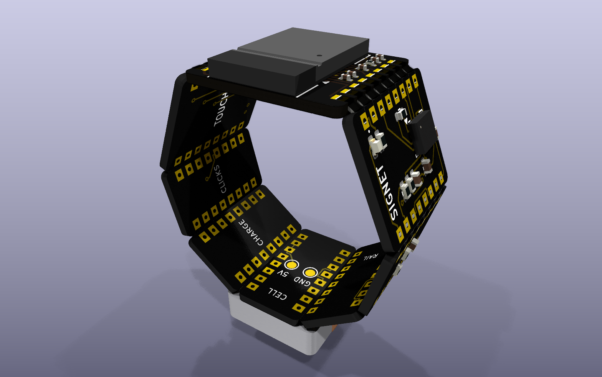 |

| Along the finger, from the hand | The radio's face | The cell's face, from the palm |
|---|---|---|
| 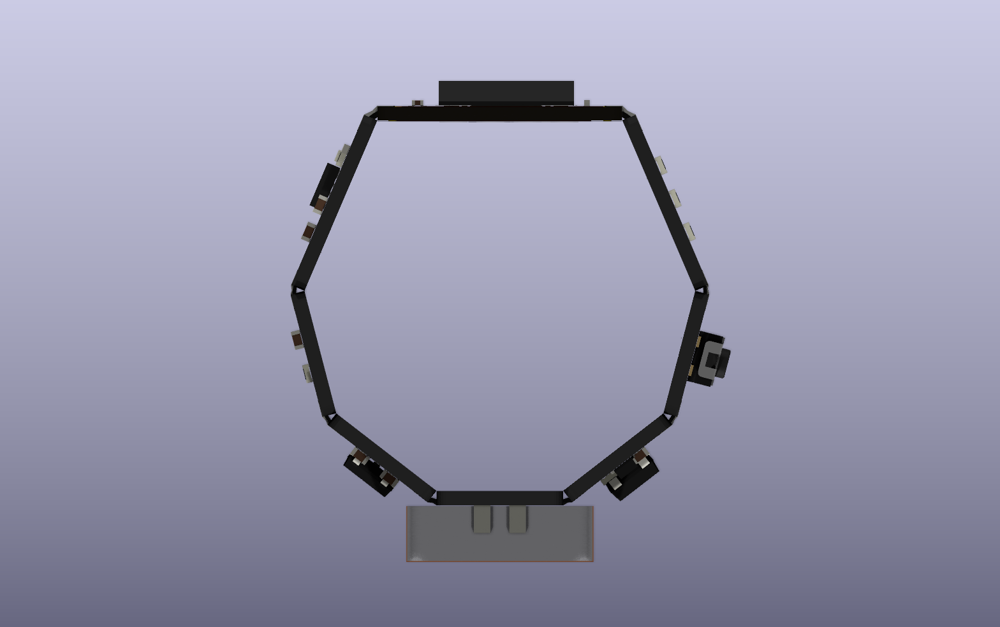 | 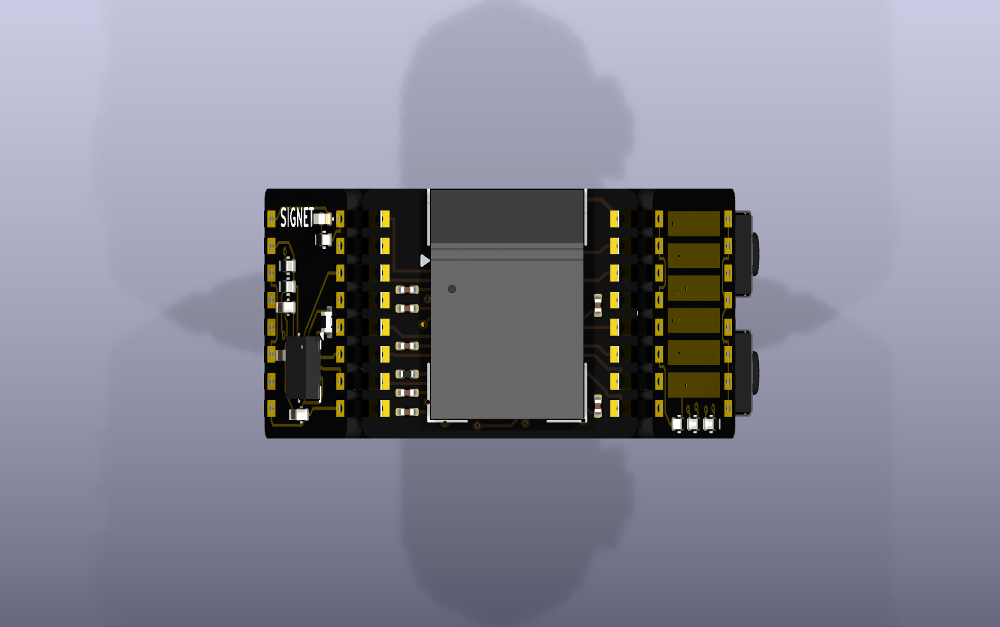 | 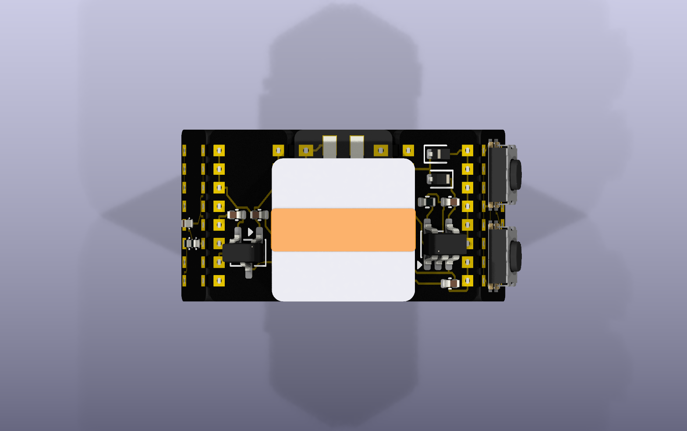 |

Each tile, turning (`workcenter render --views spin`), and from its outer face:

| Radio | Touch | Clicks | Charge |
|---|---|---|---|
| 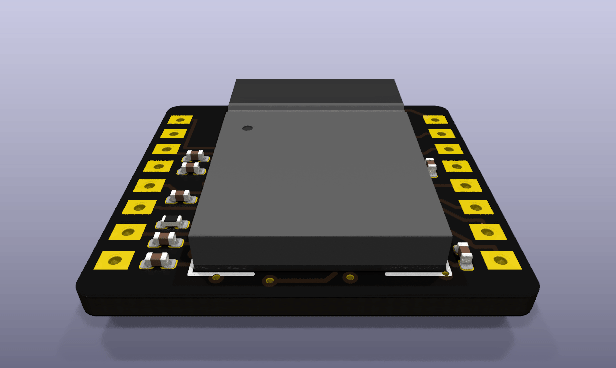 | 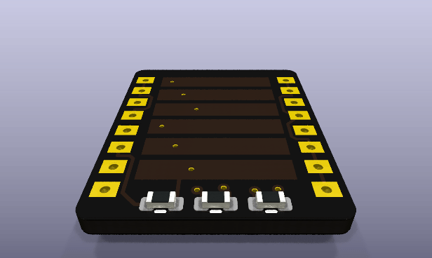 | 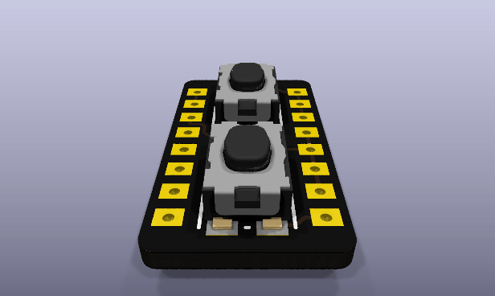 | 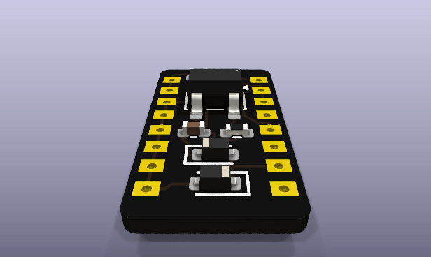 |
| 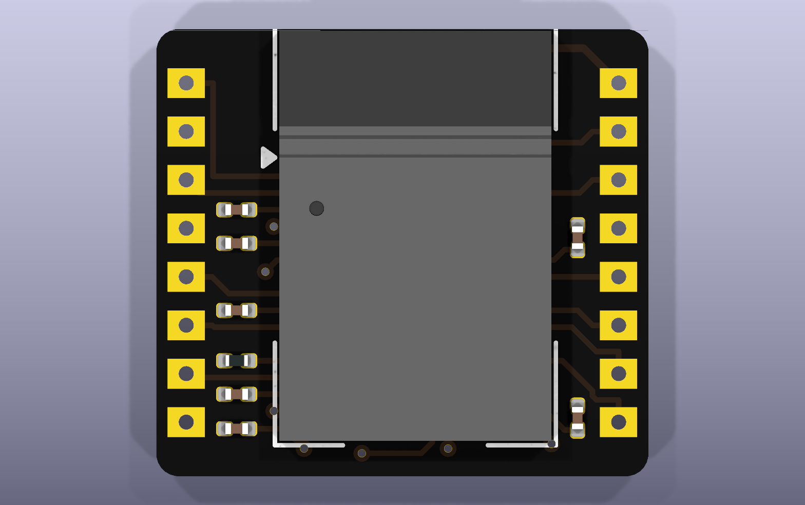 | 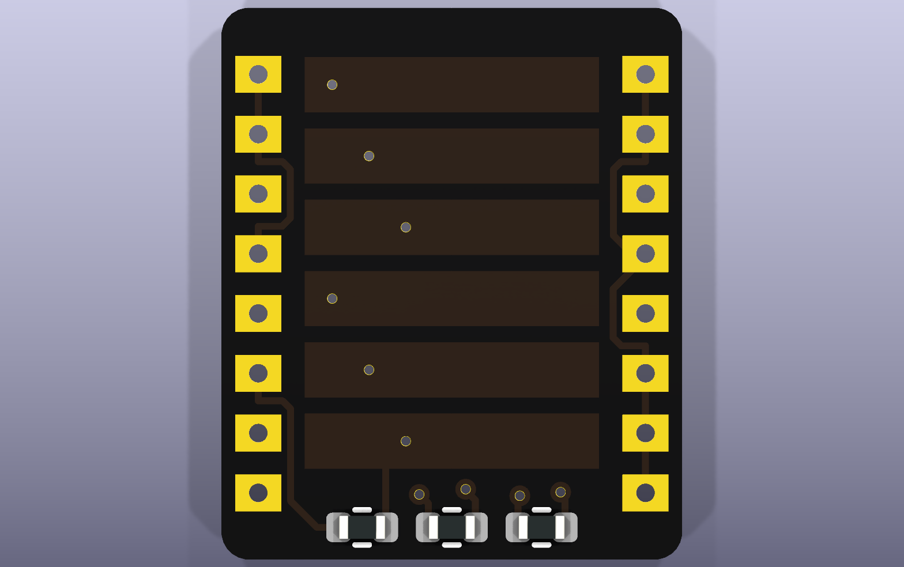 | 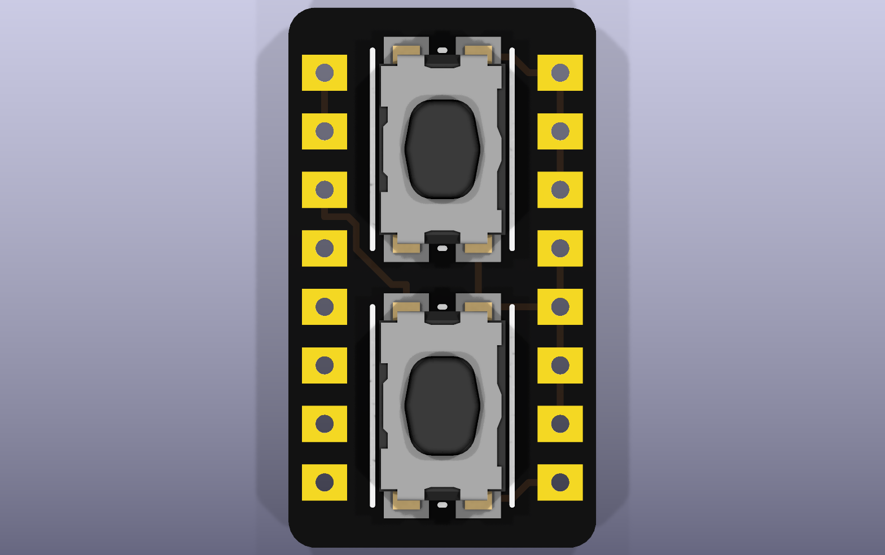 | 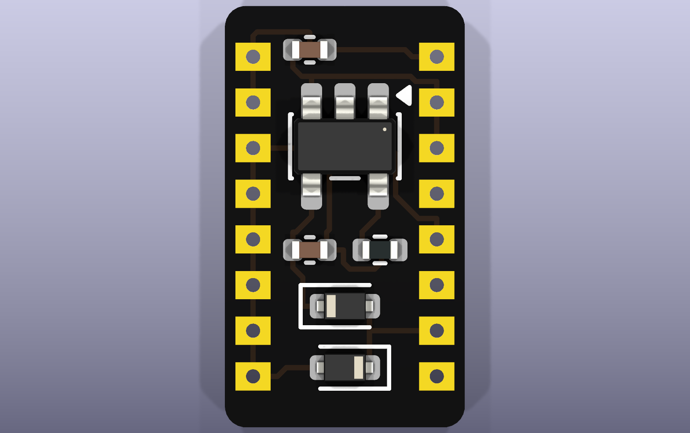 |

| Cell | Rail | Gauge | Motion |
|---|---|---|---|
| 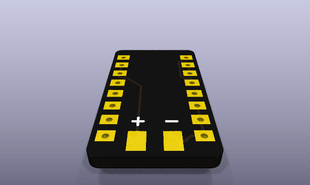 | 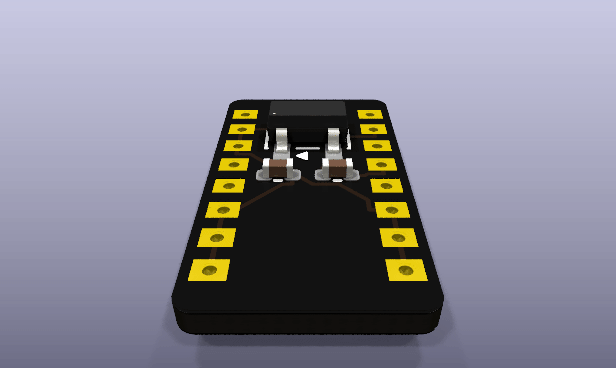 | 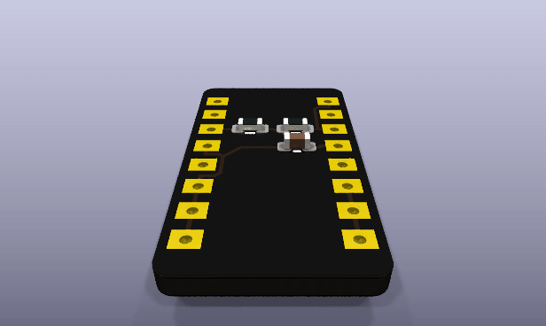 | 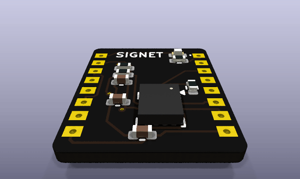 |
| 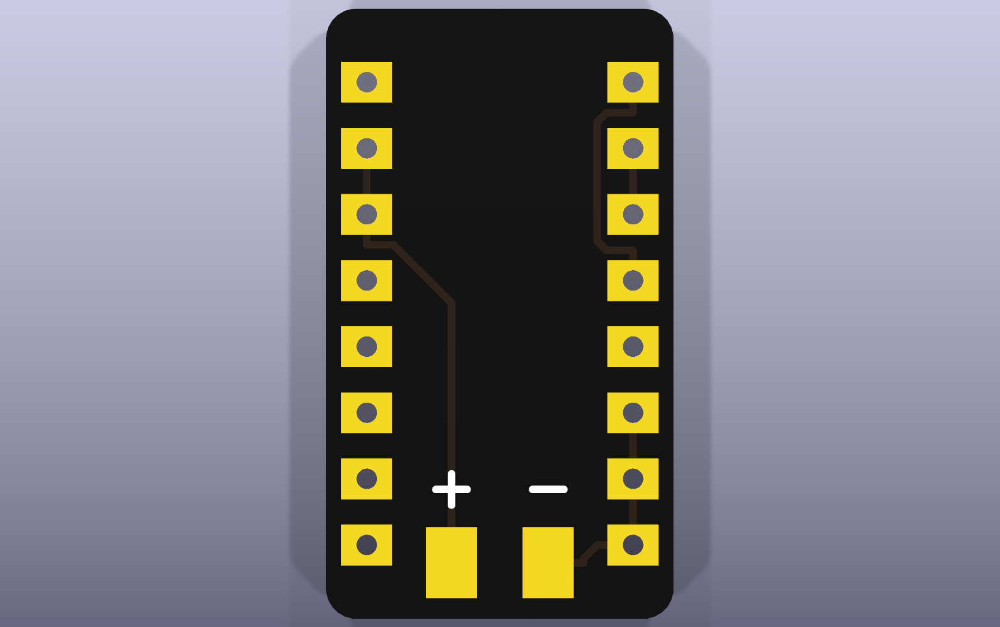 | 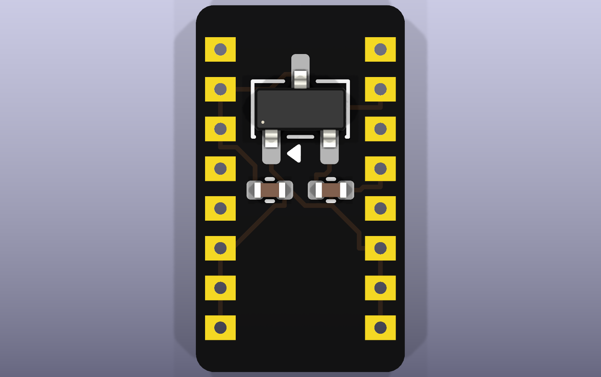 | 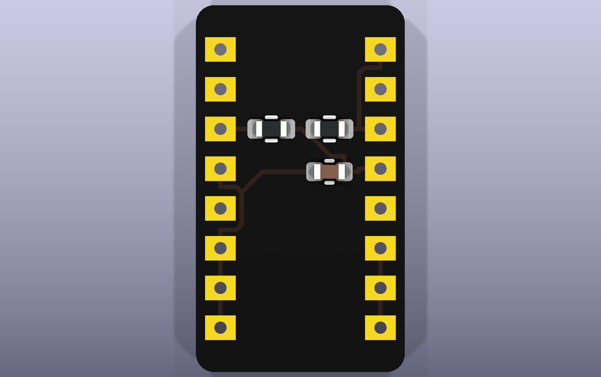 | 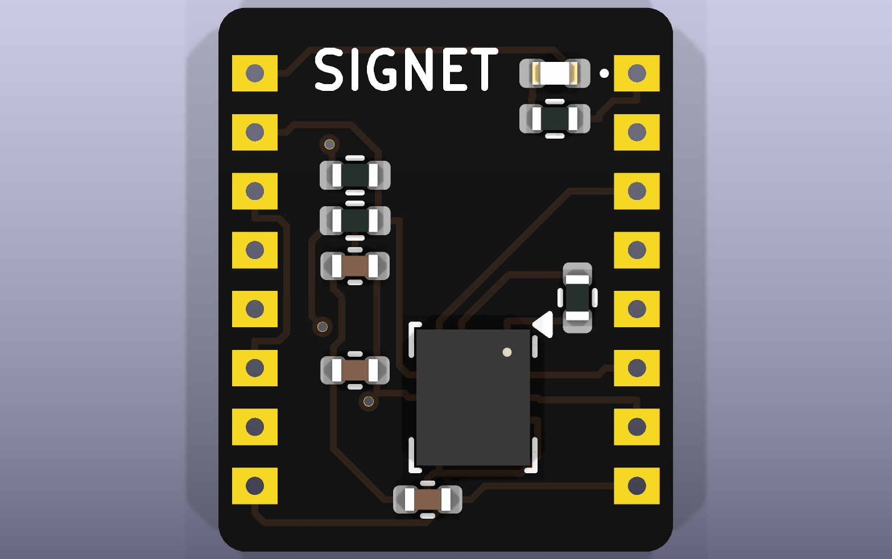 |

Every layer of each tile: [radio](docs/layers-radio.png), [touch](docs/layers-touch.png),
[clicks](docs/layers-clicks.png), [charge](docs/layers-charge.png), [cell](docs/layers-cell.png),
[rail](docs/layers-rail.png), [gauge](docs/layers-gauge.png), [motion](docs/layers-motion.png). The
schematics: [radio](docs/radio-schematic.png), [touch](docs/touch-schematic.png),
[clicks](docs/clicks-schematic.png), [charge](docs/charge-schematic.png),
[cell](docs/cell-schematic.png), [rail](docs/rail-schematic.png), [gauge](docs/gauge-schematic.png),
[motion](docs/motion-schematic.png).

## What changed in v0.5: 8 sections, a smoother ring

The owner asked for more sections, so that the ring reads smoother.

| Finding | Evidence | What v0.5 does |
|---|---|---|
| The ring read as a hexagon: 6 faces, and corners of 75.9 degrees beside the radio, 47.3 and 56.8 elsewhere | the owner: "can you make the ring have more sections? That way its smoother"; v0.4's `assembly-end.png` | 8 tiles. The radio's 2 corners are half its width; the 6 others share the rest of the turn equally (`ring.py`, `_corners`): 66.9 degrees beside the radio, 37.7 at each of the 6 others |
| More tiles leave each less room. The radio module is 7.99 mm with its courtyard, and every other tile needs a SOT-23 (3.4 mm turned) between 2 joints (2.9 mm) | the footprints' courtyards | the radio narrows to 13.2 mm: a column of 0201s flat beside the module on the left, each level with its pin and a filled via in its ground pad, another on end on the right. The module moves 0.35 mm right, so its antenna's keep-out leaves a track's room beside J1. 8 tiles leave the 5 small ones 6.83 mm; 9 would leave 5.8 mm, too narrow for a SOT-23 |
| The radio's 13 small parts do not fit 2 columns 1.4 and 0.9 mm wide | v0.4's `radio/design.py` | its supply capacitors, NRST's and BOOT0's stay, as 0201s; the light's 1k and the 4.7u bulk capacitor move to the motion tile, the 3 touch resistors to the touch tile, beside the joints their lines cross |
| The power tile's 12 parts do not fit 6.83 mm | v0.4's `power/design.py` | 3 tiles: charge (the charger, its 2 diodes), rail (the regulator) and gauge (the divider and its deck), round the cell |
| The cell tile is 6.83 mm: no room for D1 between the tab pads, nor for 2.0 mm charging pads, nor for 2 of the library's test pads (2 mm courtyards) | the tile's courtyards | D1 moves to the charge tile, the first part the post's 5 V reaches; the tab pads are 1.0 x 1.4 mm (`Ring:CellTab_1x1.4mm`, new) at x +-0.95, the charging pads 1.0 mm round at +-1.1; the 10 mm pouch reaches 1.6 mm past each edge |
| The motion tile turned to a new angle | `ring.face_angle("motion")` is -66.85 degrees | `AIR_TILE_DEG` is -66.85 |
| The cell tile was missing from every assembly picture since v0.2: `assembly.py` wrote the tile's board body as `cell.wrl`, then the pouch under the same name, which replaced it | v0.4's `assembly-end.png`, its bottom face empty under the pouch; `build/assembly/bodies/cell.wrl`, 7 kB of pouch | the pouch is `pouch.wrl`; the workcenter's `tools/scene.py` now refuses a second body under a name it wrote (M212) |
| The turning GIF never showed the whole ring: since v0.1 it turned at twice the stills' zoom, 2 or 3 tiles to a frame | `site/examples.py --pictures`: "assembly-spin.gif cuts it off at frame 0"; v0.4's frames | `assembly.py` turns it at zoom 0.38, and all 4 frames of the framing check (`workcenter pictures . --frames 4`) hold the ring whole (M214) |

### Board

All 8 tiles generated and routed from their design files. The touch tile's stripes are 6.4 mm long
(7.4 before), and the strip stands 0.45 mm toward the fingertip, leaving a row for the vias of its 3
new resistors below it. The radio's 5 SWD pads stand 4 in a row 2.0 mm apart and ground in a second
row, clear of the columns' filled vias. The clicks tile's 2 switches stand turned a quarter turn, their 4.2 mm along the
finger, one above the other; the L and R marks have no room left beside them. The charger's STAT
reaches the radio round the cell's side, through the cell, rail, gauge and motion tiles, at pad 5 of
each joint. On the radio the short links between the left column and the module, the light's line
past the keep-out to J1's first pad, the 2 ground pins' vias and the right column's 2 links are
drawn by hand (`radio/design.py`): the router ran the module's lines to J1 first and left those
links no room.

## What changed in v0.4: a ring that closes

The third pass of the loop ([`../LOOP.md`](../LOOP.md)) judged v0.3 against its checklist, and
measured the assembly against the boards' own geometry.

| Finding | Evidence | What v0.4 does |
|---|---|---|
| The radio tile's 2 joints did not close: its corners stood 1.3 mm out from its neighbours', along the line between them, and the solder there hung in the air | v0.3's `assembly-end.png`; `ring.py`: a hexagon whose 6 faces all touch a circle closes only when its alternate faces add up equally, and 15.6 + 10.82 + 10.82 is not 3 x 10.82 | each joint has one tangent length, from the shared corner to where either face touches the finger; the radio's (7.8 mm) and the cell's (5.41 mm) are half their widths, and the 2 between close the circle (4.376 mm). The touch and motion tiles grow to 12.176 mm, the clicks and power tiles narrow to 9.786 mm. `ring.py` refuses to load if any 2 neighbours miss their shared corner by more than 0.005 mm |
| The assembly drew the radio tile 0.4 mm inside its neighbours, and the solder 0.4 to 0.8 mm off the boards | a side render of 1 tile's body beside its own board at heights 0, -0.4 and -0.8 mm: it lies flush at -0.4 | `scene.place` measures height from the scene board's outer face and a board body's origin is its mid-plane, as `tools/scene.py` says; the axis sits R_IN + T under the radio's outer face and each body at R_IN + T/2 |
| The air mouse turned the gyro back by the motion tile's old angle | `ring.face_angle("motion")` is -75.90 degrees now | `AIR_TILE_DEG` is -75.90 |

### Board

The radio and cell tiles keep their widths and their boards. The touch, clicks, power and motion
tiles are generated and routed again at their new widths; their parts keep their places from each
tile's middle, but on the power tile, where 6.89 mm is left between the 2 joints' courtyards: the
charger and the regulator (3.4 mm each, turned 90 degrees) stand at x -1.72 and +1.72, D2 at -2.1,
C2 at 0.15 and C3 at 2.25. The hand-drawn VBAT now leaves J1 level with its pad and rises 0.8 mm
from it, clear of the charger's pin 5. The charger's pin-1 mark on the legend now reaches J1's
pad 3, which the DRC names as a warning. The joints' V opens
75.9 degrees beside the radio, 47.3 degrees between the touch and clicks tiles and between the
power and motion tiles, and 56.8 degrees either side of the cell.

## What changed in v0.3: a light the wearer sees, a guard on the charging pads, room between the joint pads

The second pass of the loop ([`../LOOP.md`](../LOOP.md)) judged v0.2 against its checklist.

| Finding | Evidence | What v0.3 does |
|---|---|---|
| The light sat on the touch tile, under the thumb: hidden whenever the ring was in use | v0.2's `touch-board-3d-top.png`; the thumb rests on that tile | the light moves to the motion tile, beside the name at the radio's edge; the radio drives it from PA1 (pin 2) on the side that faces the motion tile, through the motion–radio joint's first pad (`ring.py`, `JOINT_NETS`) |
| The joint pads stood 0.3 mm apart along the edge: a fillet across a V bridges to its neighbour | v0.2's `Joint_Edge_1x08_P1.3mm`: 1.0 mm pads at a 1.3 mm pitch | the pads are 0.8 mm along the edge, so 0.5 mm of mask stands between 2 fillets (`footprints/make_footprints.py`) |
| The charging pads touch the world on the ring's inside, and nothing took a static discharge before the power tile | v0.2's cell tile: the pads go straight to J2 | D1, a TPD1E05U06, between VCHG and ground on the cell tile itself, where the discharge comes in ("Cell") |
| The solder beads read as dark spikes along the finger | v0.2's `assembly-end.png` | each bead stops 0.95 mm in on its pad and rounds 0.08 mm over the gap; 0.8 mm long, as its pad |

### Board

All 6 tiles generated and routed again. The radio's 1k for the light (R2) moves to the left
column, level with PA1, and the 4.7u bulk capacitor (C1) takes the column's free place below it.
The touch tile carries only its strip, now in its middle. The cell's tab pads move 0.5 mm out
(x +-2.7) to make room for D1 between them; their + and - marks move above them, under the cell's
end. On the power tile VBAT is drawn by hand (`power/design.py`): with the new joint pads the router
ran PROG between the charger and the regulator and left VBAT in 2 pieces, so VBAT now takes the path
v0.2's router chose, over the top of the charger.

## What changed in v0.2: black faces, solder in the joints, the cursor

The first pass of the loop ([`../LOOP.md`](../LOOP.md)) judged v0.1 against its checklist.

| Finding | Evidence | What v0.2 does |
|---|---|---|
| The clicks, cell, power and motion tiles poured ground on both faces; through the black mask it showed olive, while the radio and touch tiles were black | v0.1's `assembly-iso.png`, `power-board-3d-top.png` | every tile 4 layers, ground only on In1 (`ring.py`, `tile()`); no pour on either face ("Board") |
| The joints held no solder in the pictures: the tiles looked set side by side, not joined | v0.1's `assembly-iso.png`, `assembly-end.png` | a fillet in every joint's V over each of its 48 pads (`assembly.py`, `fillets()`) |
| The cell was a white block | v0.1's `assembly-palm.png` | a foil pouch with a Kapton band and 2 nickel tabs folded onto their pads; the tab pads moved 0.3 mm toward the hand so the pouch's end clears them |
| The outer faces said nothing | v0.1's tile pictures | the clicks tile marks L and R; the motion tile carries the name |
| Nothing turned the gyro into cursor motion, and the IMU's axes are turned 66.36 degrees about the finger from the radio's | v0.1's README, "Open items" | `firmware/src/air.c`: the reading turned back into the ring's frame, a deadband, a gain, the strip as a clutch; 7 host tests ("Firmware") |

### Board

All 6 tiles routed again from their design files: every tile now 4 layers (F.Cu the parts, In1.Cu
ground, In2.Cu and B.Cu signals). The radio's B.Cu pour is gone with the others'. The cell's tab
pads (TP1, TP2) sit 4.9 mm below the tile's middle, 0.3 mm lower than v0.1's, with their + and -
marks beside them.

### Firmware

`air.c` turns each gyro reading from the chip's frame into the ring's: the tile's x and z turned by
-66.36 degrees about the finger (`AIR_TILE_DEG`). Turning the hand about the crown's normal moves the
cursor across, pointing up or down moves it up or down, and a roll about the finger moves nothing.
Rates under 3 degrees a second are dropped (`AIR_DEADBAND`), the rest moves 20 counts a degree
(`AIR_GAIN`), with the fraction carried to the next reading. The cursor moves only while the thumb
rests on the strip. `firmware/tests/test_air.c`: the turn back is exact, a turn left moves the
cursor only left and pointing up only up, a roll, a tremor and a lifted thumb move nothing, and slow
turns add up. The chip's own axes in the tile (`AIR_CHIP_X`, `_Y`, `_Z`) are taken as the tile's:
the LSM6DSL datasheet's axis figure was not read in this session ("Open items").

## What changed in v0.1: the first ring

| Finding | The owner's answer | What v0.1 does |
|---|---|---|
| A signet's face on a band is no ring the board makes | "the mouse is a ring that someone literally wears" | the boards are the ring |
| A flat ring-shaped board with a finger hole does not wrap the finger | "the ring is three dimensional, so the circuit should exist as small boards on the surface of the cylinder" | 6 tiles on a hexagonal prism round the finger, soldered edge to edge ("The ring") |

## The ring

The tiles' inner faces are tangent to a cylinder of radius 10.0 mm, and each 2 neighbours share
their inner corner (since v0.4). Round the ring, each tile joins the next along its right edge (seen
from outside, the fingertip's edge up): radio, touch, clicks, charge, cell, rail, gauge, motion, and
back to the radio. From each shared corner, the 2 faces that meet there touch the cylinder at the
same distance, the corner's tangent length; a tile's width is the sum of its 2 corners' lengths:

| Tile | Width | Touches the finger, from its left edge | Where, round the ring |
|---|---|---|---|
| radio | 13.2 mm | 6.6 mm (its middle) | 0 degrees |
| touch | 10.016 mm | 6.6 mm | 66.9 degrees |
| clicks | 6.831 mm | 3.416 mm (its middle) | 104.6 degrees |
| charge | 6.831 mm | 3.416 mm (its middle) | 142.3 degrees |
| cell | 6.831 mm | 3.416 mm (its middle) | 180.0 degrees |
| rail | 6.831 mm | 3.416 mm (its middle) | 217.7 degrees |
| gauge | 6.831 mm | 3.416 mm (its middle) | 255.4 degrees |
| motion | 10.016 mm | 3.416 mm | 293.2 degrees |

The radio tile is the widest: the module is 7.99 mm with its courtyard, a column of 0201s lies flat
beside it on the left and another stands on end on the right. Its 2 corners' tangent lengths are
half its width, 6.6 mm, and turn the ring 66.9 degrees each; the other 6 corners share the rest of
the turn, 37.7 degrees and 3.416 mm each (since v0.5). A ring of faces that all touch a circle closes
only when the corners' angles sum to a turn, so a wider radio leaves the others narrower: at 13.2
mm, 8 tiles leave the small ones 6.83 mm, room for a SOT-23 turned (3.4 mm) between 2 joints (2.9
mm); 9 tiles would leave them 5.8 mm.

`ring.py` holds the geometry (`R_IN`, `T`, `H`, `CORNER`, `TOUCH`, `WIDTH`, `face_angle`), checks
that every 2 neighbours share their corner each time it loads, and every joint's 8 nets
(`JOINT_NETS`); both tiles of a joint read the same list, so their pads cannot disagree. Each signal
sits level with the module pin it serves, and passes straight across the tiles between:

| Joint | Pads 1 to 8, from the fingertip's edge |
|---|---|
| radio–touch | GND, GND, BTN_R, GND, BTN_L, TSC_C, TSC_B, TSC_A |
| touch–clicks | GND, GND, BTN_R, GND, BTN_L, GND, GND, GND |
| clicks–charge | GND x 8 |
| charge–cell | GND, VBAT, VBAT, GND, CHG_STAT, VCHG, VCHG, GND |
| cell–rail | GND, VBAT, VBAT, GND, CHG_STAT, GND, GND, GND |
| rail–gauge | GND, +3V3, VBAT, GND, CHG_STAT, GND, GND, GND |
| gauge–motion | GND, +3V3, GND, VBAT_SENSE, CHG_STAT, GND, GND, GND |
| motion–radio | LED, +3V3, IMU_INT, VBAT_SENSE, CHG_STAT, I2C_SDA, I2C_SCL, GND |

### Radio (`radio/`)

U1, an STM32WB5MMG: Bluetooth LE with its antenna, crystals and SMPS in a 7.3 x 11 mm module. Its
antenna end sits 0.05 mm in from the tile's fingertip edge, and the footprint's keep-out, 0.25 mm
larger, holds no copper on any layer (`ANTENNA`); the ground plane on In1 stops 0.3 mm short of it.
The module sits 0.35 mm right of the tile's middle, so the keep-out ends 0.45 mm short of J1's pads:
room for the light's track up to J1's first pad, level with the keep-out.
RF_OUT (59) is joined straight to ANT_IN (58) for the module's own antenna. The inner ground pad
(84) has a via in it, filled and capped at the fab. Ground pad 86, by the antenna, reaches J2's
ground by a track along the top edge. Since v0.5 a column of 0201s lies flat between J1 and pins
1-17, the supply's capacitors and BOOT0's resistor, each level with its pin, with a filled via in its
ground pad (no room beside a 0201 there for one), and the module's lines to J1 pass between them;
another stands on end between J2 and pins 31-47, the touch sampling capacitor and VDDUSB's. 5 SWD
pads lie flat on the inner face for a pogo jig, 4 in a row and ground below.

### Touch (`touch/`)

6 stripes, 6.4 x 1.2 mm (7.4 until v0.5), 0.35 mm apart, under the mask: A B C A B C from the
fingertip's end. A thumb sliding along the finger crosses them in turn; the radio's touch controller
reads the 3 channels through its group 1 (`radio/design.py`) and the firmware turns them into scroll
detents. In1 is a ground plane under the strip, a shield from the inside of the ring. Each stripe has
its own via near its left end, A, B and C at 3 x positions, so the router joins each channel's 2
stripes on the inner layers without crossing. Each channel's 10k series resistor (R1 to R3) stands
in a row under the strip, by the channels' pads on J1 (on the radio tile until v0.5); the strip
stands 0.45 mm toward the fingertip to leave a row of vias between them.

### Clicks (`clicks/`)

2 C&K KMR2 switches, left nearer the fingertip, turned a quarter turn since v0.5 so their 4.2 mm runs
along the finger. Each pulls its line to ground; the radio holds both up and wakes on either (PC13
and PC5 are wake-up pins).

### Charge (`charge/`)

Since v0.5 (the power tile's charger before). The post's 5 V comes in on J2 from the cell tile's
inner pads. D1 (TPD1E05U06) takes a static discharge on those pads to ground: 5.5 V stand-off and
6.5 V breakdown at least (TI SLVSBO7O), so a 5 V post never makes it conduct (on the cell tile until
v0.5). D2 (BAT54XV2) keeps a post wired the wrong way round, or a wet ring, from driving the
charger's input backward. U1 (MCP73831-2) charges the cell at 1000 V / R1 = 1000 V / 33k = 30 mA
(MCP73831 datasheet DS20001984H, section 5.1), inside its 15 to 500 mA range; its STAT goes round the
ring to the radio through the cell, rail, gauge and motion tiles.

### Cell (`cell/`)

A 3.0 x 10 x 10 mm LiPo pouch (301010 size, about 20 mAh) with its own protection board lies on the
outer face, reaching 1.6 mm past each edge of the 6.83 mm tile, where the neighbours turn away
beneath it. Its tabs, trimmed to 1 mm, fold onto TP1 (BAT+) and TP2 (BAT-), 1.0 x 1.4 mm pads at the
hand's edge (`Ring:CellTab_1x1.4mm`, since v0.5). On the inner face, TP3 (VCHG) and TP4 (GND), 1.0 mm round (2.0 until v0.5): the ring
slides onto a charging post whose 2 spring pins meet them.

### Rail (`rail/`)

Since v0.5 (the power tile's regulator before). U2 (TPS7A0533, 1 uA typical quiescent, 3 uA at
most, datasheet SBVS254D) makes +3V3 from the cell; it drops 235 mV at 200 mA, and the ring draws a
few mA. C3 and C4 (1u) on its input and output.

### Gauge (`gauge/`)

Since v0.5 (the power tile's gauge before). R2 and R3 (1M each) halve the cell for the radio's ADC
(PC3); C5 holds the node for its sampling.

### Motion (`motion/`)

U1, an LSM6DSL 6-axis IMU on I2C1 at 0x6A (SA0 low through R3), turned so SDA and SCL leave for J2
straight. R1 and R2 (4.7k) are the bus's pull-ups. INT1 wakes the radio when the hand moves. D1,
the amber light (since v0.3), sits by the name at the radio's edge, on the side of the hand where
its wearer sees it; the radio drives it from PA1 through J2 and R4, its 1k, under it. C3 (4.7u) is
the radio's bulk capacitor on +3V3, across J2 from its supply pins. R4 and C3 stood on the radio
tile until v0.5.

## Simulation

`gauge/sim/vbat_sense.cir`: the gauge with the cell at 4.2 V, every resistor at both ends of 1 %,
the capacitor at both ends of 10 %, and 32 Monte Carlo draws (`gauge/sim/corners.json`): the ratio
stays inside 0.495 to 0.505, the drain under 2.2 uA, and the ADC's input under 2.2 V.

## Firmware

`firmware/src/strip.c` turns the TSC's 3 counts into scroll detents. Each channel's fall from its
untouched count is its signal; a thumb covers several stripes, so the 3 signals rise and fall in
turn as it slides, 120 degrees apart. Their Clarke angle is the thumb's place within 1 cycle of 3
stripes (4.65 mm); unwrapped from reading to reading it is a position, and every quarter cycle is 1
detent, up when the thumb moves toward the fingertip. A touch starts when the 3 signals sum to 120
counts and ends below 80; while untouched, each baseline follows its count slowly.
`firmware/tests/test_strip.c` slides a modelled thumb along the 6 stripes: a cycle each way is 4
detents, a resting thumb and slow drift scroll nothing, a light brush is no touch, a fast flick
counts every detent, and a new touch starts afresh. At each end of the strip the thumb's bump hangs
off the last stripe and the angle moves less: the whole strip is 6 or 7 detents, not 6.67.

## Pin plan (radio, U1)

Pin numbers from KiCad's symbol; each pin's functions from ST's open pin data
(`STM32_open_pin_data`, `mcu/STM32WB5MMGHx.xml`).

| Pin | Port | Signal | Function |
|---|---|---|---|
| 3 | PA0 | IMU_INT | SYS_WKUP1: the IMU wakes the ring |
| 4, 6, 15, 17, 32 | VREF+, VDDA, VBAT, VDDSMPS, VDDUSB | +3V3 | every supply pin on the 3.3 V rail |
| 5, 16, 31, 57, 60, 84, 86 | VSS, VSSSMPS | GND | |
| 7 | PC3 | VBAT_SENSE | ADC1_IN4 |
| 9 | PC1 | CHG_STAT | GPIO, internal pull-up |
| 10 | NRST | NRST | 100n to ground (C4); SWD pad |
| 11, 14 | PB9, PB8 | I2C_SDA, I2C_SCL | I2C1 |
| 13 | PH3-BOOT0 | BOOT0 | 10k to ground: boot from flash |
| 25, 26 | PA13, PA14 | SWDIO, SWCLK | SWD |
| 35, 37, 38 | PB13, PB14, PB15 | TSC_A, TSC_B, TSC_C | TSC_G1_IO2, IO3, IO4: the strip's 3 channels, through 10k on the touch tile (since v0.5) |
| 40 | PC13 | BTN_L | SYS_WKUP2, internal pull-up |
| 41 | PB12 | TSC_CS | TSC_G1_IO1: the group's sampling capacitor, 10n C0G |
| 45 | PC5 | BTN_R | SYS_WKUP5, internal pull-up |
| 2 | PA1 | LED | TIM2_CH2, through J1 and 1k (R4) on the motion tile to the light there (since v0.3; PB11 before) |
| 58, 59 | ANT_IN, RF_OUT | RF | joined: the module's own antenna |

Shared resources: the 3 touch channels are in 1 group and are read one after another; the 2 clicks
and the IMU's interrupt are on 3 different wake-up pins.

## Bill of materials

| Tile | Ref | Value | Package | Part |
|---|---|---|---|---|
| radio | U1 | STM32WB5MMG | LGA-86 11 x 7.3 mm | ST STM32WB5MMGH6 |
| radio | C2, C3, C5, C6, C8 | 100n | 0201 | X5R; a filled via in each ground pad |
| radio | C4 | 100n | 0201 | NRST |
| radio | C7 | 10n | 0201 | C0G: the touch sampling capacitor |
| radio | R1 | 10k | 0201 | BOOT0 |
| radio | TP1-TP5 | | 1.0 mm pad, inner face | SWDIO, SWCLK, NRST, 3V3, GND |
| touch | E1 | | 6 stripes | copper |
| touch | R1, R2, R3 | 10k | 0402 | the touch channels, since v0.5 (on the radio before) |
| clicks | SW1, SW2 | KMR2 | 4.2 x 2.8 mm | C&K KMR211G LFS |
| charge | U1 | MCP73831-2 | SOT-23-5 | Microchip MCP73831T-2ACI/OT |
| charge | D1 | TPD1E05U06 | SOD-523 | TI TPD1E05U06DYAR: the charging pads' ESD guard (on the cell tile until v0.5) |
| charge | D2 | BAT54XV2 | SOD-523 | onsemi BAT54XV2T1G |
| charge | C1, C2 | 4.7u | 0402 | X5R 10 V |
| charge | R1 | 33k | 0402 | the charge current |
| cell | TP1, TP2 | | 1.0 x 1.4 mm pads | the cell's tabs |
| cell | TP3, TP4 | | 1.0 mm round pads, inner face | the charging post |
| rail | U2 | TPS7A0533 | SOT-23 | TI TPS7A0533PDBZR |
| rail | C3, C4 | 1u | 0402 | X5R |
| gauge | R2, R3 | 1M | 0402 | 1 %: the gauge |
| gauge | C5 | 100n | 0402 | the gauge |
| motion | U1 | LSM6DSL | LGA-14 3 x 2.5 mm | ST LSM6DSLTR |
| motion | D1 | amber | 0402 | the light, since v0.3 (on the touch tile before) |
| motion | C1, C2 | 100n | 0402 | |
| motion | C3 | 4.7u | 0402 | X5R 6.3 V: the radio's bulk capacitor, since v0.5 (on the radio before) |
| motion | R1, R2 | 4.7k | 0402 | I2C pull-ups |
| motion | R3 | 10k | 0402 | SA0 |
| motion | R4 | 1k | 0402 | the light, since v0.5 (on the radio before) |
| off the ring | | 301010 LiPo pouch, about 20 mAh, with its protection board | | not chosen |

## Working on this board

Run from this folder.

```sh
python3 footprints/make_footprints.py        # Ring.pretty: the joint, the scroll strip, the cell tab
workcenter design radio/design.py --route    # likewise touch, clicks, charge, cell, rail, gauge, motion
workcenter gates radio --strict              # each tile; GREEN means done
workcenter sim gauge                         # the gauge's deck at its corners
make -C firmware test                        # the decoder's host tests
workcenter pictures .                        # the renders, GIFs and the assembly into docs/
```

KiCad's 3D views need the bodies the tiles name (the workcenter's `site/media/README.md` says how
to fetch them into `KICAD10_3DMODEL_DIR`).

## Decisions

- **8 tiles, the radio's 13.2 mm** (v0.5). The owner asked for a smoother ring. More tiles turn the
  ring less at each corner, and leave each tile less room. The radio's module sets the widest tile:
  13.2 mm holds it with a column of 0201s beside it each side, and turns the ring 66.9 degrees at its
  2 corners (75.9 in v0.4). 8 tiles leave the 6 others 37.7 degrees and the 5 small tiles 6.83 mm,
  room for 1 SOT-23 between 2 joints; 9 would leave them 5.8 mm. A first try at 12.7 mm, with both
  columns on end, routed with 18 links open: no room beside the 0201s for their ground vias, and the
  antenna's keep-out 0.1 mm from J1's first pad, which no track could then reach (M213). The power
  tile's charger, regulator and gauge each get a tile, and the parts the radio cannot hold stand
  where their lines cross a joint: the touch resistors on the touch tile, the light's resistor and
  the bulk capacitor on the motion tile. The cell's pouch, 10 mm, reaches past its 6.83 mm tile.
- **Widths from the corners: the radio and the cell keep theirs** (v0.4; v0.5 gives the cell's
  corners the same length as the others'). A ring whose faces all touch the finger and whose neighbours share their corners fixes 3 tangent lengths, 1 per kind of
  corner, and the circle fixes their angles' sum. The radio needs 15.6 mm for the module and its
  capacitor columns, and the cell tile 10 mm for the pouch, so the corners beside them are half
  those widths and the 4 tiles between take the rest: the touch and motion tiles gain 1.36 mm, the
  clicks and power tiles lose 1.03 mm, which their parts allow. Letting the radio stand off the
  finger instead would close the ring with 5 equal tiles, and leave a gap under the radio.
- **The light by the name, not under the thumb** (v0.3). On the touch tile the thumb covered it
  whenever the ring was in use. The motion tile faces the side of the hand, beside the radio, and
  had room; its joint to the radio had a ground pad to spare for the light's line.
- **4 layers on every tile, ground only inside** (v0.2). v0.1 gave 4 tiles 2 layers and a ground
  pour on both faces, which showed olive through the black mask. 4 layers cost more a board; every
  tile then reads black with gold pads, the same as the radio and the touch tiles, and each has a
  ground plane under its parts.
- **6 tiles, the radio's wider** (v0.1; 8 since v0.5). A regular hexagon gives every tile 11.55 mm, too narrow
  for the module and its capacitors side by side. 8 tiles round the finger would be 8.3 mm each.
  The radio's tile takes 15.6 mm; the other 5 share the rest (until v0.4: a ring of 5 equal tiles
  and a wider one does not close).
- **Solder joints, not a flex** (v0.1). The workcenter makes rigid boards; 8 plated pads a side and
  a fillet each hold the tiles and carry the signals, as Last Hit's display board stands on its
  base. A rigid-flex ring is the production answer, and out of reach of these tools.
- **The STM32WB5MMG** (v0.1). The only BLE module in KiCad's library with its antenna inside and a
  hardware touch controller, and ST publishes its pin functions as data. Nordic's documents and
  ST's datasheet site refused this session, so the module's supply and RF hookup follow its symbol
  and pin data: every supply pin on +3V3 and RF_OUT joined to ANT_IN ("Open items").
- **The scroll strip as a 3-phase encoder** (v0.1). Scrolling needs relative motion only: 3
  channels repeated twice give a cycle every 4.65 mm and 4 detents a cycle from 3 pins and 1
  sampling capacitor.
- **Charging on a post through the inner face** (v0.1). A USB connector is wider than a tile. 2 flat
  pads inside the ring meet a post's spring pins, and D2 stops a reversed or wet post.

## Open items

Candidates for v0.6, from v0.5's work:

- The cell's pouch reaches 1.6 mm past its tile, over the 2 joints beside it. A cell 6 to 7 mm wide,
  or one curved to the ring, would sit within it; its capacity and its maker are open.
- The radio's corners still turn 66.9 degrees, against 37.7 at the others: the module sets them. A
  smaller module, or one with its antenna along its short side, would let the radio narrow.
- The clicks tile has no room left for its L and R marks.
- The ring is 12 mm wide all round. Tiles narrower on the palm's side would sit better between the
  fingers; the joints there would then be shorter than 8 pads at 1.3 mm.
- The cell holds about 20 mAh. The ring's draw while connected is not measured, so its hours of use
  are not known.
- No deck holds the touch strip's charge transfer: the TSC's pulse times are in ST's reference
  manual, which was not read in this session.

On the bench and elsewhere:

- The LSM6DSL's axes in its package (`AIR_CHIP_X`, `_Y`, `_Z` in `firmware/src/air.h`): from its
  datasheet's axis figure, not read in this session; check with the ring turned by hand.
- ST's datasheet (DS13252) was not read: check the supply pins' hookup and decoupling, and the
  RF_OUT to ANT_IN link, against it before an order. Since v0.5 the 4.7u bulk capacitor sits on the
  motion tile, across J1, about 4 mm from the supply pins: check that against the datasheet's
  layout advice too.
- The antenna lies 1.1 mm from the skin; ST tuned it for free space. Measure the range on a hand.
- The touch strip's counts with a real thumb through the mask; the decoder's thresholds are
  modelled, not measured.
- The joints' strength: a solder fillet across a V of 38 to 67 degrees on 0.8 mm boards.
- Not ordered.
