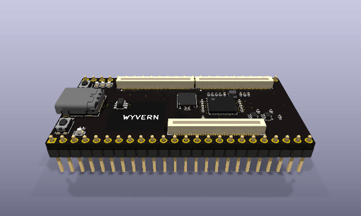
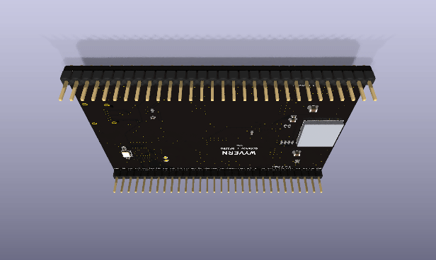

# Wyvern — prototype series

A development board with a Snapdragon on it, laid out like a Teensy. In v0.2 it is one flat board,
76.2 x 53.34 mm: a Qualcomm QCS6490 (8 Kryo 670 cores to 2.7 GHz, an Adreno 643, a 12 TOPS NPU,
8 GB of LPDDR5, 64 GB of eMMC) runs Linux or Android on Vantron's VOSM6490, an OSM module soldered
straight onto the board by its 662 pads. Beside it an RP2350 drives 30 pins at 3.3 V the way a
Teensy's microcontroller does, and the Snapdragon resets it, flashes it and talks to it over USB; the
Snapdragon's own UART, I2C, SPI and GPIOs share the rows at 1.8 V. One USB-C cable powers the board
and carries USB 3. v0.1, the first board, carried a Snapdragon 845 module on 3 sockets over a
61 x 30.5 mm stick.

This folder is the hardware. Each prototype is its own folder, and each folder is a whole KiCad
project: `design.py`, the generated `.kicad_*` files, its footprints, symbols and 3D models, its
README with the spec, pin plan, BOM and decisions, its images under `docs/`, its simulation decks
under `sim/`. It is laid out the way a board repository is (compare
[thyfriendlyfox/vape-prototype](https://github.com/ThyFriendlyFox/vape-prototype)), and it is the
EE Workcenter's example of what a design file can make: the workcenter, this repository's `tools/`,
supplies the tools and gates; this folder supplies the board.

The latest version, [v0.2](v0.2/), turning once round (`workcenter pictures v0.2`):

| From above: the module, USB-C, the power, the RP2350 | From below: the pins named, the microSD |
|---|---|
|  |  |

## Versions

| Version | Board | What it is | Firmware | Commit |
|---|---|---|---|---|
| [v0.1](v0.1/) | 60.96 x 30.48 mm, 6 layers, 1.6 mm; 2 rows of 24 pins 1.1 inch apart | the first board: the Open-Q 845 uSOM on 3 DF40 sockets, USB-C with USB 3.1 and DisplayPort, a 3 A buck for the module, an RP2350 on the pins, a microSD slot | no | `04fd430` |
| [v0.2](v0.2/) (current) | 76.2 x 53.34 mm, 6 layers, 1.6 mm; 2 rows of 30 pins 2.0 inch apart | one flat board: the VOSM6490 (QCS6490) soldered on its 662-pad LGA, USB-C with USB 3 through an HD3SS3220, a buck-boost for the module's 5.0 V, an RP2350 on the pins, a microSD slot | no | in work |

The commit is where that version was finished; its folder holds the files from that commit.

## The folders

| Folder | Holds |
|---|---|
| [`v0.2/`](v0.2/), [`v0.1/`](v0.1/) | each version's board: `design.py` and what it generates, `sim/`, `docs/` (v0.1's also `assembly.py`) |
| [`parts/`](parts/) | an orderable part for every line (`catalog.csv`), what is off the board (`offboard/`), the priced lists |
| [`library/`](library/) | `sources.csv`: each datasheet the design reads, its address, revision and the SHA-256 of the copy read; the PDFs stay with their makers, so the workcenter stays small |
| [`CLAUDE.md`](CLAUDE.md) | the commands, for an agent or a person working on the series |
