# Wyvern — board prototype v0.1

> The first version of the [Wyvern prototype series](../README.md).

A development board the size of a Teensy with a Snapdragon on it. The Snapdragon 845 (4 Kryo 385
Gold cores at 2.65 GHz and 4 Silver at 1.77 GHz, an Adreno 630, a Hexagon 685 DSP, 4 GB of LPDDR4X,
32 GB of UFS 2.1, Wi-Fi 5 2x2 and Bluetooth 5) arrives on Lantronix's Open-Q 845 uSOM, a 50 x 25 mm
module that plugs into 3 sockets on top of the board and runs Linux or Android. Under it, an RP2350
drives 30 pins at 3.3 V the way a Teensy's microcontroller does; the Snapdragon resets it, puts it in
its bootloader and talks to it over USB, so Linux flashes it. One USB-C cable powers the board and
carries USB 3.1 and a DisplayPort monitor.

This folder is a whole KiCad 10 project made with the EE Workcenter: `design.py` is the board, and
the `.kicad_*` files beside it are what `workcenter design` writes from it.

| Item | State |
|---|---|
| Schematic | drawn with wires in blocks, the SOM's 300 pins named from its datasheet; ERC <!-- erc -->0 errors, 0 warnings<!-- /erc -->; no parity warning |
| Board | 60.96 x 30.48 mm (2.4 x 1.2 in), **6 layers**, 1.6 mm, made to Sierra Circuits' Web PCB limits; 2 rows of 24 pins on the 0.1 in grid, 1.1 in apart; the SOM's sockets, USB-C, the RP2350 and its flash on the top face, the power, the microSD and the pinout card on the bottom |
| Gates | <!-- gates -->see `docs/gates.md`<!-- /gates --> |
| USB | the USB-C port's 4 SuperSpeed pairs and its USB 2 pair drawn by hand in `design.py` as coupled 90 ohm pairs on the outer layers, each over a ground plane; no pair crosses another or turns over |
| Power | 5 V from USB-C (or the 5V pin) to the SOM's 3.8 V by a TPS62130 buck, 3 A for the module's 8.7 W boot peak; 3.3 V from that by an AP2112K; the SOM's own 1.8 V on a pin |
| Simulation | 6 decks, each at every corner of its parts' tolerances (`sim/`): the 3.8 V rail inside the SOM's window, the Snapdragon's I2C on the pins, the RP2350's reset and boot lines, the USB input's resonance with a cable; a frequency plan holds the 3 clocks against it |
| Parts and cost | an orderable part for every line on the board (`../parts/catalog.csv`) but 5, each with its reason; the Snapdragon module is not priced: Digi-Key lists it as obsolete |
| Firmware | none yet |

## Images

With the Snapdragon module on its sockets (`assembly.py` on the workcenter's `tools/scene.py`,
drawn by `workcenter pictures .`), turning once round:

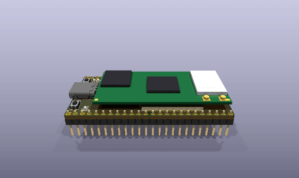

| Assembled | From the USB-C end |
|---|---|
| 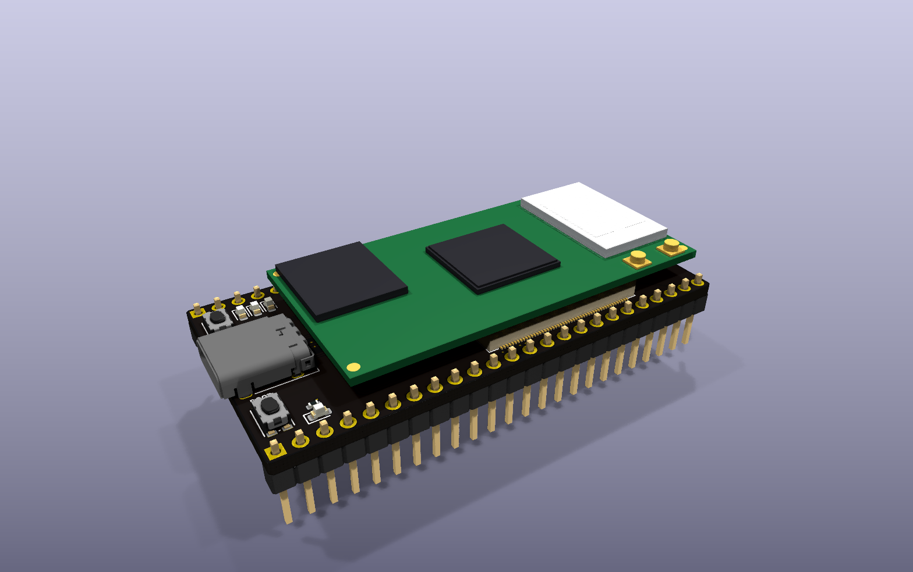 | 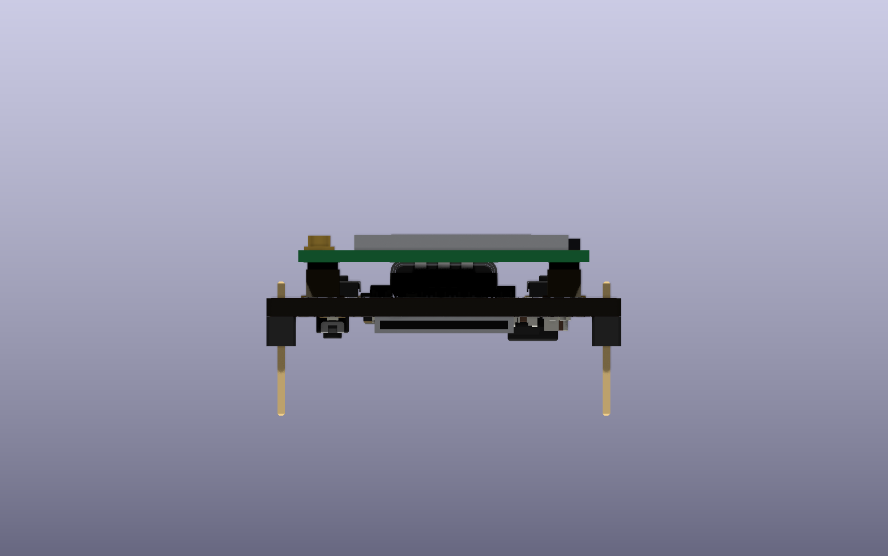 |

The carrier without the module:

| Top face | Bottom face (mirrored) |
|---|---|
| 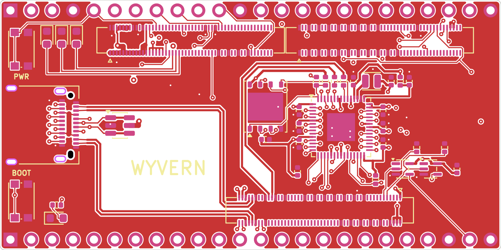 | 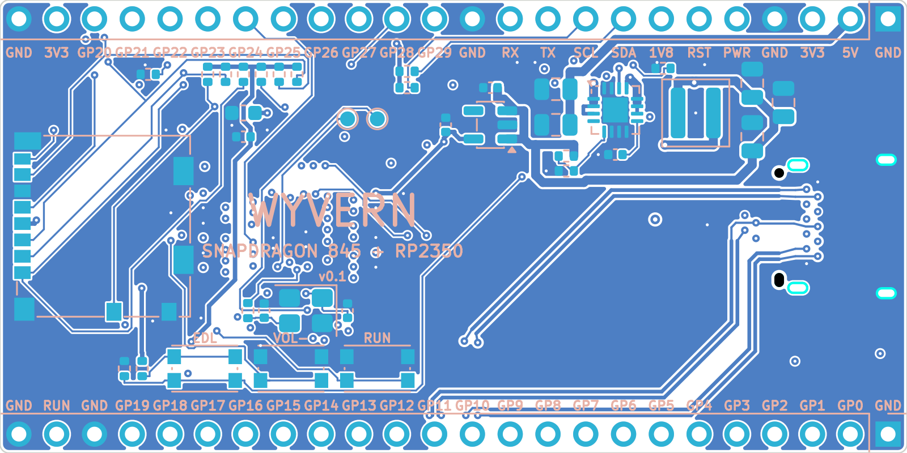 |

| 3D, from above | 3D, from below |
|---|---|
| 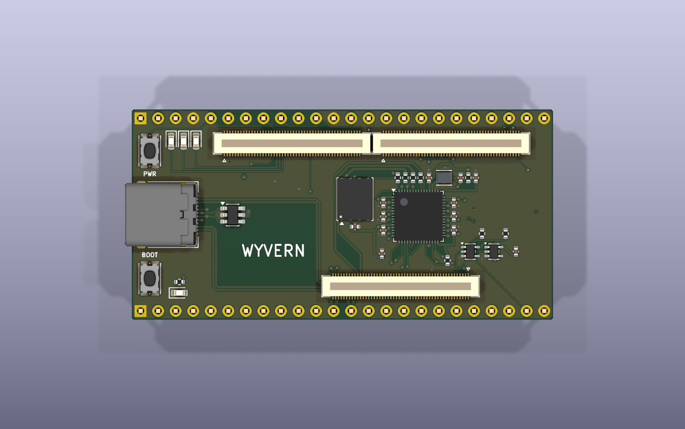 | 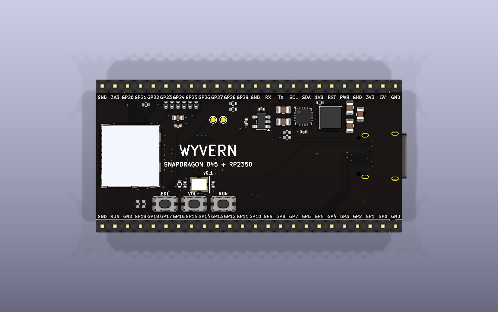 |

| Turning, from above | Turning, from below |
|---|---|
| 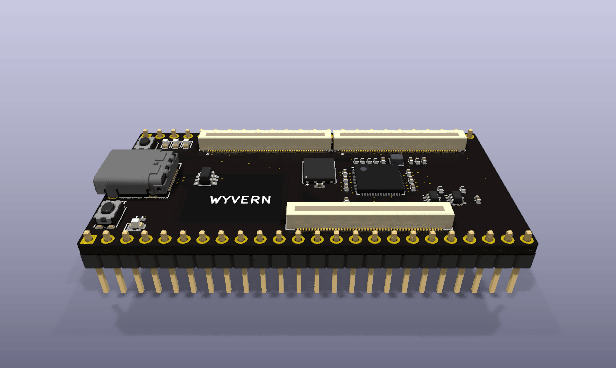 | 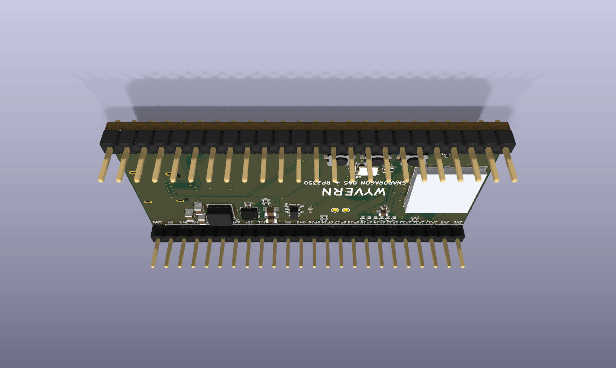 |

| Every layer | The schematic |
|---|---|
| 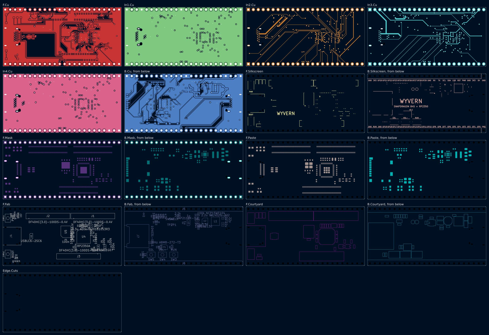 | 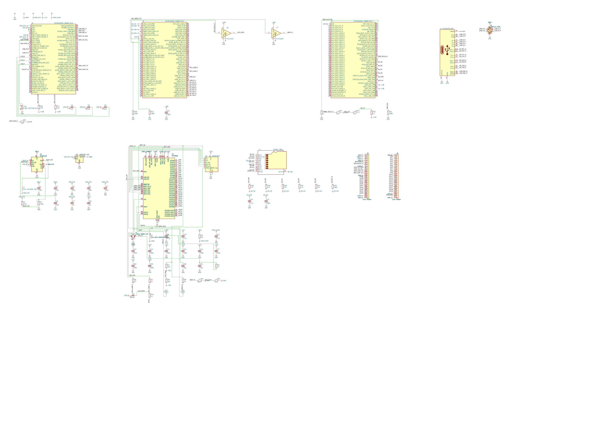 |

From `workcenter pictures .` (its `pictures.json`), with KiCad's 3D bodies in `KICAD10_3DMODEL_DIR`
and the 5 bodies in `models/`.

## What changed in v0.1: the first board

The request: a new microcontroller development board, something like a Teensy but with a Snapdragon
chip, compact, as the workcenter's example of what it can make.

| Finding | The owner's answer | What v0.1 does |
|---|---|---|
| A Snapdragon cannot stand alone on a board this size: it needs LPDDR4X, flash and 3 PMICs, and its 0.4 mm BGA needs microvias and length-matched memory lanes the workcenter's router does not draw | not asked in this round | carries the Snapdragon 845 on Lantronix's Open-Q 845 uSOM, whose pinout and land pattern are public ("The Snapdragon module") |
| A Snapdragon's pins run at 1.8 V; a Teensy's at 3.3 V | not asked in this round; the owner was shown the plan on 2026-11-11 | an RP2350 drives the pins at 3.3 V; the Snapdragon's own I2C, debug UART, power key and reset are on the pins too, marked 1.8 V ("The RP2350") |

### Board

The SOM's land pattern sets the board: its 3 sockets 23.0 mm apart along its long sides, turned 180
degrees so its power socket (JT2) sits next to USB-C. The pins run outside the module along both long
edges, so the board is the module's width plus 2 rows. Everything a hand touches is on top at the
USB-C end (PWR, BOOT, the Snapdragon's 3 lights and GP25's); the RP2350 and its flash sit under the
module on top; the power, the microSD and the buttons the board rarely needs are on the bottom. The
router (FreeRouting) drew <!-- route -->everything but the USB pairs<!-- /route -->.

### Simulation

6 new decks, run at every corner (`workcenter sim .`): SOM_SYS at 3.61 to 3.93 V against the SOM's
3.45 to 4.75 V; the I2C pull-ups' rise time 186 ns against 300 ns with 100 pF on the line; RUN at
48 mV and QSPI_SS at 0.42 V against the RP2350's 0.8 V when the Snapdragon pulls them; the 5 V
input's resonance with a USB-C cable, and the buck's power-save pulses on it. A frequency plan
(`sim/frequency-plan.json`) holds the buck, the RP2350's regulator and its crystal against that
resonance ("Frequency plan").

### Firmware

None yet ("Open items").

### Parts and cost

Every part is new. `../parts/catalog.csv` names an orderable part for each line, read from Digi-Key
on 2026-11-11; `workcenter costs ..` prices the board into `../parts/lists/` ("Bill of materials").

### Verification summary

No verification package yet ("Open items").

## Architecture

```
USB-C (J4) ──VBUS──┬──────────────────────────── 5V pin
                   ├── U1 USBLC6 (D+, D-)
                   └── U2 TPS62130 ── L1 2.2 uH ── SOM_SYS 3.8 V ──┬── SOM JT2 (SOM_SYS_PWR x17)
                                                                    └── U3 AP2112K ── +3V3 ── RP2350, 3V3 pins
USB-C SuperSpeed x4, USB 2 ────────────────────────────────────────────── SOM JT3 (USB3_SS_*, USB3_HS_*)
USB-C CC1, CC2, SBU1, SBU2 ─────────────────────────────────────────────── SOM JT2 (the PMI8998's Type-C)
SOM JT3 USB2_HS ── R6, R7 27 ohm ── U4 RP2350 USB (the RP2350 is a device on the SOM's 2nd port)
SOM JT3 GPIO27, GPIO11 (1.8 V) ── U6, U7 74LVC1G07 ── RUN, QSPI_SS (reset, bootloader)
SOM JT1 SDC2 ── J7 microSD;  SOM JT3 VREG_L21A, VREG_L13A ── its supply and pull-ups
SOM JT1 VREG_S4A ── +1V8 ── 1V8 pin, U6, U7, the I2C pull-ups
U4 RP2350 GP0..GP29 ── the pins
```

### Stackup

| Layer | Copper | Use |
|---|---|---|
| F.Cu | 35 um | parts, the SOM's sockets, 2 SuperSpeed pairs, ground pour |
| In1.Cu | 15 um | ground plane, under F.Cu's pairs (0.21 mm of 7628) |
| In2.Cu | 15 um | signals |
| In3.Cu | 15 um | signals, supplies |
| In4.Cu | 15 um | ground plane, over B.Cu's pairs |
| B.Cu | 35 um | parts, 2 SuperSpeed pairs and the USB 2 pair, ground pour |

A 90 ohm pair on an outer layer is 0.25 mm tracks 0.15 mm apart over 0.21 mm of FR4 (er 4.5), by
IPC-2141's edge-coupled microstrip; its 0.4 mm pitch is the SOM socket's.

## The Snapdragon module

Lantronix's Open-Q 845 uSOM (QC-DB-P10004: 4 GB, 32 GB) carries the SDA845, its LPDDR4X on top of it,
the UFS flash, the PM845, PMI8998 and PM8005 PMICs and a WCN3990 for Wi-Fi and Bluetooth, on
50 x 25 mm. It mates through 3 Hirose DF40C-100DP-0.4V(51) headers underneath; this board carries the
DF40HC(3.0)-100DS-0.4V(51) receptacles for a 3.0 mm stack, so up to 1.5 mm of parts fit under it.
Every pin name in `open_q_845.py` and the 3 symbols in `symbols/wyvern.kicad_sym` is the datasheet's
(PDS-0007 Rev C, Tables 2 to 4); the sockets' places and pin 1 corners are its Figure 7. The
datasheet calls its schematic the controlling document; that needs a development-kit registration.

- **Power.** SOM_SYS_PWR, 3.45 to 4.75 V, typical 3.8 V (Table 7); the module draws 8.7 W at most
  while it boots and 6.9 W with every core loaded (Table 9). USB_VBUS goes to the PMI8998's charger
  input for USB detection; BATT_ID and BATT_THERM are left open, so it sees no battery
  ("Decisions").
- **Its lights.** The PMI8998's RGB current sources drive D1 to D3 straight, with no resistors.
- **Its keys.** PWR (SW1, PHONE_ON_N) and VOL- (SW4, PM_RESIN_VOLDN_N; held with PWR, a hard reset).
  EDL (SW5) holds GPIO57 high through 1k at power-on: the Snapdragon's emergency download over USB.
  CBL_PWR_N is grounded through R15 (0 ohm), so the module starts when power arrives; leave R15 off
  to start it with PWR.
- **Its temperature.** AUX_THERM has a 100k NTC (TH1) under the power stage.

## Power

| Rail | From | To | Set by |
|---|---|---|---|
| VBUS | USB-C or the 5V pin | U2, the SOM's USB_VBUS, U1 | a 5 V, 3 A Type-C supply: the SOM's 8.7 W boot peak is 2.3 A at 3.8 V, about 2 A at 5 V |
| SOM_SYS | U2 TPS62130, L1 2.2 uH | the SOM, U3 | R1 374k over R2 100k: 0.8 V x 4.74 = 3.79 V nominal; 3.61 to 3.93 V at every corner (`sim/`) |
| +3V3 | U3 AP2112K-3.3 | the RP2350, its flash, the 3V3 pins | its 600 mA; 250 mV dropout typical at 600 mA from a 3.6 V or higher input |
| +1V1 | the RP2350's own regulator, L2 3.3 uH | the RP2350's core | Raspberry Pi's layout and parts (Hardware design with RP2350, 2.1) |
| +1V8 | the SOM's VREG_S4A | the 1V8 pin, U6, U7, R16, R17 | the SOM; 600 mA for the carrier (Table 2) |
| SD_VDD, SD_VIO | the SOM's VREG_L21A and VREG_L13A | the microSD, its pull-ups | the SOM; 800 mA for the card (Table 4) |

The 5V pin is VBUS itself: power the board from USB-C or from the pin, not both. A 5 V supply on the
pin with a computer on USB-C feeds that computer's port.

## USB-C

J4 is Amphenol's 12401610E4#2A, a USB 3.1 Gen 2 receptacle with both rows on the top layer, its front
face 1.0 mm past the board's edge. The SOM's Type-C port (the PMI8998 handles CC and orientation)
gives USB 3.1, USB 2 and DisplayPort over the same pins.

It is wired the way a plug turned over sees it: the SOM's lane 0 (TX0, RX0) on the receptacle's
second SuperSpeed pins (TX2, RX2), lane 1 on the first, CC1 on B5 and CC2 on A5, SBU swapped to
match. A plug in either orientation still meets the lane its CC pin selects. The point is the layout:
so wired, each layer carries 1 pair to each end of the receptacle, and no 2 pairs on a layer cross.

| Pair | SOM pins (JT3) | Receptacle | Layer |
|---|---|---|---|
| SS_TX1 | 93 (P), 91 (N) | A2, A3 | F.Cu: the inner row into the gap between JT3's rows, west, north, west |
| SS_RX0 | 94 (P), 92 (N) | A11, A10 | F.Cu: the outer row into the gap, west, north, west |
| SS_RX1 | 97 (P), 99 (N) | B11, B10 | B.Cu through 2 vias north of JT3; vias in front of the B row |
| SS_TX0 | 100 (P), 98 (N) | B2, B3 | B.Cu through 2 vias south of JT3 |
| USB_D | 86 (P), 88 (N) | A6, A7; B6, B7 | B.Cu to 2 vias behind the A row; B6 on B.Cu, B7 on In2 |

Every pair keeps P on the same side the whole way: a USB 3 receiver can turn a pair round, a
DisplayPort lane need not. The B row's 12 pads reach 12 vias in 2 staggered columns in front of it,
0.9 mm apart, each 0.69 mm or more from its neighbours' holes on every inner layer (Sierra's 13 mil).
U1, a USBLC6-2SC6, clamps D+ and D- inside the top layer's pairs.

## The RP2350

U4, an RP2350A (QFN-60), with a 16 MB W25Q128JV (U5), the ABM8-272-T3 crystal and the 3.3 uH
inductor Raspberry Pi tuned its oscillator and its core regulator to, and their resistors and
capacitors as Raspberry Pi's minimal design has them. It sits under the module, where everything is
1.0 mm tall or less.

- **USB.** Its USB pins, through R6 and R7 (27 ohm), go to the SOM's second USB port (USB2_HS on
  JT3), a host. Linux sees the RP2350 as a device: its bootloader as a drive, then whatever its
  firmware is.
- **Reset and bootloader.** RUN and QSPI_SS each have a 10k pull-up and the RP2350's own (32k at
  least). The Snapdragon pulls them through U6 and U7, 74LVC1G07 open-drain buffers on its 1.8 V,
  from its GPIO27 and GPIO11; R10 and R11 (100k) hold the buffers off while the module is off. RUN
  (SW3) and BOOT (SW2) do the same by hand. Hold BOOT and press RUN, or let the Snapdragon do it:
  the RP2350 comes up as a drive.
- **SWD.** SWCLK and SWDIO on 2 pads on the bottom (TP1, TP2).

## Pin plan

Every GPIO of the RP2350 is on a pin; functions from its datasheet's function table (F1 SPI, F2
UART, F3 I2C, F4 PWM; section 1.2.3). GP12 to GP19 also carry HSTX, the RP2350's high-speed serial
output (DVI). The header's pins count from the USB-C end.

<!-- pinplan -->

The other pins:

| Pin | Top row | Bottom row |
|---|---|---|
| 1 | GND | GND |
| 2 | 5V (VBUS) | GP0 |
| 3 | 3V3 | GP1 |
| 4 | GND | GP2 |
| 5 | PWR: the SOM's power key, active low (1.8 V) | GP3 |
| 6 | RST: the SOM's RESIN, active low (1.8 V) | GP4 |
| 7 | 1V8: the SOM's VREG_S4A | GP5 |
| 8 | SDA: the Snapdragon's I2C (QUP10), 1.8 V, 2.2k pull-up | GP6 |
| 9 | SCL, 1.8 V, 2.2k pull-up | GP7 |
| 10 | TX: the Snapdragon's debug UART (QUP9), 1.8 V | GP8 |
| 11 | RX, 1.8 V | GP9 |
| 12 | GND | GP10 |
| 13 to 22 | GP29 to GP20 | GP11 to GP19, GND (22) |
| 23 | 3V3 | RUN: the RP2350's reset, active low |
| 24 | GND | GND |

The 1.8 V pins are the Snapdragon's own and are not 3.3 V tolerant.

## Datasheets, models and simulation

The datasheets the design reads, each named where it is used:

| Part | Document |
|---|---|
| Open-Q 845 uSOM | Lantronix PDS-0007 Rev C (April 2022), cdn.lantronix.com |
| TPS62130 | TI SLVSAG7F (November 2021) |
| RP2350 | Raspberry Pi RP2350 Datasheet; Hardware design with RP2350 |
| SN74LVC1G07 | TI SCES296AG (October 2025) |
| 12401610E4#2A | Amphenol Commercial Products' USB Type-C cut sheet (the 9.59 mm from the face to the pegs) |
| I2C | NXP UM10204 Rev. 7.0 |

The decks in `sim/` stand in for the parts with their datasheets' numbers, at every corner of the
board's 1 % resistors, C1 and C2 at 50 % either way and a cable from 0.5 to 1.5 m
(`sim/corners.json`, 32 Monte Carlo runs each):

| Deck | What it proves | Result |
|---|---|---|
| `sys_rail_low.cir` | SOM_SYS with the TPS62130's reference at 781.6 mV and FB's 100 nA out of the pin | 3.67 V; 3.61 V at the lowest corner, in 3.45 to 4.75 V |
| `sys_rail_high.cir` | the same at 822.4 mV and 100 nA in | 3.94 V at the highest corner, in 3.45 to 4.75 V |
| `som_i2c.cir` | the Snapdragon's I2C on the pins, 2.2k to 1.8 V, 100 pF | rise 186 ns (300 ns allowed); low 0.14 V at 0.76 mA |
| `mcu_control.cir` | RUN and QSPI_SS pulled by U6, U7 and BOOT | RUN 48 mV; QSPI_SS 0.42 V by U7, 0.38 V by BOOT (0.8 V allowed) |
| `vbus_pdn.cir` | the 5 V input's impedance: a USB-C cable with C1 and C2 | a peak of 0.74 ohm at 41 kHz, Q 3.9; 2.17 ohm at the worst corner, under the buck's 2.29 ohm |
| `vbus_psm.cir` | the buck's power-save pulses at that resonance | 5.1 mV of ripple; 10.5 mV at the worst corner (50 mV allowed) |

### Frequency plan

`sim/frequency-plan.json` (workcenter PROCESSES.md P30); `workcenter sim .` holds each source's first
10 harmonics against each resonance's band.

| Source | Frequency | From |
|---|---|---|
| TPS62130 | 2.5 MHz in PWM; in power save, a rate that falls with the load to 2 kHz | SLVSAG7F 8.4.1, 8.4.2 |
| RP2350 core regulator | 3 MHz | RP2350 datasheet, Table 1689 |
| RP2350 crystal | 12 MHz | Y1 |

| Resonance | Frequency over the corners | Band held |
|---|---|---|
| VBUS behind a USB-C cable (`vbus_pdn.cir`) | 27.4 to 82.2 kHz, Q 2.5 to 6.5 | 21.9 to 98.7 kHz |

The buck in power save passes through that band, so the plan answers the overlap with `vbus_psm.cir`:
each pulse draws 33 nC, and the input moves 10.5 mV at most. The buck's input is also a negative
resistance, VIN squared over its power: 2.29 ohm at the module's boot peak from USB's 4.75 V. The
cable's peak stays under it at every corner, with 0.13 ohm to spare when the cable is 1.5 m and C1
and C2 are at their low end ("Open items").

The plan leaves out the module's own regulators (the PM845's and PMI8998's frequencies are not in the
public datasheet) and the resonances of SOM_SYS, +3V3 and +1V1: each is a regulator's closed-loop
output, and none of the 3 makers publishes its output impedance.

## Bill of materials

<!-- bom -->

## Working on this board

The tools come from the EE Workcenter, this repository's `tools/`. Run the commands from this
folder.

```sh
workcenter design design.py --route          # regenerate the KiCad project and route it
workcenter gates . --report docs/gates.md    # ERC, DRC, simulation, export; GREEN means done
workcenter sim .                             # the sim/ decks at every corner
workcenter pictures .                        # what pictures.json names: renders, layers, GIFs, the assembly
workcenter costs ..                          # price the board into ../parts/lists/
python3 symbols/make_symbols.py              # the SOM's 3 connector symbols, from open_q_845.py
python3 footprints/make_footprints.py        # the 2 library footprints copied with one change each
python3 models/make_models.py                # the 5 bodies KiCad's 3D library has none for
```

`design.py` is the source of truth; the `.kicad_*` files are generated from it and committed so
KiCad can open them. Its last function, `usb_pairs`, draws the USB pairs, their vias and the stubs
round the receptacle by hand; the router keeps them and fills in the rest.

## Decisions

- **A module, not the chip** (v0.1). The QRB2210, the Snapdragon-class chip Arduino's UNO Q carries,
  has a public pinout but sits in a 752-ball 0.4 mm BGA that needs LPDDR4X, eMMC and a PMIC routed
  on an HDI board with matched lengths; the workcenter's generator draws through vias only and its
  router matches no lengths. The Open-Q 845 uSOM has all of that inside and a public pinout and land
  pattern, so the carrier can be checked pin by pin against its datasheet.
- **An RP2350 on the pins** (v0.1). The Snapdragon's pins are 1.8 V, a Teensy's 3.3 V. The RP2350 is
  a 3.3 V microcontroller with USB in its boot ROM, so the Snapdragon can flash it with no other part.
  Its pins' HSTX gives a second display.
- **A 3.0 mm stack** (v0.1). The DF40HC(3.0) receptacles leave room for the RP2350 and its parts
  under the module; the 1.5 mm stack would leave none.
- **6 layers** (v0.1). On 4 layers the bottom's pairs would reference In2, which carries signals; 6
  layers give both outer layers a ground plane under them.
- **The battery inputs left open** (v0.1). The module takes "a single cell lithium battery or 3.8 V
  DC" on SOM_SYS_PWR. This board is the DC case: BATT_ID and BATT_THERM are open, so the PMI8998
  finds no battery and does not charge, and the fuel gauge's sense pins read the 3.8 V rail
  (VBATT_CONN_VSENSE_P) across no shunt (CS_P, CS_N to ground). The carrier design guide that would
  confirm it needs a registration.
- **0.2 mm from copper to a hole or the edge** (v0.1). The receptacle's rear shell slot and its peg
  are 0.375 mm apart, so no pad keeps a 6 mil ring and the workcenter's 0.3 mm. The 2 rear tabs carry
  copper on the outer layers only (they are unnumbered in `footprints/`); the shell is grounded by
  its front tabs.

## Open items

### Candidates for v0.2

- **The module's supply.** Digi-Key lists the Open-Q 845 uSOM as obsolete; Lantronix sells it to
  order. The Open-Q 2200 SIP (QRB2210) or a newer module is the question if it stops.
- **The carrier design guide.** Confirm the battery-free strapping, the USB-C lane order and the SBU
  orientation against Lantronix's carrier design guide (R-2 in the datasheet) and the SOM schematic.
- **The input's damping.** With a 1.5 m cable and C1 and C2 at their DC-bias low, the input's peak
  impedance (2.17 ohm) is 0.13 ohm under the buck's negative input resistance at the module's boot
  peak: stable, with little margin. A polymer capacitor whose ESR damps the cable would give 2 to 1.
  USB 2.0 allows a device 10 uF at attach (7.2.4.1); C1 and C2 are 20 uF written and about 11 uF at
  5 V, so more needs a soft-start switch in front of it.
- **ESD on the SuperSpeed pairs.** U1 covers D+ and D-; a TPD4E05U06 on each side would cover the 4
  SuperSpeed pairs flow-through.
- **Firmware.** The RP2350's side of the USB link and the pin map; the Snapdragon's device tree for
  its GPIO27 and GPIO11.
- **Camera and display.** The SOM's 4 MIPI CSI and 2 DSI lanes are unused; an FPC connector at the
  far end would bring one of each out.
- **The board's colours.** A black mask and gold finish in the renders needs the workcenter's
  generator to write them into the stackup; not done in this version.

### On the bench

No board has been made.
