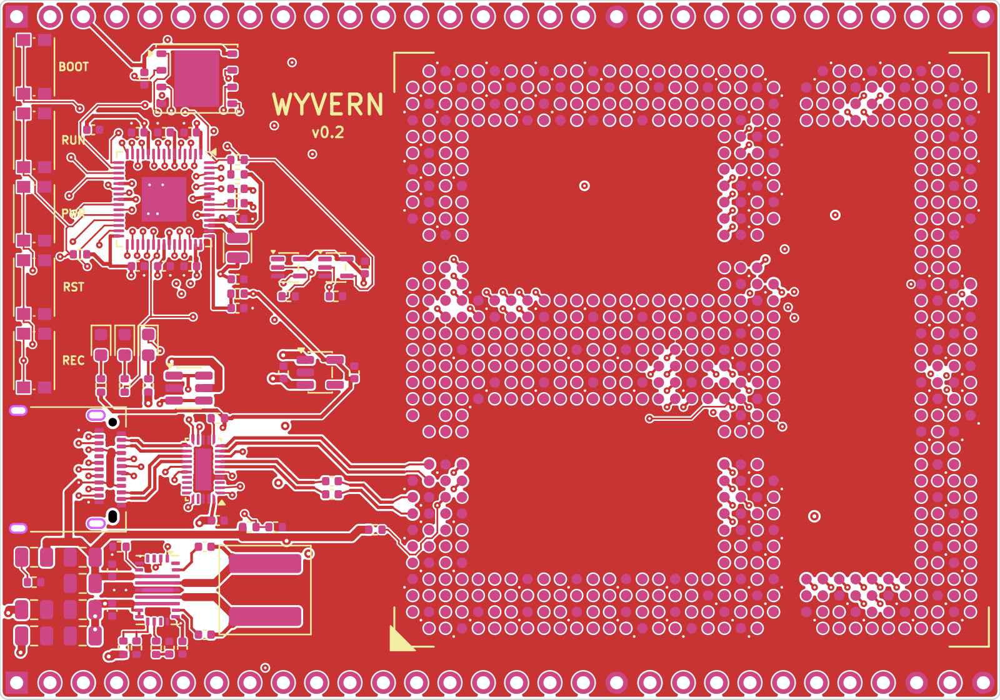
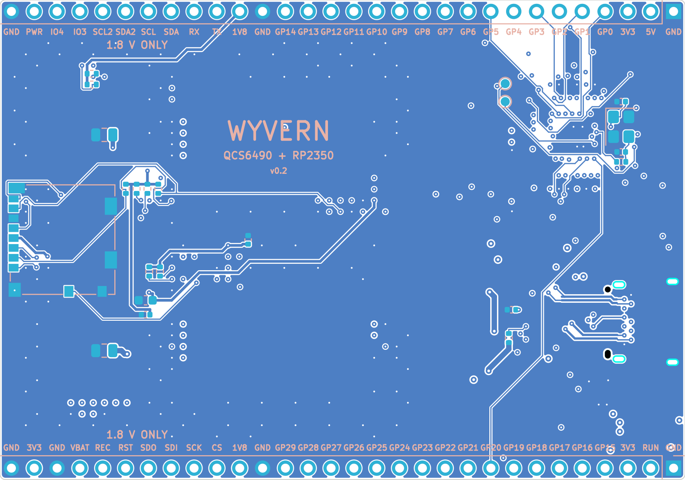
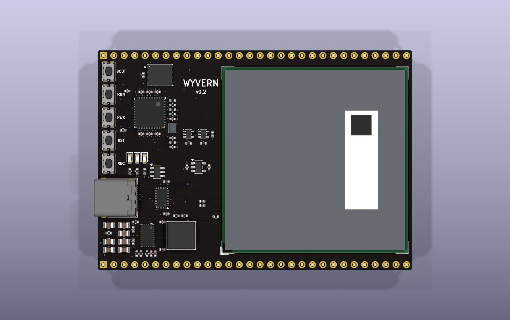
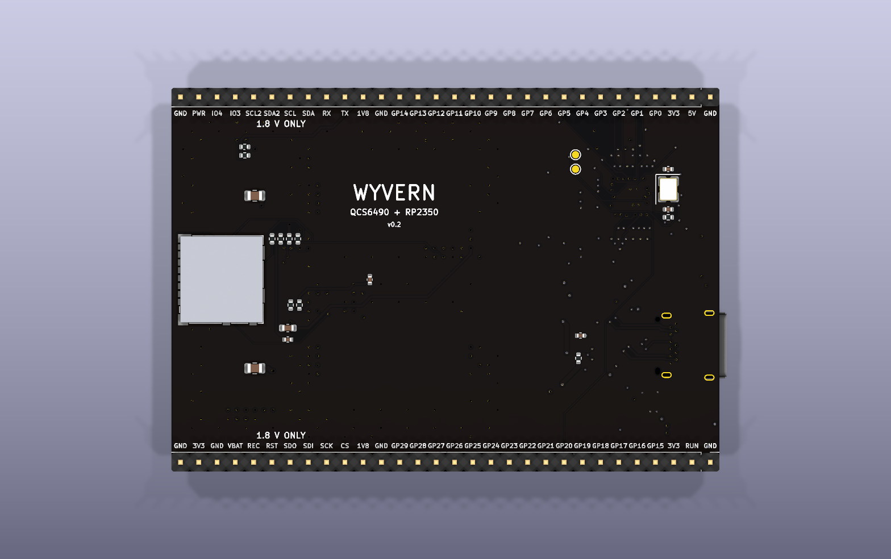
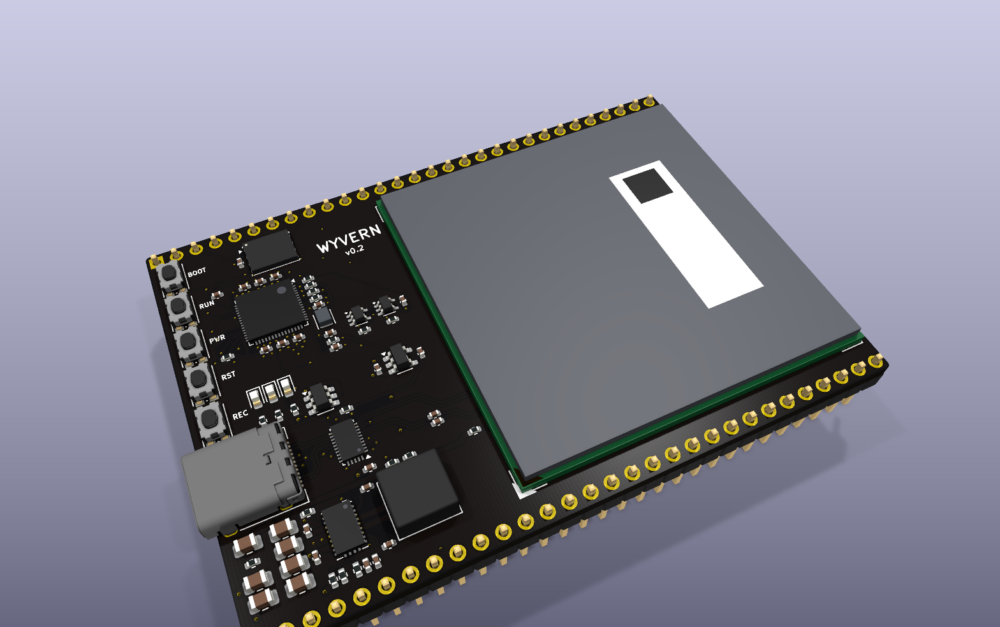
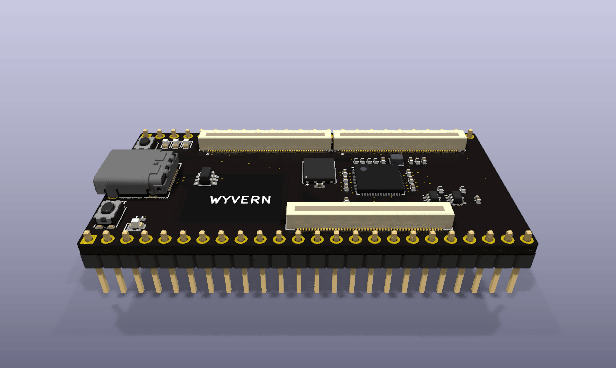
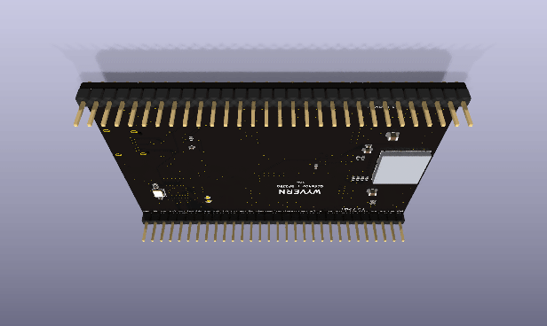
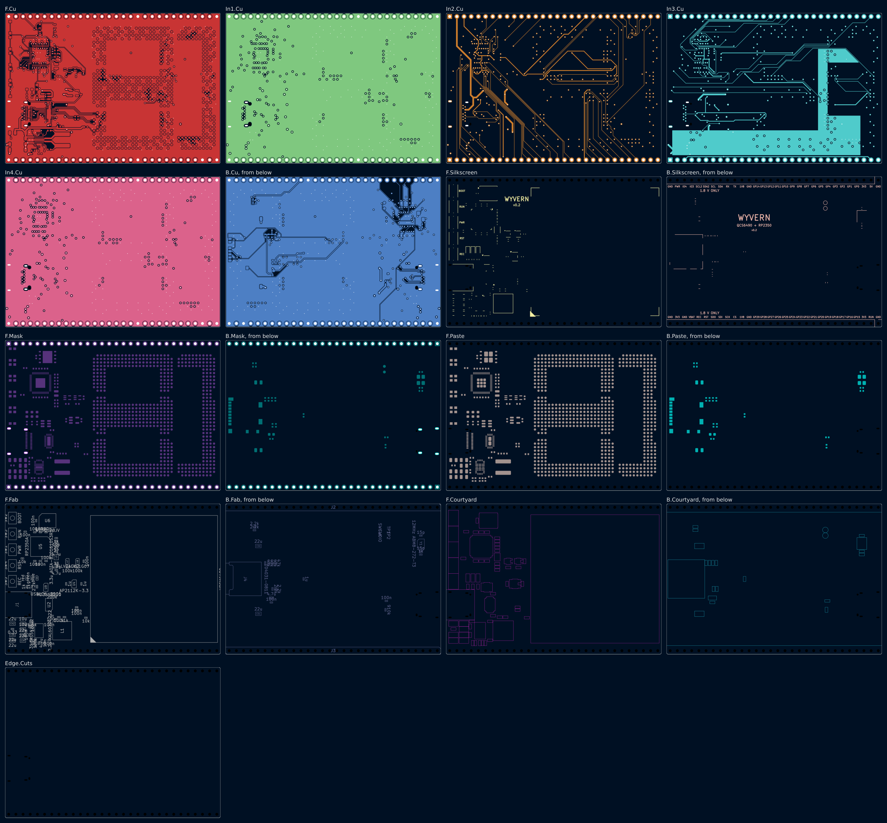
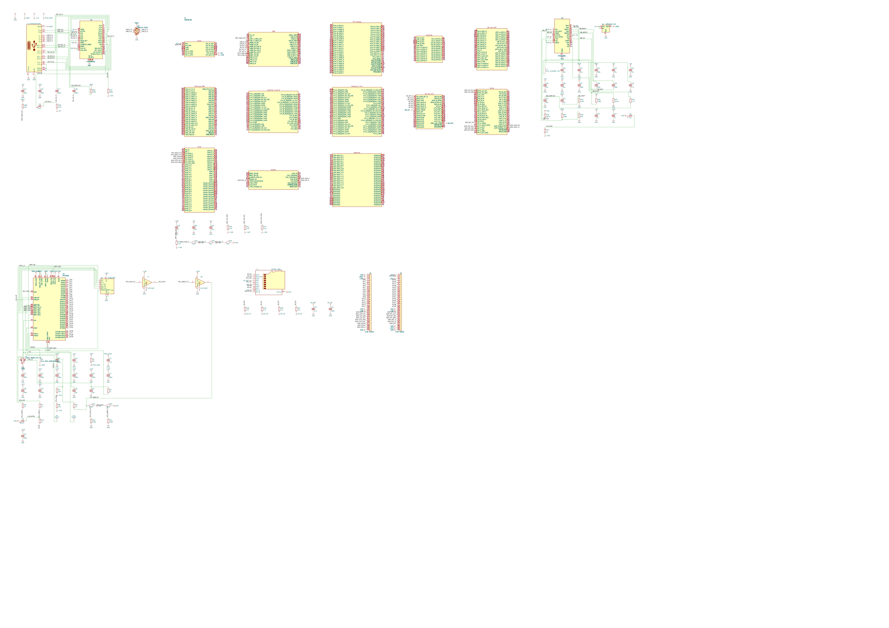

# Wyvern — board prototype v0.2

> The current version of the [Wyvern prototype series](../README.md), started as a copy of [`../v0.1/`](../v0.1/). The earlier version is the sibling folder [`../v0.1/`](../v0.1/).

A development board with a Snapdragon on it, on one flat board. The Qualcomm QCS6490 (8 Kryo 670
cores, 1 at 2.7 GHz, 3 at 2.4 GHz and 4 at 1.9 GHz; an Adreno 643; a Hexagon NPU of 12 TOPS; 8 GB of
LPDDR5 and 64 GB of eMMC) comes on Vantron's VOSM6490, a 45 x 45 mm OSM Size-L module that is soldered
straight onto the board by its 662 pads, like any other chip, and runs Linux or Android. Beside it, an
RP2350 drives 30 pins at 3.3 V the way a Teensy's microcontroller does; the Snapdragon resets it,
puts it in its bootloader and talks to it over USB, so Linux flashes it. The Snapdragon's own UART,
2 I2C buses, an SPI bus and 2 GPIOs are on the same rows at the module's end, at 1.8 V. One USB-C
cable powers the board and carries USB 3.

Wyvern lies flat on a bench, or stands in a breadboard on its 2 rows of pins, with one USB-C cable
at its left end. It is one board, 76.2 x 53.34 mm (3.0 x 2.1 inch) and 6 layers, with the module,
the USB-C, the power and the RP2350 on its top face and the microSD slot and the pins' names on its
bottom.

This folder is a whole KiCad 10 project made with the EE Workcenter: `design.py` is the board, and
the `.kicad_*` files beside it are what `workcenter design` writes from it.

| Item | State |
|---|---|
| Schematic | drawn with wires in blocks, the module's 662 pins in 13 banks named from the OSM standard and Vantron's datasheet; ERC <!-- erc -->0 errors, 0 warnings<!-- /erc -->; no parity warning |
| Board | 76.2 x 53.34 mm (3.0 x 2.1 in), **6 layers**, 1.6 mm, black mask, white legend, ENIG, made to Sierra Circuits' Web PCB limits; 2 rows of 30 pins on the 0.1 in grid, 2.0 in apart; the module, USB-C, the power, the RP2350 and the buttons on the top face, the microSD and the pins' names on the bottom |
| Gates | <!-- gates -->GREEN with 16 warnings: ERC 0 and 0; DRC 0 errors, 0 unconnected, 0 parity, 9 warnings (silkscreen at the edge, 4 vias with nothing past them); SIM 7 decks, 397 corner runs, 0 failures; EXPORT 4 of 4 (`docs/gates.md`)<!-- /gates --> |
| USB | the module's SuperSpeed lane through an HD3SS3220 to both sides of the USB-C receptacle, drawn by hand as 90 ohm pairs; CC by the HD3SS3220, which answers a charger with nothing else powered; the USB 2 pair to both rows |
| Power | 5 V from USB-C (or the 5V pin) to the module's 5.0 V by a TPS552892 buck-boost, 4.86 to 5.17 V at every corner; 3.3 V from that by an AP2112K; the module's own 1.8 V on 2 pins |
| Simulation | 7 decks, each at every corner of its parts' tolerances (`sim/`): the 5.0 V rail inside the module's window, where the converter starts, the USB input's resonance with a cable, the Snapdragon's I2C on the pins, the RP2350's reset and boot lines; a frequency plan holds the 3 clocks against the resonance |
| Parts and cost | an orderable part for every line (`../parts/catalog.csv`); the board's parts $34.18 for 1, $26.00 each for 10, with 4 lines not priced and each reason named; 7 lines out of stock at Digi-Key when read, most with a restock date; the module is sold by quote and not priced |
| Firmware | none yet |

## Images

| Top face | Bottom face (mirrored) |
|---|---|
|  |  |

| 3D, from above | 3D, from below |
|---|---|
|  |  |



| Turning, from above | Turning, from below |
|---|---|
|  |  |

| Every layer | The schematic |
|---|---|
|  |  |

From `workcenter pictures .` (its `pictures.json`), with KiCad's 3D bodies in `KICAD10_3DMODEL_DIR`
and the 5 bodies in `models/`. The module's body is a stand-in ("The Snapdragon module").

## What changed in v0.2: one flat board

The request, on 2026-11-12: "there's a LOT of open hinges here, power, data, alot of routing, it
looks like you slapped two board together too. Can it be one board for v0.2?"

| Finding | The owner's answer | What v0.2 does |
|---|---|---|
| v0.1 is 2 boards: the Open-Q 845 module stands 3 mm over the carrier on 3 sockets, 300 contacts to buy, align and mate | chose "Flat QCS6490 module" (2026-11-12): one flat board, about 53 x 76 mm, a 45 mm QCS6490 module soldered straight on, no sockets and no second board; 5 V in, 3.3 V pins along both long edges, USB-C at one end | the VOSM6490 sits on its 662-pad LGA, reflowed with every other part; the board is 76.2 x 53.34 mm ("The Snapdragon module") |
| Power: v0.1's module wanted 3.45 to 4.75 V from USB's 5 V through a buck whose input stood 0.13 ohm from oscillating with a long cable; this module wants 4.8 to 5.2 V, which a cable carrying 3 A does not deliver | part of the same answer: 5 V in | a TPS552892 buck-boost makes 5.0 V from any VBUS between 3.8 and 5.5 V (4.86 to 5.17 V at every corner), and a damper holds the cable's resonance at 0.51 ohm at worst against the converter's 1.33 ohm ("Power") |
| Data: v0.1 relied on the module's own Type-C controller and lane order, which its maker documents only in a carrier guide behind a registration | part of the same answer | an HD3SS3220 owns the plug: CC, orientation and the SuperSpeed lane, and it answers a charger before anything is powered; every module pad the board uses is named from Vantron's public pin tables ("USB-C") |
| Supply: Digi-Key lists the Open-Q 845 uSOM as obsolete | part of the same answer | the VOSM6490 carries the QCS6490 on SGET's open OSM standard, so its land pattern is public and other makers' OSM-L modules share it |

### Board

The module sets the board: 45 mm square between 2 rows of 30 pins 2.0 inch apart, its row A (its
USB-C lane) facing the USB-C end, its right edge 1.0 mm from the board's. The 31 mm left of it holds
everything else on the top face: the buttons down the left edge, the RP2350 block in the upper half
(v0.1's, turned a quarter turn), USB-C, its mux and the buck-boost in the lower half. The microSD
slot sits under the far end, its card standing out past the right edge. Every module pad the board
uses has a via in the middle of the 4 pads round it (`module_fanout`), so the router takes each
signal out from under the module on the inner layers. The router (FreeRouting) drew <!-- route -->1007 segments and 76 vias round
what `design.py` draws by hand: the buck-boost's power pads, the SuperSpeed lane through its mux,
the receptacle's B row, the RP2350's supplies and fan-out, the module's 184 vias and a spine that
holds the 5 V plane together under the module<!-- /route -->.

### Simulation

7 decks, run at every corner (`workcenter sim .`): the module's 5.0 V at 4.86 to 5.17 V against
its 4.8 to 5.2 V; where the buck-boost starts, 3.51 to 3.78 V of VBUS; the USB input's peak
impedance with a cable, 0.26 ohm at 37 kHz and 0.51 ohm at the worst corner against 1.33 ohm; the
Snapdragon's I2C on the pins, the RP2350's reset and boot lines. A frequency plan holds the
buck-boost, the RP2350's regulator and its crystal against the cable's resonance.

### Firmware

None yet ("Open items").

### Parts and cost

The module, the mux, the buck-boost and its inductor, 9 resistors and capacitors and the 1 x 30
headers are new; the RP2350 block's parts are v0.1's. `../parts/catalog.csv` names an orderable part
for each line, read on 2026-11-12; `workcenter costs ..` prices the board into `../parts/lists/`
("Bill of materials").

### Verification summary

No verification package yet ("Open items").

## What changed in v0.1: the first board

The request: a new microcontroller development board, something like a Teensy but with a Snapdragon
chip, compact, as the workcenter's example of what it can make. v0.1 carried a Snapdragon 845 on
Lantronix's Open-Q 845 uSOM, plugged into 3 DF40 sockets on a 61 x 30.5 mm stick, with an RP2350 on
the pins; its folder, [`../v0.1/`](../v0.1/), tells the rest.

## Architecture

```
USB-C (J1) ─VBUS─┬─ 5V pin
                 ├─ C30, C31, C42 + R45 (damper) ─ U3 TPS552892 ─ L1 2.2 uH ─ +5V ─┬─ module VCC_IN_5V x17
                 ├─ R36 ─ U2 VBUS_DET;  R38 ─ module USB-C_VBUS_DET (C9)         ├─ U2 VDD5
                 └─ U9 USBLC6 (D+, D-)                                           └─ U4 AP2112K ─ +3V3 ─ RP2350, U2, 3V3 pins
USB-C CC1, CC2 ─ U2 HD3SS3220 (UFP; dead-battery Rd)
USB-C TX1/RX1, TX2/RX2 ═ U2 mux ═ module USB0 SS lane (TX through C47, C48)
USB-C D+, D- ──────────────────── module USB0 HS
module USB1 HS ─ R6, R7 27 ohm ─ U5 RP2350 USB (the RP2350 is a device on the module's host port)
module EXT_GPIO_1, _2 (1.8 V) ─ U7, U8 74LVC1G07 ─ RUN, QSPI_SS (reset, bootloader)
module SDC2 ─ J4 microSD;  VREG_L9C, SDC2_VDDIO ─ its supply and pull-ups
module VCC_OUT_IO ─ +1V8 ─ 1V8 pins, U7, U8, the I2C pull-ups
module UART_DEBUG, APPS_I2C, EXT_I2C2, SPI_A, EXT_GPIO_3, _4, PWR_BTN#, SYS_RST#, FORCE_RECOVERY#, RTC_PWR ─ the pins (1.8 V)
U5 RP2350 GP0..GP29 ─ the pins (3.3 V)
```

### Stackup

| Layer | Copper | Use |
|---|---|---|
| F.Cu | 35 um | parts, the module's pads and their 184 vias, the SuperSpeed lane, ground pour |
| In1.Cu | 15 um | ground plane, under F.Cu's pairs (0.21 mm of 7628) |
| In2.Cu | 15 um | signals, CC1 and CC2 |
| In3.Cu | 15 um | signals; the 5 V plane under the power stage and the module's 5 V pads |
| In4.Cu | 15 um | ground plane, over B.Cu's pairs |
| B.Cu | 35 um | the microSD, the crystal, 2 SuperSpeed pairs to the receptacle's B row, ground pour |

A 90 ohm pair on an outer layer is 0.25 mm tracks 0.15 mm apart over 0.21 mm of FR4 (er 4.5), by
IPC-2141's edge-coupled microstrip; its 0.4 mm pitch is the mux's.

## The Snapdragon module

Vantron's VOSM6490 carries the QCS6490 with 8 GB of LPDDR5, 64 GB of eMMC 5.1 and its PMICs on a
45 x 45 mm OSM Size-L module. OSM (Open Standard Module) is SGET's standard for modules soldered
straight onto their board: no connector, a grid of round pads underneath. The land pattern
(`osm_l.py`, `footprints/make_footprints.py`) is the standard's Size-L contact map: a 35 x 35 grid
at 1.25 mm, 662 of its places populated, 0.80 mm round pads opened 1:1 in mask and paste. It equals
Antmicro's open OSM-L footprint pad for pad. `osm_l_pins.csv` names every pad: the standard's name
for each, from Antmicro's open OSM-L carrier schematic, and Vantron's for the 64 the board uses,
read from the VOSM6490 datasheet's pin tables (V1.5). The symbol draws the 662 pins as 13 banks, one
for each interface.

- **Power.** VCC_IN_5V, 4.8 to 5.2 V, 5 V / 3 A, on 17 pads; 135 ground pads. VCC_OUT_IO (U18) is the
  module's 1.8 V for the board's 1.8 V parts, under 100 mA.
- **Its keys.** PWR (SW1, PWR_BTN#, the PMIC's power key), RST (SW4, SYS_RST#) and REC (SW5,
  FORCE_RECOVERY#: low at power-on, the module boots from USB). Each has a 10k pull-up on the
  module. BOOT_SEL0# and BOOT_SEL1# stay open: boot from eMMC.
- **What the board leaves open.** CSI, DSI, eDP, PCIe, UFS, Ethernet, audio, the other UARTs and
  GPIOs: about 500 pads, each on a net of its own.
- **Its height.** Vantron publishes no drawing of the module's top; the body in `models/` is 2.5 mm
  high, the height Advantech and Kontron give for their OSM modules.

Every via under the module is tented (the fab plugs and caps it on request): an open via beside an
LGA pad draws its solder away.

## Power

| Rail | From | To | Set by |
|---|---|---|---|
| VBUS | USB-C or the 5V pin | U3, U2's VBUS_DET, the module's VBUS sense, U9 | a 5 V, 3 A Type-C supply; the board starts from 3.51 to 3.78 V (R34 100k over R35 51k on U3's EN/UVLO) |
| +5V | U3 TPS552892, L1 2.2 uH | the module's 17 VCC_IN_5V pads, U2, U4 | R30 100k over R31 31.6k: 1.2 V x 4.16 = 5.00 V nominal; 4.86 to 5.17 V at every corner (`sim/`) |
| +3V3 | U4 AP2112K-3.3 | the RP2350, its flash, U2's VCC33, the 3V3 pins | its 600 mA |
| +1V1 | the RP2350's own regulator, L2 3.3 uH | the RP2350's core | Raspberry Pi's layout and parts (Hardware design with RP2350, 2.1) |
| +1V8 | the module's VCC_OUT_IO | the 1V8 pins, U7, U8, the I2C pull-ups | the module; under 100 mA |
| SD_VDD, SD_VIO | the module's VREG_L9C (2.96 V) and SDC2_VDDIO | the microSD, its pull-ups | the module |

U3 is a 4-switch buck-boost with its 4 MOSFETs inside (8 A average inductor current limit): it
holds 5.0 V whether the cable delivers more or less. It runs in forced PWM at 746 kHz (R33 26.1k on
FSW), so its harmonics stay clear of the cable's resonance. In forced PWM it would also push current
back into its input if something held its output up; the 5V pin is therefore VBUS, before U3,
and nothing outside the board reaches +5V. Power the board from USB-C or from the 5V pin, not both:
a supply on the pin with a computer on USB-C feeds that computer's port. Its output current limit
is off (ISP and ISN tied to VOUT). The compensation, R32 4.7k and C41 10 nF on COMP, comes from TI's
equations 24 and 25 for a crossover near 10 kHz, under a fifth of the right-half-plane zero in boost
(77 kHz at 4.0 V in and 3 A out). It is not simulated: TI publishes no model of the TPS552892.

The 3 A of a 5 V USB-C supply is the budget for the whole board: the module is rated 5 V / 3 A. The
blue light D3 says the charger offers 3 A (U2's OUT2); the red D1 says +3V3 is up.

## USB-C

J1 is Amphenol's 12401610E4#2A, a USB 3.1 Gen 2 receptacle, its front face 1.0 mm past the board's
left edge. The module's USB0 is a dual-role 5 Gbps port with 1 SuperSpeed lane (TX0, RX0) and its
USB 2 pair. U2, an HD3SS3220, does the rest:

- **CC.** Its PORT pin is tied low, so it is a sink (UFP); with its supply off it still pulls both CC
  pins down through 5.1k (dead battery, 6.4.3), so a Type-C charger turns VBUS on before anything
  on the board is powered. Its ADDR pin is open: it runs in GPIO mode and needs no I2C. The
  module's own CC pins (D9, C8, its PMIC's Type-C detector) stay open, and the module learns of a
  host from VBUS on its C9.
- **The lane.** U2 reads the plug's orientation and switches the module's lane to the receptacle's
  TX1/RX1 or TX2/RX2. The module's TX pair is AC coupled by C47 and C48, 100 nF, on its way to U2
  (TI: on TX only; the far end's TX capacitors couple RX).
- **3 A.** Its OUT2 sinks the blue light D3 when the charger offers 3 A.

| Pair | Module | Mux | Receptacle | Layer |
|---|---|---|---|---|
| SS_TXC, SS_TX | A8 (P), A9 (N) | 6, 7 through C47, C48 | | F.Cu, west from the module's row A |
| SS_RX | B10 (P), B11 (N) | 9, 10 | | F.Cu; B11 through row A's gap at columns 11 to 13 |
| SS_TX1 | | 17 (P), 16 (N) | A3, A2 | F.Cu, turned over: see below |
| SS_RX2 | | 19 (P), 18 (N) | A11, A10 | F.Cu, west and south past the middle pads' vias |
| SS_RX1 | | 15 (P), 14 (N) | B11, B10 | B.Cu, from 2 vias north of the mux to the B row's vias |
| SS_TX2 | | 21 (P), 20 (N) | B2, B3 | B.Cu, from 2 vias west of the mux |
| USB_D | D10 (P), D11 (N) | | A6, A7; B6, B7 | the router, from vias behind the A row |

The mux's TX1 pins run the other way round from the receptacle's A2 and A3, so the TX1 pair lands
turned over (its P on A3): every USB 3 receiver inverts a lane by itself during training, and the
pair stays on the top layer without crossing itself. The receptacle's B row reaches 11 vias in 2
staggered columns in front of it, as in v0.1. U9, a USBLC6-2SC6, clamps D+ and D-.

## The RP2350

U5, an RP2350A (QFN-60), with a 16 MB W25Q128JV (U6), the ABM8-272-T3 crystal and the 3.3 uH
inductor Raspberry Pi tuned its oscillator and its core regulator to, and their resistors and
capacitors as Raspberry Pi's minimal design has them. The block is v0.1's, parts and hand copper,
turned a quarter turn clockwise about the chip (`T` and `TR` in `design.py`): its GPIO 0 to 11 face
the top row of pins, GPIO 19 to 29 the bottom row, and its USB and flash side faces the module.

- **USB.** Its USB pins, through R6 and R7 (27 ohm), go to the module's USB1 (AB23, AC22), a host
  port. Linux sees the RP2350 as a device: its bootloader as a drive, then whatever its firmware is.
- **Reset and bootloader.** RUN and QSPI_SS each have a 10k pull-up and the RP2350's own (32k at
  least). The Snapdragon pulls them through U7 and U8, 74LVC1G07 open-drain buffers on its 1.8 V,
  from its EXT_GPIO_1 and EXT_GPIO_2; R10 and R11 (100k) hold the buffers off while the module is
  off. RUN (SW3) and BOOT (SW2) do the same by hand. Hold BOOT and press RUN, or let the Snapdragon
  do it: the RP2350 comes up as a drive.
- **SWD.** SWCLK and SWDIO on 2 pads on the bottom (TP1, TP2).

## Pin plan

Every GPIO of the RP2350 is on a pin; functions from its datasheet's function table (F1 SPI, F2
UART, F3 I2C, F4 PWM; section 1.2.3). GP12 to GP19 also carry HSTX, the RP2350's high-speed serial
output (DVI). The header's pins count from the USB-C end.

| GPIO | RP2350 pin | Header | Functions (F1 to F4) | Also |
|---|---|---|---|---|
| GP0 | 2 | top 4 | SPI0 RX, UART0 TX, I2C0 SDA, PWM0 A |  |
| GP1 | 3 | top 5 | SPI0 CSn, UART0 RX, I2C0 SCL, PWM0 B |  |
| GP2 | 4 | top 6 | SPI0 SCK, UART0 CTS, I2C1 SDA, PWM1 A |  |
| GP3 | 5 | top 7 | SPI0 TX, UART0 RTS, I2C1 SCL, PWM1 B |  |
| GP4 | 7 | top 8 | SPI0 RX, UART1 TX, I2C0 SDA, PWM2 A |  |
| GP5 | 8 | top 9 | SPI0 CSn, UART1 RX, I2C0 SCL, PWM2 B |  |
| GP6 | 9 | top 10 | SPI0 SCK, UART1 CTS, I2C1 SDA, PWM3 A |  |
| GP7 | 10 | top 11 | SPI0 TX, UART1 RTS, I2C1 SCL, PWM3 B |  |
| GP8 | 12 | top 12 | SPI1 RX, UART1 TX, I2C0 SDA, PWM4 A |  |
| GP9 | 13 | top 13 | SPI1 CSn, UART1 RX, I2C0 SCL, PWM4 B |  |
| GP10 | 14 | top 14 | SPI1 SCK, UART1 CTS, I2C1 SDA, PWM5 A |  |
| GP11 | 15 | top 15 | SPI1 TX, UART1 RTS, I2C1 SCL, PWM5 B |  |
| GP12 | 16 | top 16 | SPI1 RX, UART0 TX, I2C0 SDA, PWM6 A | HSTX (DVI) |
| GP13 | 17 | top 17 | SPI1 CSn, UART0 RX, I2C0 SCL, PWM6 B | HSTX (DVI) |
| GP14 | 18 | top 18 | SPI1 SCK, UART0 CTS, I2C1 SDA, PWM7 A | HSTX (DVI) |
| GP15 | 19 | bottom 4 | SPI1 TX, UART0 RTS, I2C1 SCL, PWM7 B | HSTX (DVI) |
| GP16 | 27 | bottom 5 | SPI0 RX, UART0 TX, I2C0 SDA, PWM0 A | HSTX (DVI) |
| GP17 | 28 | bottom 6 | SPI0 CSn, UART0 RX, I2C0 SCL, PWM0 B | HSTX (DVI) |
| GP18 | 29 | bottom 7 | SPI0 SCK, UART0 CTS, I2C1 SDA, PWM1 A | HSTX (DVI) |
| GP19 | 31 | bottom 8 | SPI0 TX, UART0 RTS, I2C1 SCL, PWM1 B | HSTX (DVI) |
| GP20 | 32 | bottom 9 | SPI0 RX, UART1 TX, I2C0 SDA, PWM2 A |  |
| GP21 | 33 | bottom 10 | SPI0 CSn, UART1 RX, I2C0 SCL, PWM2 B |  |
| GP22 | 34 | bottom 11 | SPI0 SCK, UART1 CTS, I2C1 SDA, PWM3 A |  |
| GP23 | 35 | bottom 12 | SPI0 TX, UART1 RTS, I2C1 SCL, PWM3 B |  |
| GP24 | 36 | bottom 13 | SPI1 RX, UART1 TX, I2C0 SDA, PWM4 A |  |
| GP25 | 37 | bottom 14 | SPI1 CSn, UART1 RX, I2C0 SCL, PWM4 B | LED D2 through R12 |
| GP26 | 40 | bottom 15 | SPI1 SCK, UART1 CTS, I2C1 SDA, PWM5 A | ADC0 |
| GP27 | 41 | bottom 16 | SPI1 TX, UART1 RTS, I2C1 SCL, PWM5 B | ADC1 |
| GP28 | 42 | bottom 17 | SPI1 RX, UART0 TX, I2C0 SDA, PWM6 A | ADC2 |
| GP29 | 43 | bottom 18 | SPI1 CSn, UART0 RX, I2C0 SCL, PWM6 B | ADC3 |

The other pins:

| Pin | Top row (J2) | Bottom row (J3) |
|---|---|---|
| 1 | GND | GND |
| 2 | 5V: VBUS, in or out | RUN: the RP2350's reset, active low |
| 3 | 3V3 | 3V3 |
| 4 to 18 | GP0 to GP14 | GP15 to GP29 |
| 19 | GND | GND |
| 20 | 1V8: the module's VCC_OUT_IO | 1V8 |
| 21 | TX: the Snapdragon's debug UART (UART_DEBUG_TXD) | CS: its SPI_A chip select, active low |
| 22 | RX (UART_DEBUG_RXD) | SCK: SPI_A clock |
| 23 | SDA: its APPS_I2C, 2.2k pull-up | SDI: SPI_A data in |
| 24 | SCL, 2.2k pull-up | SDO: SPI_A data out |
| 25 | SDA2: its EXT_I2C2, 2.2k pull-up | RST: the module's SYS_RST#, active low |
| 26 | SCL2, 2.2k pull-up | REC: FORCE_RECOVERY#, active low |
| 27 | IO3: EXT_GPIO_3 | VBAT: RTC_PWR, for a 3 V coin cell |
| 28 | IO4: EXT_GPIO_4 | GND |
| 29 | PWR: PWR_BTN#, active low | 3V3 |
| 30 | GND | GND |

Pins 20 to 29 at the module's end are the Snapdragon's own, at 1.8 V, and are not 3.3 V tolerant;
the bottom face says so beside them.

## Datasheets, models and simulation

The datasheets the design reads, each named where it is used (`../library/sources.csv`):

| Part | Document |
|---|---|
| VOSM6490 | Vantron VOSM6490 System-on-Module Datasheet V1.5 (2026) |
| OSM Size-L | SGET OSM v1.2 (the contact map), Antmicro's open OSM-L footprint and carrier schematic, F&S Application Note OSM01 (the I2C pull-ups) |
| HD3SS3220 | TI SLLSES1E (July 2025) |
| TPS552892 | TI SLVSH28A (April 2023) |
| XAL6030-222 | Coilcraft Document 887 (February 2026) |
| RP2350 | Raspberry Pi RP2350 Datasheet; Hardware design with RP2350 |
| SN74LVC1G07 | TI SCES296AG (October 2025) |
| 12401610E4#2A | Amphenol Commercial Products' USB Type-C cut sheet |
| I2C | NXP UM10204 Rev. 7.0 |

The decks in `sim/` stand in for the parts with their datasheets' numbers, at every corner of the
board's 1 % resistors, C30, C31 and C42 at 50 % either way and a cable from 0.5 to 1.5 m
(`sim/corners.json`, 32 Monte Carlo runs each):

| Deck | What it proves | Result |
|---|---|---|
| `sys_rail_low.cir` | +5V with U3's reference at 1.188 V and FB's 100 nA out of the pin | 4.94 V; 4.86 V at the lowest corner, in 4.8 to 5.2 V |
| `sys_rail_high.cir` | the same at 1.212 V and 0.4 uA into the pin | 5.09 V; 5.17 V at the highest corner, in 4.8 to 5.2 V |
| `vbus_uvlo_low.cir` | where U3 starts, VUVLO at 1.20 V | 3.55 V of VBUS; 3.51 V at the lowest corner (3.0 V at least) |
| `vbus_uvlo_high.cir` | the same at 1.26 V | 3.73 V; 3.78 V at the highest corner (4.0 V at most) |
| `vbus_pdn.cir` | the USB input's impedance: a cable with C30, C31 and the damper | a peak of 0.26 ohm at 37 kHz, Q 1.4; 0.51 ohm at the worst corner, under U3's 1.33 ohm |
| `som_i2c.cir` | the Snapdragon's I2C on the pins, 2.2k on the board and 2.2k on the module, 100 pF | rise 93 ns (300 ns allowed); low 0.25 V at 1.4 mA |
| `mcu_control.cir` | RUN and QSPI_SS pulled by U7, U8 and BOOT | RUN 48 mV; QSPI_SS 0.42 V by U8, 0.38 V by BOOT (0.8 V allowed) |

### Frequency plan

`sim/frequency-plan.json` (workcenter PROCESSES.md P30); `workcenter sim .` holds each source's first
10 harmonics against each resonance's band.

| Source | Frequency | From |
|---|---|---|
| TPS552892 | 746 kHz in forced PWM, 10 % either way | SLVSH28A, equation 3 and 6.5 |
| RP2350 core regulator | 3 MHz | RP2350 datasheet, Table 1689 |
| RP2350 crystal | 12 MHz | Y1 |

| Resonance | Frequency over the corners | Band held |
|---|---|---|
| VBUS behind a USB-C cable (`vbus_pdn.cir`) | 24.1 to 83.2 kHz, Q 1.1 to 2.5 | 12.8 to 122 kHz |

No source's harmonic lands in the band. The plan leaves out the module's own regulators (Vantron
does not publish their frequencies) and the resonances of +5V, +3V3 and +1V1: each is a regulator's
closed-loop output, and none of the makers publishes its output impedance.

## Bill of materials

| Ref | Value | Package | Face | Part |
|---|---|---|---|---|
| C9 | 4.7u | C_0402_1005Metric | top | Murata GRM155R61A475MEAAD |
| C10 | 4.7u | C_0402_1005Metric | top | Murata GRM155R61A475MEAAD |
| C11 | 4.7u | C_0402_1005Metric | top | Murata GRM155R61A475MEAAD |
| C12 | 100n | C_0402_1005Metric | top | Murata GRM155R71C104KA88D |
| C13 | 100n | C_0402_1005Metric | top | Murata GRM155R71C104KA88D |
| C14 | 100n | C_0402_1005Metric | top | Murata GRM155R71C104KA88D |
| C15 | 100n | C_0402_1005Metric | top | Murata GRM155R71C104KA88D |
| C16 | 100n | C_0402_1005Metric | top | Murata GRM155R71C104KA88D |
| C17 | 100n | C_0402_1005Metric | top | Murata GRM155R71C104KA88D |
| C18 | 100n | C_0402_1005Metric | top | Murata GRM155R71C104KA88D |
| C19 | 100n | C_0402_1005Metric | top | Murata GRM155R71C104KA88D |
| C20 | 15p | C_0402_1005Metric | bottom | Murata GRM1555C1H150JA01D |
| C21 | 15p | C_0402_1005Metric | bottom | Murata GRM1555C1H150JA01D |
| C22 | 100n | C_0402_1005Metric | top | Murata GRM155R71C104KA88D |
| C23 | 4.7u | C_0603_1608Metric | bottom | Murata GRM188R61A475KE15D |
| C24 | 100n | C_0402_1005Metric | bottom | Murata GRM155R71C104KA88D |
| C30 | 10u | C_0805_2012Metric | top | Murata GRM21BR61C106KE15L |
| C31 | 10u | C_0805_2012Metric | top | Murata GRM21BR61C106KE15L |
| C32 | 100n | C_0402_1005Metric | top | Murata GRM155R71C104KA88D |
| C33 | 22u | C_0805_2012Metric | top | Murata GRM21BR61A226ME51L |
| C34 | 22u | C_0805_2012Metric | top | Murata GRM21BR61A226ME51L |
| C35 | 22u | C_0805_2012Metric | top | Murata GRM21BR61A226ME51L |
| C36 | 22u | C_0805_2012Metric | top | Murata GRM21BR61A226ME51L |
| C37 | 100n | C_0402_1005Metric | top | Murata GRM155R71C104KA88D |
| C38 | 100n | C_0402_1005Metric | top | Murata GRM155R71C104KA88D |
| C39 | 100n | C_0402_1005Metric | top | Murata GRM155R71C104KA88D |
| C40 | 4.7u | C_0402_1005Metric | top | Murata GRM155R61A475MEAAD |
| C41 | 10n | C_0402_1005Metric | top | Murata GRM155R71H103KA88D |
| C42 | 22u | C_0805_2012Metric | top | Murata GRM21BR61A226ME51L |
| C43 | 1u | C_0402_1005Metric | top | Murata GRM155R61A105KE15D |
| C44 | 1u | C_0402_1005Metric | top | Murata GRM155R61A105KE15D |
| C45 | 100n | C_0402_1005Metric | top | Murata GRM155R71C104KA88D |
| C46 | 100n | C_0402_1005Metric | bottom | Murata GRM155R71C104KA88D |
| C47 | 100n | C_0402_1005Metric | top | Murata GRM155R71C104KA88D |
| C48 | 100n | C_0402_1005Metric | top | Murata GRM155R71C104KA88D |
| C49 | 1u | C_0402_1005Metric | bottom | Murata GRM155R61A105KE15D |
| C50 | 22u | C_0805_2012Metric | bottom | Murata GRM21BR61A226ME51L |
| C51 | 22u | C_0805_2012Metric | bottom | Murata GRM21BR61A226ME51L |
| D1 | red | LED_0603_1608Metric | top | Lite-On LTST-C191KRKT |
| D2 | green | LED_0603_1608Metric | top | Lite-On LTST-C191KGKT |
| D3 | blue | LED_0603_1608Metric | top | Lite-On LTST-C191TBKT |
| J1 | 12401610E4#2A | USB_C_Receptacle_Amphenol_12401610E4-2A_Ring6mil | top | Amphenol ICC 12401610E4#2A |
| J2 | 1x30 header | PinHeader_1x30_P2.54mm_Vertical | bottom | Sullins PRPC030SAAN-RC |
| J3 | 1x30 header | PinHeader_1x30_P2.54mm_Vertical | bottom | Sullins PRPC030SAAN-RC |
| J4 | 104031-0811 | microSD_HC_Molex_104031-0811 | bottom | Molex 1040310811 |
| L1 | 2.2u XAL6030-222 | L_Coilcraft_XAL6030-XXX | top | Coilcraft XAL6030-222MEC |
| L2 | 3.3u AOTA-B201610S3R3 | L_Abracon_AOTA-B201610S | top | Abracon AOTA-B201610S3R3-101-T |
| R3 | 33 | R_0402_1005Metric | top | YAGEO RC0402FR-0733RL |
| R4 | 10k | R_0402_1005Metric | top | YAGEO RC0402FR-0710KL |
| R5 | 1k | R_0402_1005Metric | bottom | YAGEO RC0402FR-071KL |
| R6 | 27 | R_0402_1005Metric | top | YAGEO RC0402FR-0727RL |
| R7 | 27 | R_0402_1005Metric | top | YAGEO RC0402FR-0727RL |
| R8 | 10k | R_0402_1005Metric | top | YAGEO RC0402FR-0710KL |
| R9 | 1k | R_0402_1005Metric | top | YAGEO RC0402FR-071KL |
| R10 | 100k | R_0402_1005Metric | top | YAGEO RC0402FR-07100KL |
| R11 | 100k | R_0402_1005Metric | top | YAGEO RC0402FR-07100KL |
| R12 | 1k | R_0402_1005Metric | top | YAGEO RC0402FR-071KL |
| R18 | 47k | R_0402_1005Metric | bottom | YAGEO RC0402FR-0747KL |
| R19 | 47k | R_0402_1005Metric | bottom | YAGEO RC0402FR-0747KL |
| R20 | 47k | R_0402_1005Metric | bottom | YAGEO RC0402FR-0747KL |
| R21 | 47k | R_0402_1005Metric | bottom | YAGEO RC0402FR-0747KL |
| R30 | 100k | R_0402_1005Metric | top | YAGEO RC0402FR-07100KL |
| R31 | 31.6k | R_0402_1005Metric | top | YAGEO RC0402FR-0731K6L |
| R32 | 4.7k | R_0402_1005Metric | top | YAGEO RC0402FR-074K7L |
| R33 | 26.1k | R_0402_1005Metric | top | YAGEO RC0402FR-0726K1L |
| R34 | 100k | R_0402_1005Metric | top | YAGEO RC0402FR-07100KL |
| R35 | 51k | R_0402_1005Metric | top | YAGEO RC0402FR-0751KL |
| R36 | 910k | R_0402_1005Metric | bottom | YAGEO RC0402FR-07910KL |
| R37 | 200k | R_0402_1005Metric | top | YAGEO RC0402FR-07200KL |
| R38 | 10k | R_0402_1005Metric | top | YAGEO RC0402FR-0710KL |
| R39 | 2.2k | R_0402_1005Metric | top | YAGEO RC0402FR-072K2L |
| R40 | 2.2k | R_0402_1005Metric | bottom | YAGEO RC0402FR-072K2L |
| R41 | 2.2k | R_0402_1005Metric | bottom | YAGEO RC0402FR-072K2L |
| R42 | 2.2k | R_0402_1005Metric | bottom | YAGEO RC0402FR-072K2L |
| R43 | 2.2k | R_0402_1005Metric | bottom | YAGEO RC0402FR-072K2L |
| R44 | 1k | R_0402_1005Metric | top | YAGEO RC0402FR-071KL |
| R45 | 0.33 | R_0402_1005Metric | top | Panasonic ERJ-2BQFR33X |
| SW1 | PWR | SW_Push_1P1T_NO_CK_KMR2 | top | C&K KMR221GLFS |
| SW2 | BOOT | SW_Push_1P1T_NO_CK_KMR2 | top | C&K KMR221GLFS |
| SW3 | RUN | SW_Push_1P1T_NO_CK_KMR2 | top | C&K KMR221GLFS |
| SW4 | RST | SW_Push_1P1T_NO_CK_KMR2 | top | C&K KMR221GLFS |
| SW5 | REC | SW_Push_1P1T_NO_CK_KMR2 | top | C&K KMR221GLFS |
| TP1 | SWCLK | TestPoint_Pad_D1.0mm | bottom |   |
| TP2 | SWDIO | TestPoint_Pad_D1.0mm | bottom |   |
| U1 | VOSM6490 | OSM_L_LGA-662_45x45mm_P1.25mm | top | Vantron VOSM6490 |
| U2 | HD3SS3220 | Texas_RNH0030A_WQFN-30-1EP_2.5x4.5mm_P0.4mm_EP1.2x3.2mm | top | Texas Instruments HD3SS3220RNHR |
| U3 | TPS552892 | Texas_RYQ0021A_VQFN-HR-21_5x3mm_P0.5mm | top | Texas Instruments TPS552892RYQR |
| U4 | AP2112K-3.3 | SOT-23-5 | top | Diodes AP2112K-3.3TRG1 |
| U5 | RP2350A | QFN-60-1EP_7x7mm_P0.4mm_EP3.4x3.4mm | top | Raspberry Pi RP2350A |
| U6 | W25Q128JV | WSON-8-1EP_6x5mm_P1.27mm_EP3.4x4.3mm | top | Winbond W25Q128JVPIQ |
| U7 | 74LVC1G07 | SOT-353_SC-70-5 | top | Texas Instruments SN74LVC1G07DCKR |
| U8 | 74LVC1G07 | SOT-353_SC-70-5 | top | Texas Instruments SN74LVC1G07DCKR |
| U9 | USBLC6-2SC6 | SOT-23-6 | top | STMicroelectronics USBLC6-2SC6 |
| Y1 | 12MHz ABM8-272-T3 | Crystal_SMD_3225-4Pin_3.2x2.5mm | bottom | Abracon ABM8-272-T3 |

The bare board is off the board: `../parts/offboard/v0.2.csv`. The priced list is
`../parts/lists/v0.2.md`.

## Working on this board

The tools come from the EE Workcenter, this repository's `tools/`. Run the commands from this
folder.

```sh
workcenter design design.py --route          # regenerate the KiCad project and route it
workcenter gates . --report docs/gates.md    # ERC, DRC, simulation, export; GREEN means done
workcenter sim .                             # the sim/ decks at every corner
workcenter pictures .                        # what pictures.json names: renders, layers, GIFs
workcenter costs ..                          # price the board into ../parts/lists/
python3 symbols/make_symbols.py              # the module's banked symbol, the HD3SS3220, the TPS552892
python3 footprints/make_footprints.py        # the module's LGA, the TPS552892's RYQ, the USB-C copy
python3 models/make_models.py                # the 5 bodies KiCad's 3D library has none for
```

`design.py` is the source of truth; the `.kicad_*` files are generated from it and committed so
KiCad can open them. 5 functions draw copper by hand, and the router keeps it and fills in the rest:
`power_stage` takes the buck-boost's 0.25 mm power pads out to their capacitors and the inductor;
`usb_lane` draws the SuperSpeed lane from the module through the mux to both sides of the
receptacle, the B row's vias and the mux's control vias; `core_rail` is v0.1's copper round the
RP2350, turned with it; `module_fanout` puts a via beside each module pad the board uses;
`five_volt_spine` runs 5 V on In3 along the module's middle pad line, which no fan-out via touches,
so the router cannot cut the 5 V plane under the module in pieces.

## Decisions

- **A soldered module** (v0.2). The owner asked for one board. An OSM module is made to be soldered:
  its 662 pads reflow with the rest, and its pinout and land pattern are a public standard. The
  QCS6490 itself, like v0.1's SDA845, needs LPDDR5 and a PMIC routed on an HDI board, which the
  workcenter's generator (through vias only) does not draw.
- **A buck-boost for 5.0 V** (v0.2). The module wants 4.8 to 5.2 V; a USB-C source gives 4.75 V at
  least and a cable carrying 3 A drops up to half a volt. TPS552892: no I2C to set it up, its 4
  switches inside, an 8 A limit over the 4.3 A the inductor carries at 3 A out from 4.0 V.
- **Forced PWM** (v0.2). One frequency, clear of the cable's resonance at every corner, where power
  save would sweep through it. The cost is the reverse current, answered by putting the 5V pin on
  VBUS ("Power").
- **The HD3SS3220 owns CC** (v0.2). The board is powered by the port it reads: the controller must
  answer a charger with its own supply off, which the HD3SS3220 does; the module's PMIC is not yet
  powered then.
- **TX1 turned over** (v0.2). The pair keeps to one layer; USB 3 receivers invert a lane's polarity.
- **An RP2350 on the pins** (v0.1). The Snapdragon's pins are 1.8 V, a Teensy's 3.3 V. The RP2350 is
  a 3.3 V microcontroller with USB in its boot ROM, so the Snapdragon can flash it with no other part.
  Its pins' HSTX gives a second display.
- **6 layers** (v0.1). On 4 layers the bottom's pairs would reference In2, which carries signals; 6
  layers give both outer layers a ground plane under them.
- **0.2 mm from copper to a hole or the edge** (v0.1). The receptacle's rear shell slot and its peg
  are 0.375 mm apart, so no pad keeps a 6 mil ring and the workcenter's 0.3 mm. The 2 rear tabs carry
  copper on the outer layers only (they are unnumbered in `footprints/`); the shell is grounded by
  its front tabs.

## Open items

### Candidates for v0.3

- **The module's own carrier guide.** Vantron's datasheet gives pins and ratings; its carrier design
  guide and reference schematic would confirm the USB0 role (CC on the HD3SS3220, VBUS on C9), the
  SuperSpeed AC coupling and the power-on behaviour (the board has a PWR button; whether the module
  starts by itself when power arrives is not in the datasheet).
- **VBUS at attach.** C30, C31 and the damper's C42 hold 42 uF written, about 21 uF at 5 V of DC
  bias; USB Type-C asks a sink for at most 10 uF on VBUS at attach unless it limits its inrush. A
  4 A load switch with a slew capacitor in front of them would bring the board inside it, and the
  cable's resonance would then see the switch's resistance too.
- **Wi-Fi and Bluetooth.** The module's radio is on the board's side (PCIe 1 lane and a UART, marked
  for WLAN and BT): an M.2 E-key slot or a soldered WCN module at the far end.
- **Heat.** The module is rated 5 V / 3 A and Vantron gives no thermal figures; a 40 x 40 mm
  stick-on heatsink on its shield is the bench answer, and mounting holes for a clamped one the next.
- **ESD on the SuperSpeed pairs.** U9 covers D+ and D-; a TPD4E05U06 on each side of the mux would
  cover the lane.
- **Camera and display.** The module's 4-lane CSI, DSI and eDP are unused; an FPC connector at the
  far end would bring one of each out.
- **Firmware.** The RP2350's side of the USB link and the pin map; the module's device tree for
  EXT_GPIO_1 and _2 and for USB0 as a peripheral with VBUS on C9.

### On the bench

No board has been made.
