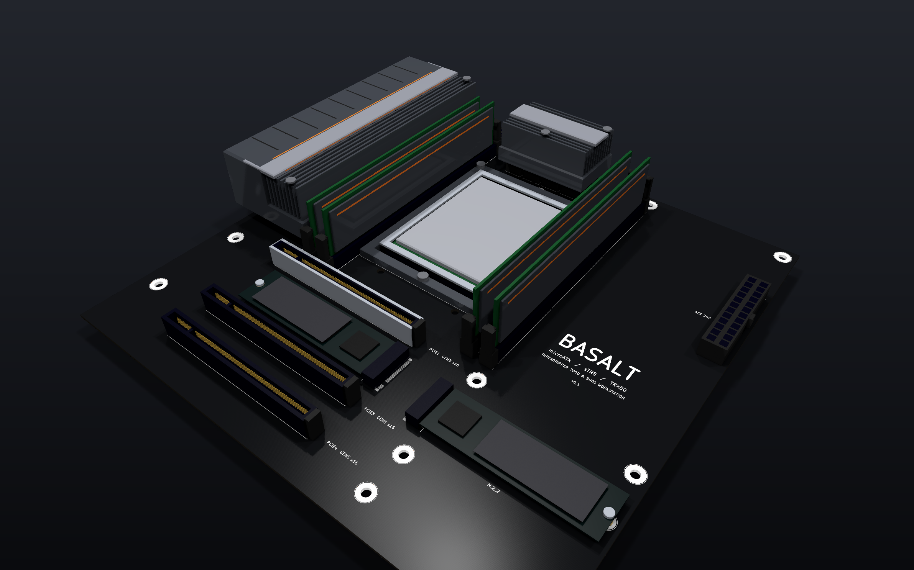
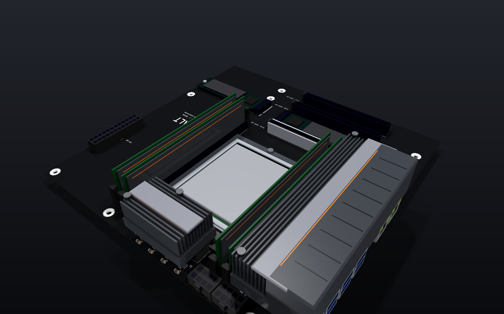
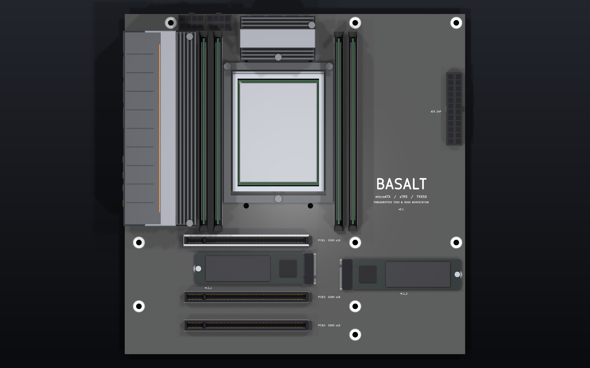
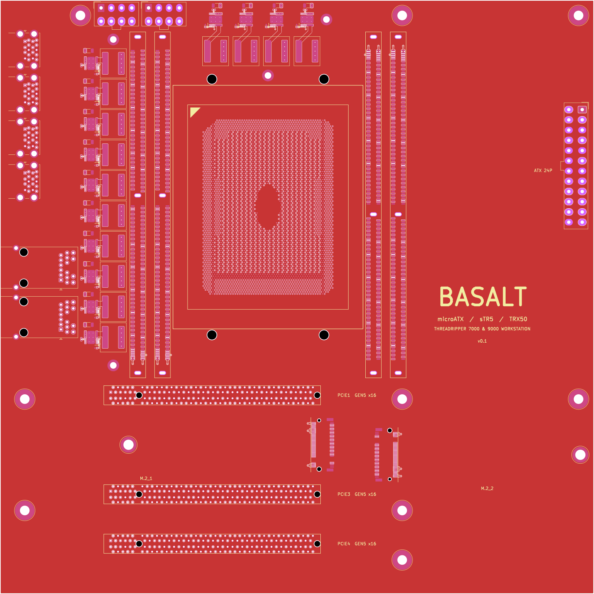
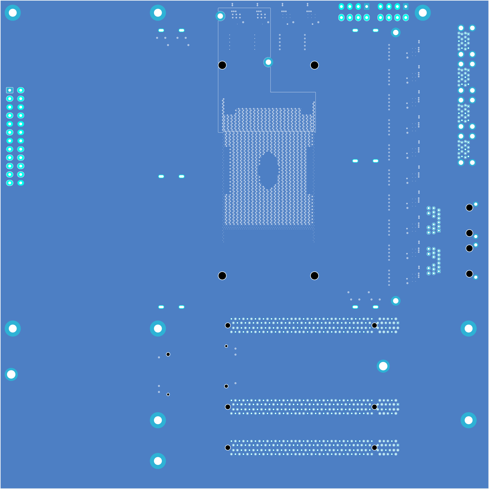
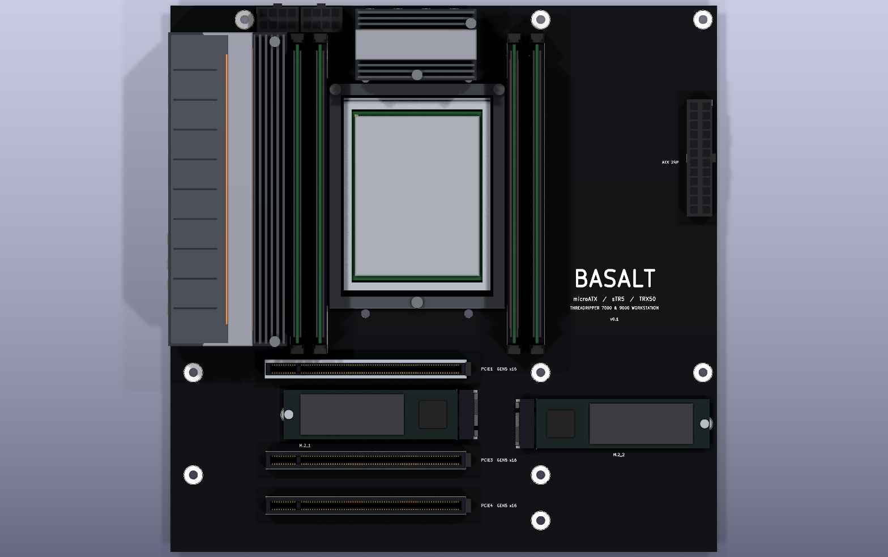
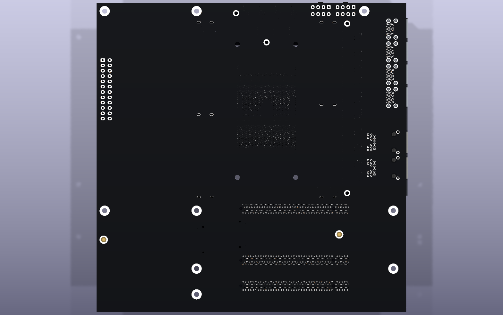
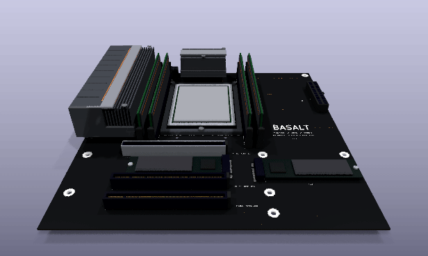
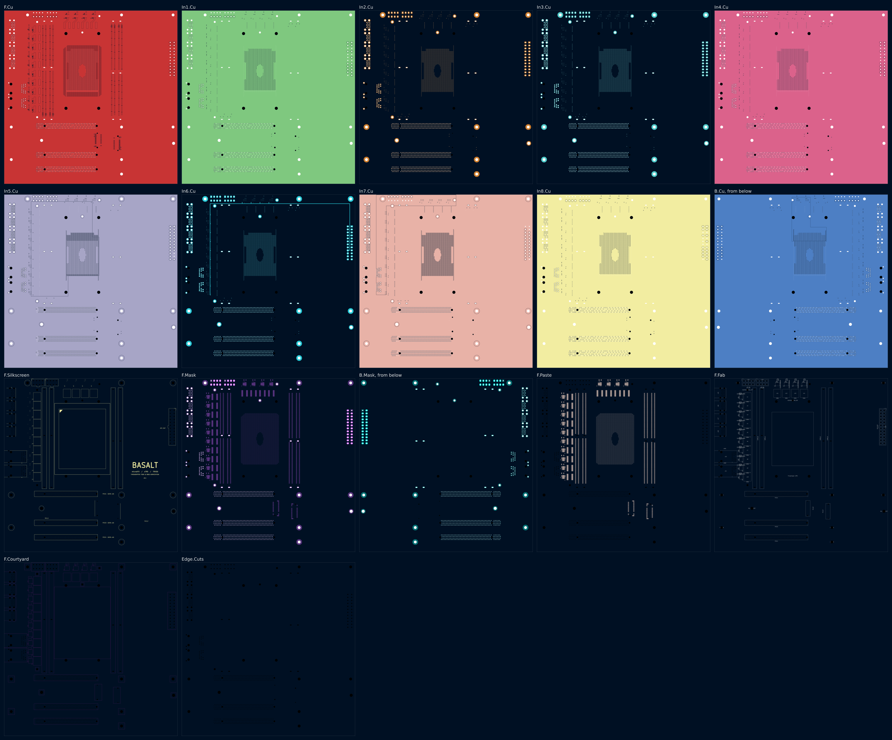

# Basalt — board prototype v0.1

> The current version of the [Basalt prototype series](../README.md), and its first.

Basalt is a microATX motherboard for an AMD Threadripper 7000 or 9000 on the sTR5 socket (the TRX50
platform): 4 DDR5 RDIMM slots, 3 PCI Express 5.0 x16 slots, 2 M.2 sockets, 14 phases of power
stages for a 350 W processor, and the rear I/O, on 244 x 244 mm. No microATX TRX50 board has been
made; the smallest is ATX.

This folder is a whole KiCad 10 project made with the EE Workcenter, which supplies the tools and the
gates: `design.py` and the modules beside it are the board, the `.kicad_*` files are what
`workcenter design` writes from them, and `footprints/`, `symbols/` and `models/` hold what KiCad's
libraries lack, each written by a script from its maker's drawing.

| Item | State |
|---|---|
| Schematic | 1 A0 sheet drawn with wires, the processor as banks; ERC 0 errors, 0 warnings; no parity warning |
| Board | 244 x 244 mm (9.6 x 9.6 in), microATX; 10 layers, 1.6 mm; black mask, white legend, immersion silver; 102 parts, 50 nets, 3559 vias |
| Gates | GREEN with no warning, see [`docs/gates.md`](docs/gates.md): ERC, DRC (0 errors, 0 unconnected), EXPORT (30 Gerber files); no deck for SIM |
| Processor | the sTR5 socket's 4844 lands on a 0.94 x 0.81 mm interstitial array; v0.1 joins its ground, VDDCR_CPU and VDDCR_SOC lands, a via in each (3289); its signal lands come with their buses |
| Memory | 4 DDR5 RDIMM slots, each with its 12 V and 3.3 V; the 4 channels' buses are v0.2 |
| Expansion | 3 PCI Express x16 slots and 2 M.2 sockets with their supplies; the lanes are v0.3 |
| Power | the 24-pin ATX and 2 EPS 8-pin connectors; 14 phases of TI CSD95490Q5MC (75 A) and 10 x 10 mm chokes: 12 for VDDCR_CPU, 2 for VDDCR_SOC; every supply in a pour or a drawn track; the phases' controller is v0.4 |
| Rear I/O | 2 gigabit RJ45 jacks with magnetics, 4 stacked pairs of USB 3 Type-A, under a grooved cover; their controllers are v0.4 |
| Datasheets and models | the makers' drawings named in `footprints/make_footprints.py` and `symbols/make_symbols.py`; no SPICE model (no deck) |
| Verification | none yet: no requirement is judged until the board carries signals |

## Images

`workcenter pictures .` draws every picture below from [`pictures.json`](pictures.json):
`workcenter render` the stills, the layer sheet and the turning GIF (tilt -55, zoom 0.92), and
[`hero.py`](hero.py) the headline views, in the board's own colours on a dark ground.



| From the 24-pin's corner | From above |
|---|---|
|  |  |

| Top face | Bottom face (mirrored) |
|---|---|
|  |  |

| 3D, top | 3D, bottom |
|---|---|
|  |  |

| Turning, from above | Every layer |
|---|---|
|  |  |

The sheet: [docs/schematic.png](docs/schematic.png).

## What changed in v0.1: the floor plan and the power

The first version places every part whose position the form factor or another part fixes and
joins what carries power, so that each later version adds one bus to a board that is already GREEN.

| Finding | The owner's answer | What v0.1 does |
|---|---|---|
| No microATX board exists for TRX50 | "an MicroATX motherboard for a thread ripper processor", "a compact board that looks great" (2026-11-11) | the floor plan in "Where everything is", every position from the ATX 2.2 and PCI Express CEM 4.0 drawings |
| AMD's sTR5 pin map and voltage-regulator interface are under NDA | not asked in this round | a stand-in pin map (`pinmap.py`), named as one everywhere |

### Board

- The socket, the 4 memory slots, the 3 expansion slots, the 2 M.2 sockets, the 24-pin and 2 EPS
  connectors, the 9 mounting holes and the rear I/O, each where "Where everything is" says.
- 14 phases (`vrm.py`), drawn from the power stage's land pattern: 10 in a column left of the
  memory, 4 in a row above the socket. Each phase's switch node, bootstrap, sense and driver-supply
  links are drawn; the router is given none of them.
- The supplies (`supply.py`): 3 pours on In5 and In7 and 1 track on In6, with a via for every
  surface pin of a supply. The board needs no router: `workcenter design` writes it whole, in 229 s.
- Placed and moved before v0.1 was GREEN, while the buses of v0.2 and v0.3 were planned: the cooler's
  holes 46 mm apart across the socket (65.2 put 2 in the memory buses' combs), 4 phases on top where
  6 stood on the buses' paths, the M.2 sockets turned to face the lanes' trunk, the memory slots
  0.9 mm up for a row of slot 1's capacitors.

### Simulation

No deck: v0.1 carries no circuit a deck would hold to a bound. The phases' controller (v0.4) brings
the first.

### Firmware

None.

### Parts and cost

Every part is new; "Bill of materials" lists them. Not priced: the socket's and the slots' makers
sell them to board makers, not through a distributor.

### Verification summary

No package yet.

## Architecture

### Where everything is

Positions are in the board's own frame, millimetres from its top left corner with the rear I/O edge
on the left (`mech.py`). The ATX 2.2 and CEM 4.0 drawings put the rear edge at the top; a drawing's
(x, y) is (y, 243.84 − x) here.

| What | Where | Source |
|---|---|---|
| Mounting holes, 3.96 mm | F (33.02, 6.35), J (165.10, 6.35), M (237.49, 6.35), C (10.16, 163.83), H (165.10, 163.83), L (237.49, 163.83), B (10.16, 209.55), S (165.10, 209.55), R (165.10, 229.87) | ATX 2.2 fig. 2 and 3 |
| Expansion slots | centre lines at v = 162.26 (slot 1), 182.58, 202.90, 223.22; an x16 connector from u = 42.60 to 131.60, its key at u = 57.10 | CEM 4.0 fig. 86 and 87 |
| Rear I/O aperture | 158.75 x 44.45 mm along the left edge, v = −2.44 to 156.31 | ATX 2.2 fig. 4 |
| Processor | the package's centre at (110, 85), its long side along v | the TRX50 boards' orientation |
| Memory | slot centre lines at u = 56.54, 66.70 (channels B, A) and 153.30, 163.46 (C, D), centred at v = 84.1; 10.16 mm apart | estimate: a common desktop pitch |
| PCI Express x16 | slots 1, 3 and 4; slot 1 wears a steel sleeve | slot 2's place holds M.2_1 |
| M.2 | M.2_1 in slot 2's place, its connector at u = 131 and its drive toward the rear edge; M.2_2 right of the slots at (160, 186.7), its drive toward the right edge; 2280 standoffs 78.25 mm out | Foxconn's drawing |
| Power | 24-pin ATX on the right edge; 2 EPS 8-pin on the top edge, left of the memory | |

### Stackup

10 layers, 1.6 mm, from kicadgen's FR4 stackup.

| Layer | Copper | Use |
|---|---|---|
| F.Cu | 35 µm | parts; the memory's near pin rows (v0.2); ground pour |
| In1.Cu | 15 µm | ground plane |
| In2.Cu, In3.Cu | 15 µm | signal |
| In4.Cu | 15 µm | ground plane |
| In5.Cu | 15 µm | power: VDDCR_CPU from the phases' chokes, under the left memory, to the socket's middle; +12V everywhere else |
| In6.Cu | 15 µm | signal; the +5V track to the power stages |
| In7.Cu | 15 µm | signal; +12V_CPU from the EPS connectors to the stages' inputs, +3V3 everywhere else |
| In8.Cu | 15 µm | ground plane |
| B.Cu | 35 µm | VDDCR_SOC pour from its 2 phases to its lands; ground pour |

### The processor's lands

`pinmap.py` lays out 4844 lands: 89 rows of 57 on a 0.94 x 0.81 mm interstitial array, less a
chamfer at each corner (pin 1's deeper) and a window in the middle, where a package carries land-side
capacitors. AMD's map is under NDA; this one is a stand-in laid out the way a processor's is:

- a band 5 columns deep down each long side for the memory channels, 2 channels a side, the side
  nearest their slots; its 5th column ground;
- a band 8 rows deep along the bottom for the PCI Express lanes, toward the slots;
- a band along the top for the slow signals;
- the middle: VDDCR_CPU and ground on alternate lands, VDDCR_SOC in a band under the slow signals,
  VDD_18, VDD_33 and VDDIO_MEM in solid blocks.

Every land of a supply v0.1 carries has a via in the land to its plane or pour: 1803 ground, 1181
VDDCR_CPU, 305 VDDCR_SOC. The lands of the rails v0.1 does not carry (VDDIO_MEM, VDD_18, VDD_33) are
unnumbered until their regulators come.

### Supplies

Every supply is drawn by the design (`supply.py`), as a motherboard carries it: in planes and pours,
1 net to a region of a layer. A through-hole pin joins its pour on its own; a surface pin of a supply
gets a via beside it or in it.

| Net | Carried by | From, to |
|---|---|---|
| +12V_CPU | In7, along the top edge and down the phase column | the 2 EPS connectors to the 14 stages' inputs: 3 vias in each input pad, 2 in each input capacitor's |
| VDDCR_CPU | In5, the middle of the board | 12 chokes, 5 vias each, to the socket's core lands |
| VDDCR_SOC | B.Cu, above the socket | 2 chokes to the SoC's band of lands |
| +12V | In5, all of it outside VDDCR_CPU | the ATX connector to each memory slot (2 vias past its end) and each PCI Express slot |
| +3V3 | In7, all of it outside +12V_CPU | the ATX connector to each memory slot, each PCI Express slot and each M.2 socket (a via for each group of pins) |
| +5V | 1 track on In6, 0.6 mm | the ATX connector along the top edge and down the phase column to the 14 stages' driver supply, 25 mA each |
| GND | In1, In4, In8 and both faces | |

### Power

The 2 EPS 8-pin connectors feed +12V_CPU to 14 phases. Each phase is a TI CSD95490Q5MC smart power
stage (75 A continuous, 5 x 6 mm) and a Coilcraft XAL1010 choke, drawn from the stage's land pattern
(`vrm.py`): the switch node from the SW pad's outer edge to the choke by a 2.0 mm track, the choke's
output into its plane through 5 vias in its pad, the stage's ground pad into the ground planes
through 6, the output-sense pin to its plane through 1; the input, bootstrap and driver-supply
capacitors above and below the stage. 10 phases stand in a column left of the memory and 4 in a row
above the socket, between the 2 regions where the memory buses turn up to the slots' top pins. 12
phases make VDDCR_CPU (12 x 75 A for a 350 W processor at about 1.1 V, near 320 A), the row's last 2
VDDCR_SOC. A heatsink sits over each group; the left one is one piece with the rear I/O cover.

## Bill of materials

| Ref | Part | Why |
|---|---|---|
| U1 | AMD sTR5 socket (LGA 4844) | Threadripper 7000 and 9000; the footprint's lands from the package size and the land pitch, the housing, frame and cooler holes estimates |
| J1-J4 | Amphenol DDR516112010E | DDR5 RDIMM, 287 contacts; the only DDR5 socket drawing found is SMT, and its pads route from both rows |
| J5-J7 | Molex 87715-9306 | PCI Express x16, through hole, the CEM hole pattern; the pad size (1.00 mm) is an estimate |
| J8, J9 | Foxconn 2E0BC2x-S64BM | M.2 Key M, 6.4 mm, with a 2280 standoff (H10, H11) |
| Q1-Q14 | TI CSD95490Q5MC | 75 A smart power stage whose datasheet gives a land pattern (Infineon's TDA21490 gives none) |
| L1-L14 | Coilcraft XAL1010, 150 nH | 10 x 10 mm choke in KiCad's library |
| C100-C113 | 100 nF 0402 | each stage's bootstrap |
| C120-C133 | 1 µF 0402 | each stage's driver supply |
| C140-C153 | 22 µF 1206 | each stage's input |
| J10 | Molex Mini-Fit Jr 5566-24A | 24-pin ATX |
| J11, J12 | Molex Mini-Fit Jr 5566-08A | EPS 8-pin, 2 for 350 W |
| J13, J14 | Pulse JK0654219NL | gigabit RJ45 with magnetics and 2 LEDs; KiCad's footprint with its legend cut at the board edge the jack's face stands past |
| J15-J18 | Molex 48406-0001 | 2 USB 3 Type-A stacked |
| H1-H9 | ATX mounting holes | 3.96 mm in an 8 mm ground ring |
| HS1, HS2 | the board's own heatsinks | over the 2 groups of phases; the left one merged with the rear I/O cover |

KiCad's 3D library has no body for the Mini-Fit Jr headers or the stacked USB receptacle;
`models/make_models.py` draws them with the socket, the slots, the M.2 socket, the power stage and
the heatsinks. What sits in a socket or a slot for the pictures (a processor, 4 memory modules, 2
drives) is drawn with it and is not on the BOM.

## Working on this board

Run the commands from this folder. From the series folder, name `v0.1` instead of `.`.

```sh
workcenter design design.py                                              # the KiCad project; nothing is left to route
workcenter gates . --report docs/gates.md                                # ERC, DRC, SIM, EXPORT
python3 models/fetch_library_bodies.py basalt.kicad_pcb ~/kicad-bodies   # KiCad's bodies the board names
KICAD10_3DMODEL_DIR=~/kicad-bodies workcenter pictures .                 # the pictures, from pictures.json
```

`design.py` writes `footprints/basalt.pretty` and `symbols/basalt.kicad_sym` from their scripts
before it builds the board; `python3 models/make_models.py` writes the 3D bodies.

## Decisions

- **Every supply in a pour, none routed** (v0.1). FreeRouting given +12V, +3V3, +12V_CPU and +5V as
  tracks ran 20 minutes without finishing its first pass, twice; its tracks would also have taken the
  paths the memory and PCI Express buses need. `supply.py` draws them, and the DRC finds 0
  unconnected. A plane net goes to a router as 1 pin, so a later version's route keeps clear of its
  vias and connects none of them.
- **Black, opaque mask; immersion silver** (v0.1). A translucent mask over the copper pours rendered
  brown, and gold pads glared yellow on black. Immersion silver is flat enough for the socket's
  0.94 mm lands.
- **The board in 10 layers** (v0.1). 4 ground and power planes and 6 routing layers: the memory needs
  4 routing layers a side (one per pin row), the PCI Express escape 5 more under the socket's bottom
  edge; fewer would not carry the 4844-land array's escape. Real TRX50 boards use 10 to 12.
- **4 phases on top, 10 on the left** (v0.1). 6 on top put the row's outer chokes on the paths the
  memory buses take up to the slots' top pins.
- **The cooler holes 105 x 46 mm** (v0.1). The TR4 family's pattern is reported as 105 by 65.2 and
  46; 65.2 puts 2 holes in the memory buses' combs. The holes are estimates either way.
- **A stand-in pin map** (v0.1). AMD's is under NDA; `pinmap.py` lays out one the way a processor's
  is, and a licensee replaces `assign()` with AMD's table.

## Open items

Candidates for v0.2, from v0.1's work and the owner's request:

- The 4 DDR5 channels' buses (576 nets), constructive, in `buses.py`.
- The ports and headers a modern board carries, which the owner asked for on 2026-11-11 ("I/O,
  M.2, SSD, RGB light controller, fan speed port, CMOS battery, a bunch of ports that all modern
  motherboards have"): SATA for drives, fan and pump headers with speed sense and their controller,
  RGB and addressable RGB headers with their controller, the CMOS battery and its clear jumper, the
  front panel, USB and audio headers, the BIOS flash, buttons and status LEDs.
- The lanes of v0.3 cross In7, where +3V3 is a pour round the whole board; the DRC will say whether
  the pour stays whole round them.

On the bench and elsewhere:

- The socket's housing, frame and cooler holes, and the land pitch, against a socket drawing (Lotes,
  Foxconn; NDA).
- Not ordered.
