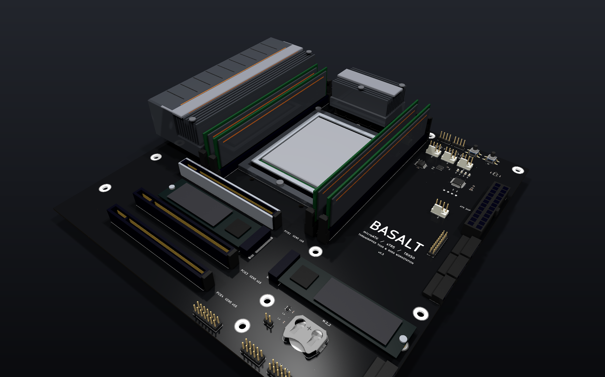
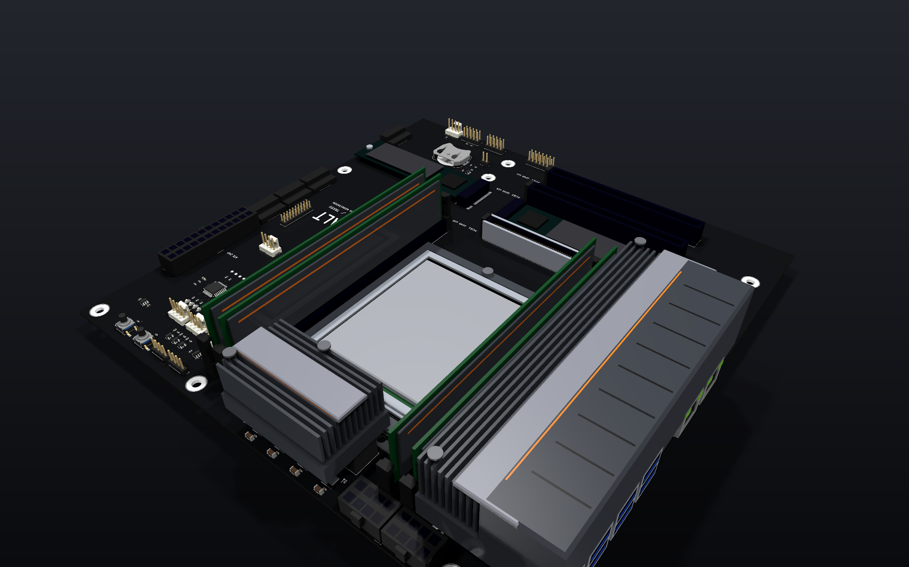
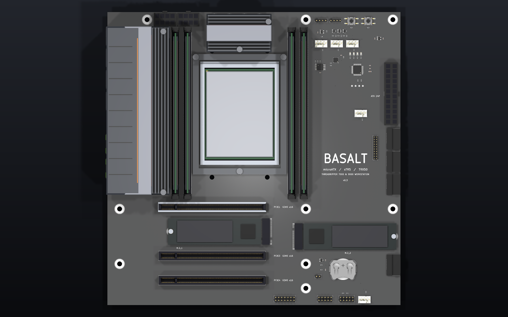
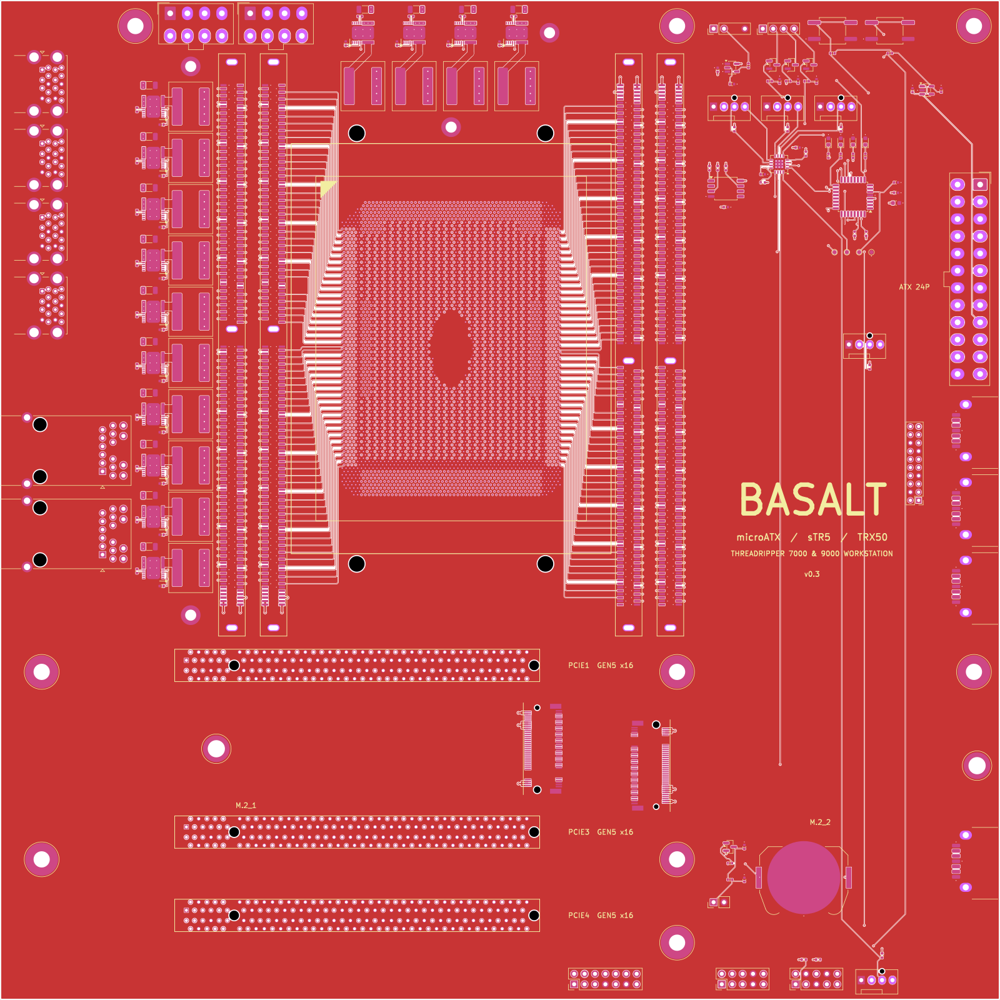
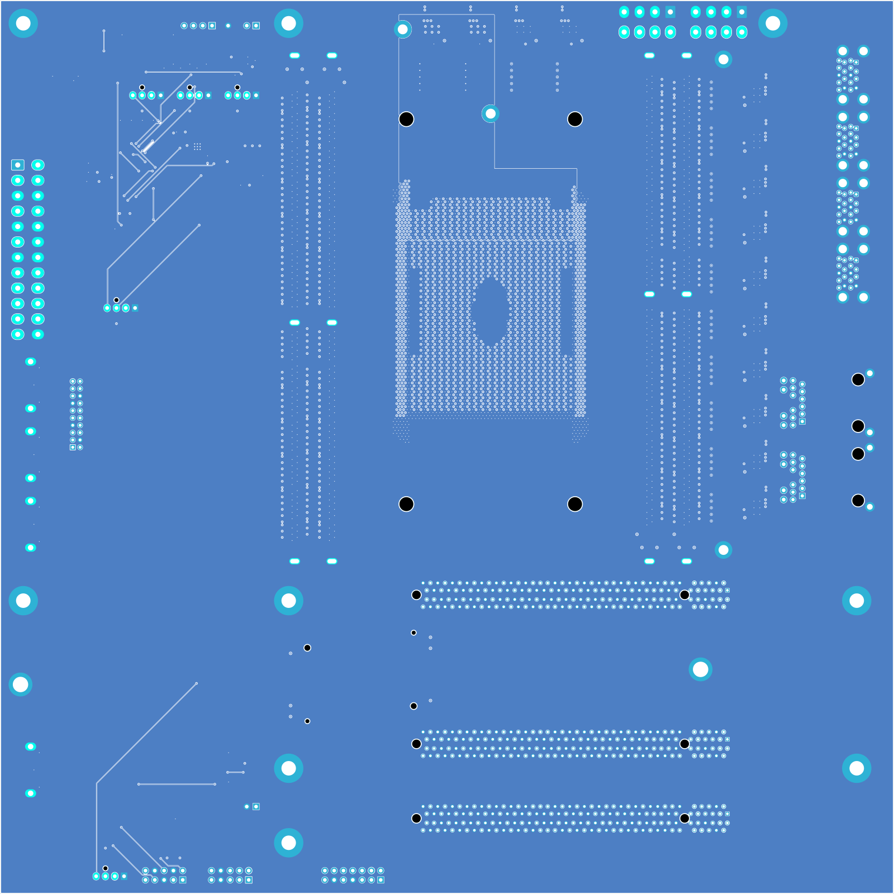
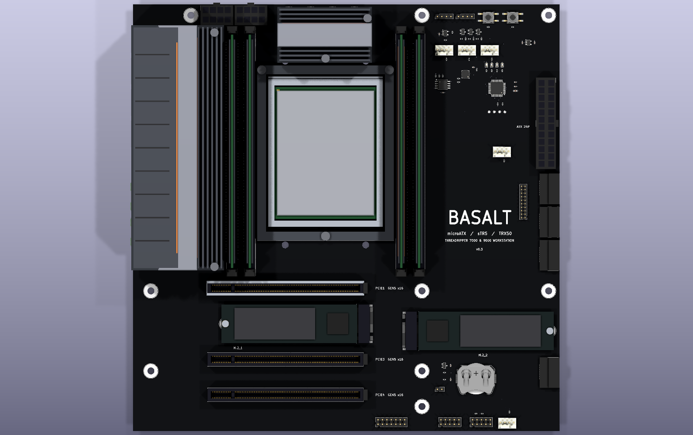
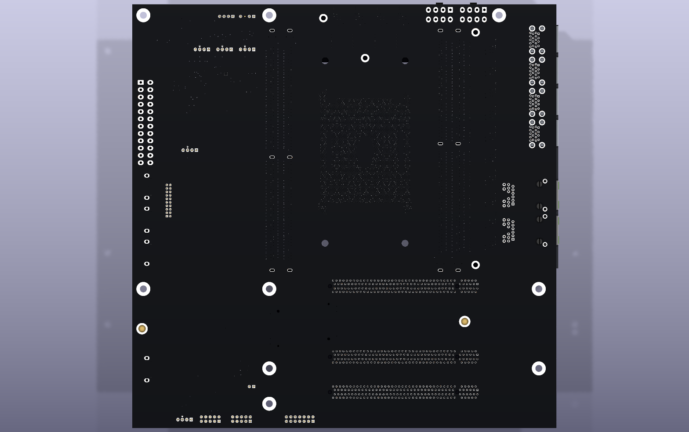
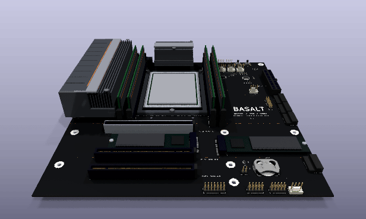
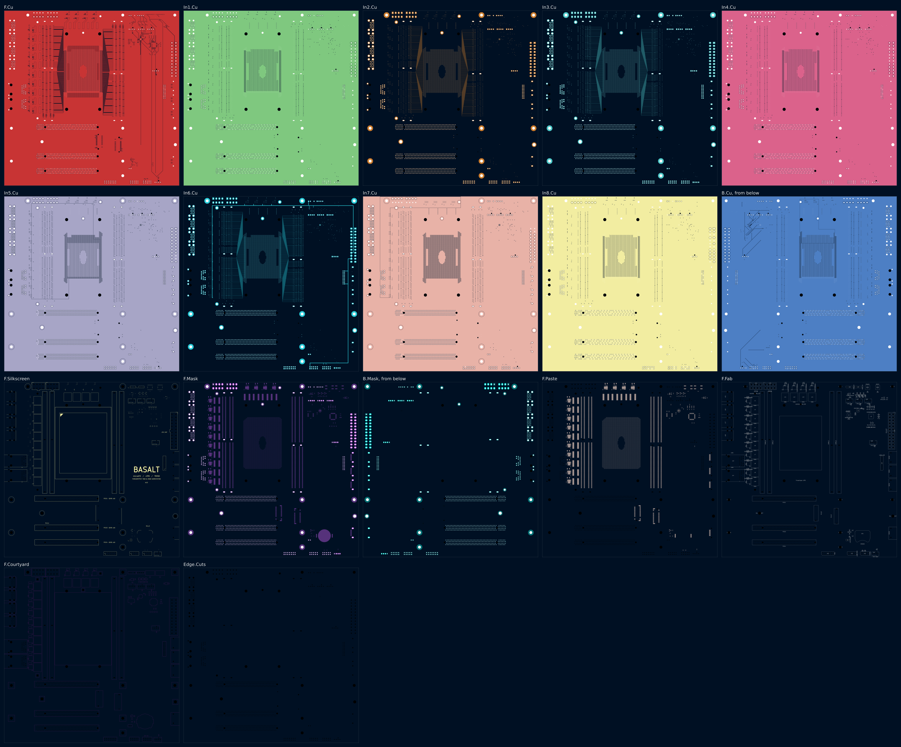

# Basalt — board prototype v0.3

> The current version of the [Basalt prototype series](../README.md), started as a copy of [`../v0.2/`](../v0.2/). The earlier versions are the sibling folders, [`../v0.1/`](../v0.1/) to [`../v0.2/`](../v0.2/).

Basalt is a microATX motherboard for an AMD Threadripper 7000 or 9000 on the sTR5 socket (the TRX50
platform): 4 DDR5 RDIMM slots, 3 PCI Express 5.0 x16 slots, 2 M.2 sockets, 14 phases of power
stages for a 350 W processor, and the rear I/O, on 244 x 244 mm. No microATX TRX50 board has been
made; the smallest is ATX.

This folder is a whole KiCad 10 project made with the EE Workcenter, which supplies the tools and the
gates: `design.py` and the modules beside it are the board, the `.kicad_*` files are what
`workcenter design` writes from them, and `footprints/`, `symbols/` and `models/` hold what KiCad's
libraries lack, each written by a script from its maker's drawing.

| Item | State |
|---|---|
| Schematic | 1 A0 sheet drawn with wires, the processor as banks; the 576 bus nets as labels at both ends; ERC 0 errors, 0 warnings; no parity warning |
| Board | 244 x 244 mm (9.6 x 9.6 in), microATX; 10 layers, 1.6 mm; black mask, white legend, immersion silver; 179 parts, 676 nets, 5137 vias, 5915 track segments |
| Gates | GREEN with no warning, see [`docs/gates.md`](docs/gates.md): ERC, DRC (0 errors, 0 unconnected), EXPORT (30 Gerber files); no deck for SIM |
| Processor | the sTR5 socket's 4844 lands on a 0.94 x 0.81 mm interstitial array; its ground, VDDCR_CPU and VDDCR_SOC lands each with a via; 576 memory lands joined to their slots; the memory bands' other lands ground |
| Memory | 4 DDR5 RDIMM slots, 1 per channel, each with its 12 V and 3.3 V; the 4 channels' 576 traces drawn by `buses.py`, 144 a layer on F.Cu, In2, In3 and In6, 864 vias |
| Expansion | 3 PCI Express x16 slots and 2 M.2 sockets with their supplies; the lanes come later |
| Power | the 24-pin ATX and 2 EPS 8-pin connectors; 14 phases of TI CSD95490Q5MC (75 A) and 10 x 10 mm chokes: 12 for VDDCR_CPU, 2 for VDDCR_SOC; every supply in a pour or a drawn track; the phases' controller comes later |
| Rear I/O | 2 gigabit RJ45 jacks with magnetics, 4 stacked pairs of USB 3 Type-A, under a grooved cover; their controllers come later |
| Ports and headers | 4 SATA ports; 5 fan headers (CPU_FAN, CPU_OPT, PUMP, SYS_FAN1, SYS_FAN2) with PWM and speed sense from a Microchip EMC2305; an addressable RGB header and a 12 V RGB header driven by the board's own controller (an STM32G0B1); a USB 3 front header, a USB 2.0 header, the front panel header, a TPM header; power and reset buttons; 4 status LEDs; the BIOS flash; the CMOS battery and its clear jumper; a 3.3 V standby rail. What reaches the processor joins it with its slow signals later |
| Datasheets and models | the makers' drawings named in `footprints/make_footprints.py` and `symbols/make_symbols.py`; Microchip DS20006532A (EMC2305); ST's pin data for the STM32G0B1; Adam Tech's SATA-A-PL-SMT-K drawing; no SPICE model (no deck) |
| Verification | none yet: no requirement is judged until the board carries signals |

v0.2 (the memory buses) is under [`../v0.2/`](../v0.2/); its last commit is `4cd1d72`. v0.1 (the floor plan and
the power) is under [`../v0.1/`](../v0.1/); its last commit is `4c25dc0`.

## Images

`workcenter pictures .` draws every picture below from [`pictures.json`](pictures.json):
`workcenter render` the stills, the layer sheet and the turning GIF (tilt -55, zoom 0.92), and
[`hero.py`](hero.py) the headline views, in the board's own colours on a dark ground.



| From the 24-pin's corner | From above |
|---|---|
|  |  |

| Top face | Bottom face (mirrored) |
|---|---|
|  |  |

| 3D, top | 3D, bottom |
|---|---|
|  |  |

| Turning, from above | Every layer |
|---|---|
|  |  |

The sheet: [docs/schematic.png](docs/schematic.png).

## What changed in v0.3: the ports and headers

| Finding | The owner's answer | What v0.3 does |
|---|---|---|
| The board had the processor, memory, slots and power, and few of the ports a desktop board carries | "make it have I/O, m.2, ssd, RGB light controller on there too, fan speed port, basically a bunch of ports that all modern motherboards have. CMOS battery, there's a lot that seems missing" (2026-11-11) | the ports, headers and parts in "Ports and headers" (`ports.py`) |

### Board

- 77 parts in the right column and along the bottom edge, where the microATX outline had room
  ("Ports and headers"); every one placed where a desktop board puts it: the fan headers by the
  processor, the SATA ports on the right edge facing out, the front panel and USB 2.0 headers on the
  bottom edge, the buttons and status LEDs at the top right.
- Their own 51 nets are joined by the project's grid router (`gridroute.py`) on F.Cu and B.Cu: 1071
  track segments (1019 on F.Cu, 52 on B.Cu) and the vias between. A fine-pitch pin leaves its chip
  straight out first, odd pins 0.6 mm and even 1.6 mm past the pad, so 2 neighbours' vias never
  stand side by side.
- Each surface pin of a supply has a via of its own to its plane; +5V reaches the ARGB buffer, the
  front panel's LEDs and both USB headers on In6, from the 24-pin down the right side and along the
  bottom edge.
- Not yet joined, because their other end is the processor: the SATA pairs, the USB headers' data,
  the board controller's USB, the flash's and the TPM's SPI, the buttons' and battery's lines to
  the processor, the drive LED. Each pin is open or on its local net until the processor's slow
  signals come.

### Simulation

No deck.

### Firmware

The board controller's firmware is not written: its pins and their functions are fixed here ("Pin
plan") so the firmware can be.

### Parts and cost

77 parts added; "Bill of materials" lists them. Not priced.

### Verification summary

No package yet.

## What changed in v0.2: the memory buses

| Finding | The owner's answer | What v0.2 does |
|---|---|---|
| v0.1's first open item: the 4 DDR5 channels' buses | the loop's list (`../LOOP.md`), from the owner's request for the board | 576 traces from the processor's memory bands to the 4 slots, drawn by `buses.py` ("The memory buses") |

### Board

- 576 traces, 144 a channel: each channel's data, strobes, check bits, command and address, clocks
  and controls, from the land the stand-in pin map gives it to its slot's pin. Each pin row of a
  slot has a layer of its own: channel A's and C's near rows on F.Cu, their far rows on In2;
  channel B's and D's near rows on In3, their far rows on In6.
- 864 vias: an inner-layer trace has 1 in its land and 1 beside its slot's pin, with an F.Cu stub to
  the pad. Each of the slots' ground pins has a via between the 2 rows, and each land of the
  memory bands no trace takes is ground with a via of its own: 2495 ground vias in all.
- Lengths, from the board's own tracks: channel A 15.8 to 56.6 mm (mean 36.5), B 28.4 to 68.7
  (48.7), C 17.6 to 55.7 (36.6), D 29.4 to 67.7 (48.7). Inside a byte lane (8 data bits and their
  strobe) the spread is 0.5 mm at the median and 12.3 mm at most (channel C, subchannel B, byte 3);
  nothing is tuned yet.
- The router is given none of it: the design builds with its buses in 2.4 s, and the first DRC
  found 0 errors and 0 unconnected.

### Simulation

No deck.

### Firmware

None.

### Parts and cost

No part added: v0.2 is copper.

### Verification summary

No package yet.

## What changed in v0.1: the floor plan and the power

The first version places every part whose position the form factor or another part fixes and
joins what carries power, so that each later version adds one bus to a board that is already GREEN.

| Finding | The owner's answer | What v0.1 does |
|---|---|---|
| No microATX board exists for TRX50 | "an MicroATX motherboard for a thread ripper processor", "a compact board that looks great" (2026-11-11) | the floor plan in "Where everything is", every position from the ATX 2.2 and PCI Express CEM 4.0 drawings |
| AMD's sTR5 pin map and voltage-regulator interface are under NDA | not asked in this round | a stand-in pin map (`pinmap.py`), named as one everywhere |

### Board

- The socket, the 4 memory slots, the 3 expansion slots, the 2 M.2 sockets, the 24-pin and 2 EPS
  connectors, the 9 mounting holes and the rear I/O, each where "Where everything is" says.
- 14 phases (`vrm.py`), drawn from the power stage's land pattern: 10 in a column left of the
  memory, 4 in a row above the socket. Each phase's switch node, bootstrap, sense and driver-supply
  links are drawn; the router is given none of them.
- The supplies (`supply.py`): 3 pours on In5 and In7 and 1 track on In6, with a via for every
  surface pin of a supply. The board needs no router: `workcenter design` writes it whole, in 229 s.
- Placed and moved before v0.1 was GREEN, while the buses of v0.2 and v0.3 were planned: the cooler's
  holes 46 mm apart across the socket (65.2 put 2 in the memory buses' combs), 4 phases on top where
  6 stood on the buses' paths, the M.2 sockets turned to face the lanes' trunk, the memory slots
  0.9 mm up for a row of slot 1's capacitors.

### Simulation

No deck: v0.1 carries no circuit a deck would hold to a bound. The phases' controller (v0.4) brings
the first.

### Firmware

None.

### Parts and cost

Every part is new; "Bill of materials" lists them. Not priced: the socket's and the slots' makers
sell them to board makers, not through a distributor.

### Verification summary

No package yet.

## Architecture

### Where everything is

Positions are in the board's own frame, millimetres from its top left corner with the rear I/O edge
on the left (`mech.py`). The ATX 2.2 and CEM 4.0 drawings put the rear edge at the top; a drawing's
(x, y) is (y, 243.84 − x) here.

| What | Where | Source |
|---|---|---|
| Mounting holes, 3.96 mm | F (33.02, 6.35), J (165.10, 6.35), M (237.49, 6.35), C (10.16, 163.83), H (165.10, 163.83), L (237.49, 163.83), B (10.16, 209.55), S (165.10, 209.55), R (165.10, 229.87) | ATX 2.2 fig. 2 and 3 |
| Expansion slots | centre lines at v = 162.26 (slot 1), 182.58, 202.90, 223.22; an x16 connector from u = 42.60 to 131.60, its key at u = 57.10 | CEM 4.0 fig. 86 and 87 |
| Rear I/O aperture | 158.75 x 44.45 mm along the left edge, v = −2.44 to 156.31 | ATX 2.2 fig. 4 |
| Processor | the package's centre at (110, 85), its long side along v | the TRX50 boards' orientation |
| Memory | slot centre lines at u = 56.54, 66.70 (channels B, A) and 153.30, 163.46 (C, D), centred at v = 84.1; 10.16 mm apart | estimate: a common desktop pitch |
| PCI Express x16 | slots 1, 3 and 4; slot 1 wears a steel sleeve | slot 2's place holds M.2_1 |
| M.2 | M.2_1 in slot 2's place, its connector at u = 131 and its drive toward the rear edge; M.2_2 right of the slots at (160, 186.7), its drive toward the right edge; 2280 standoffs 78.25 mm out | Foxconn's drawing |
| Power | 24-pin ATX on the right edge; 2 EPS 8-pin on the top edge, left of the memory | |

### Stackup

10 layers, 1.6 mm, from kicadgen's FR4 stackup.

| Layer | Copper | Use |
|---|---|---|
| F.Cu | 35 µm | parts; memory channels A's and C's near pin rows; ground pour |
| In1.Cu | 15 µm | ground plane |
| In2.Cu | 15 µm | memory channels A's and C's far pin rows |
| In3.Cu | 15 µm | memory channels B's and D's near pin rows |
| In4.Cu | 15 µm | ground plane |
| In5.Cu | 15 µm | power: VDDCR_CPU from the phases' chokes, under the left memory, to the socket's middle; +12V everywhere else |
| In6.Cu | 15 µm | memory channels B's and D's far pin rows; the +5V track to the power stages |
| In7.Cu | 15 µm | signal; +12V_CPU from the EPS connectors to the stages' inputs, +3V3 everywhere else |
| In8.Cu | 15 µm | ground plane |
| B.Cu | 35 µm | VDDCR_SOC pour from its 2 phases to its lands; ground pour |

### The processor's lands

`pinmap.py` lays out 4844 lands: 89 rows of 57 on a 0.94 x 0.81 mm interstitial array, less a
chamfer at each corner (pin 1's deeper) and a window in the middle, where a package carries land-side
capacitors. AMD's map is under NDA; this one is a stand-in laid out the way a processor's is:

- a band 5 columns deep down each long side for the memory channels, 2 channels a side, the side
  nearest their slots; its 5th column ground;
- a band 8 rows deep along the bottom for the PCI Express lanes, toward the slots;
- a band along the top for the slow signals;
- the middle: VDDCR_CPU and ground on alternate lands, VDDCR_SOC in a band under the slow signals,
  VDD_18, VDD_33 and VDDIO_MEM in solid blocks.

Every land of a supply v0.1 carries has a via in the land to its plane or pour: 1803 ground, 1181
VDDCR_CPU, 305 VDDCR_SOC. The lands of the rails v0.1 does not carry (VDDIO_MEM, VDD_18, VDD_33) are
unnumbered until their regulators come.

### The memory buses

`buses.py` draws every trace of the 4 channels from 4 rules, so no 2 traces of a layer cross and
none needs a router:

1. **Pairing.** On each layer the 72 lands of a band and the 72 pins of a slot's row are paired in
   order along v, the lands chosen nearest the array's middle row.
2. **Escape.** From its land, 45 degrees into the gap below the land's row; every via of the array
   sits on a land, so each gap carries 1 trace on every layer. A land past the outermost column
   takes a via in the land and starts on its own layer.
3. **Comb.** Beside the socket each trace has a column of its own, up or down to its lane: the trace
   that moves furthest takes the column nearest the socket, so a last leg never crosses another
   trace's column.
4. **Lane.** Along the lane to the slot: on F.Cu straight onto the pad; on an inner layer 0.425 mm
   (half the slots' pitch) off its pin's line, which passes between the slots' own vias, then a 45
   degree jog onto the pin's line, a via, and a 0.2 mm stub to the pad.

The slots' ground pins each take a via between the 2 rows, 0.7 mm from the slot's centre line; a signal pin's via stands 3.4 mm
from the slot's centre line, outside its row. The bus nets are labels on the sheet, 1 at the
processor's bank and 1 at the slot, since they cross the whole sheet (P24).

### Supplies

Every supply is drawn by the design (`supply.py`), as a motherboard carries it: in planes and pours,
1 net to a region of a layer. A through-hole pin joins its pour on its own; a surface pin of a supply
gets a via beside it or in it.

| Net | Carried by | From, to |
|---|---|---|
| +12V_CPU | In7, along the top edge and down the phase column | the 2 EPS connectors to the 14 stages' inputs: 3 vias in each input pad, 2 in each input capacitor's |
| VDDCR_CPU | In5, the middle of the board | 12 chokes, 5 vias each, to the socket's core lands |
| VDDCR_SOC | B.Cu, above the socket | 2 chokes to the SoC's band of lands |
| +12V | In5, all of it outside VDDCR_CPU | the ATX connector to each memory slot (2 vias past its end) and each PCI Express slot |
| +3V3 | In7, all of it outside +12V_CPU | the ATX connector to each memory slot, each PCI Express slot and each M.2 socket (a via for each group of pins) |
| +5V | 1 track on In6, 0.6 mm | the ATX connector along the top edge and down the phase column to the 14 stages' driver supply, 25 mA each |
| GND | In1, In4, In8 and both faces | |

### Power

The 2 EPS 8-pin connectors feed +12V_CPU to 14 phases. Each phase is a TI CSD95490Q5MC smart power
stage (75 A continuous, 5 x 6 mm) and a Coilcraft XAL1010 choke, drawn from the stage's land pattern
(`vrm.py`): the switch node from the SW pad's outer edge to the choke by a 2.0 mm track, the choke's
output into its plane through 5 vias in its pad, the stage's ground pad into the ground planes
through 6, the output-sense pin to its plane through 1; the input, bootstrap and driver-supply
capacitors above and below the stage. 10 phases stand in a column left of the memory and 4 in a row
above the socket, between the 2 regions where the memory buses turn up to the slots' top pins. 12
phases make VDDCR_CPU (12 x 75 A for a 350 W processor at about 1.1 V, near 320 A), the row's last 2
VDDCR_SOC. A heatsink sits over each group; the left one is one piece with the rear I/O cover.

### Ports and headers

| What | Where (u, v) | Parts | Notes |
|---|---|---|---|
| ARGB header | (174, 7), top edge | J19, a 1 x 4 header without pin 3 (`PinHeader_1x04_Key3`) | +5V, DIN, key, GND; the controller's SPI stream through a 74AHCT1G125 to 5 V and 33 ohm |
| 12 V RGB header | (186, 7) | J20; Q15 to Q17 AO3400A | each colour switched to ground; 100 ohm into each gate, 100k holding it off in reset |
| Power and reset buttons | (203, 7.5), (217, 7.5) | SW1, SW2, C&K KSC6 | in parallel with the front panel's; 10k to the standby rail |
| Standby rail | (226, 22) | U6 AP2112K-3.3 | +3V3SB from the 24-pin's +5VSB, alive whenever the supply is plugged in |
| CPU_FAN, CPU_OPT, PUMP | (174, 26), (187, 26), (200, 26) | J21 to J23, 4-pin fan headers | 12 V, ground, speed sense with 10k to 3.3 V, PWM |
| Fan controller | (190, 40), turned 180 | U3 EMC2305 | 5 PWM channels with speed sense on SMBus at 0x2C (ADDR_SEL 10k to 3.3 V, Table 5-1); PWM open drain, 5 V tolerant, so the fan's own pull-up sets its level; CLK 10k to ground (the datasheet gives no termination for it unused); all fans to full after 4 s with no host write (section 4.11.1) |
| Board controller | (208, 48), turned 180 | U2 STM32G0B1KBT6 | a USB device of the host, the fan controller's SMBus master, the RGB headers' driver and the status LEDs'; SWD on 4 test pads |
| Status LEDs | (202 to 211, 34.5) | D1 to D4 | CPU, DRAM, VGA, BOOT, each through 1k from a controller pin |
| BIOS flash | (177, 46) | U4 W25Q128JVSIQ, 16 MB | CS#, WP# and HOLD# held high by 10k |
| SYS_FAN1 | (207, 84) | J25 | |
| USB 3 front header | (224, 122), turned 180 | J24, 2 x 10 at 2.0 mm | Intel's 19-pin pinout; +5V on pins 1 and 19 |
| SATA ports | the right edge at v = 105, 124, 143, 210 | J36 to J39, Adam Tech SATA-A-PL-SMT-K | right angle, the faces flush with the edge (`SATA_7P_RA_SMT`); grounds joined now |
| CMOS battery | (196, 214) | BT1 CR2032 in a Keystone 3034; D5 BAT54C; J31 CLR_CMOS | VBAT from the cell through 1k or from +3V3, whichever is higher; RTC_RST held at VBAT by 20k and 1 uF, the jumper clears it |
| Front panel | (194, 240), bottom edge | J32, 2 x 5 | Intel's front panel I/O pinout; 330 ohm from +5V to each LED's anode |
| USB 2.0 header | (176, 240) | J33, 2 x 5 | 2 ports; +5V on pins 1 and 2 |
| SYS_FAN2 | (210, 239) | J34 | |
| TPM header | (140, 240) | J35, 2 x 7 | an SPI TPM module; +3V3 and ground joined now |

## Pin plan

The board controller, an STM32G0B1KBT6 in LQFP-32. Each function is ST's, from
`STM32_open_pin_data` (`mcu/STM32G0B1K(B-C-E)Tx.xml`); unlisted pins are unused.

| Pin | Port | Signal | Function |
|---|---|---|---|
| 4 | VDD | +3V3 | 100 nF and 4.7 uF |
| 5 | VSS | GND | |
| 6 | PF2-NRST | MCU_NRST | 100 nF; a test pad |
| 9 | PA2 | ARGB_DIN | SPI1_MOSI: the addressable stream, 3 SPI bits a LED bit |
| 13 | PA6 | RGB_G_PWM | TIM3_CH1 |
| 14 | PA7 | RGB_R_PWM | TIM3_CH2 |
| 15 | PB0 | RGB_B_PWM | TIM3_CH3 |
| 16 | PB1 | LED_CPU | GPIO |
| 17 | PB2 | LED_DRAM | GPIO |
| 18 | PA8 | LED_VGA | GPIO |
| 22, 23 | PA11, PA12 | (the host's USB, later) | USB_DM, USB_DP |
| 24 | PA13 | MCU_SWDIO | SYS_SWDIO; a test pad |
| 25 | PA14-BOOT0 | MCU_SWCLK | SYS_SWCLK; a test pad |
| 26 | PA15 | LED_BOOT | GPIO |
| 29 | PB5 | FAN_ALERT | EXTI5, the fan controller's alert; 10k to 3.3 V |
| 30 | PB6 | SMB_SCL | I2C1_SCL; 4.7k to 3.3 V |
| 31 | PB7 | SMB_SDA | I2C1_SDA; 4.7k to 3.3 V |

Shared resources: the 3 RGB colours on 1 timer (TIM3), so their PWM runs together; 1 interrupt input
(EXTI5) and no other on line 5; no analog input; the 5 V parts it meets (the ARGB buffer, the fan
headers) are behind the 74AHCT1G125 and the EMC2305, never on a controller pin.

## Bill of materials

| Ref | Part | Why |
|---|---|---|
| U1 | AMD sTR5 socket (LGA 4844) | Threadripper 7000 and 9000; the footprint's lands from the package size and the land pitch, the housing, frame and cooler holes estimates |
| J1-J4 | Amphenol DDR516112010E | DDR5 RDIMM, 287 contacts; the only DDR5 socket drawing found is SMT, and its pads route from both rows |
| J5-J7 | Molex 87715-9306 | PCI Express x16, through hole, the CEM hole pattern; the pad size (1.00 mm) is an estimate |
| J8, J9 | Foxconn 2E0BC2x-S64BM | M.2 Key M, 6.4 mm, with a 2280 standoff (H10, H11) |
| Q1-Q14 | TI CSD95490Q5MC | 75 A smart power stage whose datasheet gives a land pattern (Infineon's TDA21490 gives none) |
| L1-L14 | Coilcraft XAL1010, 150 nH | 10 x 10 mm choke in KiCad's library |
| C100-C113 | 100 nF 0402 | each stage's bootstrap |
| C120-C133 | 1 µF 0402 | each stage's driver supply |
| C140-C153 | 22 µF 1206 | each stage's input |
| J10 | Molex Mini-Fit Jr 5566-24A | 24-pin ATX |
| J11, J12 | Molex Mini-Fit Jr 5566-08A | EPS 8-pin, 2 for 350 W |
| J13, J14 | Pulse JK0654219NL | gigabit RJ45 with magnetics and 2 LEDs; KiCad's footprint with its legend cut at the board edge the jack's face stands past |
| J15-J18 | Molex 48406-0001 | 2 USB 3 Type-A stacked |
| H1-H9 | ATX mounting holes | 3.96 mm in an 8 mm ground ring |
| HS1, HS2 | the board's own heatsinks | over the 2 groups of phases; the left one merged with the rear I/O cover |
| U2 | ST STM32G0B1KBT6 | the board controller (v0.3); "Pin plan" |
| U3 | Microchip EMC2305-1-AP | 5-channel PWM fan controller with speed sense (v0.3) |
| U4 | Winbond W25Q128JVSIQ | the BIOS flash, 16 MB, SOIC-8 208 mil (v0.3) |
| U5 | 74AHCT1G125 | the ARGB stream to 5 V (v0.3) |
| U6 | Diodes AP2112K-3.3 | the 3.3 V standby rail (v0.3) |
| Q15-Q17 | AO3400A | the 12 V RGB header's 3 colours (v0.3) |
| D1-D4 | LED 0603 | status: CPU, DRAM, VGA, BOOT (v0.3) |
| D5 | BAT54C | VBAT from the cell or the 3.3 V rail (v0.3) |
| BT1 | CR2032 in a Keystone 3034 | the CMOS battery (v0.3) |
| SW1, SW2 | C&K KSC6 | power and reset (v0.3) |
| J19 | 1 x 4 header, pin 3 left out | ARGB (v0.3) |
| J20 | 1 x 4 header | 12 V RGB (v0.3) |
| J21-J23, J25, J34 | 4-pin fan headers | CPU_FAN, CPU_OPT, PUMP, SYS_FAN1, SYS_FAN2 (v0.3) |
| J24 | 2 x 10 header, 2.0 mm | USB 3 front (v0.3) |
| J31 | 1 x 2 header | CLR_CMOS (v0.3) |
| J32 | 2 x 5 header | front panel (v0.3) |
| J33 | 2 x 5 header | USB 2.0 (v0.3) |
| J35 | 2 x 7 header | TPM (v0.3) |
| J36-J39 | Adam Tech SATA-A-PL-SMT-K | SATA, right angle (v0.3) |
| R300-R362, C300-C309, TP1-TP4 | 0402 and 0603 passives, test pads | the parts round the above (v0.3) |

KiCad's 3D library has no body for the Mini-Fit Jr headers or the stacked USB receptacle;
`models/make_models.py` draws them with the socket, the slots, the M.2 socket, the power stage and
the heatsinks. What sits in a socket or a slot for the pictures (a processor, 4 memory modules, 2
drives) is drawn with it and is not on the BOM.

## Working on this board

Run the commands from this folder. From the series folder, name `v0.1` instead of `.`.

```sh
workcenter design design.py                                              # the KiCad project; nothing is left to route
workcenter gates . --report docs/gates.md                                # ERC, DRC, SIM, EXPORT
python3 models/fetch_library_bodies.py basalt.kicad_pcb ~/kicad-bodies   # KiCad's bodies the board names
KICAD10_3DMODEL_DIR=~/kicad-bodies workcenter pictures .                 # the pictures, from pictures.json
```

`design.py` writes `footprints/basalt.pretty` and `symbols/basalt.kicad_sym` from their scripts
before it builds the board; `python3 models/make_models.py` writes the 3D bodies.

## Decisions

- **The ports' nets routed by the project's own grid router** (v0.3). FreeRouting given only these
  nets finished in 0.3 s with none routed, every time, on this board; it did route the same
  workcenter's smaller boards. `gridroute.py` searches F.Cu and B.Cu together and places a via
  where both layers and every inner layer are clear; it joins all 51 nets.
- **A board controller of the board's own** (v0.3). Desktop boards drive their RGB headers from a
  small controller that the host sees as a USB device; Basalt's also masters the fan controller's
  SMBus and drives the status LEDs, so 1 part answers to the host for all of them.
- **A fan controller, not a Super I/O** (v0.3). The EMC2305 holds each fan to a speed by itself on
  SMBus, in 4 x 4 mm; a Super I/O does that and much else on a bus the processor's map does not
  name yet.
- **A 3.3 V standby rail** (v0.3). The power button must work with the board off; its pull-up and the
  battery's backup take +3V3SB from the 24-pin's +5VSB.

- **The buses drawn, not routed** (v0.2). 576 traces whose order is known from both ends: paired
  in order on each layer, they cannot cross, and each gap of the land array carries 1 trace a
  layer. A router would take minutes for what the rules draw in 2.4 s, and would not leave the
  regular combs the pictures show.
- **1 slot a channel** (v0.2). The platform has 4 channels; 2 slots a side is what microATX leaves
  room for, and 1 slot a channel keeps every trace point to point.
- **A layer for each pin row** (v0.2). Each of a slot's 2 rows is a pairing of its own; 4 layers a
  side carry the 2 slots' 4 rows.

- **Every supply in a pour, none routed** (v0.1). FreeRouting given +12V, +3V3, +12V_CPU and +5V as
  tracks ran 20 minutes without finishing its first pass, twice; its tracks would also have taken the
  paths the memory and PCI Express buses need. `supply.py` draws them, and the DRC finds 0
  unconnected. A plane net goes to a router as 1 pin, so a later version's route keeps clear of its
  vias and connects none of them.
- **Black, opaque mask; immersion silver** (v0.1). A translucent mask over the copper pours rendered
  brown, and gold pads glared yellow on black. Immersion silver is flat enough for the socket's
  0.94 mm lands.
- **The board in 10 layers** (v0.1). 4 ground and power planes and 6 routing layers: the memory needs
  4 routing layers a side (one per pin row), the PCI Express escape 5 more under the socket's bottom
  edge; fewer would not carry the 4844-land array's escape. Real TRX50 boards use 10 to 12.
- **4 phases on top, 10 on the left** (v0.1). 6 on top put the row's outer chokes on the paths the
  memory buses take up to the slots' top pins.
- **The cooler holes 105 x 46 mm** (v0.1). The TR4 family's pattern is reported as 105 by 65.2 and
  46; 65.2 puts 2 holes in the memory buses' combs. The holes are estimates either way.
- **A stand-in pin map** (v0.1). AMD's is under NDA; `pinmap.py` lays out one the way a processor's
  is, and a licensee replaces `assign()` with AMD's table.

## Open items

Candidates for v0.4, from v0.3's work:

- The PCI Express and M.2 lanes, with the host transmitters' AC capacitors. Tried on a copy of v0.3
  (`../LOOP.md`, pass 12): the grid router joins 151 of the 234; the M.2 lanes need a trunk beside
  the slots drawn by rule, as the memory's combs are, before the slots' lanes fill the way.
- The processor's slow signals: the SATA pairs (lanes in SATA mode), USB 2.0 to the headers and the
  board controller, SPI to the flash and the TPM, the buttons, VBAT and RTC_RST, the drive LED.
- The rear I/O's controllers, on the processor's remaining lanes.
- The board controller's firmware.
- Length tuning inside each memory byte lane (12.3 mm at most).
- The sheet: the ports' parts sit in the shelves one by one, and their wires run long; each port's
  parts belong in a block of their own, as each phase's are (P24 step 4).

On the bench and elsewhere:

- The socket's housing, frame and cooler holes, and the land pitch, against a socket drawing (Lotes,
  Foxconn; NDA).
- AMD's pin map in place of the stand-in.
- The SATA plug's polarity against the part bought (its maker draws left and right variants).
- Not ordered.
