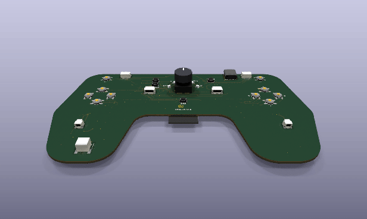
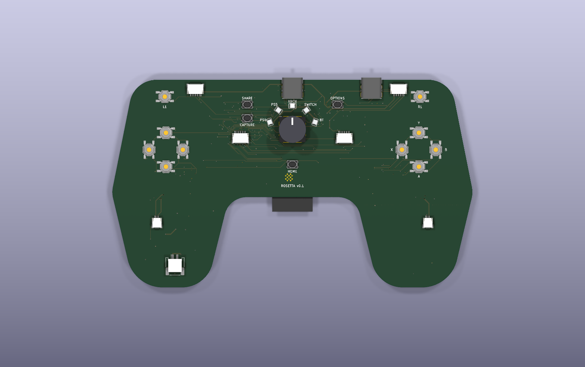
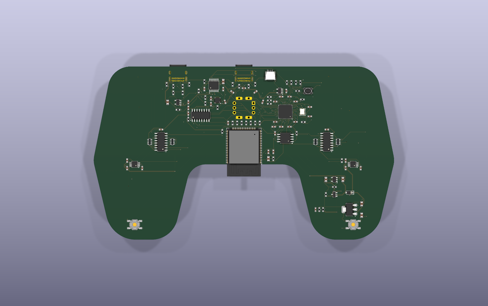
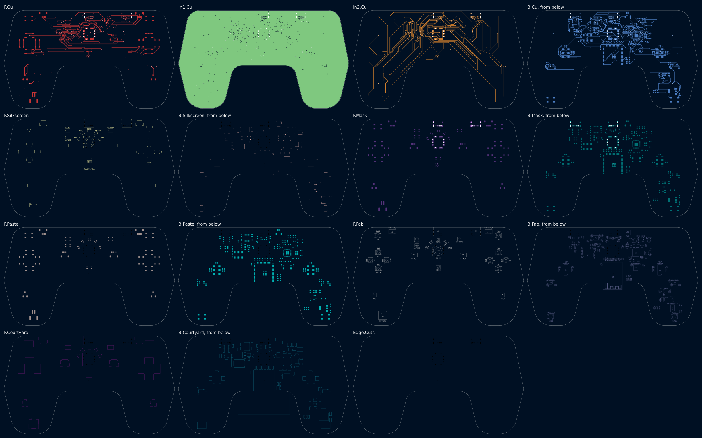
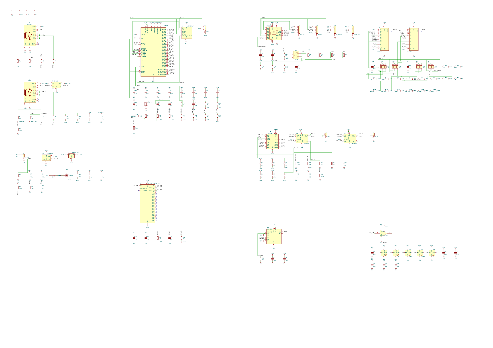

# Rosetta v0.1: a universal game controller

One controller for a PS4, a PS5, an Xbox, a Switch, or anything over Bluetooth. A 5-position
knob on its face picks the console. The controller drops off the bus while the knob turns and
comes back as the chosen console's own controller.

This folder is a whole KiCad 10 project made with the EE Workcenter: `design.py` is the board,
and the `.kicad_*` files beside it are what `workcenter design` writes from it. It is the
workcenter's example project, laid out the way a board repository lays out a version.

<!-- pictures:begin -->


| Front | Back |
|---|---|
|  |  |

| Every layer | The schematic, wired, in blocks |
|---|---|
|  |  |

From `workcenter render . --strict --views schematic,3d,layers,spin --width 1600 --spin-zoom 1.1`, with
KiCad's 3D bodies in `KICAD10_3DMODEL_DIR` (the workcenter's `site/media/README.md` says how to
fetch them) and the 3 bodies in `models/`.
<!-- pictures:end -->

## What is hard about it, and where each part lives

| The problem | The answer on this board |
|---|---|
| 1 knob, 5 consoles, no microcontroller pin to spare | SW1, an NKK NR01 1-pole 5-position rotary switch, taps a ladder of 6 x 1k (R40-R45). The ADC reads 1 number: position k at (6 - k)/6 of full scale. Between detents R46 (100k) pulls the wiper to ~0, and the firmware drops off the bus. 6 decks hold every position inside its window at every corner (`sim/`). |
| A PS4, a PS5 and an Xbox talk only to a licensed controller | J2 is a USB host port for an auth donor: a licensed controller or dongle. The RP2040 runs a second USB port in software (PIO-USB, GPIO16 and GPIO17, R7 to R10) and relays the console's challenge to the donor. U13 switches the port's 5 V and reports a fault. |
| Bluetooth Classic (the Switch, PlayStation pads) and BLE (phones, PCs) | U3, an ESP32-WROOM-32E, on the RP2040's UART0. The RP2040 holds its EN and IO0, so it can put the ESP32 in its bootloader and flash it: 1 USB cable updates both chips. U3 sits on the back, turned so its antenna hangs past the notch between the grips: the footprint's antenna keep-out lies in the air. |
| Sticks that drift | Hall-effect stick and trigger modules on J3 to J6, read by U4, a 12-bit 8-input SPI ADC (MCP3208) whose reference is the same +3V3 that feeds the sensors. |
| Triggers that push back (the PS5's trigger effects) | A small motor in each trigger module, on pins 4 and 5 of J3 and J4, driven both ways by U6 (DRV8833). |
| Rumble in each grip | An LRA on J7 and J8, each with a DRV2605L (U9, U10). The chip has 1 fixed I2C address, so each has its own bus (I2C0, I2C1). |
| Gyro aim | U5, an LSM6DSL 6-axis IMU on I2C0. |
| A light that names the console | 5 RGB LEDs (D2-D6, WS2812B-2020) on a ring round the knob. They need 3.7 V or more; they run from VSYS (the cell or USB), and U14 (74AHCT1G125) lifts the RP2040's 3.3 V data to that rail. |
| 16 buttons and 2 paddles | 2 74HC165 shift registers (U7, U8) on 3 pins, each input held up by a 10k in a pack (RN1-RN4). The back paddles SW15 and SW16 go to their own pins. |

## The board

- Outline: a controller's silhouette, 160 x 92 mm, drawn in `design.py` as a polygon with filleted
  corners (`ControllerDesign`). The notch between the grips is concave; its edge is where the
  ESP32's antenna hangs out.
- 4 layers, 1.6 mm: F.Cu signal, In1.Cu a whole GND plane, In2.Cu signal, B.Cu signal. Order it as
  4 layers.
- The front carries what a hand touches: the D-pad, A/B/X/Y, L1/R1, Share, Options, Home,
  Capture, the knob and its ring, and the connectors. The back carries the electronics and the
  2 paddles.
- 2 stick modules sit over the face at (147, 141) and (193, 141): `design.py` keeps every part on
  the front out of a 10 mm circle there (`d.keepout(..., parts=True, copper=False)`).

### Power

USB VBUS (J1) feeds VSYS through D1; with no cable, Q1 (AO3401A) connects the cell to VSYS. Its
gate sits on VBUS, held low by R13 when the cable is out. U11 (MCP73831) charges the cell at
500 mA (R12, 2k). U12 (AP7361C, 1 A) makes +3V3 from VSYS. The RP2040 makes its own +1V1. R14 and
R15 halve the cell's voltage for the ADC (channel 7).

### The RP2040's pins

| GPIO | Net | To |
|---|---|---|
| 0, 1 | ESP_RXD, ESP_TXD | U3 UART0 (pins 34, 35) |
| 2, 3 | ESP_EN, ESP_IO0 | U3 reset and boot strap, each pulled up (R20, R21) |
| 4, 5 | I2C0 | U5 IMU, U9 left haptics, R26/R27 |
| 6, 7 | I2C1 | U10 right haptics, R28/R29 |
| 8-11 | ADC_MISO, ADC_CS, ADC_SCK, ADC_MOSI | U4 (SPI1); R22 holds CS high in reset |
| 12, 13, 14 | SR_PL, SR_CLK, SR_Q | U7, U8 (R47, R48 hold the load and clock in reset) |
| 15 | LED_DATA | U14, then the ring (R49 holds it low in reset) |
| 16, 17 | PIO_D+, PIO_D- | J2 through R7, R8 (PIO-USB host; R9, R10 the host's pull-downs) |
| 18, 19 | HOST_EN, FAULT_N | U13 enable (R11 off in reset); U13's and U6's faults, wired-OR (R24) |
| 20-23 | TRIG_L_A/B, TRIG_R_A/B | U6 inputs, PWM slices 2 and 3 |
| 24 | MOT_SLEEP | U6 nSLEEP (R23 low in reset) |
| 25 | IMU_INT | U5 INT1 |
| 26 | HAPTIC_EN | U9, U10 EN (R25 low in reset) |
| 27, 28 | PADDLE_L, PADDLE_R | SW15, SW16 (internal pull-ups) |
| 29 | CHG_STAT | U11 STAT (internal pull-up) |

The ADC's channels: 0-3 the sticks' X and Y, 4 and 5 the triggers, 6 the knob, 7 the cell.

### Connectors

| Ref | Part | Pins |
|---|---|---|
| J1 | USB-C (GCT USB4085, through-hole) to the console | VBUS, D+/D- (R3, R4 27 ohm), CC1/CC2 5.1k to GND (a device) |
| J2 | USB-C to the auth donor | VBUS_HOST from U13, D+/D- to PIO-USB, CC1/CC2 56k to VBUS_HOST (a source) |
| J3, J4 | JST SH 5-way, left and right trigger modules | 1 +3V3, 2 Hall output, 3 GND, 4 and 5 the motor |
| J5, J6 | JST SH 5-way, left and right stick modules | 1 +3V3, 2 X, 3 Y, 4 the stick's click, 5 GND |
| J7, J8 | JST SH 2-way, the LRAs | 1 OUT+, 2 OUT- |
| J9 | JST PH 2-way, the cell | 1 BAT, 2 GND |
| J10 | JST SH 3-way, Raspberry Pi's debug connector, on the back | 1 SWCLK, 2 GND, 3 SWDIO |

## What proves it

```sh
workcenter design design.py --route    # the KiCad project, routed: from this folder
workcenter gates .                     # ERC, DRC, SIM, EXPORT
make -C firmware test                  # the knob's decoder on the host
```

- **The gates.** ERC and DRC on the routed board, the 6 knob decks at their corners, and the
  fabrication outputs in `build/fab/`. The site shows the run.
- **The knob, simulated.** `sim/mode_p1.cir` to `sim/mode_p5.cir` put the wiper on each tap and
  `sim/mode_between.cir` on none, each with the ADC's worst input leakage (1 uA). Every resistor
  runs at both ends of 1 % and 32 Monte Carlo draws (`sim/corners.json`). Each position stays
  within 0.04 of full scale of its nominal; the decoder's thresholds are 0.0833 away.
  The first value of R46 was 1 M: with that leakage it read 1 V between detents, a position.
  The deck found it; R46 is 100k and the ladder 1k.
- **The decoder.** `firmware/src/mode.c` turns a reading into a mode and decides when to drop off
  the bus and come back. `firmware/tests/test_mode.c` checks it against the decks' corner values:
  a brush past a tap changes nothing, and a fast flick detaches before it attaches.

## Parts and why

| Ref | Part | Why |
|---|---|---|
| U1 | RP2040, W25Q128JV (U2), 12 MHz (Y1) | Native USB for the console, PIO for a second USB port in software, 2 I2C, 2 UART, SPI, 16 PWM channels. |
| U3 | ESP32-WROOM-32E | Bluetooth Classic and BLE in 1 certified module. The ESP32-S3 has BLE only. |
| U4 | MCP3208 | 8 inputs at 12 bits on SPI, against an external reference. |
| U5 | LSM6DSL | A 6-axis IMU in KiCad's library, I2C. |
| U6 | DRV8833 | 2 H-bridges for the 2 trigger motors, from VSYS. |
| U9, U10 | DRV2605L | LRA drivers with a library of effects and auto-resonance. |
| U11 | MCP73831 | A 1-cell charger in SOT-23-5. |
| U12 | AP7361C-3.3 | 1 A for the ESP32's radio bursts, 0.36 V dropout. |
| U13 | TPS2051C | A current-limited switch for the donor's 5 V, with a fault flag. |
| U14 | 74AHCT1G125 | TTL thresholds on a VSYS supply: 3.3 V data reads high at 4.2 V. |
| SW1 | NKK NR01 1-pole 5-position | A real detented rotary switch, in KiCad's library with its footprint. |
| SW2-SW14, SW18 | TL3342 (face), PTS810 (small) | Tactile switches on the face. |
| J1, J2 | GCT USB4085 | Through-hole USB-C: a controller's cable gets yanked. |

KiCad 10 draws the ESP32's 4 ground pins as 1 stacked pin, which the generator does not split;
`symbols/rosetta.kicad_sym` is a copy of the library's symbol with the 4 pins apart
(`symbols/split_stacked.py` writes it). KiCad's 3D library has no body for the NR01, the
SMD JST PH or the WS2812B-2020; `models/make_models.py` draws one for each (the knob's cap is
drawn for the renders and is not on the BOM).

## What is open

- **Firmware.** Only the knob's decoder is written and tested. The USB descriptors and reports
  for each console, the PIO-USB host, the auth relay, the ESP32's Bluetooth stacks, the haptics
  and the trigger effects are not written.
- **The auth relay is the design's bet.** Commercial adapters relay a console's challenge to a
  licensed controller the same way; nothing on this board has been tried against a console.
- **Power.** The AP7361C needs about 3.66 V in for 3.3 V out at 1 A; the cell spends its last
  part below that, where +3V3 sags. A buck-boost is the change for v0.2.
- **Not ordered.** No board has been made. The stick and trigger modules, the cell, the LRAs and
  the shell are off the board and not chosen.
- **The schematic** is wired (`sch_wires`) and laid out by `lay_out_schematic()` in blocks: each
  IC in a row with its own parts under it, a wire for a net inside a block and a label for a net
  between blocks. It passes ERC with 0 errors and 0 warnings; it is not yet arranged by hand the
  way a service manual's sheet is. Its first ERC found 3 faults the label sheet had hidden: the
  sticks' clicks on nets that reached nothing, the DRV8833's sense pins and the IMU's strap pins
  tied straight to a rail. Each is fixed: `BTN_L3` and `BTN_R3`, R50 and R51 (0.5 ohm, a 400 mA
  limit on each trigger motor), R52.
