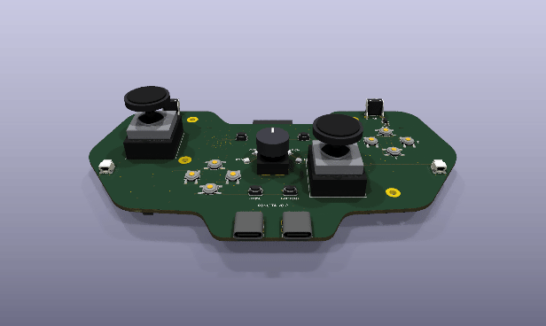
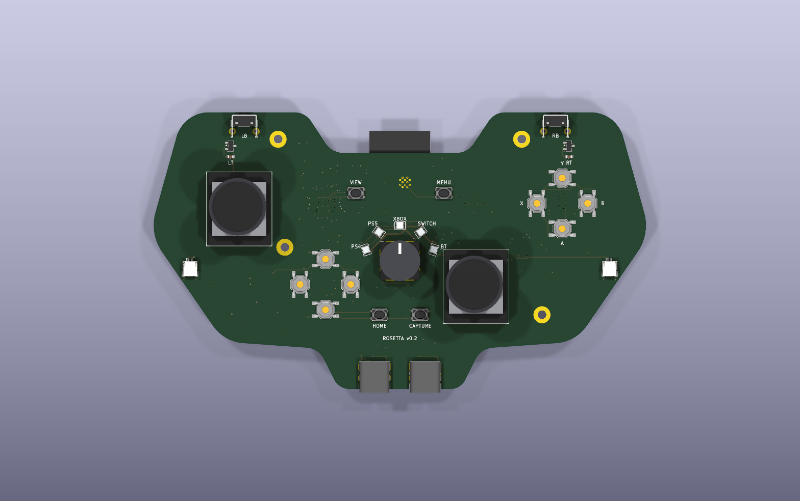
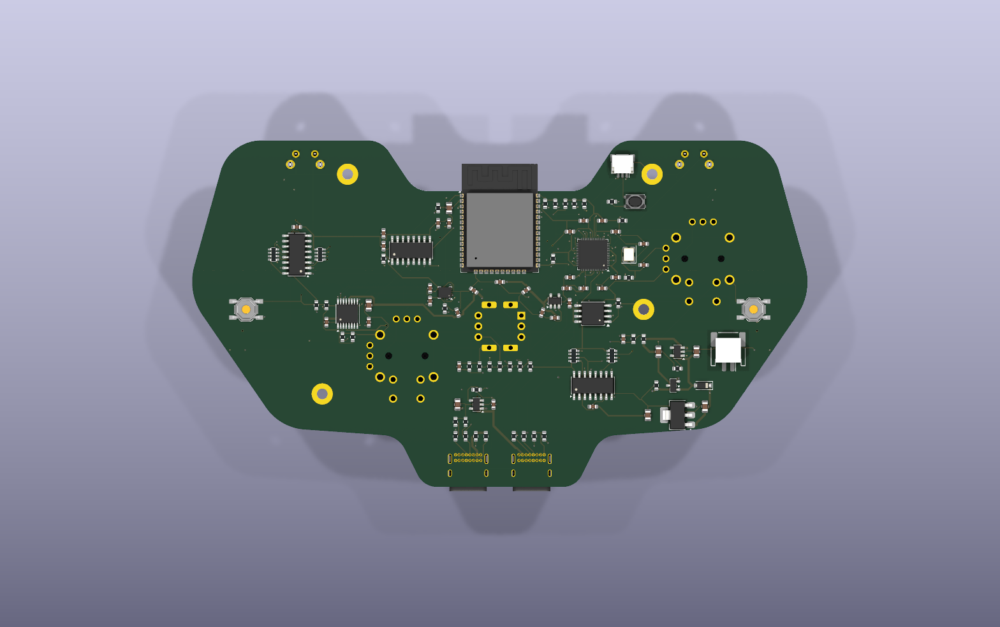
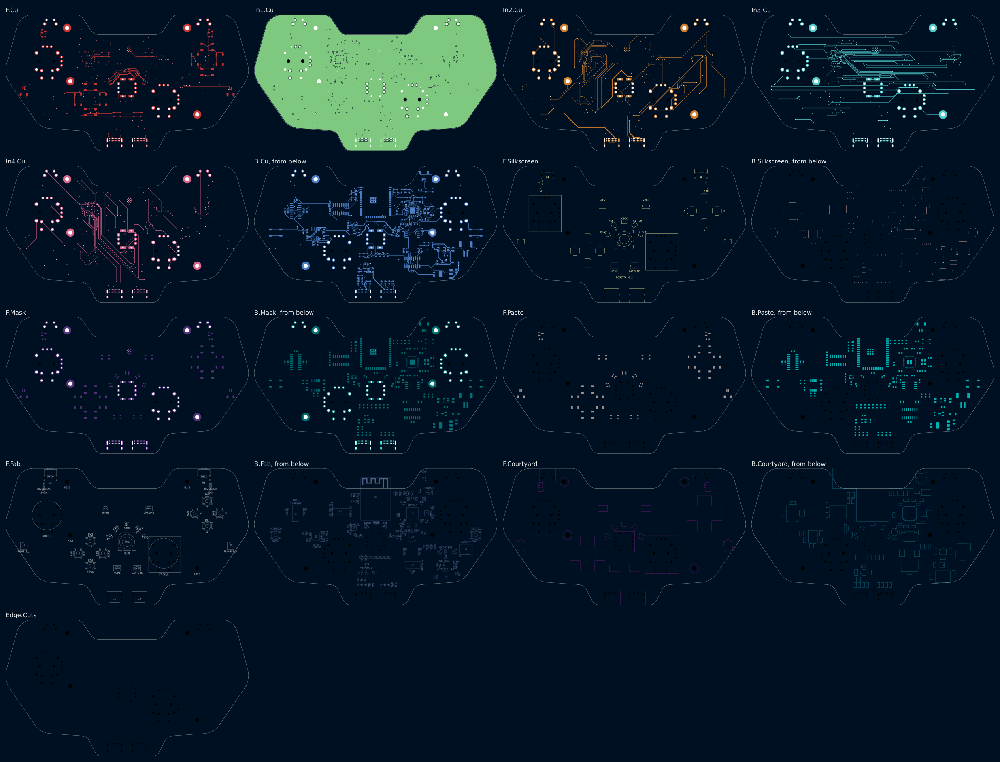
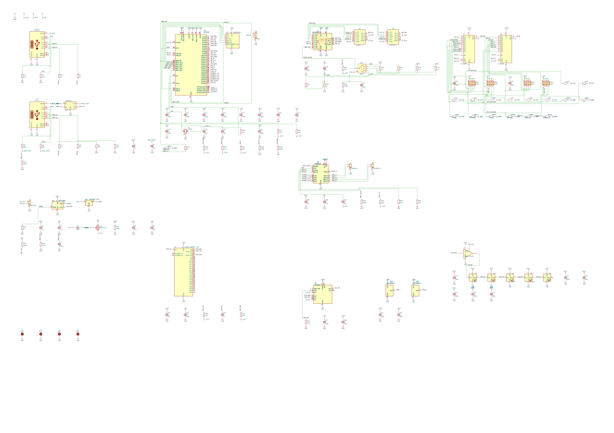

# Rosetta v0.2: a universal game controller, as a controller's own main board

One controller for a PS4, a PS5, an Xbox, a Switch, or anything over Bluetooth. A 5-position
knob where an Xbox 360 pad has its guide button picks the console. The controller drops off the
bus while the knob turns and comes back as the chosen console's own controller.

v0.1 was a carrier: the sticks, the triggers and the haptics plugged in on cables. v0.2 is laid
out like an Xbox 360 controller's main board, and everything a hand touches is on it: the
thumbsticks solder on, the triggers read Hall sensors on the shoulder horns, the bumpers stand on
the horns' top edges, and the rumble motors plug in at the grips.

This folder is a whole KiCad 10 project made with the EE Workcenter: `design.py` is the board,
and the `.kicad_*` files beside it are what `workcenter design` writes from it.

<!-- pictures:begin -->


| Front | Back |
|---|---|
|  |  |

| Every layer | The schematic, wired, in blocks |
|---|---|
|  |  |

From `workcenter render . --strict --views schematic,3d,layers,spin --width 1600 --spin-zoom 1.1`, with
KiCad's 3D bodies in `KICAD10_3DMODEL_DIR` (the workcenter's `site/media/README.md` says how to
fetch them) and the 4 bodies in `models/`.
<!-- pictures:end -->

## What is hard about it, and where each part lives

| The problem | The answer on this board |
|---|---|
| Thumbsticks on the board, with no drift | SL and SR take ALPS RKJXV122400R sticks, the stick of PlayStation and Xbox pads, or a Hall-effect drop-in in the same holes. KiCad has no footprint for it: `footprints/make_footprints.py` writes one from the catalog's mounting-hole drawing (6 axis pins at 2.5 mm, 4 frame legs, 2 locating holes, 4 push-switch pins), and the drawing's "prohibited wiring area" under each stick is a keep-out on the front. Each axis's 3 pins are the rails and the output: a pot is a divider, a Hall stick drives its output. |
| Triggers that read a magnet | U15 and U16 (DRV5055A1, ratiometric linear Hall sensors) sit on the shoulder horns under each trigger's magnet. Their output is a fraction of +3V3, read by the ADC against +3V3. |
| 1 knob, 5 consoles | SW1, an NKK NR01 1-pole 5-position rotary switch, taps a ladder of 6 x 1k (R40-R45). The ADC reads 1 number: position k at (6 - k)/6 of full scale; between detents R46 (100k) pulls the wiper to ~0. 6 decks hold every position inside its window at every corner (`sim/`). |
| A PS4, a PS5 and an Xbox talk only to a licensed controller | J2 is a USB host port for a licensed donor. The RP2040 runs a second USB port in software (PIO-USB, GPIO16 and GPIO17) and relays the console's challenge to the donor. U13 switches the donor's 5 V. |
| Bluetooth Classic and BLE | U3, an ESP32-WROOM-32E on the RP2040's UART, on the back. Its antenna hangs past the dip between the shoulder horns, where the footprint's keep-out lies in the air. The RP2040 holds its EN and IO0, so 1 USB cable updates both chips. |
| Rumble | 2 motors on J7 and J8 at the grips, as the 360's are, each on 1 bridge of U6 (DRV8833), whose current is limited to 400 mA by R50 and R51. |
| Gyro aim | U5, an LSM6DSL 6-axis IMU. |
| A light that names the console | 5 RGB LEDs (D2-D6) round the knob, fed from VSYS, their data lifted to that rail by U14 (74AHCT1G125). |
| 16 buttons and 2 paddles | 2 74HC165 shift registers (U7, U8) on 3 pins; the bumpers SW10 and SW11 are right-angle switches whose plungers stand out of the horns' top edge. |

## The board

- Outline: the 360's main-board silhouette, 148 x 82 mm: 2 shoulder horns, a dip between them,
  the shoulders, the grips and a tab at the bottom that both USB-C ports open through. `design.py`
  draws it as a polygon with filleted corners (`ControllerDesign`).
- 6 layers, 1.6 mm: F.Cu signal, In1.Cu a whole GND plane, In2.Cu to In4.Cu signal, B.Cu signal.
  Order it as 6 layers. On 4, the RP2040's 0.4 mm pins had 1 inner layer to fan out on, and every
  route left 2 to 6 of its connections open; 4 routes and 4 hand-drawn links did not close them.
- 4 M2.5 holes for the shell (H1-H4): 2 beside the triggers' pivots, 2 in the grips.
- The front: the sticks, the D-pad, A/B/X/Y, the knob and its ring, View, Menu, Home, Capture,
  the bumpers, the trigger sensors, the USB ports, the rumble connectors. The back: the RP2040,
  its flash, the ESP32, the ADC, the IMU, the shift registers, the motor driver, the power
  parts, the battery connector and the 2 paddles.

### Power

USB VBUS (J1) feeds VSYS through D1; with no cable, Q1 connects the cell to VSYS. U11
(MCP73831) charges the cell at 500 mA. U12 (AP7361C, 1 A) makes +3V3. R14 and R15 halve the cell's
voltage for the ADC.

### The RP2040's pins

| GPIO | Net | To |
|---|---|---|
| 0, 1 | ESP_RXD, ESP_TXD | U3 UART0 |
| 2, 3 | ESP_EN, ESP_IO0 | U3 reset and boot strap (R20, R21) |
| 4, 5 | I2C0 | U5 (R26, R27) |
| 8-11 | ADC_MISO, ADC_CS, ADC_SCK, ADC_MOSI | U4 (SPI1); R22 holds CS high in reset |
| 12, 13, 14 | SR_PL, SR_CLK, SR_Q | U7, U8 (R47, R48) |
| 15 | LED_DATA | U14, then the ring (R49) |
| 16, 17 | PIO_D+, PIO_D- | J2 (R7-R10) |
| 18, 19 | HOST_EN, FAULT_N | U13 enable (R11); U13's and U6's faults (R24) |
| 20-23 | RUMBLE_L_A/B, RUMBLE_R_A/B | U6 inputs, PWM slices 2 and 3 |
| 24 | MOT_SLEEP | U6 nSLEEP (R23) |
| 25 | IMU_INT | U5 INT1 |
| 27, 28 | PADDLE_L, PADDLE_R | SW15, SW16 |
| 29 | CHG_STAT | U11 STAT |

The ADC's channels: 0-3 the sticks' X and Y, 4 and 5 the triggers, 6 the knob, 7 the cell.

### What plugs in

| Ref | Part | Pins |
|---|---|---|
| SL, SR | ALPS RKJXV122400R or a Hall drop-in | A1 +3V3, A2 X, A3 GND; B1 +3V3, B2 Y, B3 GND; a the click, d GND |
| J1 | USB-C (GCT USB4085) to the console | a device: CC1/CC2 5.1k to GND |
| J2 | USB-C to the auth donor | a source: CC1/CC2 56k to VBUS_HOST |
| J7, J8 | JST SH 2-way, the rumble motors | 1 MOT+, 2 MOT- |
| J9 | JST PH 2-way, on the back, the cell | 1 BAT, 2 GND |
| J10 | JST SH 3-way, on the back, Raspberry Pi's debug connector | SWCLK, GND, SWDIO |

## What proves it

```sh
workcenter design design.py --route --passes 40 --timeout 3500    # from this folder
workcenter gates .
make -C firmware test
python3 footprints/make_footprints.py       # the stick's footprint, from its drawing
python3 models/make_models.py               # the bodies KiCad's 3D library lacks
```

`workcenter gates .` prints GREEN with 6 warnings, all silkscreen at the board's edge: the
outlines of the 2 USB-C receptacles and the ESP32 module, which hang over it on purpose, and the
3.3 V regulator's beside the left grip. The knob's 6 decks (370 corner runs) and the decoder are
v0.1's, unchanged: the ladder and the ADC are the same.

5 links are drawn by hand in `design.py`, each probed clear before it went in: J1's CC1 and
CC2 and J2's CC2 between the receptacles' 2 rows of pins, the RP2040's 1.1 V core supply under the
chip on In2, the knob's pin 5 to its ladder. The board went from 4 layers to 6 when 4 routes in a
row on 4 layers each left 2 to 6 of the RP2040's connections open.

## Parts and why

| Ref | Part | Why |
|---|---|---|
| SL, SR | ALPS RKJXV122400R footprint | The stick of PlayStation and Xbox pads; Hall-effect sticks are made to drop into its holes. |
| U15, U16 | DRV5055A1 | A ratiometric linear Hall sensor in SOT-23: the trigger's magnet moves its output, read against the same +3V3. |
| SW10, SW11 | C&K PTS645 right-angle | A 6 mm tactile switch whose plunger points out of the board's edge. |
| U6 | DRV8833 | 2 H-bridges, 1 per rumble motor, from VSYS. |

The rest is v0.1's (its README's "Parts and why").

## What is open

- **The stick's switch pins.** The drawing names the push switch's 4 holes a to d but not which
  pairs are joined inside. The board uses a for the click and d for GND, which is right if a-b
  and c-d, or a-c and b-d, are the joined pairs, and wrong if a-d are. The formal specification
  ALPS sends on request settles it.
- **The triggers' magnets and pivots** are not designed: the shell holds them. Each DRV5055 needs
  its magnet's field across the trigger's travel inside its 21 mT range (A1).
- Everything v0.1 lists as open: the firmware beyond the knob's decoder, the auth relay against a
  real console, the regulator's dropout at the end of the cell.
