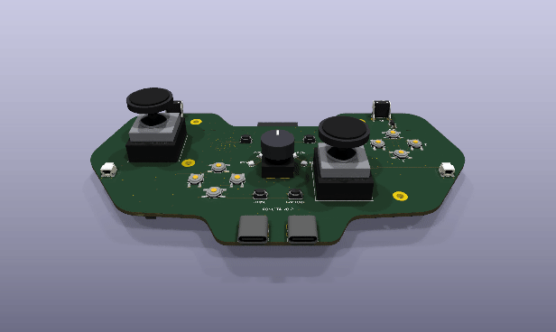
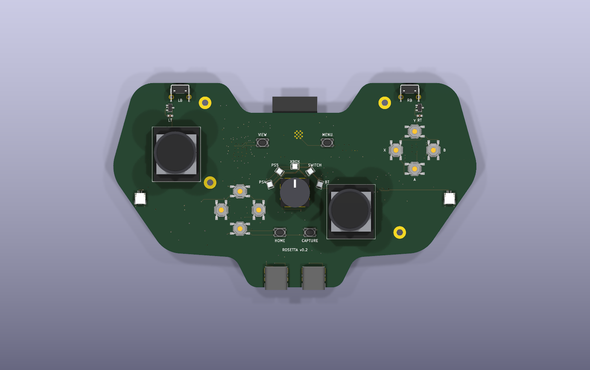
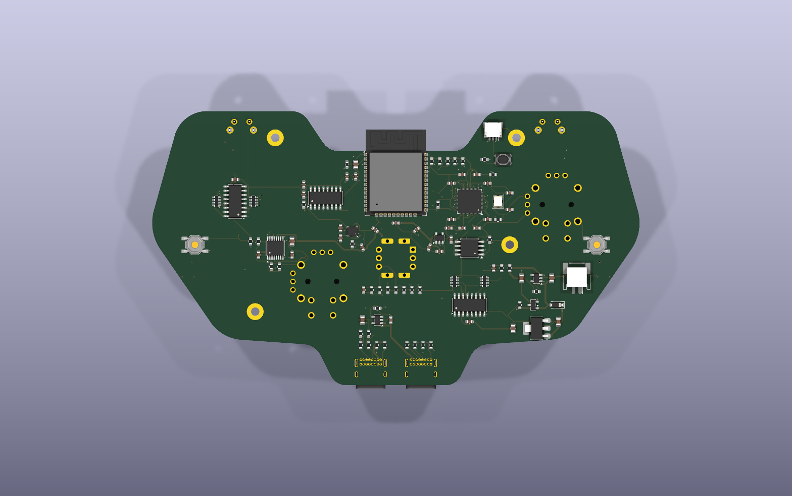
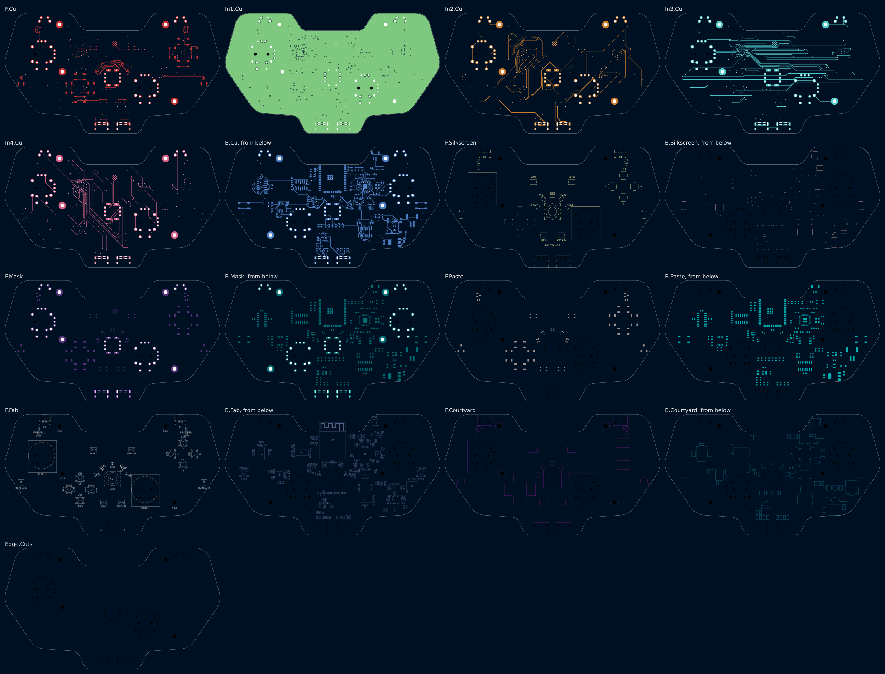
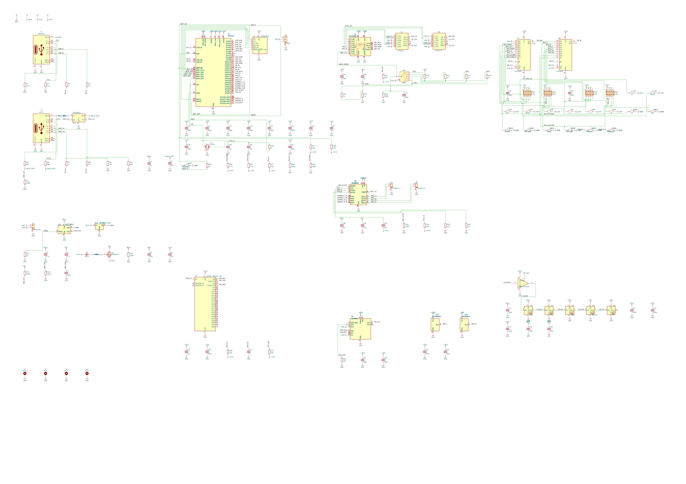

# Rosetta v0.3: a wireless universal controller with a screen, light rings, turbo and a fast-charged cell

One controller for a PS4, a PS5, an Xbox, a Switch, or anything over Bluetooth. A 5-position
knob where an Xbox 360 pad has its guide button picks the console. The controller drops off the
bus while the knob turns and comes back as the chosen console's own controller.

v0.2 laid the board out as an Xbox 360 controller's main board. v0.3 makes the software run more of
the controller and makes the controller wireless:

- **A screen.** DS1, a 0.91 in 128 x 32 OLED, sits under the dip between the horns. It shows the
  console the knob chose, the cell's charge, and each button's turbo setting.
- **A light ring round each stick.** 8 RGB LEDs circle each Hall stick, and the firmware draws
  patterns round them: the mode's colour, the stick's direction, the charge.
- **Turbo from 2 back buttons.** SW19 and SW20 set any button to repeat in 1 of 4 fixed patterns:
  rapid, staggered, burst or pulsed.
- **A cell, charged fast over USB-C.** A BQ25895 charges a 1S Li-ion cell at up to 2.5 A from a
  5 V, 3 A USB-C source. A BQ27441 fuel gauge counts the charge, and a TPS63001 buck-boost makes
  3.3 V from the cell down to 2.5 V.
- **USB-C data with a flat cell.** The charger's power path runs the controller from the cable
  alone, cell flat or missing, and J1's data lines go to the RP2040. Plugged in, it is a wired
  controller.

This folder is a whole KiCad 10 project made with the EE Workcenter: `design.py` is the board,
and the `.kicad_*` files beside it are what `workcenter design` writes from it.

<!-- pictures:begin -->


| Front | Back |
|---|---|
|  |  |

| Every layer | The schematic, wired, in blocks |
|---|---|
|  |  |

From `workcenter render . --strict --views schematic,3d,layers,spin --width 1600 --spin-zoom 1.1`, with
KiCad's 3D bodies in `KICAD10_3DMODEL_DIR` (the workcenter's `site/media/README.md` says how to
fetch them) and the 7 bodies in `models/`.
<!-- pictures:end -->

## What is hard about it, and where each part lives

| The problem | The answer on this board |
|---|---|
| Thumbsticks on the board, with no drift | SL and SR take ALPS RKJXV122400R sticks, the stick of PlayStation and Xbox pads, or a Hall-effect drop-in in the same holes. KiCad has no footprint for it: `footprints/make_footprints.py` writes one from the catalog's mounting-hole drawing, and the drawing's "prohibited wiring area" under each stick is a keep-out on the front. |
| A ring of light round a stick whose body is a rectangle | Each ring is 8 WS2812B-2020s on a 15 mm circle, the first at 22.5 degrees, so each LED sits between the stick's 4 directions, where the stick's 20 x 23 mm body leaves room. The right stick moved 3 mm down from v0.2's place so its ring clears Home and Capture. The 16 LEDs follow the knob's 5 in 1 chain on LED_DATA, so 1 PIO program drives all 21. |
| A screen in a board with no spare face | DS1's module lies under the dip with its 4 pins in a column at its right end. Its I2C shares I2C0 with the IMU, the charger and the gauge: 0x3C, 0x6B, 0x6A and 0x55. The IMU moved from 0x6A to 0x6B (R52 now ties SA0 to +3V3), because the charger has 0x6A. |
| Turbo that a console sees | The firmware's `turbo.c` repeats a held button at 5, 8, 10 or 20 presses a second. Every console polls its controller at least every 8 ms; the fastest press is 25 ms down and 25 ms up, so each one is seen. The timing is fixed and regular, so the same hold gives the same presses every time. |
| 3 A from USB-C, and only 5 V | U11 (BQ25895) takes up to 3.25 A, capped at 2.96 A by R12 (120 ohms on ILIM), and its input current optimizer finds what the source can give without its voltage sagging: 3 A from a USB-C charger, 0.5 A from a console's port. Its high-voltage modes (HVDCP and MaxCharge) stay off: VBUS also feeds the auth donor on J2, which takes 5 V only. D+ and D- are not wired to the charger, and the firmware clears both enables at boot. |
| A cell that may be flat | U11's power path holds VSYS at 3.5 V or more from VBUS whatever the cell does, so the RP2040 starts on the cable alone and enumerates on J1 as a wired controller while the cell charges. |
| 3.3 V from a cell that ends below 3.3 V | U12 (TPS63001) bucks or boosts as the cell needs, from 4.35 V down to 2.5 V. v0.2's linear regulator dropped out near the end of the cell. |
| Knowing the charge | U17 (BQ27441-G1) counts the current through R14 (10 milliohms, in the cell's negative lead) and reports the charge in percent over I2C. J9 brings the cell's thermistor to U11's TS pin, so the charger stops outside 0-60 C. |
| A PS4, a PS5 and an Xbox talk only to a licensed controller | J2 is a USB host port for a licensed donor. The RP2040 runs a second USB port in software (PIO-USB, GPIO16 and GPIO17) and relays the console's challenge to the donor. U13 switches the donor's 5 V. |
| Bluetooth Classic and BLE | U3, an ESP32-WROOM-32E on the RP2040's UART, on the back. Its antenna hangs past the dip between the shoulder horns. |
| Triggers, rumble, gyro, 16 buttons, 2 paddles | v0.2's: DRV5055 Hall sensors under the triggers, a DRV8833 for 2 motors, an LSM6DSL, 2 74HC165s. |

## The board

- Outline: the 360's main-board silhouette, 148 x 82 mm, as v0.2's: 2 shoulder horns, a dip
  between them, the shoulders, the grips and a tab at the bottom that both USB-C ports open
  through.
- 6 layers, 1.6 mm: F.Cu signal, In1.Cu a whole GND plane, In2.Cu to In4.Cu signal, B.Cu signal.
- 4 M2.5 holes for the shell (H1-H4).
- The front: the sticks and their rings, the screen, the D-pad, A/B/X/Y, the knob and its ring,
  View, Menu, Home, Capture, the bumpers, the trigger sensors, the USB ports, the rumble
  connectors. The back: the RP2040, its flash, the ESP32, the ADC, the IMU, the shift registers,
  the motor driver, the charger, the gauge, the buck-boost, the battery connector, the 2 paddles
  and the 2 turbo buttons.

### Power

J1's VBUS feeds U11 (BQ25895), a switch-mode charger with a power path: L1 (1 uH) is its
inductor, VSYS its output. VSYS feeds the rumble driver, the 21 LEDs (through U14's level shift),
and U12 (TPS63001, with L2, 1.5 uH), which makes +3V3 for everything else. U11 charges the cell
on J9 from VSYS's side; R13 and R15 bias the cell's 10k NTC on TS as TI's BQ2589x EVM does for a
103AT. U17 measures the cell's current across R14 and its voltage on BAT. R54 and R55 halve VSYS
for the ADC.

### The RP2040's pins

| GPIO | Net | To |
|---|---|---|
| 0, 1 | ESP_RXD, ESP_TXD | U3 UART0 |
| 2, 3 | ESP_EN, ESP_IO0 | U3 reset and boot strap (R20, R21) |
| 4, 5 | I2C0 | U5, U11, U17, DS1 (R26, R27) |
| 6, 7 | TURBO_A, TURBO_B | SW19, SW20 on the back |
| 8-11 | ADC_MISO, ADC_CS, ADC_SCK, ADC_MOSI | U4 (SPI1); R22 holds CS high in reset |
| 12, 13, 14 | SR_PL, SR_CLK, SR_Q | U7, U8 (R47, R48) |
| 15 | LED_DATA | U14, then the knob's ring and both stick rings (R49) |
| 16, 17 | PIO_D+, PIO_D- | J2 (R7-R10) |
| 18, 19 | HOST_EN, FAULT_N | U13 enable (R11); U13's and U6's faults (R24) |
| 20-23 | RUMBLE_L_A/B, RUMBLE_R_A/B | U6 inputs, PWM slices 2 and 3 |
| 24 | MOT_SLEEP | U6 nSLEEP (R23) |
| 25 | IMU_INT | U5 INT1 |
| 26 | CHG_INT | U11 INT, open-drain |
| 27, 28 | PADDLE_L, PADDLE_R | SW15, SW16 |
| 29 | CHG_STAT | U11 STAT, open-drain |

The ADC's channels: 0-3 the sticks' X and Y, 4 and 5 the triggers, 6 the knob, 7 VSYS halved.

### What plugs in

| Ref | Part | Pins |
|---|---|---|
| SL, SR | ALPS RKJXV122400R or a Hall drop-in | A1 +3V3, A2 X, A3 GND; B1 +3V3, B2 Y, B3 GND; a the click, d GND |
| J1 | USB-C (GCT USB4085) to the console or a charger | a device: CC1/CC2 5.1k to GND |
| J2 | USB-C to the auth donor | a source: CC1/CC2 56k to VBUS_HOST |
| J7, J8 | JST SH 2-way, the rumble motors | 1 MOT+, 2 MOT- |
| J9 | JST PH 3-way, on the back, a 1S Li-ion cell with a 10k (103AT) thermistor | 1 BAT+, 2 the thermistor, 3 BAT- |
| J10 | JST SH 3-way, on the back, Raspberry Pi's debug connector | SWCLK, GND, SWDIO |

The cell: 1S Li-ion, 3000 mAh or more (the firmware charges at 2.5 A), with its own protection
board and a 10k NTC, B 3435 (a 103AT), on a 3-wire lead.

## The firmware

`firmware/` holds the parts of the firmware that decide things, each with host tests
(`make -C firmware test`):

| File | What it decides |
|---|---|
| `src/mode.c` | The knob: an ADC reading to a console, and when to drop off the bus and come back. v0.1's, unchanged. |
| `src/turbo.c` | Turbo: whether a held button reads pressed at a given millisecond, in each pattern. The back buttons step a button's pattern (TURBO_A held) and its rate (TURBO_B held). |
| `src/charger.c` | The BQ25895's setup at boot: the watchdog off (else it goes back to its defaults, HVDCP on, 40 s after the last write), HVDCP and MaxCharge off, the input current optimizer on, 3.25 A asked for at the input and 2.5 A of charge. Its comments name each field's place in TI's register map. |

The turbo patterns:

| Pattern | While the button is held |
|---|---|
| RAPID | pressed for half a period, released for half, from the moment of the press |
| STAGGER | RAPID, half a period late: on 2 buttons, 1 RAPID and 1 STAGGER take turns |
| BURST | a group of presses (3 unless set), then released until the button is let go |
| PULSE | a group of presses, a gap (250 ms unless set), and again |

Letting go of a button reads released at once in every pattern. The patterns are fixed and
regular by design; this board makes no attempt to hide turbo from a game or a console.

## What proves it

```sh
workcenter design design.py --route --passes 40 --timeout 3500    # from this folder
workcenter gates .
make -C firmware test
python3 footprints/make_footprints.py       # the stick's footprint, from its drawing
python3 models/make_models.py               # the bodies KiCad's 3D library lacks
```

<!-- gates:begin -->
`workcenter gates .`: see the run below once the board is routed.
<!-- gates:end -->

## Parts and why

| Ref | Part | Why |
|---|---|---|
| U11 | TI BQ25895 | A 5 A switch-mode charger with a power path, an input current optimizer and an I2C ADC. Its power path runs the controller from USB with a flat cell. |
| U17 | TI BQ27441-G1 | A fuel gauge that needs only a sense resistor and the cell's capacity to report a percentage. |
| U12 | TI TPS63001 | A 1.8 A buck-boost fixed at 3.3 V: the cell's whole range, 4.35 V to 2.5 V. |
| L1 | Coilcraft XAL4020-102 | 1 uH, 4 x 4 mm, saturating well above the charger's 3 A peak. |
| L2 | Coilcraft LPS4018-152 | 1.5 uH, the TPS63001 datasheet's value, 3.9 x 3.9 mm. |
| DS1 | East Rising ER-OLEDM0.91-1 | A 0.91 in 128 x 32 SSD1306 OLED module on I2C, with a KiCad footprint and symbol. |
| D7-D22 | WS2812B-2020 | 2 x 2 mm addressable RGB LEDs, the knob ring's part. |
| J9 | JST S3B-PH-SM4-TB | A 3-way PH header lying down: the cell's +, its thermistor and its -. |
| SW19, SW20 | E-Switch TL3342 | v0.2's tactile switch, on the back where the middle fingers rest. |

The rest is v0.2's (its README's "Parts and why").

## What is open

- **The fuel gauge's capacity.** The BQ27441 must be told the cell's design capacity once (TI's
  SLUUAC9, "Configuring the Design Capacity"). The firmware does not write it yet.
- **The thermistor's divider** is TI's EVM values for a 103AT (R13 5.23k, R15 30.1k). A cell with
  another thermistor needs them worked out again against the BQ25895's TS thresholds.
- **The inductors' parts.** L1 and L2 are the datasheets' values in Coilcraft's sizes; the
  saturation currents are not yet checked against the worst-case peaks.
- **The screen's drawing, the rings' patterns and the back buttons' menu** are not written; the
  firmware has the decisions (`turbo.c`), not the drivers.
- Everything v0.2 lists as open: the stick's switch pins, the triggers' magnets and pivots, the
  auth relay against a real console.
