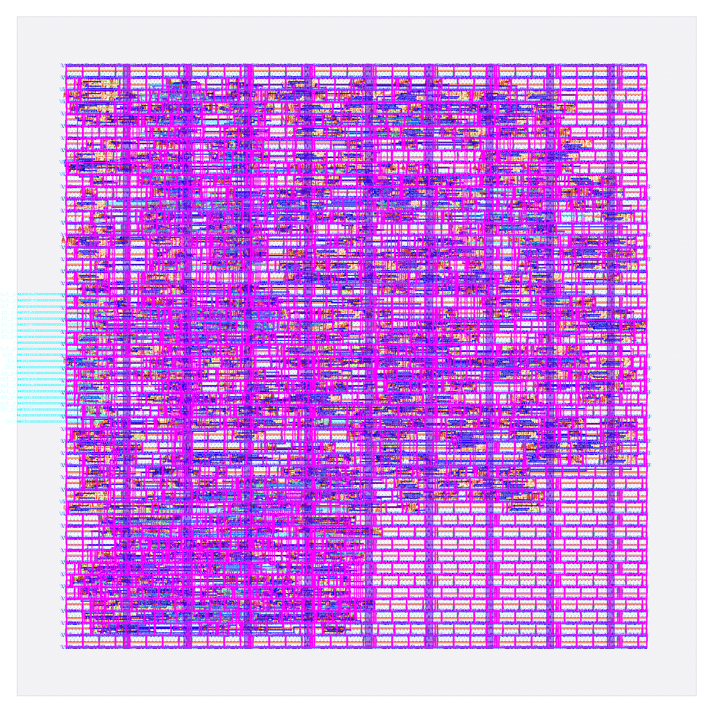
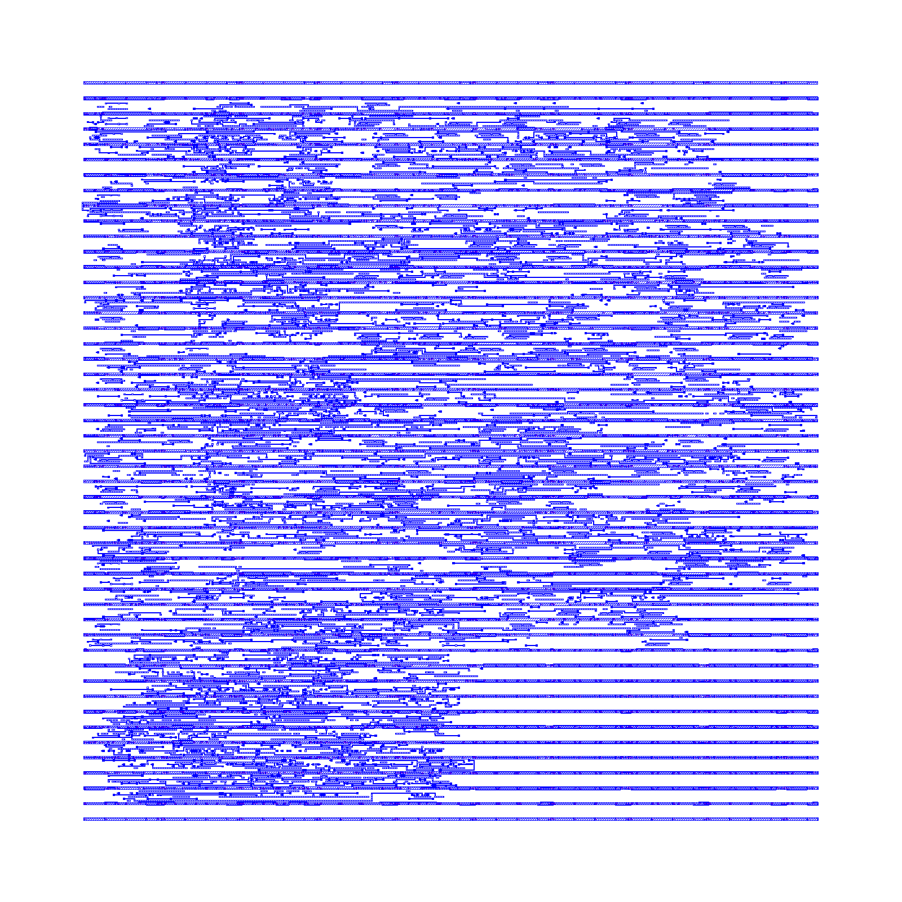
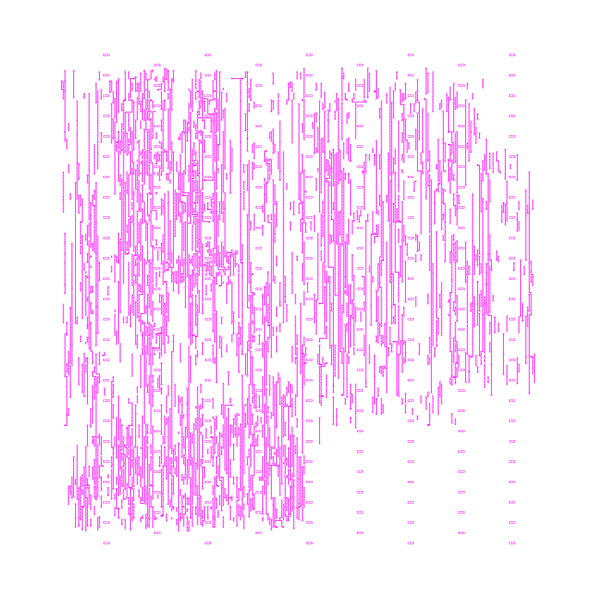
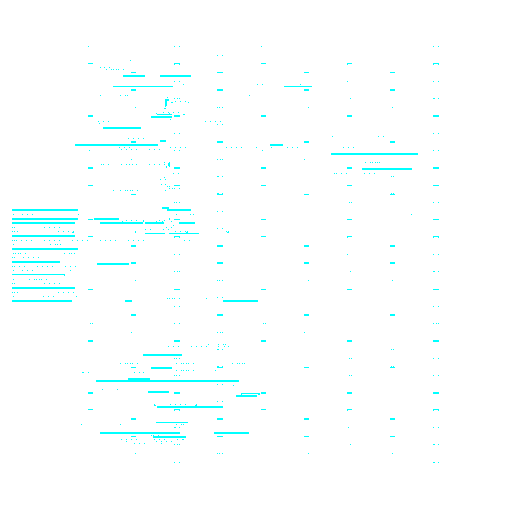
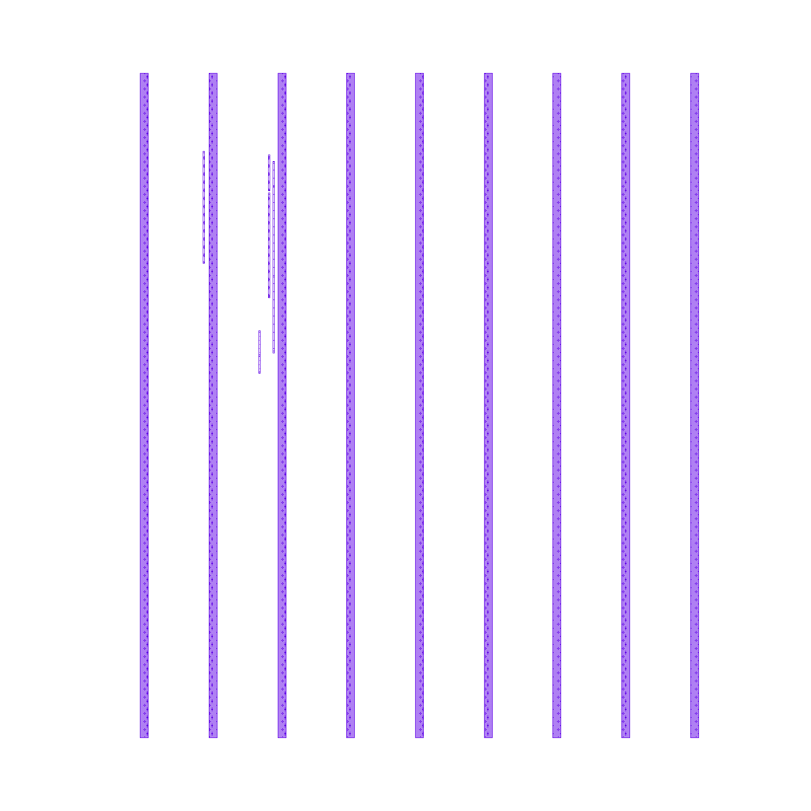

# Media

The pictures of the root `README.md`, and the 2 its first picture is made
of: 12 stills and 1 GIF. 6 are of the fixture board
`tests/boards/pass-first-design`, as commands of this repository draw it.
2 are captures of the site's diagram. 5 are of the fixture chip
`tests/chips/pass-acc8`, an 8-bit processor.

## The first picture

<picture>
  <source media="(prefers-color-scheme: dark)" srcset="hero-dark.png">
  
</picture>

`hero.png`, `hero-dark.png`: captures of `hero.html` at 1320 x 500, at 2
device pixels a pixel. The page shows the 3 cards of the site's board
section: 12 lines of the board's `design.py`, then `schematic.png` and
`board.png`. `tests/test_docs.py` holds the 12 lines to the file, on both
pages.

## The board

<table>
  <tr>
    <td width="50%"></td>
    <td width="50%"></td>
  </tr>
  <tr>
    <td><code>schematic.png</code>: the circuit's part of the sheet that <code>workcenter render</code> draws. The sheet's 2 power flags are outside the crop.</td>
    <td><code>board.png</code>: KiCad's own 3D view with no background, closer than the views of <code>workcenter render</code>.</td>
  </tr>
  <tr>
    <td width="50%"></td>
    <td width="50%"></td>
  </tr>
  <tr>
    <td><code>board-spin.gif</code>: 36 frames from <code>workcenter render --views spin</code>, with the pivot on the parts.</td>
    <td><code>layers.png</code>: the sheet of each layer that holds something, from <code>workcenter render --views layers</code>.</td>
  </tr>
</table>

## The diagram

<picture>
  <source media="(prefers-color-scheme: dark)" srcset="diagram-dark.png">
  
</picture>

`diagram.png`, `diagram-dark.png`: the diagram of the site's page, alone
and edge to edge. `index.html?shot=diagram` shows it that way, and
`&theme=dark` asks for the dark theme.

## The chip

<table>
  <tr>
    <td width="50%"></td>
    <td width="50%"></td>
  </tr>
  <tr>
    <td><code>chip.png</code>: every layer of the layout, 152.38 um by 152.38 um.</td>
    <td><code>chip-met1.png</code> and <code>chip-met2.png</code>: 1 metal layer each.</td>
  </tr>
  <tr>
    <td width="50%"></td>
    <td width="50%"></td>
  </tr>
  <tr>
    <td><code>chip-met3.png</code></td>
    <td><code>chip-met4.png</code>: the layer of the supply stripes.</td>
  </tr>
</table>

`workcenter chip render` draws the layout that the gates recorded: the top
cell with every layer, and 1 picture for each routing layer that holds a
shape. The processor's layout holds none on the fifth.

## Draw them again

Run each command from the repository's root. Draw the board's pictures
again when the template's design file or the generator changes. Draw the
captures again when `hero.html`, a card's look in `site.css` or the diagram
changes. KiCad writes `board.png` at 1176 x 840 for the 1200 x 857 that
the command asks.

The 3D views need the body of each part. The package `kicad-packages3d`
has them all. Without it, fetch the 3 files the board names from KiCad's
3D library into a folder, and name the folder in `KICAD10_3DMODEL_DIR`.
The files are those of 1 commit of the library, each held to its SHA256:

```sh
work=$(mktemp -d)
export KICAD10_3DMODEL_DIR=$work/bodies
rev=b8b3cfdfad88ba66f21002b3de51dc6f7d55ba5a
for body in Connector_PinHeader_2.54mm.3dshapes/PinHeader_1x03_P2.54mm_Vertical \
    Resistor_SMD.3dshapes/R_0603_1608Metric Capacitor_SMD.3dshapes/C_0603_1608Metric; do
  mkdir -p "$KICAD10_3DMODEL_DIR/${body%/*}"
  curl -fsSL -o "$KICAD10_3DMODEL_DIR/$body.step" \
    "https://raw.githubusercontent.com/KiCad/kicad-packages3D/$rev/$body.step"
done
sha256sum -c <<SUMS
b91b4ac5acf1a0d28a676703db972d17b8f11ef26a85b58d60786a69246b921b  $KICAD10_3DMODEL_DIR/Connector_PinHeader_2.54mm.3dshapes/PinHeader_1x03_P2.54mm_Vertical.step
1875571c326d0d9e96f36b4efeb8094068ef7619f0a449c781caf0b49c2e5861  $KICAD10_3DMODEL_DIR/Resistor_SMD.3dshapes/R_0603_1608Metric.step
4857b3dc717675bf1fb22edda622ac3b3ae03cf44d81eefaf3fa3ba3a86d84c1  $KICAD10_3DMODEL_DIR/Capacitor_SMD.3dshapes/C_0603_1608Metric.step
SUMS
```

The workcenter draws the schematic, the layers and the GIF. `--strict`
fails the run when a part has no body:

```sh
workcenter render tests/boards/pass-first-design --out "$work" --strict --views schematic,layers,spin --spin-zoom 1.2 --spin-pivot=-0.45,0,0.3
cp "$work/render/board-spin.gif" "$work/render/layers.png" site/media/
```

librsvg cuts the circuit out of the sheet, and KiCad draws the close view:

```sh
rsvg-convert -z 7.056 --page-width=1600 --page-height=1152 --left=-2400 --top=-1653 \
  -b white -o site/media/schematic.png "$work/render/schematic.svg"
xvfb-run -a kicad-cli pcb render --output site/media/board.png --width 1200 --height 857 \
  --background transparent --quality high --perspective --rotate -35,0,25 --zoom 1.5 \
  --pivot -0.4,0,0.3 tests/boards/pass-first-design/divider.kicad_pcb
```

Chromium draws the 4 captures, so the type is Inter itself. `chromium` is
any Chromium build: the package of that name, or a Playwright browser by
its full path. `install.sh` installs none. As root, Chromium also asks for
`--no-sandbox`.

```sh
chromium --headless --hide-scrollbars --force-device-scale-factor=2 --window-size=1320,500 \
  --virtual-time-budget=4000 --screenshot=site/media/hero.png "file://$PWD/site/media/hero.html"
chromium --headless --hide-scrollbars --force-device-scale-factor=2 --window-size=1320,500 \
  --virtual-time-budget=4000 --screenshot=site/media/hero-dark.png "file://$PWD/site/media/hero.html?dark"
chromium --headless --hide-scrollbars --force-device-scale-factor=2 --window-size=1180,374 \
  --virtual-time-budget=4000 --screenshot=site/media/diagram.png "file://$PWD/site/index.html?shot=diagram"
chromium --headless --hide-scrollbars --force-device-scale-factor=2 --window-size=1180,374 \
  --virtual-time-budget=4000 --screenshot=site/media/diagram-dark.png "file://$PWD/site/index.html?shot=diagram&theme=dark"
```

The chip's 5 pictures need the chip engines and the process kit
(`sudo ./install.sh --chip`). The gates build the layout in a copy, and
`chip render` draws what they recorded:

```sh
chip=$(mktemp -d)
cp -r tests/chips/pass-acc8 "$chip/"
workcenter chip gates "$chip/pass-acc8" --strict
workcenter chip render "$chip/pass-acc8"
cp "$chip/pass-acc8/build/chip/render/acc8.png" site/media/chip.png
for layer in met1 met2 met3 met4; do
  cp "$chip/pass-acc8/build/chip/render/acc8.$layer.png" "site/media/chip-$layer.png"
done
```

## What is not ours

The cells in the chip's layout are those of the SkyWater `sky130A`
process kit, library `sky130_fd_sc_hd` (Copyright 2020 The SkyWater PDK
Authors, Apache License 2.0). The kit is not in this repository: the
pictures show the cells. 1 test sample holds the head of the library's
timing file and 5 of its cells (`tests/chips/samples/front/README.md`).

The part bodies in the 3D views are from KiCad's 3D library. Its license
is CC BY-SA 4.0, with an exception for a design that uses the library and
for the files generated from that design. No body file is in this
repository: the pictures show the bodies.
