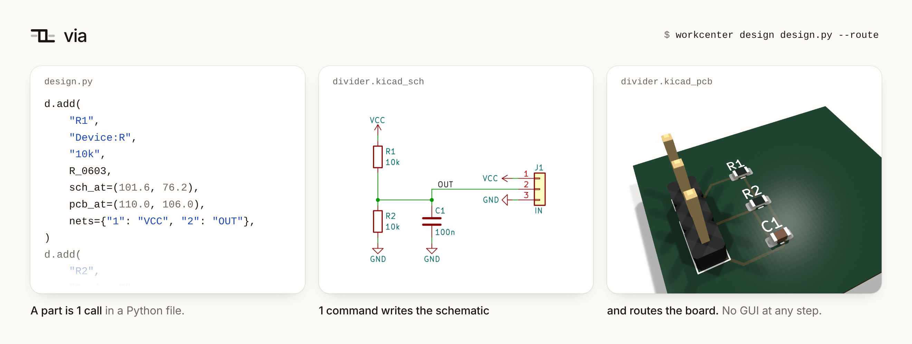
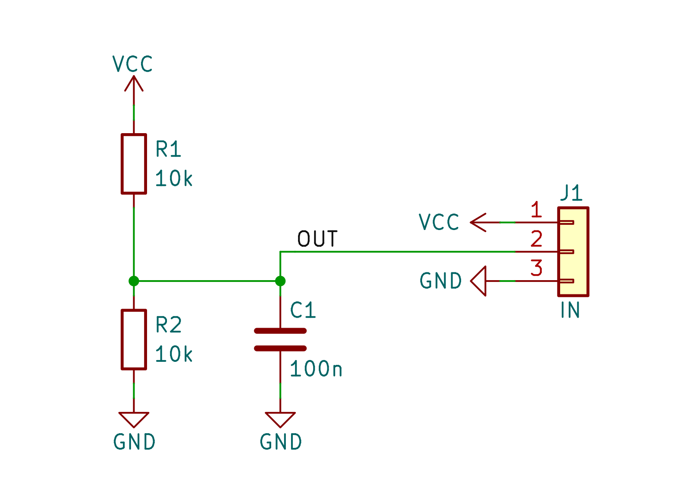
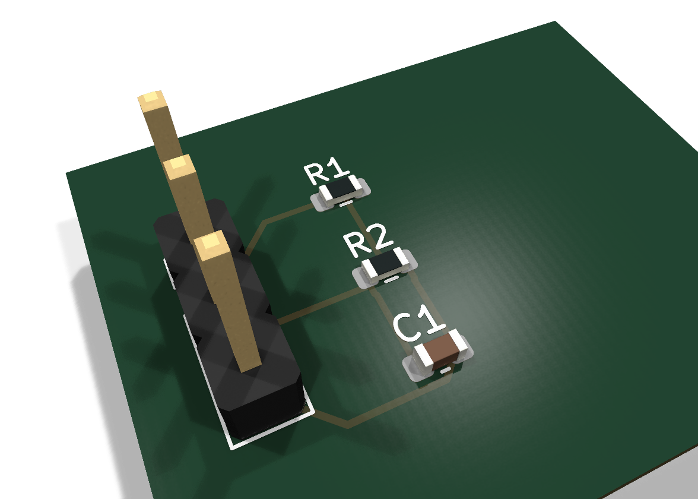
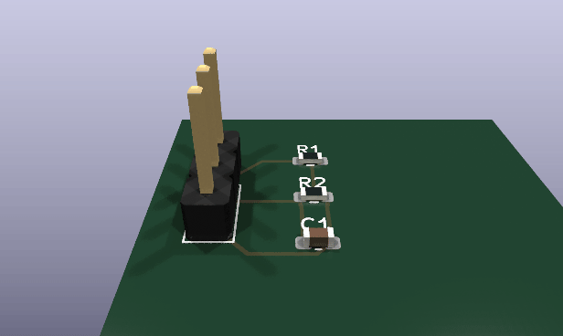
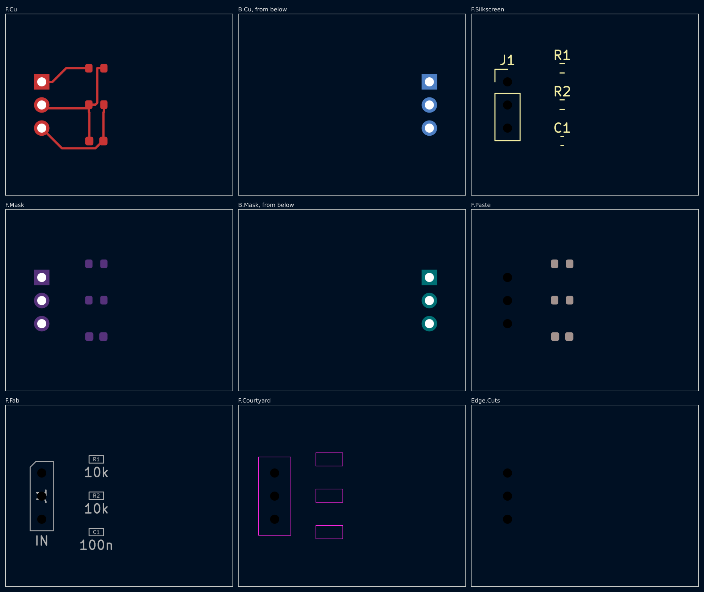
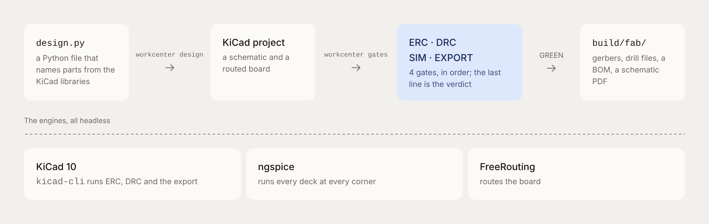

# Media

The pictures of the root `README.md`, and the 2 its first picture is made
of: 7 stills and 1 GIF. 6 are of the fixture board
`tests/boards/pass-first-design`, as commands of this repository draw it.
2 are captures of the site's diagram. The site's page shows `schematic.png`
and `board.png` in its board section.

## The first picture

<picture>
  <source media="(prefers-color-scheme: dark)" srcset="hero-dark.png">
  
</picture>

`hero.png`, `hero-dark.png`: captures of `hero.html` at 1320 x 500, at 2
device pixels a pixel. The page shows the 3 cards of the site's board
section: 12 lines of the board's `design.py`, then `schematic.png` and
`board.png`. `tests/test_docs.py` holds the 12 lines to the file, on both
pages.

## The board

<table>
  <tr>
    <td width="50%"></td>
    <td width="50%"></td>
  </tr>
  <tr>
    <td><code>schematic.png</code>: the circuit's part of the sheet that <code>workcenter render</code> draws. The sheet's 2 power flags are outside the crop.</td>
    <td><code>board.png</code>: KiCad's own 3D view with no background, closer than the views of <code>workcenter render</code>.</td>
  </tr>
  <tr>
    <td width="50%"></td>
    <td width="50%"></td>
  </tr>
  <tr>
    <td><code>board-spin.gif</code>: 36 frames from <code>workcenter render --views spin</code>, with the pivot on the parts.</td>
    <td><code>layers.png</code>: the sheet of every layer from <code>workcenter render --views layers</code>.</td>
  </tr>
</table>

## The diagram

<picture>
  <source media="(prefers-color-scheme: dark)" srcset="diagram-dark.png">
  
</picture>

`diagram.png`, `diagram-dark.png`: the diagram of the site's page, alone
and edge to edge. `index.html?shot=diagram` shows it that way, and
`&theme=dark` asks for the dark theme.

## Draw them again

Run each command from the repository's root. Draw the board's pictures
again when the template's design file or the generator changes. Draw the
captures again when `hero.html`, a card's look in `site.css` or the diagram
changes. KiCad writes `board.png` at 1176 x 840, and the site's page
states that size.

The 3D views need the body of each part. The package `kicad-packages3d`
has them all. Without it, fetch the 3 files the board names from KiCad's
3D library into a folder, and name the folder in `KICAD10_3DMODEL_DIR`:

```sh
export KICAD10_3DMODEL_DIR=/tmp/kicad-bodies
for body in Connector_PinHeader_2.54mm.3dshapes/PinHeader_1x03_P2.54mm_Vertical \
    Resistor_SMD.3dshapes/R_0603_1608Metric Capacitor_SMD.3dshapes/C_0603_1608Metric; do
  mkdir -p "$KICAD10_3DMODEL_DIR/${body%/*}"
  curl -fsSL -o "$KICAD10_3DMODEL_DIR/$body.step" \
    "https://raw.githubusercontent.com/KiCad/kicad-packages3D/master/$body.step"
done
```

The workcenter draws the schematic, the layers and the GIF. `--strict`
fails the run when a part has no body:

```sh
workcenter render tests/boards/pass-first-design --out /tmp/via-media --strict --views schematic,layers,spin --spin-zoom 1.2 --spin-pivot=-0.45,0,0.3
cp /tmp/via-media/render/board-spin.gif /tmp/via-media/render/layers.png site/media/
```

librsvg cuts the circuit out of the sheet, and KiCad draws the close view:

```sh
rsvg-convert -z 7.056 --page-width=1600 --page-height=1152 --left=-2400 --top=-1653 \
  -b white -o site/media/schematic.png /tmp/via-media/render/schematic.svg
xvfb-run -a kicad-cli pcb render --output site/media/board.png --width 1200 --height 857 \
  --background transparent --quality high --perspective --rotate -35,0,25 --zoom 1.5 \
  --pivot -0.4,0,0.3 tests/boards/pass-first-design/divider.kicad_pcb
```

Chromium draws the 4 captures, so the type is Inter itself:

```sh
chromium --headless --hide-scrollbars --force-device-scale-factor=2 --window-size=1320,500 \
  --virtual-time-budget=4000 --screenshot=site/media/hero.png "file://$PWD/site/media/hero.html"
chromium --headless --hide-scrollbars --force-device-scale-factor=2 --window-size=1320,500 \
  --virtual-time-budget=4000 --screenshot=site/media/hero-dark.png "file://$PWD/site/media/hero.html?dark"
chromium --headless --hide-scrollbars --force-device-scale-factor=2 --window-size=1180,374 \
  --virtual-time-budget=4000 --screenshot=site/media/diagram.png "file://$PWD/site/index.html?shot=diagram"
chromium --headless --hide-scrollbars --force-device-scale-factor=2 --window-size=1180,374 \
  --virtual-time-budget=4000 --screenshot=site/media/diagram-dark.png "file://$PWD/site/index.html?shot=diagram&theme=dark"
```

## What is not ours

The part bodies in the 3D views are from KiCad's 3D library. Its license
is CC BY-SA 4.0, with an exception for a design that uses the library and
for the files generated from that design. No body file is in this
repository: the pictures show the bodies.
